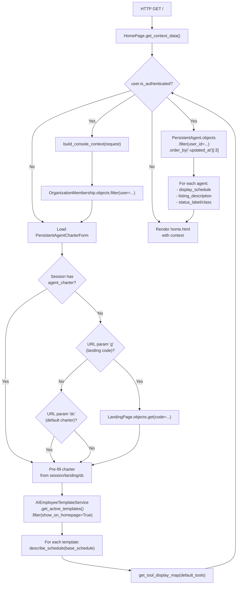
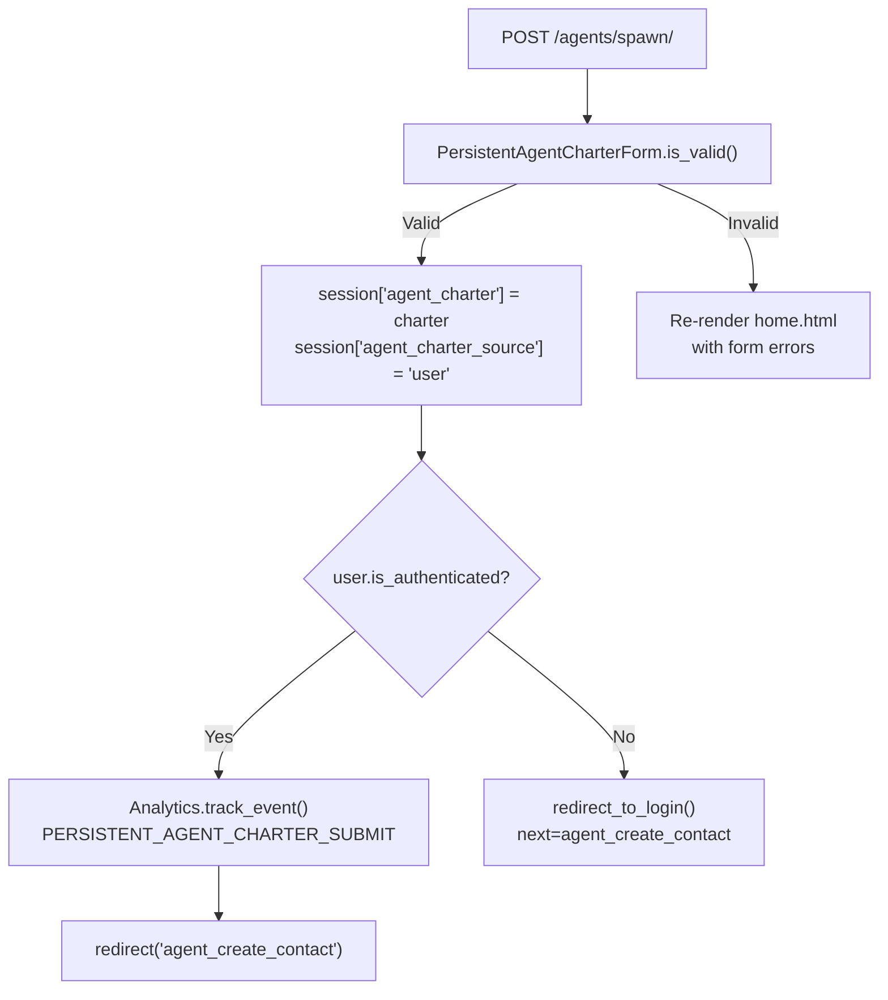
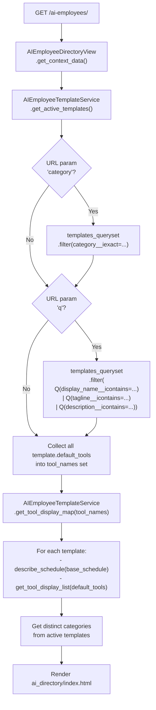
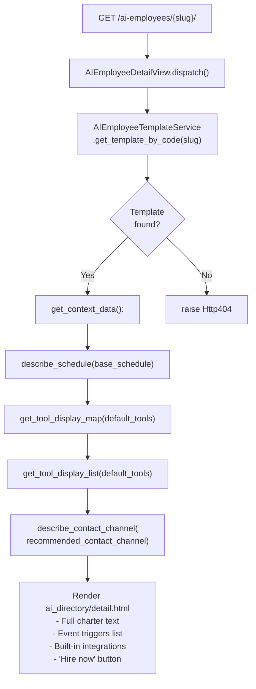
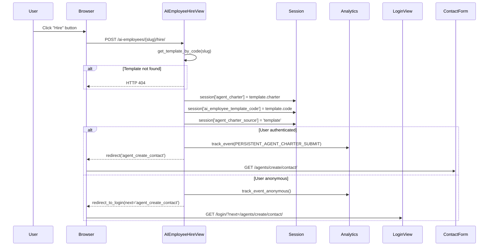
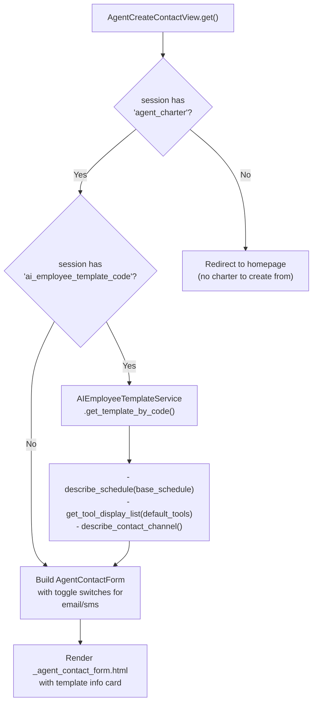

<!-- source: DeepWiki mcp.deepwiki.com · repo gobii-ai/gobii-platform · page 8.2 Homepage & AI Employee Directory · fetched 2026-10-27 -->

# Homepage & AI Employee Directory

<details>
<summary>Relevant source files</summary>

The following files were used as context for generating this wiki page:

- [agents/services.py](agents/services.py)
- [console/templates/partials/_agent_contact_form.html](console/templates/partials/_agent_contact_form.html)
- [pages/templates/ai_directory/detail.html](pages/templates/ai_directory/detail.html)
- [pages/templates/ai_directory/index.html](pages/templates/ai_directory/index.html)
- [pages/templates/home.html](pages/templates/home.html)
- [pages/views.py](pages/views.py)
- [tests/unit/test_agent_limits.py](tests/unit/test_agent_limits.py)
- [tests/unit/test_ai_employee_directory.py](tests/unit/test_ai_employee_directory.py)
- [tests/unit/test_console_context.py](tests/unit/test_console_context.py)

</details>


This document describes the homepage interface and AI employee directory system that serve as the primary onboarding entry points for agent creation. For information about the actual agent provisioning logic after charter submission, see [Creating Agents](#4.1). For the contact form that follows charter selection, see the agent creation flow in the console UI.

## Purpose and Scope

The homepage and AI employee directory provide two distinct paths for users to create persistent agents:

1. **Custom Charter Path**: Users write a freeform charter describing their agent's mission
2. **Template Path**: Users select from curated "AI employee" templates with pre-configured charters, schedules, and tools

Both paths store the selected charter in the session and redirect to the contact form ([console/templates/partials/_agent_contact_form.html:1-500]()), where users configure communication endpoints before the agent is provisioned via `PersistentAgentProvisioningService`.

---

## Homepage Structure

### Main Components

The homepage ([pages/templates/home.html:1-656]()) consists of four primary sections:

| Section | Purpose | Visibility |
|---------|---------|------------|
| Hero & Charter Input | Freeform agent charter submission with "Spawn" button | Always visible |
| Task Usage Warning | Displays credit consumption and warnings | Authenticated users only |
| Recent Agents | Shows up to 3 recently updated agents with quick access links | Authenticated users with agents |
| Featured Templates | Displays up to 3 `show_on_homepage=True` templates | Always visible |

**Homepage View Flow**



**Sources:** [pages/views.py:50-196](), [pages/templates/home.html:76-290]()

### Charter Input Form

The charter input is a textarea with auto-resize functionality and a gradient "Spawn" button. The form supports pre-filling from multiple sources:

1. **Session Storage**: `request.session['agent_charter']` from previous submission ([pages/views.py:101-105]())
2. **Landing Pages**: URL parameter `g={code}` loads charter from `LandingPage` model ([pages/views.py:72-95]())
3. **Direct Charter**: URL parameter `dc={text}` directly sets charter ([pages/views.py:69-71]())
4. **Template Selection**: Set when user "hires" a template (covered below)

The form submission is handled by `HomeAgentSpawnView`:



**Sources:** [pages/views.py:198-244](), [pages/templates/home.html:107-159]()

### Recent Agents Section

For authenticated users with existing agents, the homepage displays up to 3 recent agents ([pages/views.py:159-193]()):

```python
recent_agents_qs = PersistentAgent.objects.filter(user_id=self.request.user.id)
total_agents = recent_agents_qs.count()
recent_agents = list(recent_agents_qs.order_by('-updated_at')[:3])
```

Each agent card includes:
- Agent name
- Status badge (Active/Expired) derived from `life_state` field
- Display schedule via `AIEmployeeTemplateService.describe_schedule()`
- Listing description via `build_listing_description()` (max 140 chars)
- Link to agent detail page

**Sources:** [pages/views.py:159-193](), [pages/templates/home.html:162-210]()

### Game of Life Animation

The charter input card features a Conway's Game of Life animation rendered on a `<canvas>` element ([pages/templates/home.html:349-588]()). The implementation:

- Uses `ResizeObserver` to adapt grid size to container
- Pauses animation when not visible via `IntersectionObserver`
- Applies radial gradient masking for visual effect
- Sprinkles new cells on low population or every 200 ticks
- Supports pointer interaction to seed new cells

**Sources:** [pages/templates/home.html:7-74](), [pages/templates/home.html:349-588]()

---

## AI Employee Directory

The AI employee directory provides a browsable catalog of curated agent templates stored in the `PersistentAgentTemplate` model.

### Directory Index

**Template Listing View**



**Sources:** [pages/views.py:247-299](), [pages/templates/ai_directory/index.html:1-120]()

### Template Cards

Each template card displays ([pages/templates/ai_directory/index.html:42-109]()):

| Field | Source | Example |
|-------|--------|---------|
| Category badge | `template.category` | "Sales", "HR", "Finance" |
| Display name | `template.display_name` | "Daily Sales Intelligence Agent" |
| Tagline | `template.tagline` | "Monitors pipeline, sends daily summaries" |
| Schedule | `describe_schedule(base_schedule)` | "Every day at 9:00 AM" |
| Event triggers | `template.event_triggers` (JSON array) | "New lead", "Deal closed" |
| Tools | First 3 from `display_default_tools` | "Google Sheets", "Slack", "+2 more" |

### Template Detail Page

The detail view ([pages/views.py:302-327]()) provides full template information:



**Sources:** [pages/views.py:302-327](), [pages/templates/ai_directory/detail.html:1-97]()

---

## Template System Architecture

### AIEmployeeTemplateService

The `AIEmployeeTemplateService` ([agents/services.py:119-265]()) provides utilities for working with `PersistentAgentTemplate` records:

**Core Methods**

```mermaid
graph TB
    subgraph "Template Discovery"
        GetActive["get_active_templates()"]
        GetByCode["get_template_by_code(code)"]
        
        GetActive --> QueryActive["Template.objects<br/>.filter(is_active=True)<br/>.order_by('priority', 'display_name')"]
        GetByCode --> QueryCode["Template.objects<br/>.get(code=code, is_active=True)"]
    end
    
    subgraph "Schedule Processing"
        ComputeJitter["compute_schedule_with_jitter(<br/>base_schedule, jitter_minutes)"]
        DescribeSchedule["describe_schedule(base_schedule)"]
        
        ComputeJitter --> ParseCron["Parse cron expression<br/>Apply random offset ±jitter"]
        DescribeSchedule --> NormalizeCron["_normalize_cron_expression()"]
        NormalizeCron --> CronDescriptor["cron_descriptor<br/>.get_description()"]
    end
    
    subgraph "Tool Display"
        GetToolMap["get_tool_display_map(tool_names)"]
        GetToolList["get_tool_display_list(<br/>tool_names, display_map)"]
        
        GetToolMap --> QueryToolNames["ToolFriendlyName.objects<br/>.filter(tool_name__in=...)"]
        GetToolList --> MapNames["Map each tool_name<br/>to display_name<br/>or _fallback_tool_display()"]
    end
    
    subgraph "Contact Channel"
        DescribeChannel["describe_contact_channel(channel)"]
        DescribeChannel --> Mapping["Map 'email' → 'Email updates'<br/>'sms' → 'Text message (SMS)'<br/>'slack' → 'Slack message'"]
    end
```



**Sources:** [agents/services.py:119-265]()

### Schedule Jitter

Templates support schedule jitter to distribute execution times ([agents/services.py:149-180]()):

```python
def compute_schedule_with_jitter(base_schedule: str | None, jitter_minutes: int | None) -> str | None:
    # Parse "30 9 * * *" (9:30 AM daily)
    # Apply jitter: random offset ±jitter_minutes
    # Return "37 9 * * *" (9:37 AM daily)
    
    total_minutes = hour_val * 60 + minute_val
    offset = random.randint(-jitter, jitter)
    total_minutes = (total_minutes + offset) % (24 * 60)
```

This prevents thundering herd when many templates use the same base schedule.

**Sources:** [agents/services.py:149-180](), [tests/unit/test_ai_employee_directory.py:8-19]()

### Cron Description

The service converts cron expressions to human-readable text using the `cron_descriptor` library:

| Input | Output |
|-------|--------|
| `"0 9 * * *"` | "Every day at 9:00 AM" |
| `"0 9 * * MON-FRI"` | "At 9:00 AM, Monday through Friday" |
| `"@daily"` | "Every day at 12:00 AM" |
| `"@hourly"` | "Every hour" |

Macros like `@daily` are normalized using `_CRON_MACRO_MAP` ([agents/services.py:123-131]()) before being passed to `cron_descriptor`.

**Sources:** [agents/services.py:182-214]()

---

## Agent Creation Flow

### Template Hire Flow

When a user clicks "Hire" on a template, the following sequence occurs:



**Sources:** [pages/views.py:329-373]()

### Session State Management

Both homepage spawn and template hire flows use session storage to preserve state:

| Session Key | Set By | Used By | Purpose |
|-------------|--------|---------|---------|
| `agent_charter` | `HomeAgentSpawnView`, `AIEmployeeHireView` | `AgentCreateContactView` | Stores the agent's charter text |
| `agent_charter_source` | `HomeAgentSpawnView` (`'user'`), `AIEmployeeHireView` (`'template'`) | Homepage (display logic) | Distinguishes user-written vs template charters |
| `ai_employee_template_code` | `AIEmployeeHireView` | `PersistentAgentProvisioningService` | Template code for applying defaults (schedule, tools, etc.) |

The contact form ([console/templates/partials/_agent_contact_form.html:1-500]()) retrieves these values and displays template information if `ai_employee_template_code` is present:



**Sources:** [console/templates/partials/_agent_contact_form.html:50-85](), [pages/views.py:336-339]()

### Context Switching

The contact form supports organization context switching ([console/templates/partials/_agent_contact_form.html:23-47]()):

```html
<select id="agent-owner-selector-contact">
  <option value='{"type": "personal", "id": "...", "name": "..."}'>
    Personal – {{ request.user.get_full_name }}
  </option>
  
    <option value='{"type": "organization", "id": "...", "name": "..."}'>
      Organization – {{ membership.org.name }}
    </option>
  
</select>
```

On change, JavaScript calls `POST /console/switch-context/` to update session context ([console/templates/partials/_agent_contact_form.html:240-280]()). The provisioning service then creates the agent under the selected owner (user or organization).

**Sources:** [console/templates/partials/_agent_contact_form.html:23-47](), [console/templates/partials/_agent_contact_form.html:240-280](), [tests/unit/test_console_context.py:215-244]()

---

## Search and Filtering

### Directory Filters

The directory supports two filter mechanisms ([pages/views.py:254-265]()):

**Category Filter**
```python
category = self.request.GET.get('category', '').strip()
if category:
    templates_queryset = templates_queryset.filter(category__iexact=category)
```

**Text Search**
```python
search = self.request.GET.get('q', '').strip()
if search:
    templates_queryset = templates_queryset.filter(
        Q(display_name__icontains=search)
        | Q(tagline__icontains=search)
        | Q(description__icontains=search)
    )
```

Categories are dynamically loaded from existing templates ([pages/views.py:282-289]()):

```python
all_categories = (
    AIEmployeeTemplateService.get_active_templates()
    .exclude(category__isnull=True)
    .exclude(category__exact="")
    .values_list('category', flat=True)
    .distinct()
    .order_by('category')
)
```

**Sources:** [pages/views.py:247-299](), [pages/templates/ai_directory/index.html:13-38]()

---

## Analytics Integration

Both flows track analytics events via the `Analytics` service:

**Homepage Spawn**
```python
Analytics.track_event(
    user_id=request.user.id,
    event=AnalyticsEvent.PERSISTENT_AGENT_CHARTER_SUBMIT,
    source=AnalyticsSource.WEB,
    properties={
        'charter': form.cleaned_data['charter'],
        'source_page': 'home',
    }
)
```

**Template Hire (Authenticated)**
```python
Analytics.track_event(
    user_id=request.user.id,
    event=AnalyticsEvent.PERSISTENT_AGENT_CHARTER_SUBMIT,
    source=AnalyticsSource.WEB,
    properties={
        "source_page": "ai_employee_directory",
        "template_code": template.code,
    },
)
```

**Template Hire (Anonymous)**
```python
Analytics.track_event_anonymous(
    anonymous_id=str(session_key),
    event=AnalyticsEvent.PERSISTENT_AGENT_CHARTER_SUBMIT,
    source=AnalyticsSource.WEB,
    properties={
        "source_page": "ai_employee_directory",
        "template_code": template.code,
    },
)
```

**Sources:** [pages/views.py:214-223](), [pages/views.py:342-366]()

---

## Template Model Structure

The `PersistentAgentTemplate` model (referenced but not shown in files) includes:

| Field | Type | Purpose |
|-------|------|---------|
| `code` | String (unique) | URL-safe identifier (e.g., "sales-intelligence") |
| `display_name` | String | Human-readable name |
| `tagline` | String | Short description |
| `description` | Text | Full description of what the template does |
| `charter` | Text | Agent charter/instructions |
| `category` | String | Category for filtering (e.g., "Sales", "HR") |
| `base_schedule` | String | Cron expression for scheduling |
| `schedule_jitter_minutes` | Integer | Randomization range for schedule |
| `default_tools` | JSON Array | List of tool names to enable by default |
| `event_triggers` | JSON Array | List of event trigger configurations |
| `recommended_contact_channel` | String | Suggested communication method |
| `is_active` | Boolean | Whether template appears in directory |
| `show_on_homepage` | Boolean | Whether to feature on homepage |
| `priority` | Integer | Sort order (lower = higher priority) |

**Sources:** [pages/views.py:138-156](), [pages/templates/ai_directory/detail.html:1-97]()

---

## Landing Page Integration

The homepage supports landing pages via the `LandingPage` model ([pages/views.py:72-95]()):

**URL Pattern**: `/?g={landing_code}`

**Loading Logic**:
```python
landing = LandingPage.objects.get(code=self.request.GET['g'], disabled=False)
initial['charter'] = landing.charter.strip()
context['landing_hero_text'] = landing.hero_text  # With {blue} tag support
context['landing_preview_image'] = landing.image_url
```

Landing pages can customize:
- Hero text with gradient highlighting via `{blue}...{/blue}` tags
- Pre-filled charter
- Preview image
- UTM parameters for tracking

The `LandingRedirectView` ([pages/views.py:393-442]()) handles short URLs like `/g/{code}/` and redirects to `/?g={code}` with UTM preservation.

**Sources:** [pages/views.py:72-95](), [pages/views.py:393-442]()

---

## Agent Quota Display

For authenticated users, the homepage shows agent availability ([pages/templates/home.html:211-289]()):

**When No Agents Available**:
```html
<div class="bg-gradient-to-br from-blue-50 to-indigo-50">
  <h3>No Agents Available</h3>
  <p>You've reached your agent limit (0/{{ account.usage.agent_limit }})</p>
  <a href="">Upgrade Your Plan</a>
</div>
```

This display uses the `account.usage.agents_available` property calculated by `AgentService.get_agents_available()` ([agents/services.py:45-97]()).

**Sources:** [pages/templates/home.html:211-289](), [agents/services.py:45-97](), [tests/unit/test_agent_limits.py:1-284]()

---

