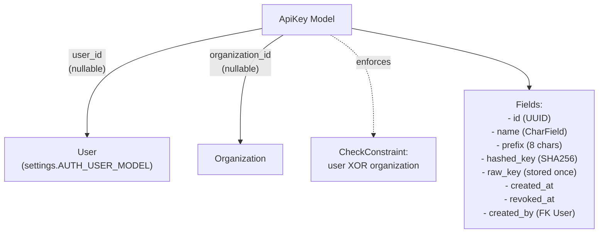
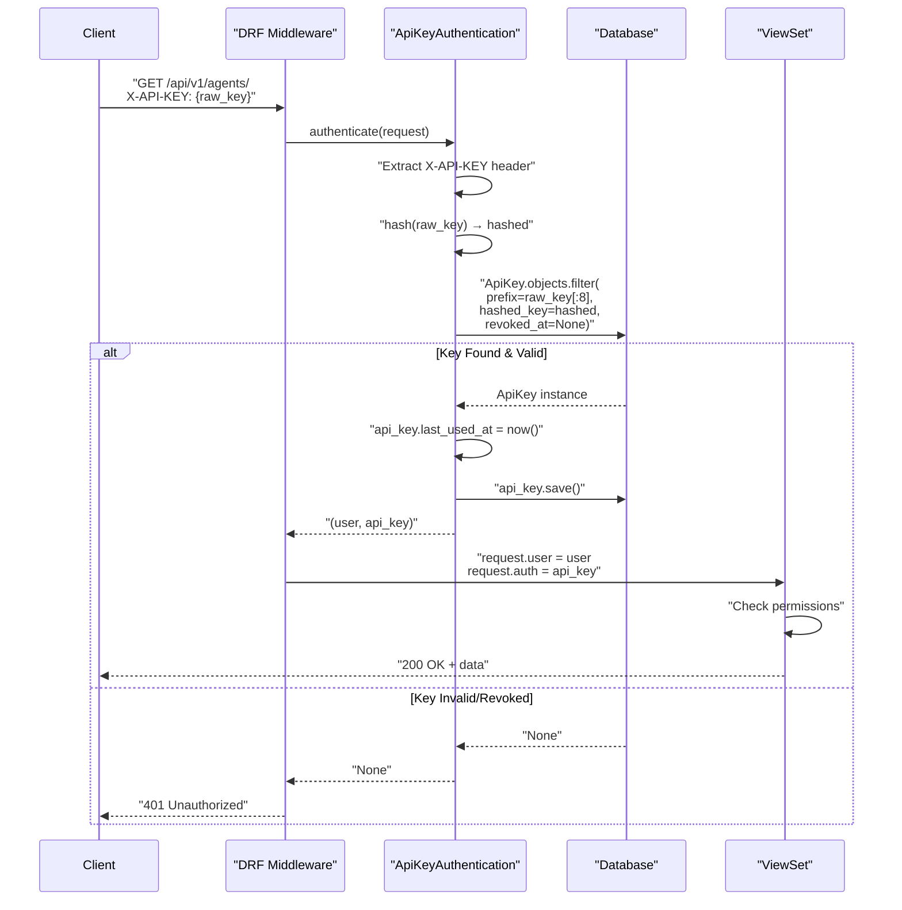
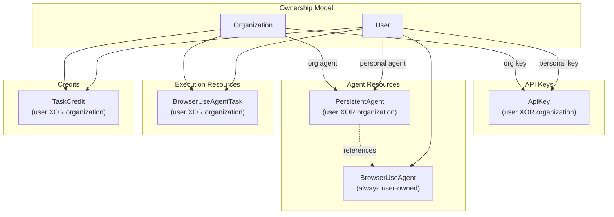
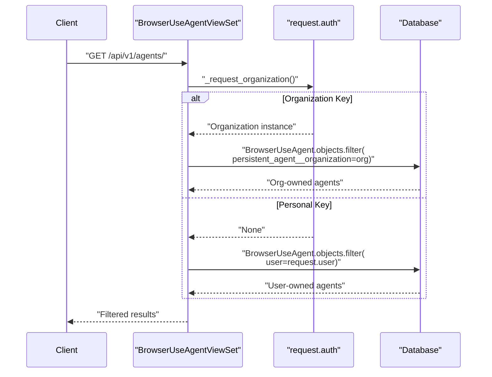
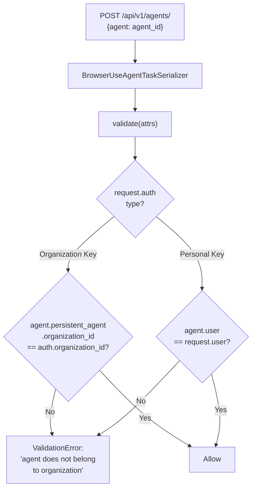
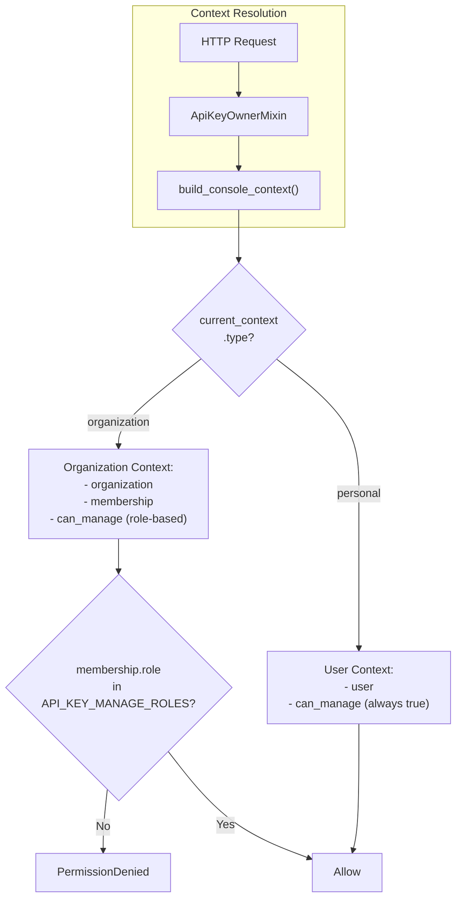
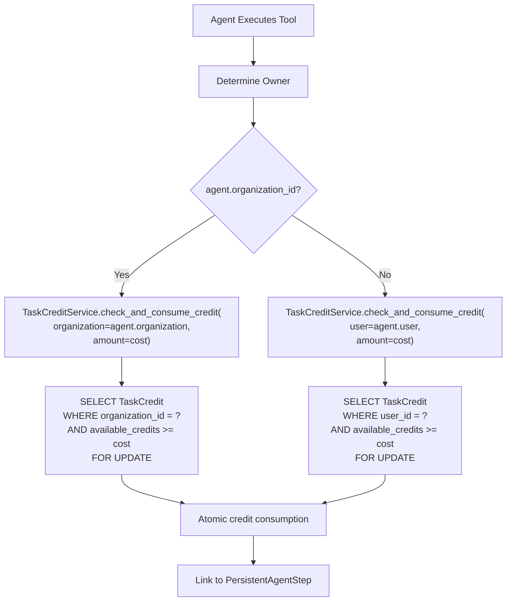

<!-- source: DeepWiki mcp.deepwiki.com · repo gobii-ai/gobii-platform · page 9.2 Authentication & Authorization · fetched 2026-10-27 -->

# Authentication & Authorization

<details>
<summary>Relevant source files</summary>

The following files were used as context for generating this wiki page:

- [AGENTS.md](AGENTS.md)
- [api/agent/core/event_processing.py](api/agent/core/event_processing.py)
- [api/exceptions.py](api/exceptions.py)
- [api/migrations/0145_browseruseagenttask_organization_and_more.py](api/migrations/0145_browseruseagenttask_organization_and_more.py)
- [api/models.py](api/models.py)
- [api/serializers.py](api/serializers.py)
- [api/services/persistent_agents.py](api/services/persistent_agents.py)
- [api/urls.py](api/urls.py)
- [api/views.py](api/views.py)
- [console/views.py](console/views.py)
- [tests/unit/test_api.py](tests/unit/test_api.py)
- [tests/unit/test_api_persistent_agents.py](tests/unit/test_api_persistent_agents.py)

</details>


This page documents the API authentication mechanism and authorization model for the gobii-platform. It covers API key-based authentication, the dual-ownership model (user vs organization), permission enforcement, and how these systems integrate with resource access control.

For information about user session management and web-based authentication, see [User Lifecycle & Authentication](#2.2). For credit-based resource gating, see [TaskCreditService](#5.1).

---

## Overview

The platform uses **API key authentication** for programmatic access to the REST API. API keys can be owned by individual users (personal keys) or by organizations (organization keys). Each resource in the system (agents, tasks, credits) is owned by either a user or an organization, enforced via database constraints. Authorization checks ensure that API keys can only access resources belonging to their owner.

---

## API Key Model

### Dual-Ownership Structure

API keys implement an **XOR ownership constraint**: each key belongs to exactly one owner—either a `user` or an `organization`, never both.



**Sources:** [api/models.py:122-276]()

### Key Limits

- **Personal Keys**: Maximum 50 per user (`MAX_API_KEYS_PER_USER`)
- **Organization Keys**: Maximum 50 per organization (`MAX_API_KEYS_PER_ORG`)

Limits are enforced in `ApiKey.clean()` validation method during creation.

**Sources:** [api/models.py:213-237]()

---

## Authentication Flow

### Request Authentication

Authentication occurs via the `X-API-KEY` HTTP header. The platform uses a custom authentication class that extracts the key, hashes it, and validates it against stored records.



**Sources:** The authentication logic is implemented in a custom authentication class (not shown in provided files, but referenced in settings). The `ApiKey.matches()` method validates keys at [api/models.py:265-266]().

---

## Dual-Ownership Model

### Resource Ownership Architecture

All major resources implement dual ownership through nullable foreign keys with XOR constraints:



**Sources:** [api/models.py:122-175]() (ApiKey), [api/models.py:290-387]() (TaskCredit), [api/models.py:618-636]() (BrowserUseAgentTask)

### Ownership Resolution Pattern

Views resolve ownership from the authenticated API key:

| Key Type | Ownership Source | Access Scope |
|----------|------------------|--------------|
| Personal (`user_id` set) | `request.user` | User-owned resources only |
| Organization (`organization_id` set) | `request.auth.organization` | Organization-owned resources only |

**Sources:** [api/views.py:100-104](), [api/views.py:198-202]()

---

## Permission Enforcement

### Organization Roles

Organization members have role-based permissions for managing organization resources:

| Role | API Key View | API Key Manage | Billing Access | Member Management |
|------|--------------|----------------|----------------|-------------------|
| `OWNER` | ✓ | ✓ | ✓ | ✓ |
| `ADMIN` | ✓ | ✓ | ✓ | ✓ |
| `BILLING` | ✓ | ✗ | ✓ | ✗ |
| `MEMBER` | ✗ | ✗ | ✗ | ✗ |

**Sources:** [console/views.py:128-146]()

### Resource Access Control



**Sources:** [api/views.py:106-129]()

### Validation in Serializers

Serializers enforce ownership during creation and updates:



**Sources:** [api/serializers.py:162-185]()

---

## API Key Management

### Console-Based Management

The console provides views for creating, listing, revoking, and deleting API keys. The `ApiKeyOwnerMixin` resolves context and enforces role-based permissions:



**Sources:** [console/views.py:149-181]()

### Key Generation

API keys use secure random generation:

1. **Raw Key**: 32-byte URL-safe token via `secrets.token_urlsafe(32)`
2. **Prefix**: First 8 characters (for quick lookup)
3. **Hashed Key**: SHA256 hash of raw key (stored for validation)
4. **Raw Key Storage**: Stored once on creation, then cleared or shown only once to user

**Sources:** [api/models.py:177-180](), [api/models.py:183-211]()

---

## API Restrictions by Key Type

### Organization Key Restrictions

Organization API keys have specific limitations to maintain separation between personal and organizational resources:

| Operation | Personal Key | Organization Key |
|-----------|--------------|------------------|
| Create `BrowserUseAgent` | ✓ | ✗ (raises `ValidationError`) |
| Create `PersistentAgent` | ✓ | ✓ |
| Create agentless `BrowserUseAgentTask` | ✓ (user-owned) | ✓ (org-owned) |
| List agents | User-owned only | Org-owned only |
| List tasks | User-owned only | Org-owned only |
| Access organization billing | If member | If OWNER/ADMIN/BILLING |

**Rationale**: `BrowserUseAgent` is always user-owned (legacy model), while `PersistentAgent` supports dual ownership. Organization keys cannot create browser agents directly but can create persistent agents, which provision browser agents internally.

**Sources:** [api/views.py:137-146](), [api/serializers.py:370-433]()

---

## Credit System Integration

### Owner-Aware Credit Operations

The `TaskCreditService` determines ownership from the agent's user or organization, then consumes credits from the appropriate owner:



The service uses `SELECT FOR UPDATE` to ensure atomic credit consumption and prevent race conditions.

**Sources:** [tasks/services.py]() (service implementation, not directly shown but referenced), [api/agent/core/event_processing.py:510-711]() (credit gating in agent loop)

---

## Implementation Examples

### Console API Key Creation

When creating an API key from the console, the view resolves ownership from the active console context:

```python
# From ApiKeyListView.post()
ctx = self.api_key_context  # Resolved by ApiKeyOwnerMixin

if ctx["type"] == "organization":
    raw_key, api_key = ApiKey.create_for_org(
        ctx["organization"],
        created_by=self.request.user,
        name=name,
    )
else:
    raw_key, api_key = ApiKey.create_for_user(
        self.request.user,
        name=name,
        created_by=self.request.user,
    )
```

**Sources:** [console/views.py:685-705]()

### Task Creation with Organization Key

When creating a task via an organization API key, the task automatically inherits organization ownership:

```python
# From BrowserUseAgentTaskViewSet.perform_create()
org = self._request_organization()  # Returns org if auth is ApiKey with org

save_kwargs = {'agent': agent, 'user': self.request.user}
if org is not None:
    save_kwargs['organization'] = org
elif agent and hasattr(agent, 'persistent_agent') and agent.persistent_agent.organization:
    save_kwargs['organization'] = agent.persistent_agent.organization

task = serializer.save(**save_kwargs)
```

**Sources:** [api/views.py:328-334]()

### Queryset Filtering by Ownership

Views filter querysets based on the authenticated key's ownership:

```python
# From BrowserUseAgentTaskViewSet.get_queryset()
org = self._request_organization()
if org is not None:
    qs = qs.filter(
        models.Q(organization=org) |
        models.Q(agent__persistent_agent__organization=org)
    ).distinct()
else:
    qs = qs.filter(user=self.request.user, organization__isnull=True)
```

**Sources:** [api/views.py:241-250]()

---

## Database Constraints

### XOR Ownership Enforcement

All dual-ownership models enforce exactly-one-owner constraints at the database level:

```sql
-- ApiKey constraint
ALTER TABLE api_apikey
ADD CONSTRAINT api_key_exactly_one_owner
CHECK (
    (user_id IS NOT NULL AND organization_id IS NULL) OR
    (user_id IS NULL AND organization_id IS NOT NULL)
);

-- TaskCredit constraint  
ALTER TABLE api_taskcredit
ADD CONSTRAINT taskcredit_owner_xor_user_org
CHECK (
    (user_id IS NOT NULL AND organization_id IS NULL) OR
    (user_id IS NULL AND organization_id IS NOT NULL)
);
```

These constraints prevent orphaned resources and ambiguous ownership.

**Sources:** [api/models.py:168-175](), [api/models.py:375-385]()

---

## Testing

### Organization API Key Tests

The test suite includes comprehensive tests for organization key behavior:

```python
# Test: org key lists only org-owned agents
def test_org_key_lists_only_org_agents(self):
    self.client.credentials(HTTP_X_API_KEY=self.raw_org_key)
    response = self.client.get('/api/v1/agents/')
    
    names = {agent['name'] for agent in response.data['results']}
    self.assertIn(self.org_browser.name, names)
    self.assertNotIn(self.personal_browser.name, names)
```

**Sources:** [tests/unit/test_api.py:261-381]() (OrganizationApiKeyTests class)

---

## Summary

The authentication and authorization system implements:

1. **API Key Authentication**: SHA256-hashed keys with prefix-based lookup and last-used tracking
2. **Dual Ownership**: XOR constraints ensure resources belong to exactly one owner (user or organization)
3. **Role-Based Access**: Organization members have differentiated permissions based on role
4. **Queryset Filtering**: Views automatically scope queries to the authenticated key's owner
5. **Serializer Validation**: Ownership checks prevent cross-owner access during creation and updates
6. **Database Integrity**: Constraints enforce ownership rules at the data layer

This architecture enables the platform to serve both individual users and multi-member organizations while maintaining strict access control and resource isolation.

---

