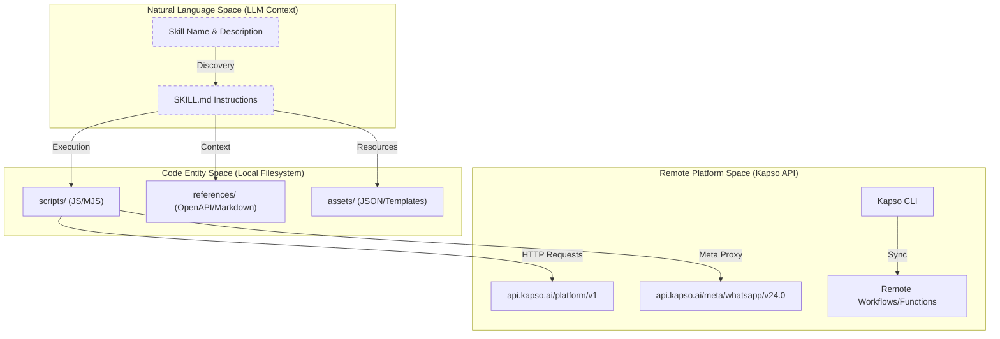
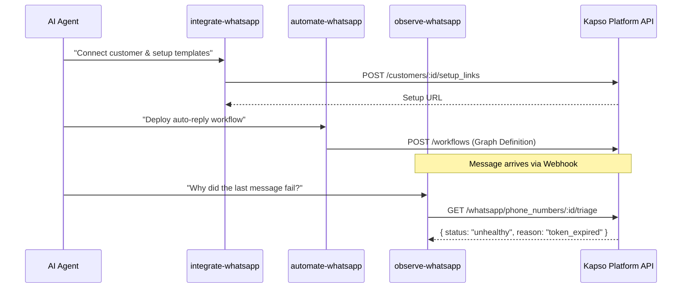

<!-- source: DeepWiki mcp.deepwiki.com · repo gokapso/agent-skills · page 1 Overview · fetched 2026-10-27 -->

# Overview

Relevant source files

The following files were used as context for generating this wiki page:

- [README.md](README.md)

The `agent-skills` repository provides a suite of specialized capabilities for the [Kapso](https://kapso.ai) platform, enabling AI agents to interact with the WhatsApp Business Platform. These skills follow the open [Agent Skills format](https://agentskills.io), allowing agents to discover and execute complex tasks through a combination of natural language instructions, executable scripts, and API references [README.md:1-8]().

## System Architecture

The repository bridges the gap between high-level agent instructions and the low-level Kapso Platform API. It is structured into three primary functional domains: integration, automation, and observation.

### From Natural Language to Code Entities

The following diagram illustrates how the abstract "Skill" concept maps to concrete filesystem entities and remote API resources.

**Skill Entity Mapping**

Sources: [README.md:35-48](), [README.md:61-80]()

## Core Skill Modules

The repository is organized into three main directories, each representing a distinct skill:

| Skill | Purpose | Key Capabilities |
|-------|---------|------------------|
| `integrate-whatsapp` | **Connectivity** | Embedded signup, message templates, WhatsApp Flows, and webhook management [README.md:51](). |
| `automate-whatsapp` | **Logic** | Graph-based workflows, AI agent nodes, serverless functions, and state management [README.md:52](). |
| `observe-whatsapp` | **Diagnostics** | Health checks, message tracing, and webhook delivery investigation [README.md:53](). |

### Logical Flow of Operations

The diagram below shows how these skills interact to manage a WhatsApp communication lifecycle.

**Operational Workflow**

Sources: [README.md:49-54]()

## Environment & Setup

To use these skills, the environment must be configured with specific credentials to authorize requests against the Kapso Platform.

*   **API Configuration**: Requires `KAPSO_API_BASE_URL` (defaulting to `https://api.kapso.ai`) and a valid `KAPSO_API_KEY` [README.md:15-28]().
*   **Path Selection**: The system prefers the **Kapso CLI** for authenticated operations (e.g., `kapso login`) but provides standalone scripts as a fallback for environments where the CLI is not present [README.md:29-34]().

For detailed installation and authentication steps, see [Getting Started & Environment Setup](#1.1).

## Agent Skills Format

Each skill directory follows a strict structural pattern to support **progressive disclosure**. This technique ensures that agents only consume the minimum necessary context at startup, loading deeper instructions only when a specific task matches the skill's description [README.md:47-48]().

*   **SKILL.md**: The entry point containing YAML frontmatter (`name`, `description`) and detailed Markdown instructions [README.md:61-80]().
*   **Directory Layout**: Supporting files are organized into `scripts/`, `references/`, and `assets/` [README.md:39-45]().

For the full specification and metadata schema, see [Agent Skills Format & SKILL.md Specification](#1.2).

---
**Sources:**
* [README.md:1-80]()

---

