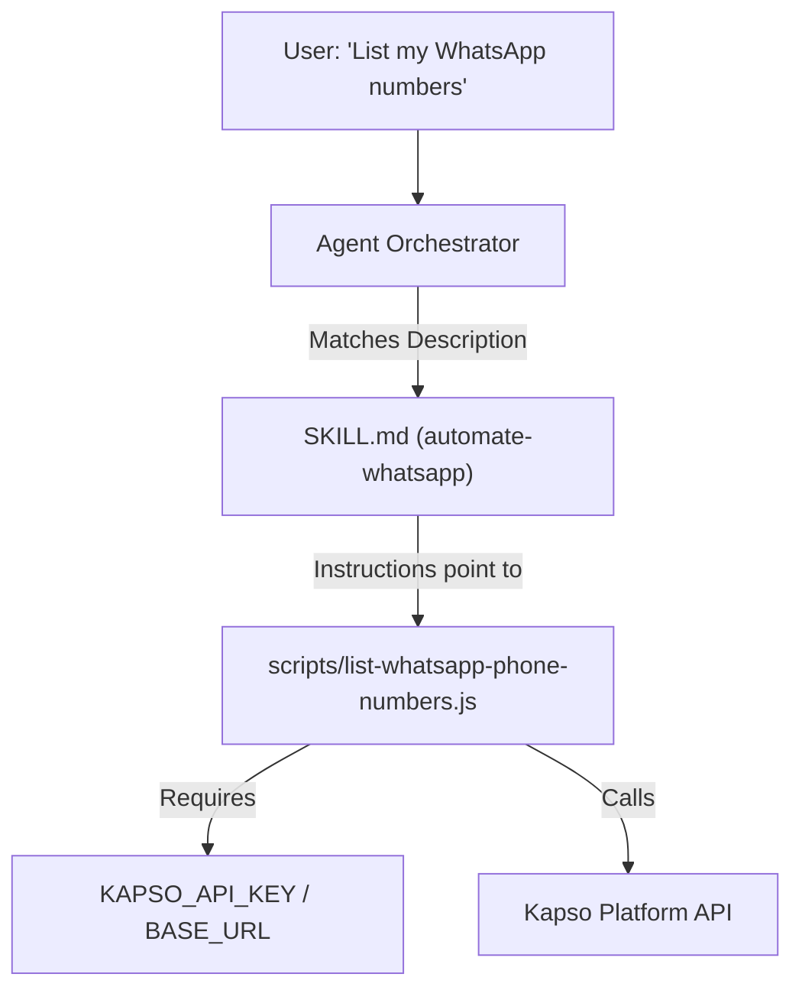
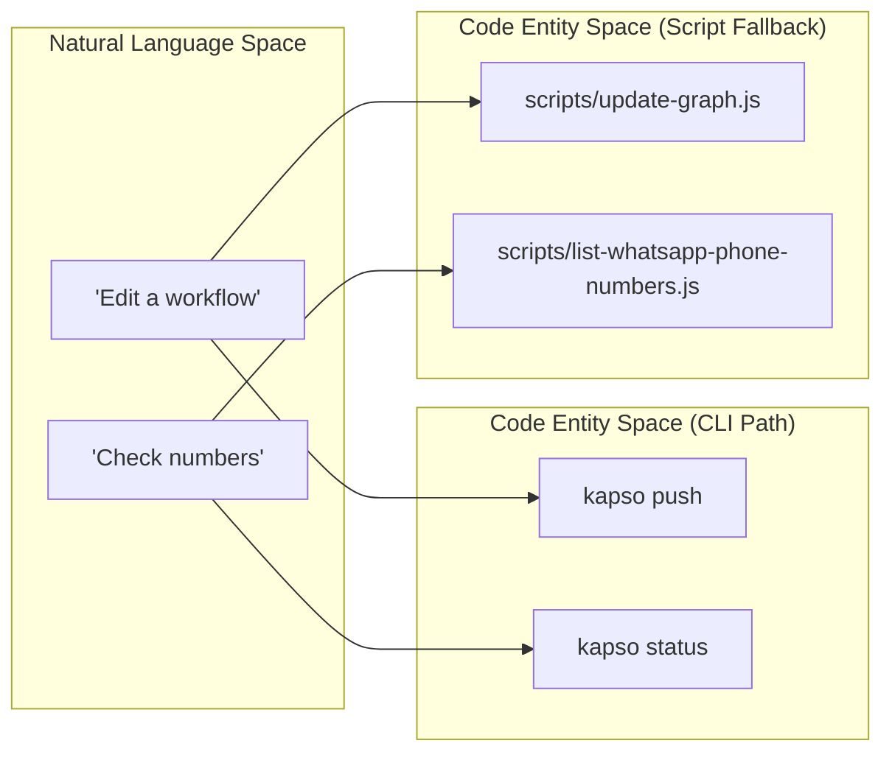

<!-- source: DeepWiki mcp.deepwiki.com · repo gokapso/agent-skills · page 1.2 Agent Skills Format & SKILL.md Specification · fetched 2026-10-27 -->

# Agent Skills Format & SKILL.md Specification

<details>
<summary>Relevant source files</summary>

The following files were used as context for generating this wiki page:

- [README.md](README.md)
- [skills/automate-whatsapp/SKILL.md](skills/automate-whatsapp/SKILL.md)

</details>


The Kapso Agent Skills repository follows the open **Agent Skills** format, a standardized directory structure designed to provide Large Language Models (LLMs) with executable scripts, domain-specific documentation, and operational instructions. This format prioritizes **progressive disclosure** to ensure that agents only consume high-value context when a specific task requires it.

[README.md:35-37]()

## Directory Layout

Each skill is encapsulated within its own directory. While only the `SKILL.md` file is strictly required, a mature skill typically includes several subdirectories to separate logic from documentation.

```text
skills/
└── <skill-name>/
    ├── SKILL.md          # Entrypoint: Metadata and high-level instructions
    ├── scripts/          # Executable JavaScript/Node.js scripts for task automation
    ├── references/       # Detailed technical specs, schemas, and deep-dive docs
    └── assets/           # Static resources, JSON templates, or example payloads
```

[README.md:39-45]()

### Component Roles
*   **SKILL.md**: Acts as the "system prompt extension." It contains the YAML frontmatter used for discovery and the primary "How-to" guides for the agent.
*   **scripts/**: Contains standalone Node.js scripts. These are the primary tools the agent executes to interact with the Kapso API.
*   **references/**: Used for technical depth that would otherwise bloat the LLM's context window (e.g., `graph-contract.md` or `node-types.md`).
*   **assets/**: Provides starting points for the agent, such as `agent-remote-sandbox-github-repo-example.json`.

[README.md:41-44](), [skills/automate-whatsapp/SKILL.md:133-133](), [skills/automate-whatsapp/SKILL.md:163-163]()

## The SKILL.md Specification

The `SKILL.md` file is the heart of the format. It uses a combination of YAML frontmatter and Markdown content to define the skill's identity and operational boundaries.

### YAML Frontmatter Schema
The frontmatter must be at the very top of the file, fenced by `---`.

| Field | Required | Description |
| :--- | :--- | :--- |
| `name` | Yes | A lowercase, hyphenated identifier (e.g., `automate-whatsapp`). |
| `description` | Yes | A concise summary (max 1024 chars) explaining when the agent should invoke this skill. |

[README.md:63-80]()

### Progressive Disclosure Pattern
To minimize context usage and prevent "hallucination" caused by irrelevant information, the format employs a two-stage discovery process:

1.  **Discovery (Minimal Context)**: The agent-hosting system only indexes the `name` and `description` from the frontmatter.
2.  **Activation (Full Context)**: Only when the agent determines the user's intent matches the `description` is the full content of `SKILL.md` (and potentially referenced files) loaded into the active context window.

[README.md:47-48]()

## Technical Implementation & Data Flow

The following diagram illustrates how an agent transitions from a natural language request to executing a specific code entity within the skill structure.

### From Natural Language to Script Execution
Title: Agent Skill Execution Flow

Sources: [README.md:20-22](), [README.md:47-48](), [skills/automate-whatsapp/SKILL.md:85-85]()

## Local Development vs. API Scripts

The format supports two distinct operational modes. The agent is instructed to prefer the **CLI-first path** when available, falling back to **direct scripts** in restricted environments.

### Data Entity Mapping
Title: Code Entity Mapping (CLI vs. Scripts)

Sources: [README.md:31-33](), [skills/automate-whatsapp/SKILL.md:71-72](), [skills/automate-whatsapp/SKILL.md:80-81](), [skills/automate-whatsapp/SKILL.md:85-85](), [skills/automate-whatsapp/SKILL.md:94-94]()

### Script Requirements
Scripts within the `scripts/` directory are typically designed to be executed via `node`. They rely on environment variables for authentication:
*   `KAPSO_API_KEY`: Authenticates requests via the `X-API-Key` header.
*   `KAPSO_API_BASE_URL`: Defines the target environment (defaulting to `https://api.kapso.ai`).

[README.md:15-27](), [skills/automate-whatsapp/SKILL.md:20-22]()

## Graph and Function Rules
To ensure compatibility with the Kapso engine, the `SKILL.md` specifies strict constraints for the agent when it generates or modifies code entities.

### Graph Constraints
*   **Start Node**: Exactly one node with `id: "start"`.
*   **Immutability**: Existing node IDs must never be changed to maintain execution history.
*   **Naming**: New nodes must follow the pattern `{node_type}_{timestamp_ms}`.

[skills/automate-whatsapp/SKILL.md:156-161]()

### Function Constraints
Serverless functions managed by these skills must follow a specific signature compatible with the Kapso runtime:
*   **Signature**: `async function handler(request, env)`.
*   **No Exports**: Agents are instructed NOT to use `export` or `export default` within the script body.
*   **Return Type**: Must return a standard `Response` object.

[skills/automate-whatsapp/SKILL.md:167-178]()

Sources: [README.md:1-86](), [skills/automate-whatsapp/SKILL.md:1-194]()

---

