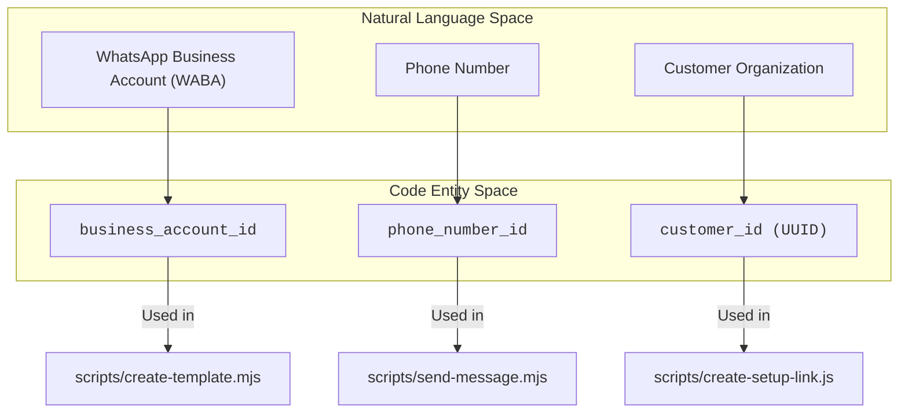
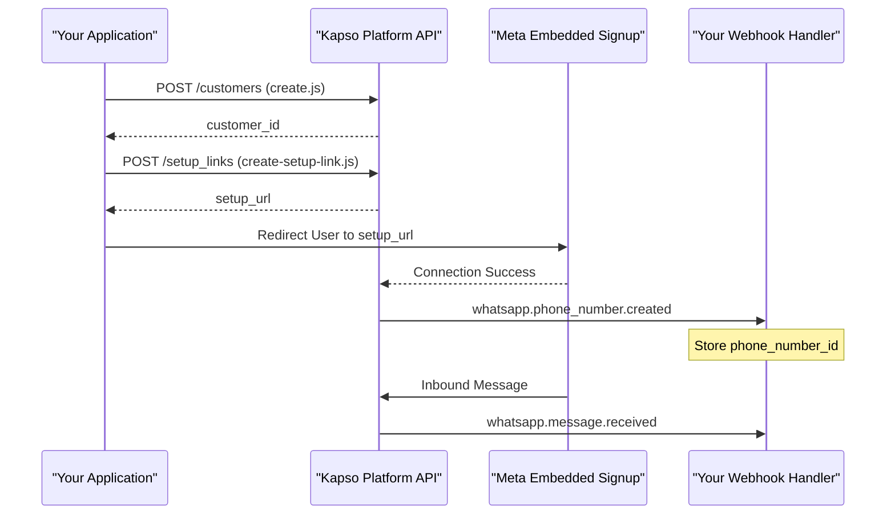

<!-- source: DeepWiki mcp.deepwiki.com · repo gokapso/agent-skills · page 2 Integrate WhatsApp Skill · fetched 2026-10-27 -->

# Integrate WhatsApp Skill

Relevant source files

The following files were used as context for generating this wiki page:

- [skills/integrate-whatsapp/SKILL.md](skills/integrate-whatsapp/SKILL.md)

The `integrate-whatsapp` skill provides the foundational tools to connect WhatsApp Business accounts to your product via the Kapso platform. It enables multi-tenant customer onboarding, automated messaging (text, templates, and interactive), WhatsApp Flow management, and a robust webhook system for event-driven architectures.

### High-Level Architecture

The skill operates by bridging your application to the Meta WhatsApp Business Platform through two primary API layers:
1.  **Kapso Platform API (`/platform/v1`)**: Handles customer entities, setup links, and webhook configurations [skills/integrate-whatsapp/SKILL.md:71-71]().
2.  **Meta Proxy API (`/meta/whatsapp/v24.0`)**: Provides a managed proxy for messaging, media, templates, and flows, using `phone_number_id` as the primary identifier [skills/integrate-whatsapp/SKILL.md:72-73]().

#### Natural Language to Code Entity Space: Core Identifiers
The following diagram maps high-level WhatsApp concepts to the specific identifiers and scripts used in the codebase.

"WhatsApp Entity Mapping"

Sources: [skills/integrate-whatsapp/SKILL.md:111-118](), [skills/integrate-whatsapp/SKILL.md:47-50]()

---

### Customer Onboarding & Setup Links
Onboarding involves creating a `customer` entity and generating a "Setup Link" for Meta's Embedded Signup. This process can be configured to provision new numbers or use existing ones, with support for specific country ISO codes and redirect URLs to handle the post-onboarding UX [skills/integrate-whatsapp/SKILL.md:56-65]().

For details, see [Customer Onboarding & Setup Links](#2.1).

### Messaging: Text, Templates & Interactive Messages
The skill supports the full spectrum of WhatsApp messaging. Plain text messages are sent via the `WhatsAppClient` SDK or direct proxy calls [skills/integrate-whatsapp/SKILL.md:141-160](). For outbound notifications outside the 24-hour window, the skill manages the lifecycle of Templates (Marketing, Utility, Authentication) [skills/integrate-whatsapp/SKILL.md:162-168](). Interactive messages, including buttons and list menus, are used for structured user input [skills/integrate-whatsapp/SKILL.md:170-176]().

For details, see [Messaging: Text, Templates & Interactive Messages](#2.2).

### WhatsApp Flows
WhatsApp Flows allow for structured, multi-step interactions (like booking appointments or collecting feedback) directly within the chat. This skill provides scripts to create, update, and publish flows, as well as the infrastructure to host data endpoints for dynamic flows [skills/integrate-whatsapp/SKILL.md:3-3]().

For details, see [WhatsApp Flows](#2.3).

### Webhooks: Events, Delivery & Verification
The webhook system is divided into **Project-level** (connection lifecycle) and **Phone-number-level** (messages and conversations) scopes [skills/integrate-whatsapp/SKILL.md:81-84](). It supports features like message buffering to prevent race conditions and payload versioning (`v2` recommended) [skills/integrate-whatsapp/SKILL.md:94-95]().

For details, see [Webhooks: Events, Delivery & Verification](#2.4).

### Integrate WhatsApp Scripts Reference
The `scripts/` directory contains a comprehensive set of CLI tools for managing the integration without writing custom code initially. These include customer CRUD, template submission, and flow management utilities.

For details, see [Integrate WhatsApp Scripts Reference](#2.5).

---

### Integration Workflow
The following diagram illustrates the sequence from onboarding a customer to receiving their first message.

"Onboarding to Messaging Workflow"

Sources: [skills/integrate-whatsapp/SKILL.md:30-54](), [skills/integrate-whatsapp/SKILL.md:75-84]()

---

