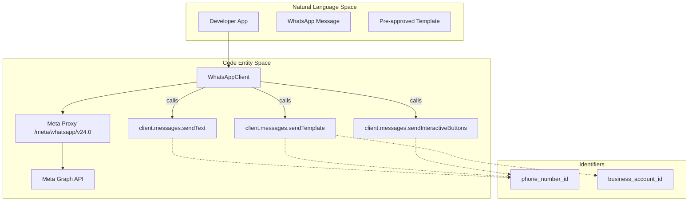
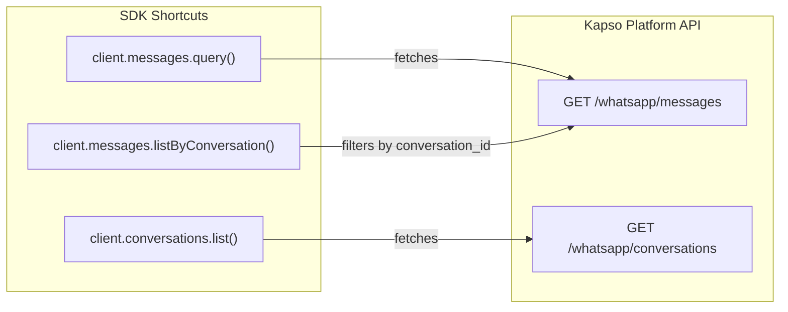

<!-- source: DeepWiki mcp.deepwiki.com · repo gokapso/agent-skills · page 2.2 Messaging: Text, Templates & Interactive Messages · fetched 2026-10-27 -->

# Messaging: Text, Templates & Interactive Messages

<details>
<summary>Relevant source files</summary>

The following files were used as context for generating this wiki page:

- [skills/integrate-whatsapp/SKILL.md](skills/integrate-whatsapp/SKILL.md)
- [skills/integrate-whatsapp/references/platform-api-reference.md](skills/integrate-whatsapp/references/platform-api-reference.md)
- [skills/integrate-whatsapp/references/setup-links.md](skills/integrate-whatsapp/references/setup-links.md)
- [skills/integrate-whatsapp/references/whatsapp-cloud-api-js.md](skills/integrate-whatsapp/references/whatsapp-cloud-api-js.md)

</details>


This page covers the outbound messaging capabilities of the `integrate-whatsapp` skill. It details how to send plain text, manage and send pre-approved templates, and utilize interactive message types such as buttons and lists. All messaging operations are routed through the Kapso Meta Proxy to ensure authentication and multi-tenant isolation.

## Messaging Architecture

Outbound messages are sent via the Meta Proxy base URL: `https://api.kapso.ai/meta/whatsapp/v24.0` [skills/integrate-whatsapp/references/platform-api-reference.md:16-16](). The system uses two primary identifiers:
1.  **`phone_number_id`**: Used for sending messages and media uploads [skills/integrate-whatsapp/SKILL.md:118-118]().
2.  **`business_account_id` (WABA ID)**: Used for Template CRUD operations [skills/integrate-whatsapp/SKILL.md:117-117]().

### Data Flow: SDK to Meta Proxy

The following diagram illustrates the flow from a developer's application using the `@kapso/whatsapp-cloud-api` SDK to the final delivery via Meta.

**Messaging Entity Map**

Sources: [skills/integrate-whatsapp/SKILL.md:141-160](), [skills/integrate-whatsapp/references/whatsapp-cloud-api-js.md:19-26]()

## WhatsAppClient SDK

The `@kapso/whatsapp-cloud-api` SDK provides a typed interface for interacting with the Kapso Meta Proxy.

### Initialization
To use the SDK with Kapso, you must provide the `baseUrl` and your `KAPSO_API_KEY` [skills/integrate-whatsapp/references/whatsapp-cloud-api-js.md:19-26]().

```ts
import { WhatsAppClient } from "@kapso/whatsapp-cloud-api";

const client = new WhatsAppClient({
  baseUrl: "https://api.kapso.ai/meta/whatsapp",
  kapsoApiKey: process.env.KAPSO_API_KEY!
});
```

### Text Messages
Text messages are the simplest form of communication. They can only be sent if there is an active 24-hour session window initiated by the user, or if they are responding to a user message [skills/integrate-whatsapp/SKILL.md:172-172]().

*   **SDK Method**: `client.messages.sendText` [skills/integrate-whatsapp/references/whatsapp-cloud-api-js.md:39-44]()
*   **CLI Command**: `kapso whatsapp messages send --phone-number-id <ID> --to <WA_ID> --text "..."` [skills/integrate-whatsapp/SKILL.md:126-126]()

Sources: [skills/integrate-whatsapp/SKILL.md:151-160](), [skills/integrate-whatsapp/references/whatsapp-cloud-api-js.md:36-44]()

## Template Management

Templates are required for business-initiated conversations outside the 24-hour window. They must be pre-approved by Meta.

### Template Categories
When creating templates, you must specify a category:
*   **MARKETING**: Promotional offers, product announcements.
*   **UTILITY**: Order updates, account alerts.
*   **AUTHENTICATION**: One-time passwords (OTPs).

### Parameter Types
Kapso supports two methods for injecting dynamic content into templates:
1.  **POSITIONAL**: Parameters are referenced by index (e.g., `{{1}}`, `{{2}}`).
2.  **NAMED**: Parameters are referenced by specific keys (e.g., `order_id`). This is the modern standard for clarity [skills/integrate-whatsapp/references/whatsapp-cloud-api-js.md:74-74]().

### Template Lifecycle
1.  **Discovery**: Resolve the `business_account_id` using `kapso whatsapp numbers resolve` [skills/integrate-whatsapp/SKILL.md:117-117]().
2.  **Creation**: Use `node scripts/create-template.mjs --business-account-id <WABA_ID> --file <payload.json>` [skills/integrate-whatsapp/SKILL.md:166-166]().
3.  **Status Check**: Monitor approval status via `node scripts/template-status.mjs` [skills/integrate-whatsapp/SKILL.md:167-167]().
4.  **Sending**: Use `client.messages.sendTemplate` [skills/integrate-whatsapp/references/whatsapp-cloud-api-js.md:63-80]().

Sources: [skills/integrate-whatsapp/SKILL.md:162-169](), [skills/integrate-whatsapp/references/whatsapp-cloud-api-js.md:61-80]()

## Interactive Messages

Interactive messages provide a richer UI within WhatsApp. These require an active 24-hour session window [skills/integrate-whatsapp/SKILL.md:172-172]().

| Type | Description | SDK Method |
| :--- | :--- | :--- |
| **Buttons** | Up to 3 quick-reply buttons. | `sendInteractiveButtons` |
| **Lists** | A menu with up to 10 rows. | `sendRaw` (with interactive list payload) |
| **CTA URL** | Buttons that open a web browser. | `sendRaw` (with cta_url payload) |
| **Catalog** | Displays product sets from a Meta Catalog. | `sendRaw` |

### Example: Interactive Buttons
```ts
await client.messages.sendInteractiveButtons({
  phoneNumberId: "<PHONE_NUMBER_ID>",
  to: "+15551234567",
  bodyText: "Choose an option",
  buttons: [
    { id: "accept", title: "Accept" },
    { id: "decline", title: "Decline" }
  ]
});
```
Sources: [skills/integrate-whatsapp/SKILL.md:170-177](), [skills/integrate-whatsapp/references/whatsapp-cloud-api-js.md:82-94]()

## Messaging History & Inspection

Kapso provides specialized endpoints to query message history, which are not available in the standard Meta Graph API [skills/integrate-whatsapp/references/whatsapp-cloud-api-js.md:157-157]().

**Message Retrieval Logic**


### Key Query Parameters for `GET /whatsapp/messages`
*   `phone_number_id`: Filter by the sender number.
*   `direction`: `inbound` or `outbound`.
*   `status`: `pending`, `sent`, `delivered`, `read`, or `failed`.
*   `limit`, `after`, `before`: Cursor-based pagination [skills/integrate-whatsapp/references/platform-api-reference.md:66-70]().

Sources: [skills/integrate-whatsapp/references/platform-api-reference.md:47-52](), [skills/integrate-whatsapp/references/whatsapp-cloud-api-js.md:96-142]()

---

