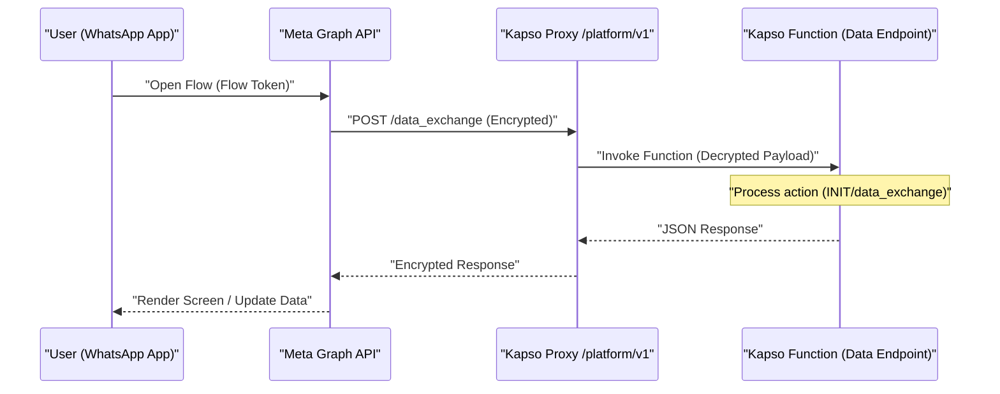
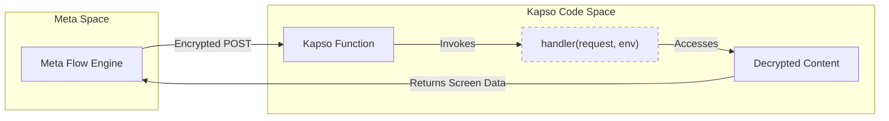

<!-- source: DeepWiki mcp.deepwiki.com · repo gokapso/agent-skills · page 2.3 WhatsApp Flows · fetched 2026-10-27 -->

# WhatsApp Flows

<details>
<summary>Relevant source files</summary>

The following files were used as context for generating this wiki page:

- [skills/integrate-whatsapp/SKILL.md](skills/integrate-whatsapp/SKILL.md)
- [skills/integrate-whatsapp/references/platform-api-reference.md](skills/integrate-whatsapp/references/platform-api-reference.md)

</details>


WhatsApp Flows allow for the creation of structured, multi-step interactions within a WhatsApp chat, enabling tasks like booking appointments, gathering feedback, or processing orders without leaving the app. The Kapso platform facilitates the lifecycle of these flows, from creation and JSON schema management to secure data exchange via encrypted endpoints.

### Flow Lifecycle and Architecture

WhatsApp Flows operate through a defined lifecycle that transitions between the Meta client and a data endpoint (hosted as a Kapso Function). The integration supports two primary types of flows:
1.  **Static Flows**: The entire UI and logic are defined in the Flow JSON.
2.  **Dynamic Flows**: The flow requests data from an endpoint at specific stages (INIT, data_exchange, or BACK) to populate fields or determine the next screen.

#### Data Exchange Lifecycle

The following diagram illustrates the interaction between the WhatsApp Client, Meta's servers, and the Kapso infrastructure during a dynamic flow execution.

**WhatsApp Flow Execution Sequence**

**Sources:** [skills/integrate-whatsapp/SKILL.md:3-4](), [skills/integrate-whatsapp/references/platform-api-reference.md:126-128]()

### Encryption and Security

Meta requires that all communication with a WhatsApp Flow data endpoint be encrypted using an asymmetric key pair. Kapso manages this complexity by acting as the decryption layer before passing the request to your business logic.

*   **Public Key**: Registered with Meta when creating or updating the flow.
*   **Private Key**: Used by the Kapso platform to decrypt incoming `POST` requests from Meta.
*   **Flow Token**: A unique identifier generated when sending a flow message. It is passed back to the data endpoint to maintain session context.

### Implementation Reference

#### Creating and Managing Flows
Flows are managed through the Kapso Platform API and Meta Proxy. The process involves creating the flow container, uploading the UI schema (JSON), and publishing it.

| Action | Code Entity / Script | API Endpoint |
| :--- | :--- | :--- |
| **Create Flow** | `scripts/create-flow.js` | `POST /meta/whatsapp/v24.0/{waba_id}/flows` |
| **Update JSON** | `scripts/update-flow-json.js` | `POST /meta/whatsapp/v24.0/{flow_id}/assets` |
| **Publish** | `scripts/publish-flow.js` | `POST /meta/whatsapp/v24.0/{flow_id}/publish` |
| **Data Endpoint** | `automate-whatsapp` Functions | `POST /platform/v1/functions/{id}/invoke` |

**Sources:** [skills/integrate-whatsapp/SKILL.md:164-168](), [skills/integrate-whatsapp/references/platform-api-reference.md:105-112]()

#### Data Endpoint Architecture
When a flow is configured with a `data_api_version`, Meta sends a request to the configured URL. In the Kapso ecosystem, this URL typically points to a **Kapso Function**.

**Code-to-System Mapping: Data Endpoint Flow**

**Sources:** [skills/automate-whatsapp/SKILL.md:3.4](), [skills/integrate-whatsapp/references/platform-api-reference.md:105-112]()

### Sending a Flow Message
Flows are delivered to users either as **Interactive Messages** (within a 24-hour window) or as **Templates**.

1.  **Interactive Flow**: Uses the `flow` type within the interactive message object. It requires a `flow_token` and `flow_action` (e.g., `navigate` or `data_exchange`).
2.  **Template Flow**: A pre-approved template containing a "Flow" button.

**Key SDK Interface:**
The `WhatsAppClient` from `@kapso/whatsapp-cloud-api` provides the interface for sending these messages.

```ts
// Example: Sending a Flow via SDK
await client.messages.sendInteractive({
  phoneNumberId: "YOUR_PHONE_NUMBER_ID",
  to: "USER_PHONE_NUMBER",
  interactive: {
    type: "flow",
    header: { type: "text", text: "Appointment Booking" },
    body: { text: "Please fill out the form to book your slot." },
    action: {
      name: "flow",
      parameters: {
        flow_token: "unique_session_id_123",
        flow_id: "FLOW_ID",
        flow_cta: "Book Now",
        flow_action: "navigate",
        flow_screen: "START_SCREEN"
      }
    }
  }
});
```
**Sources:** [skills/integrate-whatsapp/SKILL.md:142-149](), [skills/integrate-whatsapp/SKILL.md:170-176]()

### Script Reference for Flow Management

The `integrate-whatsapp` skill includes several utility scripts to manage the flow lifecycle:

*   **`create-flow.js`**: Initializes a new flow container under a WhatsApp Business Account (WABA). Requires the `business_account_id`.
*   **`update-flow-json.js`**: Uploads the `flow.json` file which defines the screens, input fields, and validation logic.
*   **`publish-flow.js`**: Transitions a flow from `DRAFT` to `PUBLISHED` status, making it available to end-users. Note that published flows have limited editability.

**Sources:** [skills/integrate-whatsapp/SKILL.md:164-168](), [skills/integrate-whatsapp/references/platform-api-reference.md:126-128]()

---

