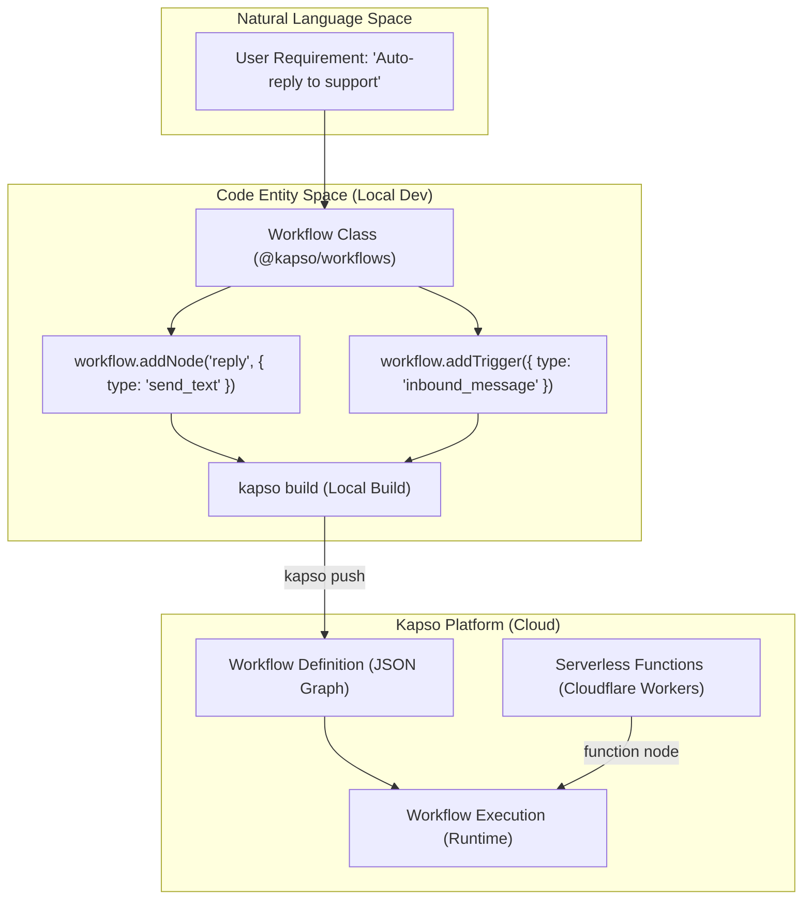
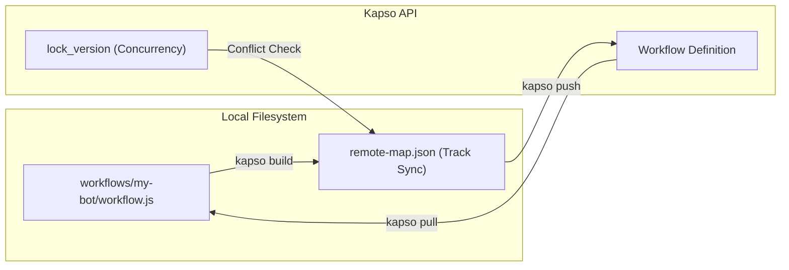

<!-- source: DeepWiki mcp.deepwiki.com · repo gokapso/agent-skills · page 3 Automate WhatsApp Skill · fetched 2026-10-27 -->

# Automate WhatsApp Skill

Relevant source files

The following files were used as context for generating this wiki page:

- [skills/automate-whatsapp/SKILL.md](skills/automate-whatsapp/SKILL.md)

The `automate-whatsapp` skill provides the tools and interfaces necessary to build, deploy, and manage event-driven WhatsApp automations. It centers around a directed-graph workflow engine where nodes represent actions (sending messages, calling functions, AI agents) and edges represent the execution flow.

This skill supports two primary development paths:
1.  **Local Source-Sync (Preferred):** Using the Kapso CLI and `@kapso/workflows` SDK to author workflows in TypeScript/JavaScript, which are then built and pushed to the platform [skills/automate-whatsapp/SKILL.md:14-17]().
2.  **API-Direct (Fallback):** Using provided scripts to interact directly with the platform's JSON graph representation and execution management endpoints [skills/automate-whatsapp/SKILL.md:19-23]().

### System Architecture Overview

The following diagram illustrates how natural language requirements are translated into code entities and deployed to the Kapso platform.

**Workflow Development Lifecycle**

Sources: [skills/automate-whatsapp/SKILL.md:40-65](), [skills/automate-whatsapp/SKILL.md:70-73]()

---

### Workflow Concepts & Execution Model
Workflows are defined as directed graphs starting from a unique `start` node [skills/automate-whatsapp/SKILL.md:156-156](). Executions move through states such as `running`, `waiting` (for user input), or `handoff` (to a human agent). The system uses a strict execution context structure containing `vars`, `system`, `context`, and `metadata` [skills/automate-whatsapp/SKILL.md:181-186]().

For details, see [Workflow Concepts & Execution Model](#3.1).

### Node Types & Graph Schema
The workflow engine supports various node types, including messaging nodes (`send_text`, `send_interactive`), logic nodes (`decide`, `set_variable`), and integration nodes (`function`, `webhook`, `agent`) [skills/automate-whatsapp/SKILL.md:57-60](). The graph contract requires specific ID conventions and edge definitions to ensure valid execution paths.

For details, see [Node Types & Graph Schema](#3.2).

### Local Development with CLI & SDK
The `@kapso/workflows` SDK allows developers to define automation logic programmatically. The Kapso CLI facilitates the lifecycle of these workflows through commands like `kapso pull` to fetch remote state and `kapso push` to deploy local changes [skills/automate-whatsapp/SKILL.md:30-36]().

**Local vs. Remote Mapping**

Sources: [skills/automate-whatsapp/SKILL.md:30-36](), [skills/automate-whatsapp/SKILL.md:91-99]()

For details, see [Local Development with CLI & @kapso/workflows SDK](#3.3).

### Functions: Runtime & Deployment
Kapso functions are serverless snippets (Cloudflare Workers) that can be invoked by `function` nodes or used as tools by AI agents. They follow a specific `handler(request, env)` signature and do not use standard ES modules `export` syntax in the platform runtime [skills/automate-whatsapp/SKILL.md:167-178]().

For details, see [Functions: Runtime, Contracts & Deployment](#3.4).

### Agent Nodes & Remote Sandbox
`agent` nodes integrate LLMs directly into the workflow. These agents can be equipped with a "Remote Sandbox," an ephemeral workspace where the AI can interact with GitHub repositories and run filesystem tools to perform complex coding or analysis tasks [skills/automate-whatsapp/SKILL.md:127-141]().

For details, see [Agent Nodes & Remote Sandbox](#3.5).

### Automate WhatsApp Scripts Reference
A comprehensive suite of scripts is provided in `skills/automate-whatsapp/scripts/` for managing every aspect of the automation lifecycle, from CRUD operations on workflows to inspecting live execution events [skills/automate-whatsapp/SKILL.md:191-205]().

For details, see [Automate WhatsApp Scripts Reference](#3.6).

---

