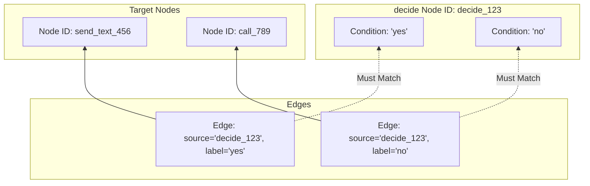

<!-- source: DeepWiki mcp.deepwiki.com · repo gokapso/agent-skills · page 3.2 Node Types & Graph Schema · fetched 2026-10-27 -->

# Node Types & Graph Schema

<details>
<summary>Relevant source files</summary>

The following files were used as context for generating this wiki page:

- [skills/automate-whatsapp/references/node-types.md](skills/automate-whatsapp/references/node-types.md)
- [skills/automate-whatsapp/references/workflow-reference.md](skills/automate-whatsapp/references/workflow-reference.md)

</details>


This page provides a technical reference for the Kapso workflow graph contract. It covers the specific JSON schemas for every node type supported by the platform, the connectivity rules for edges, and the distinction between the "Rich" graph returned by the API and the "Minimal" graph required for updates.

## Graph Contract & Structure

A workflow graph is a collection of `nodes` and `edges`. The platform uses a ReactFlow-compatible structure for representing these directed graphs [skills/automate-whatsapp/references/workflow-reference.md:74-85]().

### Node Identification & Positioning
*   **Node IDs**: Every node must have a unique `id`. The convention for new nodes is `{node_type}_{timestamp_ms}` (e.g., `send_text_1710000000000`) [skills/automate-whatsapp/references/node-types.md:39-39]().
*   **Start Node**: Every graph must contain exactly one node with the ID `start` and `node_type` `start` [skills/automate-whatsapp/references/node-types.md:48-48]().
*   **Positioning**: Nodes use an `{ x, y }` coordinate system. Graphs should be organized vertically (top-down) as nodes connect from bottom to top [skills/automate-whatsapp/references/node-types.md:28-40]().

### Edge Rules
*   **Linear Flow**: Most nodes (messaging, variables, etc.) support only one outgoing edge.
*   **Branching**: Only `decide` nodes support multiple outgoing edges. Each edge from a `decide` node must have a `label` that matches one of the node's defined `conditions` [skills/automate-whatsapp/references/node-types.md:198-198]().
*   **Validation**: The `scripts/validate-graph.js` utility enforces these rules, ensuring no orphaned edges or missing start nodes exist before deployment [skills/automate-whatsapp/references/workflow-reference.md:94-102]().

### Minimal vs. Rich Shapes
When fetching a graph via `GET /platform/v1/workflows/:id/definition`, the API returns a **Rich** shape containing computed fields like `display_name` and UI-specific `type` strings [skills/automate-whatsapp/references/workflow-reference.md:82-82](). When updating a graph via `PATCH`, you should send a **Minimal** shape; the API ignores or strips computed fields [skills/automate-whatsapp/references/workflow-reference.md:83-84]().

| Feature | Rich Shape (API Response) | Minimal Shape (API Request) |
| :--- | :--- | :--- |
| **Node Fields** | `id`, `type`, `position`, `data` | `id`, `position`, `data` |
| **Data Fields** | `node_type`, `config`, `display_name` | `node_type`, `config` |
| **Edge Fields** | `id`, `source`, `target`, `label`, `type` | `source`, `target`, `label` |

**Sources:** [skills/automate-whatsapp/references/node-types.md:22-40](), [skills/automate-whatsapp/references/workflow-reference.md:74-102]()

---

## Messaging Nodes

Messaging nodes handle outbound communication via the WhatsApp Business Platform.

### `send_text`
Sends a plain text message. Supports variable interpolation using `{{vars.name}}` syntax [skills/automate-whatsapp/references/node-types.md:50-54]().

### `send_template`
Sends a pre-approved Meta message template. Requires a `template_id` (UUID) and a mapping of positional parameters [skills/automate-whatsapp/references/node-types.md:58-72]().

### `send_interactive`
Supports four interactive subtypes defined in `config.interactive_type` [skills/automate-whatsapp/references/node-types.md:73-140]():
1.  **button**: Up to 3 quick-reply buttons.
2.  **list**: A menu with sections and rows (up to 10 rows total).
3.  **cta_url**: A button that opens a specific URL.
4.  **flow**: Triggers a Meta WhatsApp Flow. Requires `flow_id` and `flow_action_payload` specifying the initial screen.

**Sources:** [skills/automate-whatsapp/references/node-types.md:50-140]()

---

## Logic & Control Flow Nodes

### `decide`
Routes the workflow based on AI evaluation or a Function response.
*   **AI Routing**: Uses an LLM to evaluate the conversation against `conditions` (labels and descriptions) [skills/automate-whatsapp/references/node-types.md:167-180]().
*   **Function Routing**: Executes a Kapso Function; the function must return a string matching one of the `conditions[].label` values [skills/automate-whatsapp/references/node-types.md:181-195]().

### `wait_for_response`
Pauses execution until the user sends a message. The incoming message is stored in the variable defined by `save_response_to` [skills/automate-whatsapp/references/node-types.md:141-148]().

### `set_variable`
Updates the execution context. While `value_type` can vary, `string` is the standard for most interpolations [skills/automate-whatsapp/references/node-types.md:150-164]().

### `call` (Subworkflow)
Executes another workflow as a child process. Requires a `workflow_id`. If the subworkflow fails, the error can be captured in `save_error_to` [skills/automate-whatsapp/references/node-types.md:201-205]().

**Sources:** [skills/automate-whatsapp/references/node-types.md:141-205]()

---

## Integration & Agent Nodes

### `agent`
The `agent` node represents an autonomous LLM agent. It is highly configurable via `data.config` [skills/automate-whatsapp/references/node-types.md:232-246]().

*   **Delivery Modes**: 
    *   `auto_send_assistant_text`: LLM responses are sent to the user immediately.
    *   `tool_only`: LLM responses are internal. The agent must use the `send_notification_to_user` tool to communicate [skills/automate-whatsapp/references/node-types.md:250-254]().
*   **Default Tools**: Built-in capabilities like `contact_conversations` (reading history) and `enter_waiting` (pausing for input) [skills/automate-whatsapp/references/node-types.md:257-272]().
*   **Custom Tools**: Links to `webhook` tools or `mcp_servers` for external data access [skills/automate-whatsapp/references/node-types.md:273-281]().

### `function` & `webhook`
*   **function**: Invokes a Kapso serverless function by `function_id` [skills/automate-whatsapp/references/node-types.md:224-230]().
*   **webhook**: Performs a standard HTTP request. Supports custom methods, headers, and a `body_template` that allows variable interpolation [skills/automate-whatsapp/references/node-types.md:207-222]().

**Sources:** [skills/automate-whatsapp/references/node-types.md:207-281]()

---

## Entity Mapping & Data Flow

The following diagrams illustrate how graph definitions translate to execution entities and how the branching logic is enforced.

### Diagram: Graph Definition to Runtime Entities
This diagram maps the JSON schema elements to the corresponding logic in the execution engine.

```mermaid
graph TD
    subgraph "Natural Language / Design Space"
        "User Intent" --> "Condition Labels"
        "Prompting" --> "System Prompt"
    end

    subgraph "Code Entity Space (Definition)"
        NodeDef["Node JSON (data.node_type)"]
        EdgeDef["Edge JSON (source/target/label)"]
        
        NodeDef -->|type: agent| AgentConfig["Agent Config (config.provider_model_id)"]
        NodeDef -->|type: decide| DecideConfig["Decide Config (config.conditions)"]
    end

    subgraph "Execution Engine (Runtime)"
        WorkflowExec["Workflow Execution Context"]
        AgentNode["agent-executor.js logic"]
        DecideNode["decide-router.js logic"]

        AgentConfig --> AgentNode
        DecideConfig --> DecideNode
        EdgeDef -->|Match Label| DecideNode
    end

    WorkflowExec -.->|Interpolation| NodeDef
```
**Sources:** [skills/automate-whatsapp/references/node-types.md:22-40](), [skills/automate-whatsapp/references/workflow-reference.md:94-102]()

### Diagram: Branching Logic Contract
This diagram shows the strict relationship between `decide` node conditions and graph edges.


**Sources:** [skills/automate-whatsapp/references/node-types.md:167-199](), [skills/automate-whatsapp/references/workflow-reference.md:99-100]()

---

