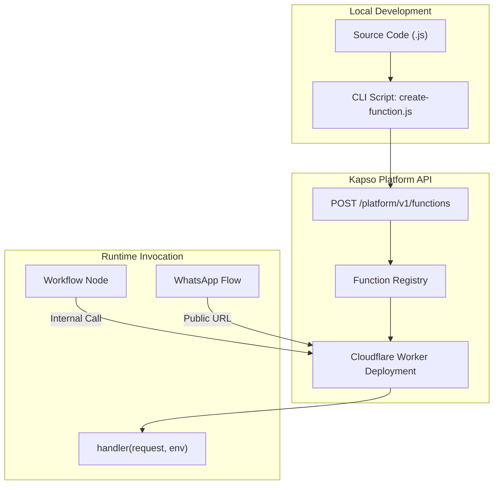

<!-- source: DeepWiki mcp.deepwiki.com · repo gokapso/agent-skills · page 3.4 Functions: Runtime, Contracts & Deployment · fetched 2026-10-27 -->

# Functions: Runtime, Contracts & Deployment

<details>
<summary>Relevant source files</summary>

The following files were used as context for generating this wiki page:

- [skills/automate-whatsapp/assets/functions-example.json](skills/automate-whatsapp/assets/functions-example.json)
- [skills/automate-whatsapp/references/functions-reference.md](skills/automate-whatsapp/references/functions-reference.md)
- [skills/automate-whatsapp/scripts/create-function.js](skills/automate-whatsapp/scripts/create-function.js)
- [skills/automate-whatsapp/scripts/lib/functions/args.js](skills/automate-whatsapp/scripts/lib/functions/args.js)
- [skills/automate-whatsapp/scripts/lib/functions/kapso-api.js](skills/automate-whatsapp/scripts/lib/functions/kapso-api.js)
- [skills/automate-whatsapp/scripts/update-function.js](skills/automate-whatsapp/scripts/update-function.js)

</details>


Kapso serverless functions provide a sandboxed JavaScript environment for executing custom logic within workflows, acting as AI tools, or serving as data endpoints for WhatsApp Flows. This page details the runtime specifications, the contracts for various invocation modes, and the lifecycle for deploying these functions to the Kapso platform.

### 1. Function Runtime & Handler Signature

Kapso functions execute in a Cloudflare Workers-like environment. Every function must define a specific entry point named `handler`.

#### Handler Signature
Functions must follow this exact signature:
```javascript
async function handler(request, env) {
  // Logic here
  return new Response(JSON.stringify({ success: true }));
}
```
*   **No Exports**: Do not use `export default` or arrow functions for the main handler [skills/automate-whatsapp/references/functions-reference.md:5-11]().
*   **Response Object**: The function must return a standard Web API `Response` object [skills/automate-whatsapp/references/functions-reference.md:11-11]().

#### Runtime APIs
*   **`request`**: A standard Fetch API `Request` object. Use `await request.json()` to parse incoming JSON payloads [skills/automate-whatsapp/references/functions-reference.md:15-15]().
*   **`env.KV`**: A key-value storage interface providing `.get(key)`, `.put(key, value)`, and `.delete(key)` [skills/automate-whatsapp/references/functions-reference.md:16-16]().
*   **`env.SECRET_NAME`**: Access to encrypted secrets configured during function creation/update [skills/automate-whatsapp/references/functions-reference.md:17-17]().

**Sources:**
- [skills/automate-whatsapp/references/functions-reference.md:5-17]()
- [skills/automate-whatsapp/assets/functions-example.json:4-4]()

---

### 2. Execution Contracts

Kapso functions are invoked in four primary contexts, each with a specific JSON payload contract.

#### 2.1 Workflow Node (Function & Decide)
When a `function` or `decide` node executes in a workflow, Kapso sends the full execution context.

**Payload Structure:**
- `execution_context`: Contains `vars` (user variables), `system` (flow metadata), `context` (channel/contact data), and `metadata` (request info) [skills/automate-whatsapp/references/functions-reference.md:55-72]().
- `available_edges`: (Decide nodes only) A list of outgoing edge labels [skills/automate-whatsapp/references/functions-reference.md:62-62]().

**Response Contract:**
- **Function Node**: Return a `vars` object to update the workflow's state [skills/automate-whatsapp/references/functions-reference.md:78-80]().
- **Decide Node**: Return `next_edge` matching one of the `available_edges` and optionally `vars` [skills/automate-whatsapp/references/functions-reference.md:88-92]().

#### 2.2 Agent Function Tools
When an `agent` node uses a function as a tool, the payload includes an `input` object (generated by the LLM) and `whatsapp_context` [skills/automate-whatsapp/references/functions-reference.md:100-108]().

#### 2.3 WhatsApp Flow Data Endpoints
Functions acting as dynamic data endpoints for WhatsApp Flows receive a `data_exchange` object. The function must respond with the standard WhatsApp Flow JSON schema (version 3.0) [skills/automate-whatsapp/references/functions-reference.md:116-139]().

### Data Flow: Natural Language to Code Entity Space
This diagram maps the logical workflow components to the code entities that handle function execution.

| Logic Space | Code Entity Space |
| :--- | :--- |
| **Workflow Logic** | `execution_context` [skills/automate-whatsapp/references/functions-reference.md:56-61]() |
| **Storage** | `env.KV` [skills/automate-whatsapp/references/functions-reference.md:16-16]() |
| **Deployment API** | `POST /platform/v1/functions` [skills/automate-whatsapp/scripts/create-function.js:59-62]() |
| **Invocation** | `endpoint_url` [skills/automate-whatsapp/references/functions-reference.md:44-44]() |

**Sources:**
- [skills/automate-whatsapp/references/functions-reference.md:50-139]()

---

### 3. Deployment & Configuration

Functions are managed via the Kapso Platform API. The deployment lifecycle involves creating the function record, uploading the code, and optionally exposing a public endpoint.

#### 3.1 Function Attributes
| Attribute | Description |
| :--- | :--- |
| `name` | Unique identifier for the function [skills/automate-whatsapp/scripts/create-function.js:50-50](). |
| `code` | The JavaScript source string containing the `handler` [skills/automate-whatsapp/scripts/create-function.js:49-49](). |
| `public_endpoint` | If `true`, the function can be called without an `X-API-Key` [skills/automate-whatsapp/references/functions-reference.md:38-46](). |
| `invoke_response_mode` | `passthrough` (returns raw function response) vs `wrapped` (legacy envelope) [skills/automate-whatsapp/references/functions-reference.md:47-48](). |

#### 3.2 Deployment Lifecycle
The following diagram illustrates the transition from local source code to a deployed Cloudflare function.



**Sources:**
- [skills/automate-whatsapp/scripts/create-function.js:18-62]()
- [skills/automate-whatsapp/scripts/update-function.js:48-68]()
- [skills/automate-whatsapp/references/functions-reference.md:21-25]()

---

### 4. Integration & Invocation Modes

#### 4.1 Public vs. Private Endpoints
*   **Private**: Default state. Requires an `X-API-Key` header for invocation via `https://api.kapso.ai/platform/v1/functions/{id}/invoke` [skills/automate-whatsapp/references/functions-reference.md:44-45]().
*   **Public**: Enabled by setting `public_endpoint: true`. Required for WhatsApp Flow data endpoints which are called directly by Meta's servers [skills/automate-whatsapp/references/functions-reference.md:24-46]().

#### 4.2 Response Modes
The `invoke_response_mode` determines how the Kapso API returns the function's output:
1.  **`passthrough`**: The body, status code, and headers returned by the `handler` are forwarded directly to the caller. This is the recommended mode for new functions [skills/automate-whatsapp/references/functions-reference.md:25-47]().
2.  **`wrapped`**: A legacy mode where the function's output is wrapped in a Kapso-specific JSON envelope [skills/automate-whatsapp/references/functions-reference.md:48-48]().

### Mapping Entities to Code
This diagram associates the API request parameters with the script implementation logic.

```mermaid
classDiagram
    class KapsoRequest {
        +String baseUrl
        +String apiKey
        +kapsoRequest(path, init)
    }
    class CreateFunctionScript {
        +resolveCode(flags)
        +parseBooleanFlag(public-endpoint)
        +main()
    }
    class FunctionPayload {
        +String name
        +String code
        +Boolean public_endpoint
        +String invoke_response_mode
    }

    CreateFunctionScript ..> KapsoRequest : uses
    CreateFunctionScript ..> FunctionPayload : constructs
    KapsoRequest --|> "kapso-api.js"
    CreateFunctionScript --|> "create-function.js"
```

**Sources:**
- [skills/automate-whatsapp/scripts/lib/functions/kapso-api.js:33-74]()
- [skills/automate-whatsapp/scripts/create-function.js:28-71]()
- [skills/automate-whatsapp/scripts/update-function.js:52-63]()
- [skills/automate-whatsapp/references/functions-reference.md:29-41]()

---

