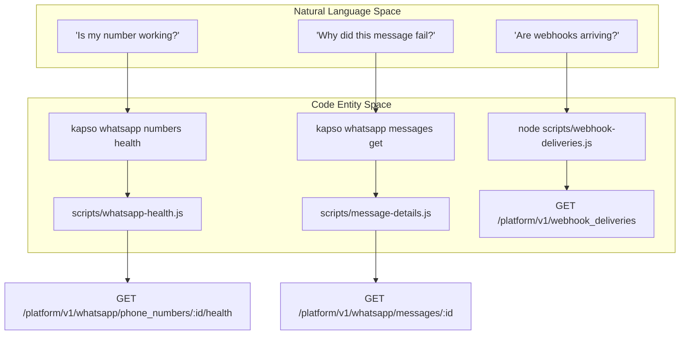
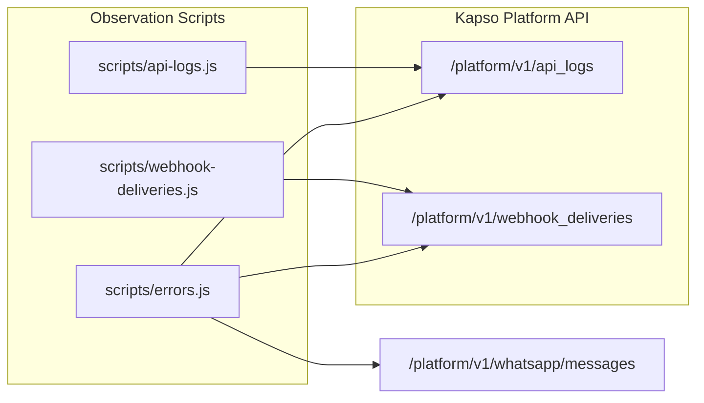

<!-- source: DeepWiki mcp.deepwiki.com · repo gokapso/agent-skills · page 4.2 Health Checks & Triage · fetched 2026-10-27 -->

# Health Checks & Triage

Relevant source files

The following files were used as context for generating this wiki page:

- [skills/observe-whatsapp/SKILL.md](skills/observe-whatsapp/SKILL.md)
- [skills/observe-whatsapp/scripts/api-logs.js](skills/observe-whatsapp/scripts/api-logs.js)
- [skills/observe-whatsapp/scripts/errors.js](skills/observe-whatsapp/scripts/errors.js)
- [skills/observe-whatsapp/scripts/overview.js](skills/observe-whatsapp/scripts/overview.js)
- [skills/observe-whatsapp/scripts/webhook-deliveries.js](skills/observe-whatsapp/scripts/webhook-deliveries.js)

The `observe-whatsapp` skill provides a suite of diagnostic tools designed to monitor the operational integrity of WhatsApp Business integrations. This system allows developers to run comprehensive health checks, triage API and message delivery failures, and inspect webhook delivery lifecycles.

## 60-Second Triage Order

When an issue is reported, the following triage sequence is recommended to isolate the root cause:

1.  **Project Overview**: Confirm general connectivity and identify if errors are widespread or isolated.
2.  **Number Health**: Execute a deep-scan of the specific `phone_number_id` to check Meta-level permissions and configuration.
3.  **API & Webhook Logs**: Inspect recent request/response cycles to identify transport-level failures.
4.  **Message Investigation**: Drill down into specific `WAMID` (WhatsApp Message IDs) for delivery status.

[skills/observe-whatsapp/SKILL.md:40-59]()

### System Triage Flow

This diagram illustrates the flow from natural language diagnostic intent to the specific code entities responsible for the check.

Title: Diagnostic Triage Flow

Sources: [skills/observe-whatsapp/SKILL.md:23-59](), [skills/observe-whatsapp/scripts/whatsapp-health.js:83]()

---

## Phone Number Health Checks

The health check system evaluates a WhatsApp number across multiple dimensions to produce an overall status: `healthy`, `degraded`, `unhealthy`, or `error`.

### Individual Check Categories

| Check | Description |
| :--- | :--- |
| `phone_number_access` | Verifies the Kapso platform can access the number via the Meta API. |
| `token_validity` | Checks if the System User Access Token is still valid and has correct scopes. |
| `messaging_health` | Inspects the Meta "Quality Rating" and "Messaging Limit" status. |
| `webhook_verified` | Confirms the Meta App webhook is correctly pointed at Kapso. |
| `webhook_subscription` | Ensures the `messages` and `message_echoes` fields are subscribed. |
| `test_message` | (Optional) Attempts a low-level delivery check to a known recipient. |

### Entity-Level Diagnosis
The health check identifies specific Meta states:
*   **LIMITED**: Messaging limits have been reached or restricted due to low quality.
*   **BLOCKED**: The account or number has been disabled for policy violations.

Sources: [skills/observe-whatsapp/SKILL.md:50-59](), [skills/observe-whatsapp/scripts/whatsapp-health.js:83]()

---

## Webhook Delivery Inspection

Webhooks are the primary mechanism for receiving inbound messages and delivery receipts. If messages appear "stuck" or status updates are missing, the `webhook-deliveries.js` script provides a window into the delivery attempts.

### Webhook Inspection Parameters
The system allows filtering by specific delivery characteristics:
*   **Period**: Filter by `24h`, `7d`, or `30d`.
*   **Status**: Filter by `delivered`, `failed`, or `retrying`.
*   **Event**: Filter by specific types like `whatsapp.message.created`.

[skills/observe-whatsapp/scripts/webhook-deliveries.js:27-44]()

Title: Webhook Delivery & API Log Data Flow

Sources: [skills/observe-whatsapp/scripts/api-logs.js:40-43](), [skills/observe-whatsapp/scripts/webhook-deliveries.js:41-44](), [skills/observe-whatsapp/scripts/errors.js:36-66]()

---

## API Log Analysis & Error Triage

The `api-logs.js` and `errors.js` scripts provide high-level visibility into the interaction between the client and the Kapso Platform.

### Unified Error Triage
The `errors.js` script aggregates failures from three distinct sources:
1.  **Message Delivery**: Outbound messages with `status=failed`.
2.  **API Calls**: Internal platform logs with `errors_only=true`.
3.  **Webhook Deliveries**: Failed attempts to push events to the developer's endpoint.

[skills/observe-whatsapp/scripts/errors.js:36-66]()

### Implementation Detail: `kapsoRequest`
All observation scripts utilize a shared utility `kapsoRequest` located in `lib/` directories (e.g., `lib/triage/kapso-api.js`) to handle authentication via `KAPSO_API_KEY` and construct requests to the `KAPSO_API_BASE_URL`.

[skills/observe-whatsapp/scripts/api-logs.js:39-43](), [skills/observe-whatsapp/scripts/overview.js:30-35]()

### Escalation Data Collection
When escalating an issue to support, the following data should be collected via the CLI or scripts:
*   The `request_id` from the `api_logs`.
*   The `phone_number_id` and the `display_phone_number`.
*   The `WAMID` of the failing message.
*   The output of `node scripts/whatsapp-health.js`.

Sources: [skills/observe-whatsapp/SKILL.md:103-107](), [skills/observe-whatsapp/scripts/api-logs.js:16](), [skills/observe-whatsapp/scripts/errors.js:16]()

---

