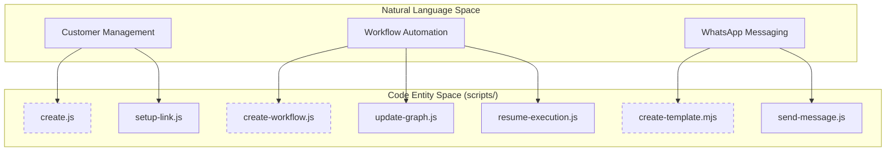
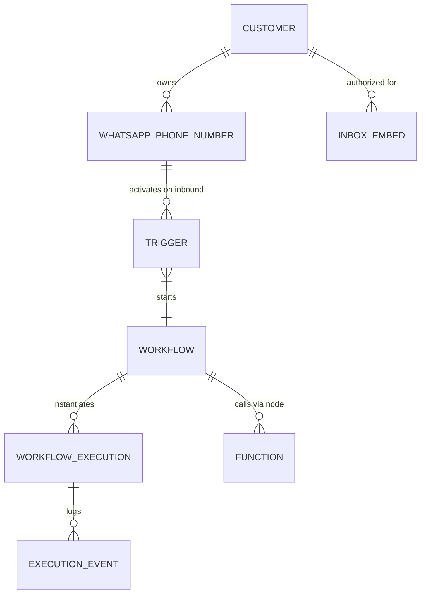

<!-- source: DeepWiki mcp.deepwiki.com · repo gokapso/agent-skills · page 5 Platform API Reference · fetched 2026-10-27 -->

# Platform API Reference

Relevant source files

The following files were used as context for generating this wiki page:

- [skills/automate-whatsapp/references/workflow-reference.md](skills/automate-whatsapp/references/workflow-reference.md)
- [skills/integrate-whatsapp/references/platform-api-reference.md](skills/integrate-whatsapp/references/platform-api-reference.md)

The Kapso Platform API is the unified interface for managing multi-tenant WhatsApp connections, workflow automations, and AI agents. It is divided into two primary entry points: the **Platform API** for resource management and the **Meta Proxy** for direct WhatsApp Cloud API interactions.

## API Architecture

The platform follows a RESTful architecture with a centralized authentication mechanism. It provides high-level abstractions for complex Meta Business operations while offering granular control over workflow execution states.

### Base URLs and Authentication
All requests require an `X-API-Key` header for authentication [skills/integrate-whatsapp/references/platform-api-reference.md:5-9]().

| Service | Base URL | Purpose |
| :--- | :--- | :--- |
| **Platform API** | `https://api.kapso.ai/platform/v1` | CRUD for Customers, Workflows, Functions, and Logs. |
| **Meta Proxy** | `https://api.kapso.ai/meta/whatsapp/v24.0` | Transparent proxy for WhatsApp Cloud API (Messages, Templates). |

### Global Utilities
- **OpenAPI Explorer:** Each skill module provides scripts that act as a CLI wrapper for these endpoints, located in the `scripts/` directory of each skill.
- **Pagination:** High-volume endpoints (Executions, Messages, Logs) use **cursor-based pagination**. Responses include a `paging` object with `after` and `before` cursors [skills/automate-whatsapp/references/workflow-reference.md:70-73]().
- **Concurrency:** Workflow updates utilize a `lock_version` model to prevent mid-air collisions during graph edits [skills/automate-whatsapp/references/workflow-reference.md:76]().

### API Space to Code Entity Mapping

The following diagram bridges the high-level API domains to the specific scripts and logic found in the codebase.

**Domain-to-Script Mapping**

Sources: [skills/integrate-whatsapp/references/platform-api-reference.md:20-40](), [skills/automate-whatsapp/references/workflow-reference.md:16-44]()

---

## Resource Domains

### 1. Customer & Phone Number Endpoints
This domain handles multi-tenancy. It allows you to create `customer` entities and generate Meta Embedded Signup `setup_links` so your end-users can connect their own WhatsApp Business Accounts (WABA) to your platform.

**Key Operations:**
- Provisioning customers and managing their connection lifecycle.
- Retrieving `phone_number_id`s for specific customers.
- Generating secure `inbox_embeds` for UI integration.

For details, see [Customer & Phone Number Endpoints](#5.1).

### 2. Workflow, Function & Execution Endpoints
This domain manages the "Automate" capabilities of the platform. It provides endpoints for deploying serverless functions, defining directed-graph workflows, and inspecting real-time execution states.

**Key Operations:**
- **Graph Management:** Updating node definitions and edge logic via `PATCH /workflows/:id`.
- **Execution Control:** Resuming paused executions (e.g., after a `wait_for_response` node) via `/resume`.
- **Function Deployment:** Managing the lifecycle of serverless code used in `function` or `decide` nodes.

For details, see [Workflow, Function & Execution Endpoints](#5.2).

### 3. Observability & Logs
The API provides deep visibility into the communication layer.
- **API Logs:** `GET /api_logs` for request/response history [skills/integrate-whatsapp/references/platform-api-reference.md:115]().
- **Webhook Deliveries:** `GET /webhook_deliveries` to debug payload arrivals and retry statuses [skills/integrate-whatsapp/references/platform-api-reference.md:116]().
- **Message Inspection:** `GET /whatsapp/messages/:id` to track the status (sent, delivered, read) of specific WAMIDs [skills/integrate-whatsapp/references/platform-api-reference.md:48-49]().

---

## Technical Entity Relationships

This diagram illustrates how the Platform API resources relate to one another within the system backend.

**Resource Relationship Diagram**

Sources: [skills/integrate-whatsapp/references/platform-api-reference.md:20-112](), [skills/automate-whatsapp/references/workflow-reference.md:45-68]()

---

## Usage Guidance
- **Local Development:** Prefer the Kapso CLI (`kapso push/pull`) for workflow and function edits. Use the Platform API endpoints primarily for programmatic triggers or custom dashboard integrations [skills/automate-whatsapp/references/workflow-reference.md:5-7]().
- **Variables:** Variable CRUD (Create/Update/Delete) is restricted via the Platform API to maintain graph integrity; variables should be managed through the workflow definition [skills/automate-whatsapp/references/workflow-reference.md:68]().
- **Meta Proxy:** Always use the Proxy for `template` and `media` operations to ensure Kapso can track message statuses and handle authentication headers automatically [skills/integrate-whatsapp/references/platform-api-reference.md:18-19]().

Sources: [skills/integrate-whatsapp/references/platform-api-reference.md:1-130](), [skills/automate-whatsapp/references/workflow-reference.md:1-108]()

---

