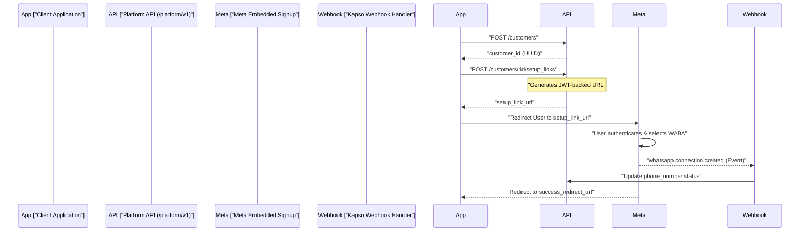
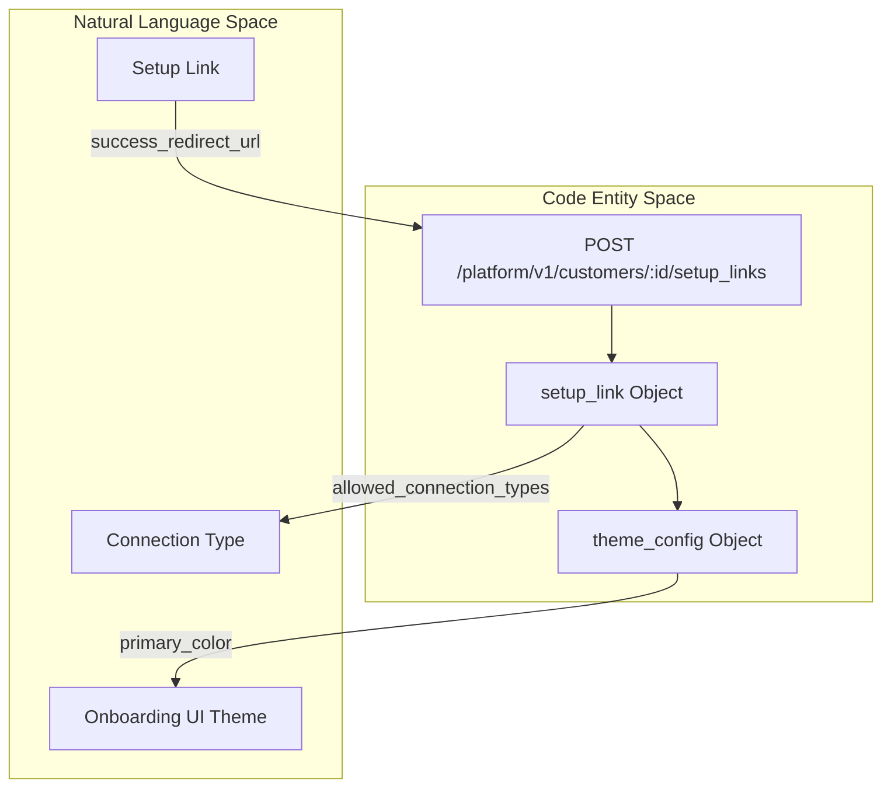

<!-- source: DeepWiki mcp.deepwiki.com · repo gokapso/agent-skills · page 5.1 Customer & Phone Number Endpoints · fetched 2026-10-27 -->

# Customer & Phone Number Endpoints

<details>
<summary>Relevant source files</summary>

The following files were used as context for generating this wiki page:

- [skills/integrate-whatsapp/references/platform-api-reference.md](skills/integrate-whatsapp/references/platform-api-reference.md)
- [skills/integrate-whatsapp/references/setup-links.md](skills/integrate-whatsapp/references/setup-links.md)
- [skills/integrate-whatsapp/references/whatsapp-cloud-api-js.md](skills/integrate-whatsapp/references/whatsapp-cloud-api-js.md)

</details>


This page provides a detailed technical reference for the Kapso Platform API endpoints dedicated to multi-tenant customer management and WhatsApp phone number provisioning. These endpoints enable developers to build onboarding flows where end-users connect their own WhatsApp Business accounts (WABA) to a platform.

## Overview of Multi-tenant Onboarding

The multi-tenant architecture uses a `Customer` entity as a container for WhatsApp configurations. The onboarding flow typically follows a four-step sequence:
1. **Create Customer**: Establish a unique identity for your end-user.
2. **Generate Setup Link**: Create a short-lived URL for the Meta Embedded Signup flow.
3. **Embedded Signup**: The customer authenticates with Facebook and selects/creates a WABA.
4. **Provisioning**: Kapso detects the connection via webhooks and provisions the `phone_number_id` for use.

### Data Flow: From Customer Creation to Connection

The following diagram illustrates the interaction between the Platform API, the Customer, and Meta's infrastructure during onboarding.

**Customer Onboarding Logic Flow**

Sources: [skills/integrate-whatsapp/references/platform-api-reference.md:20-30](), [skills/integrate-whatsapp/references/setup-links.md:6-26]()

---

## Customer Management

Customers are the primary organizational unit for multi-tenancy. If you are only sending messages from your own organization's number, these endpoints can be bypassed.

### POST /customers
Creates a new customer record.
*   **Purpose**: To generate a `customer_id` required for setup links.
*   **Auth**: Requires `X-API-Key`.

### GET /whatsapp/phone_numbers
Retrieves phone numbers, with optional filtering by customer.
*   **Query Parameter**: `customer_id=<uuid>`
*   **Use Case**: Used to verify which numbers are currently active for a specific tenant.

Sources: [skills/integrate-whatsapp/references/platform-api-reference.md:31-36]()

---

## Setup Links

Setup links are the mechanism for initiating the Meta Embedded Signup flow. They are short-lived (30 days) and only one can be active per customer at a time; creating a new link automatically revokes the previous one.

### POST /customers/:id/setup_links
Generates a customized onboarding URL.

| Field | Type | Description |
| :--- | :--- | :--- |
| `success_redirect_url` | string | URL the user is sent to after successful connection. |
| `failure_redirect_url` | string | URL the user is sent to if they cancel or an error occurs. |
| `allowed_connection_types` | array | `["coexistence"]`, `["dedicated"]`, or both. |
| `provision_phone_number` | boolean | If true, Kapso provisions a number automatically. |
| `phone_number_country_isos`| array | List of ISO codes (e.g., `["US"]`) for provisioning. |
| `language` | string | `en`, `es`, `pt`, `hi`, `id`, `ar`. Defaults to browser detection. |
| `reconnect_phone_number` | string | E.164 number to refresh an existing connection. |

**Code Entity Mapping: Setup Link Configuration**

Sources: [skills/integrate-whatsapp/references/setup-links.md:13-24](), [skills/integrate-whatsapp/references/setup-links.md:85-91](), [skills/integrate-whatsapp/references/setup-links.md:132-145]()

### Connection Types
1.  **Coexistence**: Allows the user to continue using the WhatsApp Business App on their phone alongside the API. Limited to 5 messages/second.
2.  **Dedicated**: API-only access. Supports up to 1000 messages/second but disables the mobile app.

Sources: [skills/integrate-whatsapp/references/setup-links.md:28-40]()

---

## Phone Number Management

Once a connection is established, phone numbers are managed via the Platform API.

### POST /customers/:id/whatsapp/phone_numbers
Manually associates a phone number with a customer (rarely used if `provision_phone_number` is true in the setup link).

### Phone Number Resolution
To interact with a specific number via the SDK, you must resolve the display number to its internal `phone_number_id`.

```javascript
// Example using CLI to resolve ID
// kapso whatsapp numbers resolve --phone-number "+14155551234"
```
Sources: [skills/integrate-whatsapp/references/whatsapp-cloud-api-js.md:154-154](), [skills/integrate-whatsapp/references/platform-api-reference.md:35-36]()

---

## Inbox Embeds

The Inbox Embed API allows developers to generate secure, scoped iframe URLs for the Kapso WhatsApp Inbox.

### POST /inbox_embeds
Generates a `token` and `embed_url`.

*   **Envelope**: `inbox_embed`
*   **scope_type**:
    *   `project`: Access to all numbers in the project.
    *   `customer`: Access limited to a specific `customer_id`.
    *   `phone_number`: Access limited to a specific `phone_number_id`.
*   **Security**: The `token` is returned only once upon creation. Subsequent `GET` or `LIST` calls omit the secret.

Sources: [skills/integrate-whatsapp/references/platform-api-reference.md:53-65]()

---

## Implementation Detail: Meta Proxy

All interactions with WhatsApp (sending messages, fetching templates) should go through the Kapso Meta Proxy to ensure `X-API-Key` authentication and multi-tenant routing.

*   **Base URL**: `https://api.kapso.ai/meta/whatsapp/v24.0`
*   **SDK Usage**: The `WhatsAppClient` from `@kapso/whatsapp-cloud-api` handles the transformation of camelCase requests to the snake_case required by the Meta API.

**SDK Client Initialization**
```typescript
import { WhatsAppClient } from "@kapso/whatsapp-cloud-api";

const client = new WhatsAppClient({
  baseUrl: "https://api.kapso.ai/meta/whatsapp",
  kapsoApiKey: process.env.KAPSO_API_KEY!
});
```
Sources: [skills/integrate-whatsapp/references/whatsapp-cloud-api-js.md:19-26](), [skills/integrate-whatsapp/references/platform-api-reference.md:14-19]()

---

