# Page: Overview

# Overview

<details>
<summary>Relevant source files</summary>

The following files were used as context for generating this wiki page:

- [README.md](README.md)

</details>


The `agent-skills` repository provides a suite of specialized capabilities for the [Kapso](https://kapso.ai) platform, enabling AI agents to interact with the WhatsApp Business Platform. These skills follow the open [Agent Skills format](https://agentskills.io), allowing agents to discover and execute complex tasks through a combination of natural language instructions, executable scripts, and API references [README.md:1-8]().

## System Architecture

The repository bridges the gap between high-level agent instructions and the low-level Kapso Platform API. It is structured into three primary functional domains: integration, automation, and observation.

### From Natural Language to Code Entities

The following diagram illustrates how the abstract "Skill" concept maps to concrete filesystem entities and remote API resources.

**Skill Entity Mapping**
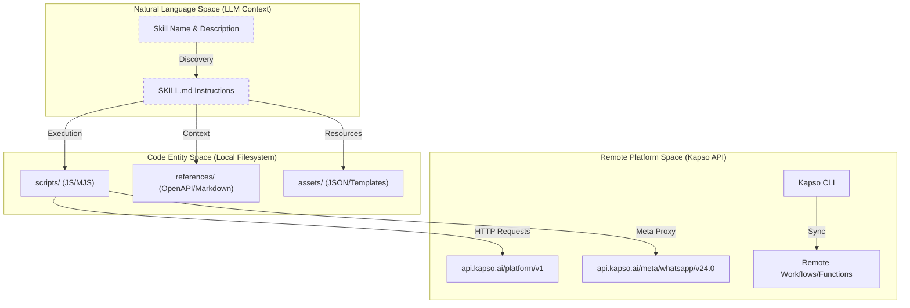
Sources: [README.md:35-48](), [README.md:61-80]()

## Core Skill Modules

The repository is organized into three main directories, each representing a distinct skill:

| Skill | Purpose | Key Capabilities |
|-------|---------|------------------|
| `integrate-whatsapp` | **Connectivity** | Embedded signup, message templates, WhatsApp Flows, and webhook management [README.md:51](). |
| `automate-whatsapp` | **Logic** | Graph-based workflows, AI agent nodes, serverless functions, and state management [README.md:52](). |
| `observe-whatsapp` | **Diagnostics** | Health checks, message tracing, and webhook delivery investigation [README.md:53](). |

### Logical Flow of Operations

The diagram below shows how these skills interact to manage a WhatsApp communication lifecycle.

**Operational Workflow**
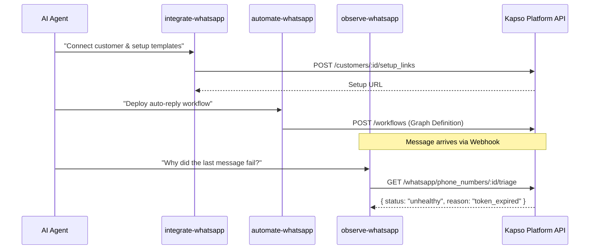
Sources: [README.md:49-54]()

## Environment & Setup

To use these skills, the environment must be configured with specific credentials to authorize requests against the Kapso Platform.

*   **API Configuration**: Requires `KAPSO_API_BASE_URL` (defaulting to `https://api.kapso.ai`) and a valid `KAPSO_API_KEY` [README.md:15-28]().
*   **Path Selection**: The system prefers the **Kapso CLI** for authenticated operations (e.g., `kapso login`) but provides standalone scripts as a fallback for environments where the CLI is not present [README.md:29-34]().

For detailed installation and authentication steps, see [Getting Started & Environment Setup](#1.1).

## Agent Skills Format

Each skill directory follows a strict structural pattern to support **progressive disclosure**. This technique ensures that agents only consume the minimum necessary context at startup, loading deeper instructions only when a specific task matches the skill's description [README.md:47-48]().

*   **SKILL.md**: The entry point containing YAML frontmatter (`name`, `description`) and detailed Markdown instructions [README.md:61-80]().
*   **Directory Layout**: Supporting files are organized into `scripts/`, `references/`, and `assets/` [README.md:39-45]().

For the full specification and metadata schema, see [Agent Skills Format & SKILL.md Specification](#1.2).

---
**Sources:**
* [README.md:1-80]()

---

# Page: Getting Started & Environment Setup

# Getting Started & Environment Setup

<details>
<summary>Relevant source files</summary>

The following files were used as context for generating this wiki page:

- [README.md](README.md)
- [skills/integrate-whatsapp/SKILL.md](skills/integrate-whatsapp/SKILL.md)

</details>


This page provides technical instructions for installing the Kapso Agent Skills package, configuring the necessary environment variables, and establishing a connection to the Kapso Platform. It details the dual-path execution strategy used by the system to prioritize CLI operations while maintaining script-based fallbacks.

## Installation

The Agent Skills package is distributed as a standardized collection of instructions and scripts. It can be added to an existing project using the `skills` CLI.

```bash
npx skills add gokapso/agent-skills
```
Sources: [README.md:9-13]()

## Environment Configuration

The skills require two primary environment variables to authenticate and route requests to the Kapso Platform API. These must be set in the shell environment or a `.env` file before executing any scripts or CLI commands.

| Variable | Description | Required |
| :--- | :--- | :--- |
| `KAPSO_API_BASE_URL` | The Kapso API host. Typically `https://api.kapso.ai`. | Yes |
| `KAPSO_API_KEY` | The secret API key retrieved from [app.kapso.ai](https://app.kapso.ai). | Yes |

```bash
export KAPSO_API_BASE_URL="https://api.kapso.ai"
export KAPSO_API_KEY="your-api-key"
```
Sources: [README.md:15-28](), [skills/integrate-whatsapp/SKILL.md:14-17]()

## Authentication & Path Selection Logic

The Kapso Agent Skills architecture implements a **CLI-First** philosophy. This means that if the Kapso CLI is installed and authenticated, it should be the primary interface for operations. If the CLI is unavailable or does not support a specific granular operation, the system falls back to direct API calls via the provided scripts in the `scripts/` directory.

### Path Selection Flow
The following diagram illustrates how an agent or developer should decide between using the CLI or local scripts.

**Title: Execution Path Selection Logic**
```mermaid
graph TD
    "START"["Start Task"] --> "CHECK_CLI"{"Is Kapso CLI installed?"}
    "CHECK_CLI" -- "Yes" --> "CHECK_AUTH"{"Is 'kapso login' active?"}
    "CHECK_AUTH" -- "Yes" --> "CLI_PATH"["Use 'kapso' commands (e.g., 'kapso setup')"]
    "CHECK_CLI" -- "No" --> "SCRIPT_PATH"["Use Fallback Scripts (e.g., 'node scripts/create.js')"]
    "CHECK_AUTH" -- "No" --> "CLI_LOGIN"["Run 'kapso login'"]
    "CLI_LOGIN" --> "CLI_PATH"
    "CLI_PATH" --> "CHECK_SUPPORT"{"Does CLI support specific task?"}
    "CHECK_SUPPORT" -- "No" --> "SCRIPT_PATH"
    "CHECK_SUPPORT" -- "Yes" --> "FINISH"["Complete Task"]
    "SCRIPT_PATH" --> "ENV_CHECK"{"Are ENV vars set?"}
    "ENV_CHECK" -- "Yes" --> "FINISH"
    "ENV_CHECK" -- "No" --> "SET_ENV"["Set KAPSO_API_KEY"]
    "SET_ENV" --> "FINISH"
```
Sources: [README.md:29-34](), [skills/integrate-whatsapp/SKILL.md:8-19]()

## Connecting to the Platform

Once the environment is configured, the first step is typically establishing a session.

### 1. CLI Authentication
If using the CLI path, the user must authenticate to obtain a session token that persists locally.
```bash
kapso login
kapso status
```
Sources: [README.md:33-33](), [skills/integrate-whatsapp/SKILL.md:11-12]()

### 2. Direct API Authentication
When using the fallback scripts or direct `curl` commands, the `KAPSO_API_KEY` must be passed in the `X-API-Key` header.
```http
X-API-Key: <your-api-key>
```
Sources: [skills/integrate-whatsapp/SKILL.md:20-23]()

## Data Flow: From Environment to Code Entities

The following diagram bridges the natural language configuration steps to the specific code entities and identifiers used within the repository.

**Title: Configuration to Code Entity Mapping**
```mermaid
graph LR
    subgraph "Natural Language Space"
        "API_KEY_LABEL"["API Key"]
        "BASE_URL_LABEL"["Base URL"]
        "PHONE_ID_LABEL"["Phone Number ID"]
    end

    subgraph "Code Entity Space"
        "ENV_KEY"["process.env.KAPSO_API_KEY"]
        "ENV_URL"["process.env.KAPSO_API_BASE_URL"]
        "WS_CLIENT"["WhatsAppClient Class"]
        "SCRIPTS"["scripts/lib/env.js"]
    end

    "API_KEY_LABEL" --> "ENV_KEY"
    "BASE_URL_LABEL" --> "ENV_URL"
    "ENV_KEY" --> "WS_CLIENT"
    "ENV_URL" --> "WS_CLIENT"
    "ENV_KEY" --> "SCRIPTS"
    "ENV_URL" --> "SCRIPTS"
    "PHONE_ID_LABEL" --> "WS_CLIENT"
```
Sources: [README.md:24-27](), [skills/integrate-whatsapp/SKILL.md:142-149]()

## Progressive Disclosure Pattern

The skills are designed using a **progressive disclosure** pattern to minimize LLM context usage. At startup, the agent only loads the `name` and `description` from the YAML frontmatter of `SKILL.md`. Full instructions and script details are only loaded when the agent determines the skill is relevant to the current task.

| Component | File Path | Role |
| :--- | :--- | :--- |
| **Metadata** | `SKILL.md` (Frontmatter) | Name and high-level description for discovery. |
| **Instructions** | `SKILL.md` (Body) | Detailed technical steps and CLI command references. |
| **Logic** | `scripts/` | Executable JavaScript/Node.js files for specific tasks. |
| **Knowledge** | `references/` | Deep-dive documentation and API schemas. |

Sources: [README.md:37-48](), [README.md:61-80]()

---

# Page: Agent Skills Format & SKILL.md Specification

# Agent Skills Format & SKILL.md Specification

<details>
<summary>Relevant source files</summary>

The following files were used as context for generating this wiki page:

- [README.md](README.md)
- [skills/automate-whatsapp/SKILL.md](skills/automate-whatsapp/SKILL.md)

</details>


The Kapso Agent Skills repository follows the open **Agent Skills** format, a standardized directory structure designed to provide Large Language Models (LLMs) with executable scripts, domain-specific documentation, and operational instructions. This format prioritizes **progressive disclosure** to ensure that agents only consume high-value context when a specific task requires it.

[README.md:35-37]()

## Directory Layout

Each skill is encapsulated within its own directory. While only the `SKILL.md` file is strictly required, a mature skill typically includes several subdirectories to separate logic from documentation.

```text
skills/
└── <skill-name>/
    ├── SKILL.md          # Entrypoint: Metadata and high-level instructions
    ├── scripts/          # Executable JavaScript/Node.js scripts for task automation
    ├── references/       # Detailed technical specs, schemas, and deep-dive docs
    └── assets/           # Static resources, JSON templates, or example payloads
```

[README.md:39-45]()

### Component Roles
*   **SKILL.md**: Acts as the "system prompt extension." It contains the YAML frontmatter used for discovery and the primary "How-to" guides for the agent.
*   **scripts/**: Contains standalone Node.js scripts. These are the primary tools the agent executes to interact with the Kapso API.
*   **references/**: Used for technical depth that would otherwise bloat the LLM's context window (e.g., `graph-contract.md` or `node-types.md`).
*   **assets/**: Provides starting points for the agent, such as `agent-remote-sandbox-github-repo-example.json`.

[README.md:41-44](), [skills/automate-whatsapp/SKILL.md:133-133](), [skills/automate-whatsapp/SKILL.md:163-163]()

## The SKILL.md Specification

The `SKILL.md` file is the heart of the format. It uses a combination of YAML frontmatter and Markdown content to define the skill's identity and operational boundaries.

### YAML Frontmatter Schema
The frontmatter must be at the very top of the file, fenced by `---`.

| Field | Required | Description |
| :--- | :--- | :--- |
| `name` | Yes | A lowercase, hyphenated identifier (e.g., `automate-whatsapp`). |
| `description` | Yes | A concise summary (max 1024 chars) explaining when the agent should invoke this skill. |

[README.md:63-80]()

### Progressive Disclosure Pattern
To minimize context usage and prevent "hallucination" caused by irrelevant information, the format employs a two-stage discovery process:

1.  **Discovery (Minimal Context)**: The agent-hosting system only indexes the `name` and `description` from the frontmatter.
2.  **Activation (Full Context)**: Only when the agent determines the user's intent matches the `description` is the full content of `SKILL.md` (and potentially referenced files) loaded into the active context window.

[README.md:47-48]()

## Technical Implementation & Data Flow

The following diagram illustrates how an agent transitions from a natural language request to executing a specific code entity within the skill structure.

### From Natural Language to Script Execution
Title: Agent Skill Execution Flow
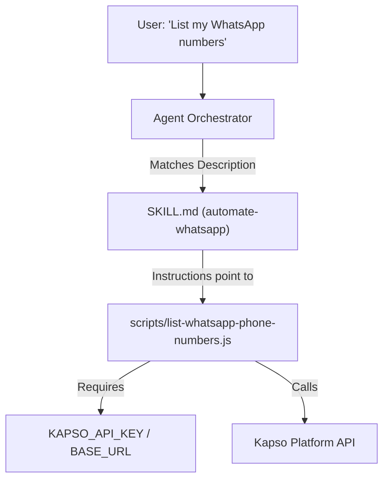
Sources: [README.md:20-22](), [README.md:47-48](), [skills/automate-whatsapp/SKILL.md:85-85]()

## Local Development vs. API Scripts

The format supports two distinct operational modes. The agent is instructed to prefer the **CLI-first path** when available, falling back to **direct scripts** in restricted environments.

### Data Entity Mapping
Title: Code Entity Mapping (CLI vs. Scripts)
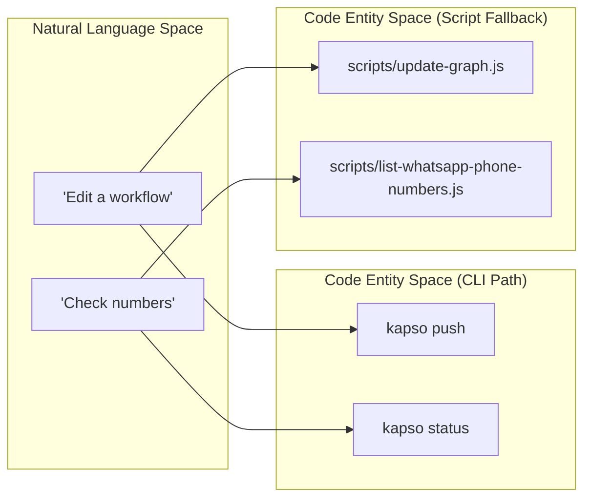
Sources: [README.md:31-33](), [skills/automate-whatsapp/SKILL.md:71-72](), [skills/automate-whatsapp/SKILL.md:80-81](), [skills/automate-whatsapp/SKILL.md:85-85](), [skills/automate-whatsapp/SKILL.md:94-94]()

### Script Requirements
Scripts within the `scripts/` directory are typically designed to be executed via `node`. They rely on environment variables for authentication:
*   `KAPSO_API_KEY`: Authenticates requests via the `X-API-Key` header.
*   `KAPSO_API_BASE_URL`: Defines the target environment (defaulting to `https://api.kapso.ai`).

[README.md:15-27](), [skills/automate-whatsapp/SKILL.md:20-22]()

## Graph and Function Rules
To ensure compatibility with the Kapso engine, the `SKILL.md` specifies strict constraints for the agent when it generates or modifies code entities.

### Graph Constraints
*   **Start Node**: Exactly one node with `id: "start"`.
*   **Immutability**: Existing node IDs must never be changed to maintain execution history.
*   **Naming**: New nodes must follow the pattern `{node_type}_{timestamp_ms}`.

[skills/automate-whatsapp/SKILL.md:156-161]()

### Function Constraints
Serverless functions managed by these skills must follow a specific signature compatible with the Kapso runtime:
*   **Signature**: `async function handler(request, env)`.
*   **No Exports**: Agents are instructed NOT to use `export` or `export default` within the script body.
*   **Return Type**: Must return a standard `Response` object.

[skills/automate-whatsapp/SKILL.md:167-178]()

Sources: [README.md:1-86](), [skills/automate-whatsapp/SKILL.md:1-194]()

---

# Page: Integrate WhatsApp Skill

# Integrate WhatsApp Skill

<details>
<summary>Relevant source files</summary>

The following files were used as context for generating this wiki page:

- [skills/integrate-whatsapp/SKILL.md](skills/integrate-whatsapp/SKILL.md)

</details>


The `integrate-whatsapp` skill provides the foundational tools to connect WhatsApp Business accounts to your product via the Kapso platform. It enables multi-tenant customer onboarding, automated messaging (text, templates, and interactive), WhatsApp Flow management, and a robust webhook system for event-driven architectures.

### High-Level Architecture

The skill operates by bridging your application to the Meta WhatsApp Business Platform through two primary API layers:
1.  **Kapso Platform API (`/platform/v1`)**: Handles customer entities, setup links, and webhook configurations [skills/integrate-whatsapp/SKILL.md:71-71]().
2.  **Meta Proxy API (`/meta/whatsapp/v24.0`)**: Provides a managed proxy for messaging, media, templates, and flows, using `phone_number_id` as the primary identifier [skills/integrate-whatsapp/SKILL.md:72-73]().

#### Natural Language to Code Entity Space: Core Identifiers
The following diagram maps high-level WhatsApp concepts to the specific identifiers and scripts used in the codebase.

"WhatsApp Entity Mapping"
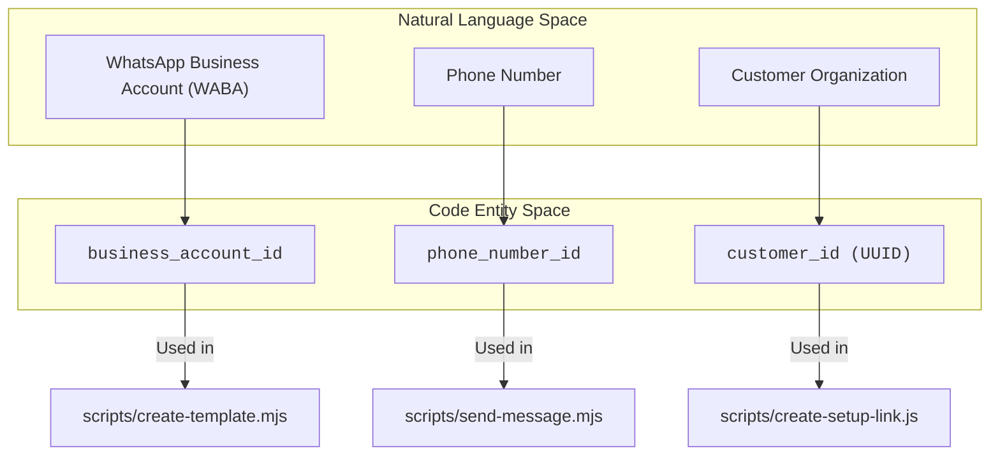
Sources: [skills/integrate-whatsapp/SKILL.md:111-118](), [skills/integrate-whatsapp/SKILL.md:47-50]()

---

### Customer Onboarding & Setup Links
Onboarding involves creating a `customer` entity and generating a "Setup Link" for Meta's Embedded Signup. This process can be configured to provision new numbers or use existing ones, with support for specific country ISO codes and redirect URLs to handle the post-onboarding UX [skills/integrate-whatsapp/SKILL.md:56-65]().

For details, see [Customer Onboarding & Setup Links](#2.1).

### Messaging: Text, Templates & Interactive Messages
The skill supports the full spectrum of WhatsApp messaging. Plain text messages are sent via the `WhatsAppClient` SDK or direct proxy calls [skills/integrate-whatsapp/SKILL.md:141-160](). For outbound notifications outside the 24-hour window, the skill manages the lifecycle of Templates (Marketing, Utility, Authentication) [skills/integrate-whatsapp/SKILL.md:162-168](). Interactive messages, including buttons and list menus, are used for structured user input [skills/integrate-whatsapp/SKILL.md:170-176]().

For details, see [Messaging: Text, Templates & Interactive Messages](#2.2).

### WhatsApp Flows
WhatsApp Flows allow for structured, multi-step interactions (like booking appointments or collecting feedback) directly within the chat. This skill provides scripts to create, update, and publish flows, as well as the infrastructure to host data endpoints for dynamic flows [skills/integrate-whatsapp/SKILL.md:3-3]().

For details, see [WhatsApp Flows](#2.3).

### Webhooks: Events, Delivery & Verification
The webhook system is divided into **Project-level** (connection lifecycle) and **Phone-number-level** (messages and conversations) scopes [skills/integrate-whatsapp/SKILL.md:81-84](). It supports features like message buffering to prevent race conditions and payload versioning (`v2` recommended) [skills/integrate-whatsapp/SKILL.md:94-95]().

For details, see [Webhooks: Events, Delivery & Verification](#2.4).

### Integrate WhatsApp Scripts Reference
The `scripts/` directory contains a comprehensive set of CLI tools for managing the integration without writing custom code initially. These include customer CRUD, template submission, and flow management utilities.

For details, see [Integrate WhatsApp Scripts Reference](#2.5).

---

### Integration Workflow
The following diagram illustrates the sequence from onboarding a customer to receiving their first message.

"Onboarding to Messaging Workflow"
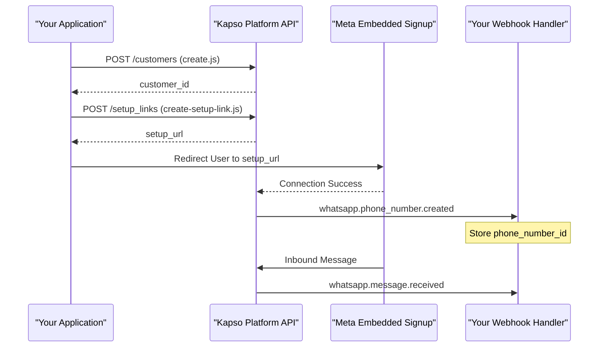
Sources: [skills/integrate-whatsapp/SKILL.md:30-54](), [skills/integrate-whatsapp/SKILL.md:75-84]()

---

# Page: Customer Onboarding & Setup Links

# Customer Onboarding & Setup Links

<details>
<summary>Relevant source files</summary>

The following files were used as context for generating this wiki page:

- [skills/integrate-whatsapp/references/detecting-whatsapp-connection.md](skills/integrate-whatsapp/references/detecting-whatsapp-connection.md)
- [skills/integrate-whatsapp/references/platform-api-reference.md](skills/integrate-whatsapp/references/platform-api-reference.md)
- [skills/integrate-whatsapp/references/setup-links.md](skills/integrate-whatsapp/references/setup-links.md)
- [skills/integrate-whatsapp/references/whatsapp-cloud-api-js.md](skills/integrate-whatsapp/references/whatsapp-cloud-api-js.md)

</details>


The Kapso platform enables multi-tenant WhatsApp integration, allowing your customers to connect their own WhatsApp Business Accounts (WABA) to your application. This process is powered by **Setup Links**, which wrap Meta's Embedded Signup flow into a customizable, hosted experience.

### Onboarding Lifecycle

The onboarding flow follows a standard sequence:
1.  **Customer Creation**: Establish a `customer` entity in the Kapso platform.
2.  **Link Generation**: Generate a unique `setup_link` for that customer.
3.  **Embedded Signup**: The customer completes the Meta OAuth flow.
4.  **Connection Detection**: Your system detects completion via webhooks or URL redirects.
5.  **Provisioning (Optional)**: Kapso automatically assigns a phone number to the new WABA.

---

### 1. Creating Customers and Setup Links

Before a customer can connect WhatsApp, they must exist as a `customer` resource. This allows Kapso to isolate WABAs, phone numbers, and message history per tenant [skills/integrate-whatsapp/references/platform-api-reference.md:20-22]().

#### Data Flow: Setup Link Generation
This diagram bridges the high-level onboarding request to the specific Platform API entities.

Title: Customer Onboarding Data Flow
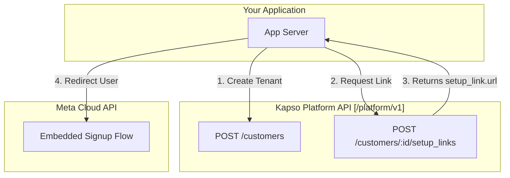
**Sources:** [skills/integrate-whatsapp/references/platform-api-reference.md:30-36](), [skills/integrate-whatsapp/references/setup-links.md:198-231]()

#### Implementation Example
To generate a setup link, call the `/setup_links` endpoint for a specific `customer_id` [skills/integrate-whatsapp/references/setup-links.md:13-21]().

```javascript
// Example implementation for generating a setup link
const response = await fetch(`${KAPSO_API_BASE_URL}/platform/v1/customers/${customerId}/setup_links`, {
  method: 'POST',
  headers: { 'X-API-Key': process.env.KAPSO_API_KEY, 'Content-Type': 'application/json' },
  body: JSON.stringify({
    setup_link: {
      success_redirect_url: 'https://app.com/callback/success',
      failure_redirect_url: 'https://app.com/callback/error',
      allowed_connection_types: ['dedicated'],
      provision_phone_number: true
    }
  })
});
```
**Sources:** [skills/integrate-whatsapp/references/setup-links.md:198-224]()

---

### 2. Connection Types & Provisioning

Kapso supports two distinct connection models for WhatsApp. The `allowed_connection_types` array in the setup link configuration controls which options the customer sees [skills/integrate-whatsapp/references/setup-links.md:95-124]().

| Connection Type | Throughput | App Access | Best Use Case |
| :--- | :--- | :--- | :--- |
| **Coexistence** | 5 msg/sec | Yes (WA Business App) | Small businesses, manual support |
| **Dedicated** | 1000 msg/sec | No (API Only) | High-volume automation, AI agents |

**Sources:** [skills/integrate-whatsapp/references/setup-links.md:28-40]()

#### Phone Number Provisioning
If `provision_phone_number` is set to `true`, Kapso will automatically purchase and assign a phone number to the customer's WABA upon successful signup [skills/integrate-whatsapp/references/setup-links.md:149-160](). 
*   **Default**: US numbers (`["US"]`).
*   **Constraint**: If `reconnect_phone_number` is used, provisioning is forced to `false` [skills/integrate-whatsapp/references/setup-links.md:190-191]().

---

### 3. Detecting Connections

Once the customer completes the Meta flow, you must capture the resulting `phone_number_id`.

#### Method A: Project Webhooks (Recommended)
Configure a webhook for the `whatsapp.phone_number.created` event. This is the most reliable method for backend synchronization [skills/integrate-whatsapp/references/detecting-whatsapp-connection.md:8-11]().

Title: Webhook Connection Detection
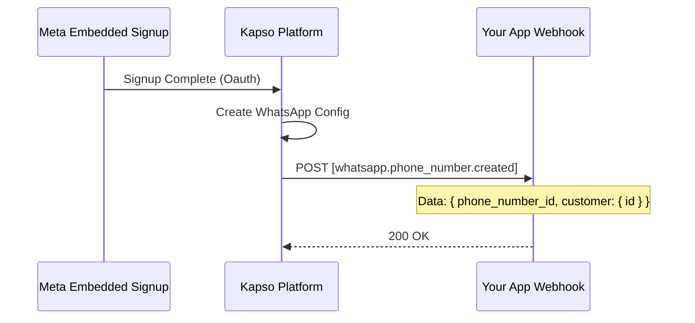
**Sources:** [skills/integrate-whatsapp/references/detecting-whatsapp-connection.md:21-33]()

#### Method B: Success Redirect
The customer is redirected to your `success_redirect_url` with query parameters containing the connection details [skills/integrate-whatsapp/references/detecting-whatsapp-connection.md:61-63]().

**Key Query Parameters:**
*   `phone_number_id`: The primary identifier for sending messages [skills/integrate-whatsapp/references/detecting-whatsapp-connection.md:97-97]().
*   `display_phone_number`: The E.164 formatted number [skills/integrate-whatsapp/references/detecting-whatsapp-connection.md:100-100]().
*   `status`: Will be `completed` [skills/integrate-whatsapp/references/detecting-whatsapp-connection.md:96-96]().

---

### 4. Error Handling & Reconnection

#### Onboarding Errors
If setup fails, the user is sent to the `failure_redirect_url` with an `error_code` [skills/integrate-whatsapp/references/detecting-whatsapp-connection.md:135-142]().

| Error Code | Meaning |
| :--- | :--- |
| `facebook_auth_failed` | User cancelled the Facebook login popup |
| `phone_verification_failed` | The number provided failed Meta's OTP check |
| `link_expired` | The 30-day link validity period has passed |
| `already_used` | The setup link has already been completed |

**Sources:** [skills/integrate-whatsapp/references/detecting-whatsapp-connection.md:143-149]()

#### Reconnecting Existing Numbers
If a customer's token is revoked or they change their Meta password, you can generate a "refresh" link using the `reconnect_phone_number` field [skills/integrate-whatsapp/references/setup-links.md:176-186]().
*   **Behavior**: Forces the customer to select the specific existing number during signup.
*   **Validation**: Fails if the customer selects a different WABA or number than the one specified [skills/integrate-whatsapp/references/setup-links.md:192-192]().

**Sources:** [skills/integrate-whatsapp/references/setup-links.md:188-194]()

---

# Page: Messaging: Text, Templates & Interactive Messages

# Messaging: Text, Templates & Interactive Messages

<details>
<summary>Relevant source files</summary>

The following files were used as context for generating this wiki page:

- [skills/integrate-whatsapp/SKILL.md](skills/integrate-whatsapp/SKILL.md)
- [skills/integrate-whatsapp/references/platform-api-reference.md](skills/integrate-whatsapp/references/platform-api-reference.md)
- [skills/integrate-whatsapp/references/setup-links.md](skills/integrate-whatsapp/references/setup-links.md)
- [skills/integrate-whatsapp/references/whatsapp-cloud-api-js.md](skills/integrate-whatsapp/references/whatsapp-cloud-api-js.md)

</details>


This page covers the outbound messaging capabilities of the `integrate-whatsapp` skill. It details how to send plain text, manage and send pre-approved templates, and utilize interactive message types such as buttons and lists. All messaging operations are routed through the Kapso Meta Proxy to ensure authentication and multi-tenant isolation.

## Messaging Architecture

Outbound messages are sent via the Meta Proxy base URL: `https://api.kapso.ai/meta/whatsapp/v24.0` [skills/integrate-whatsapp/references/platform-api-reference.md:16-16](). The system uses two primary identifiers:
1.  **`phone_number_id`**: Used for sending messages and media uploads [skills/integrate-whatsapp/SKILL.md:118-118]().
2.  **`business_account_id` (WABA ID)**: Used for Template CRUD operations [skills/integrate-whatsapp/SKILL.md:117-117]().

### Data Flow: SDK to Meta Proxy

The following diagram illustrates the flow from a developer's application using the `@kapso/whatsapp-cloud-api` SDK to the final delivery via Meta.

**Messaging Entity Map**
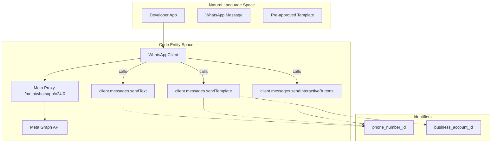
Sources: [skills/integrate-whatsapp/SKILL.md:141-160](), [skills/integrate-whatsapp/references/whatsapp-cloud-api-js.md:19-26]()

## WhatsAppClient SDK

The `@kapso/whatsapp-cloud-api` SDK provides a typed interface for interacting with the Kapso Meta Proxy.

### Initialization
To use the SDK with Kapso, you must provide the `baseUrl` and your `KAPSO_API_KEY` [skills/integrate-whatsapp/references/whatsapp-cloud-api-js.md:19-26]().

```ts
import { WhatsAppClient } from "@kapso/whatsapp-cloud-api";

const client = new WhatsAppClient({
  baseUrl: "https://api.kapso.ai/meta/whatsapp",
  kapsoApiKey: process.env.KAPSO_API_KEY!
});
```

### Text Messages
Text messages are the simplest form of communication. They can only be sent if there is an active 24-hour session window initiated by the user, or if they are responding to a user message [skills/integrate-whatsapp/SKILL.md:172-172]().

*   **SDK Method**: `client.messages.sendText` [skills/integrate-whatsapp/references/whatsapp-cloud-api-js.md:39-44]()
*   **CLI Command**: `kapso whatsapp messages send --phone-number-id <ID> --to <WA_ID> --text "..."` [skills/integrate-whatsapp/SKILL.md:126-126]()

Sources: [skills/integrate-whatsapp/SKILL.md:151-160](), [skills/integrate-whatsapp/references/whatsapp-cloud-api-js.md:36-44]()

## Template Management

Templates are required for business-initiated conversations outside the 24-hour window. They must be pre-approved by Meta.

### Template Categories
When creating templates, you must specify a category:
*   **MARKETING**: Promotional offers, product announcements.
*   **UTILITY**: Order updates, account alerts.
*   **AUTHENTICATION**: One-time passwords (OTPs).

### Parameter Types
Kapso supports two methods for injecting dynamic content into templates:
1.  **POSITIONAL**: Parameters are referenced by index (e.g., `{{1}}`, `{{2}}`).
2.  **NAMED**: Parameters are referenced by specific keys (e.g., `order_id`). This is the modern standard for clarity [skills/integrate-whatsapp/references/whatsapp-cloud-api-js.md:74-74]().

### Template Lifecycle
1.  **Discovery**: Resolve the `business_account_id` using `kapso whatsapp numbers resolve` [skills/integrate-whatsapp/SKILL.md:117-117]().
2.  **Creation**: Use `node scripts/create-template.mjs --business-account-id <WABA_ID> --file <payload.json>` [skills/integrate-whatsapp/SKILL.md:166-166]().
3.  **Status Check**: Monitor approval status via `node scripts/template-status.mjs` [skills/integrate-whatsapp/SKILL.md:167-167]().
4.  **Sending**: Use `client.messages.sendTemplate` [skills/integrate-whatsapp/references/whatsapp-cloud-api-js.md:63-80]().

Sources: [skills/integrate-whatsapp/SKILL.md:162-169](), [skills/integrate-whatsapp/references/whatsapp-cloud-api-js.md:61-80]()

## Interactive Messages

Interactive messages provide a richer UI within WhatsApp. These require an active 24-hour session window [skills/integrate-whatsapp/SKILL.md:172-172]().

| Type | Description | SDK Method |
| :--- | :--- | :--- |
| **Buttons** | Up to 3 quick-reply buttons. | `sendInteractiveButtons` |
| **Lists** | A menu with up to 10 rows. | `sendRaw` (with interactive list payload) |
| **CTA URL** | Buttons that open a web browser. | `sendRaw` (with cta_url payload) |
| **Catalog** | Displays product sets from a Meta Catalog. | `sendRaw` |

### Example: Interactive Buttons
```ts
await client.messages.sendInteractiveButtons({
  phoneNumberId: "<PHONE_NUMBER_ID>",
  to: "+15551234567",
  bodyText: "Choose an option",
  buttons: [
    { id: "accept", title: "Accept" },
    { id: "decline", title: "Decline" }
  ]
});
```
Sources: [skills/integrate-whatsapp/SKILL.md:170-177](), [skills/integrate-whatsapp/references/whatsapp-cloud-api-js.md:82-94]()

## Messaging History & Inspection

Kapso provides specialized endpoints to query message history, which are not available in the standard Meta Graph API [skills/integrate-whatsapp/references/whatsapp-cloud-api-js.md:157-157]().

**Message Retrieval Logic**
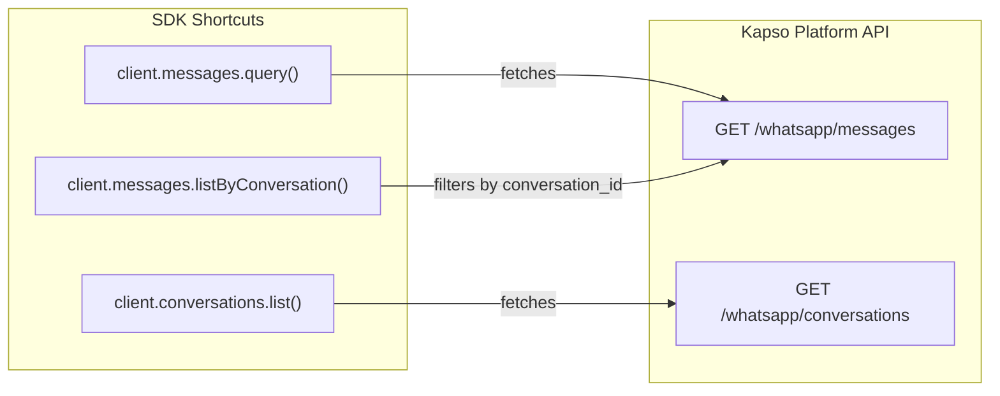

### Key Query Parameters for `GET /whatsapp/messages`
*   `phone_number_id`: Filter by the sender number.
*   `direction`: `inbound` or `outbound`.
*   `status`: `pending`, `sent`, `delivered`, `read`, or `failed`.
*   `limit`, `after`, `before`: Cursor-based pagination [skills/integrate-whatsapp/references/platform-api-reference.md:66-70]().

Sources: [skills/integrate-whatsapp/references/platform-api-reference.md:47-52](), [skills/integrate-whatsapp/references/whatsapp-cloud-api-js.md:96-142]()

---

# Page: WhatsApp Flows

# WhatsApp Flows

<details>
<summary>Relevant source files</summary>

The following files were used as context for generating this wiki page:

- [skills/integrate-whatsapp/SKILL.md](skills/integrate-whatsapp/SKILL.md)
- [skills/integrate-whatsapp/references/platform-api-reference.md](skills/integrate-whatsapp/references/platform-api-reference.md)

</details>


WhatsApp Flows allow for the creation of structured, multi-step interactions within a WhatsApp chat, enabling tasks like booking appointments, gathering feedback, or processing orders without leaving the app. The Kapso platform facilitates the lifecycle of these flows, from creation and JSON schema management to secure data exchange via encrypted endpoints.

### Flow Lifecycle and Architecture

WhatsApp Flows operate through a defined lifecycle that transitions between the Meta client and a data endpoint (hosted as a Kapso Function). The integration supports two primary types of flows:
1.  **Static Flows**: The entire UI and logic are defined in the Flow JSON.
2.  **Dynamic Flows**: The flow requests data from an endpoint at specific stages (INIT, data_exchange, or BACK) to populate fields or determine the next screen.

#### Data Exchange Lifecycle

The following diagram illustrates the interaction between the WhatsApp Client, Meta's servers, and the Kapso infrastructure during a dynamic flow execution.

**WhatsApp Flow Execution Sequence**
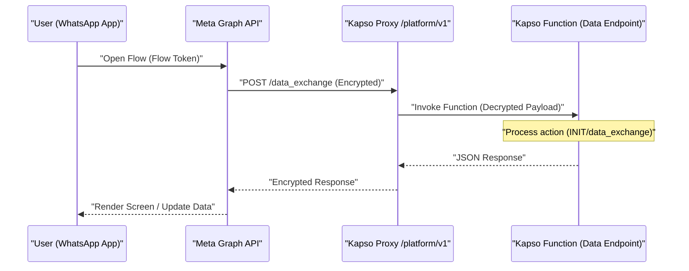
**Sources:** [skills/integrate-whatsapp/SKILL.md:3-4](), [skills/integrate-whatsapp/references/platform-api-reference.md:126-128]()

### Encryption and Security

Meta requires that all communication with a WhatsApp Flow data endpoint be encrypted using an asymmetric key pair. Kapso manages this complexity by acting as the decryption layer before passing the request to your business logic.

*   **Public Key**: Registered with Meta when creating or updating the flow.
*   **Private Key**: Used by the Kapso platform to decrypt incoming `POST` requests from Meta.
*   **Flow Token**: A unique identifier generated when sending a flow message. It is passed back to the data endpoint to maintain session context.

### Implementation Reference

#### Creating and Managing Flows
Flows are managed through the Kapso Platform API and Meta Proxy. The process involves creating the flow container, uploading the UI schema (JSON), and publishing it.

| Action | Code Entity / Script | API Endpoint |
| :--- | :--- | :--- |
| **Create Flow** | `scripts/create-flow.js` | `POST /meta/whatsapp/v24.0/{waba_id}/flows` |
| **Update JSON** | `scripts/update-flow-json.js` | `POST /meta/whatsapp/v24.0/{flow_id}/assets` |
| **Publish** | `scripts/publish-flow.js` | `POST /meta/whatsapp/v24.0/{flow_id}/publish` |
| **Data Endpoint** | `automate-whatsapp` Functions | `POST /platform/v1/functions/{id}/invoke` |

**Sources:** [skills/integrate-whatsapp/SKILL.md:164-168](), [skills/integrate-whatsapp/references/platform-api-reference.md:105-112]()

#### Data Endpoint Architecture
When a flow is configured with a `data_api_version`, Meta sends a request to the configured URL. In the Kapso ecosystem, this URL typically points to a **Kapso Function**.

**Code-to-System Mapping: Data Endpoint Flow**
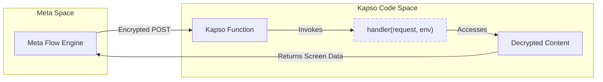
**Sources:** [skills/automate-whatsapp/SKILL.md:3.4](), [skills/integrate-whatsapp/references/platform-api-reference.md:105-112]()

### Sending a Flow Message
Flows are delivered to users either as **Interactive Messages** (within a 24-hour window) or as **Templates**.

1.  **Interactive Flow**: Uses the `flow` type within the interactive message object. It requires a `flow_token` and `flow_action` (e.g., `navigate` or `data_exchange`).
2.  **Template Flow**: A pre-approved template containing a "Flow" button.

**Key SDK Interface:**
The `WhatsAppClient` from `@kapso/whatsapp-cloud-api` provides the interface for sending these messages.

```ts
// Example: Sending a Flow via SDK
await client.messages.sendInteractive({
  phoneNumberId: "YOUR_PHONE_NUMBER_ID",
  to: "USER_PHONE_NUMBER",
  interactive: {
    type: "flow",
    header: { type: "text", text: "Appointment Booking" },
    body: { text: "Please fill out the form to book your slot." },
    action: {
      name: "flow",
      parameters: {
        flow_token: "unique_session_id_123",
        flow_id: "FLOW_ID",
        flow_cta: "Book Now",
        flow_action: "navigate",
        flow_screen: "START_SCREEN"
      }
    }
  }
});
```
**Sources:** [skills/integrate-whatsapp/SKILL.md:142-149](), [skills/integrate-whatsapp/SKILL.md:170-176]()

### Script Reference for Flow Management

The `integrate-whatsapp` skill includes several utility scripts to manage the flow lifecycle:

*   **`create-flow.js`**: Initializes a new flow container under a WhatsApp Business Account (WABA). Requires the `business_account_id`.
*   **`update-flow-json.js`**: Uploads the `flow.json` file which defines the screens, input fields, and validation logic.
*   **`publish-flow.js`**: Transitions a flow from `DRAFT` to `PUBLISHED` status, making it available to end-users. Note that published flows have limited editability.

**Sources:** [skills/integrate-whatsapp/SKILL.md:164-168](), [skills/integrate-whatsapp/references/platform-api-reference.md:126-128]()

---

# Page: Webhooks: Events, Delivery & Verification

# Webhooks: Events, Delivery & Verification

<details>
<summary>Relevant source files</summary>

The following files were used as context for generating this wiki page:

- [skills/integrate-whatsapp/SKILL.md](skills/integrate-whatsapp/SKILL.md)
- [skills/integrate-whatsapp/references/webhooks-event-types.md](skills/integrate-whatsapp/references/webhooks-event-types.md)
- [skills/integrate-whatsapp/references/webhooks-overview.md](skills/integrate-whatsapp/references/webhooks-overview.md)
- [skills/integrate-whatsapp/references/webhooks-reference.md](skills/integrate-whatsapp/references/webhooks-reference.md)

</details>


The Kapso webhook system provides real-time event notifications for WhatsApp interactions, connection lifecycles, and automation workflows. It supports two distinct scopes (Project vs. Phone-number) and two delivery formats (Kapso Event-based vs. Raw Meta forwarding).

## Webhook Scopes & Kinds

Webhooks are partitioned by scope to ensure data isolation and efficient routing [skills/integrate-whatsapp/references/webhooks-reference.md:3-9]().

### Scopes
| Scope | Target Entity | Event Types |
|-------|---------------|-------------|
| **Project** | `project_id` | Lifecycle (`whatsapp.phone_number.created`) and Workflow events (`workflow.execution.*`) [skills/integrate-whatsapp/references/webhooks-overview.md:9-12](). |
| **Phone-number** | `phone_number_id` | Messaging (`whatsapp.message.*`) and Conversation (`whatsapp.conversation.*`) [skills/integrate-whatsapp/references/webhooks-overview.md:13-16](). |

### Delivery Kinds
*   **Kapso Webhooks (Default):** Provides enriched, event-based payloads, server-side filtering, message buffering, and signature verification [skills/integrate-whatsapp/references/webhooks-overview.md:20]().
*   **Meta Webhooks:** Forwards raw payloads directly from the Meta Graph API. Does not support Kapso filtering or buffering. Includes `X-Idempotency-Key` for deduplication [skills/integrate-whatsapp/references/webhooks-overview.md:21-23]().

### Configuration Parameters
Webhooks are managed via the Platform API or CLI scripts [skills/integrate-whatsapp/SKILL.md:86-88]().
*   `payload_version`: `v2` is recommended, placing `phone_number_id` at the root [skills/integrate-whatsapp/references/webhooks-reference.md:49]().
*   `active`: Boolean toggle to enable/disable delivery [skills/integrate-whatsapp/SKILL.md:98]().

## Event Catalog

### Project Lifecycle & Workflow Events
These events notify your system when infrastructure changes occur or when AI/Automation requires human intervention.

*   **`whatsapp.phone_number.created`**: Triggered after a successful Meta Embedded Signup via a Kapso setup link [skills/integrate-whatsapp/references/webhooks-event-types.md:20-22]().
*   **`workflow.execution.handoff`**: Triggered when a workflow agent tool or action step transfers a session to a human [skills/integrate-whatsapp/references/webhooks-event-types.md:40-42]().
*   **`workflow.execution.failed`**: Triggered on execution errors or timeouts [skills/integrate-whatsapp/references/webhooks-event-types.md:69-71]().

### WhatsApp Messaging Events
These events track the full lifecycle of a message [skills/integrate-whatsapp/references/webhooks-event-types.md:95-120]().
*   `whatsapp.message.received`: Inbound message from customer.
*   `whatsapp.message.sent`: Message accepted by Meta.
*   `whatsapp.message.delivered`: Reached recipient device.
*   `whatsapp.message.read`: Recipient opened message.
*   `whatsapp.message.failed`: Delivery failure (e.g., blocked, invalid number).

### Conversation & Inactivity Events
*   `whatsapp.conversation.created`: New 24-hour window started [skills/integrate-whatsapp/references/webhooks-event-types.md:121-122]().
*   `whatsapp.conversation.inactive`: Fired when no activity occurs for a configured duration (default 60 mins) [skills/integrate-whatsapp/references/webhooks-event-types.md:131-134]().
*   `whatsapp.conversation.ended`: Manual closure or 24-hour expiration [skills/integrate-whatsapp/references/webhooks-event-types.md:127-129]().

## Delivery Logic & Buffering

### Message Buffering
For `whatsapp.message.received` events, Kapso can buffer rapid-fire messages into a single batch to reduce endpoint pressure and preserve message order for LLM processing [skills/integrate-whatsapp/references/webhooks-reference.md:51-53]().

*   `buffer_enabled`: Set to `true` to enable.
*   `buffer_window_seconds`: 1-60 seconds [skills/integrate-whatsapp/SKILL.md:96]().
*   `max_buffer_size`: 1-100 messages [skills/integrate-whatsapp/SKILL.md:97]().

### Retry Schedule
If the target endpoint does not return a `200 OK` within 10 seconds, Kapso follows a fixed retry schedule [skills/integrate-whatsapp/references/webhooks-overview.md:27-33]():
1.  **Retry 1**: 10 seconds after failure.
2.  **Retry 2**: 40 seconds after failure.
3.  **Retry 3**: 90 seconds after failure.

## Signature Verification

To ensure requests originate from Kapso, every request includes an `X-Webhook-Signature` header [skills/integrate-whatsapp/references/webhooks-overview.md:39]().

**Verification Process:**
1.  Capture the **raw request body** as bytes (do not parse JSON first) [skills/integrate-whatsapp/references/webhooks-reference.md:17]().
2.  Retrieve your `webhook_secret_key` from the Kapso dashboard or CLI.
3.  Compute an `HMAC-SHA256` hash using the secret and raw body.
4.  Compare the hex-encoded result with the value in `X-Webhook-Signature` [skills/integrate-whatsapp/references/webhooks-overview.md:40-42]().

## Implementation Diagrams

### Webhook Event Flow: Meta to Application
This diagram maps the flow from the external Meta webhook to the Kapso processing layer and finally to the user's endpoint.

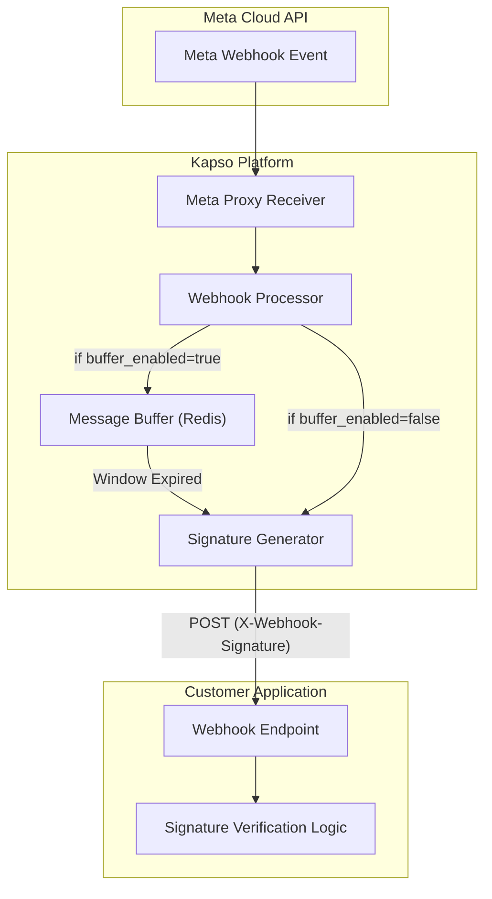
Sources: [skills/integrate-whatsapp/references/webhooks-overview.md](), [skills/integrate-whatsapp/references/webhooks-reference.md]()

### Code Entity Mapping: Webhook Management
Associating CLI scripts and parameters with the underlying system logic.

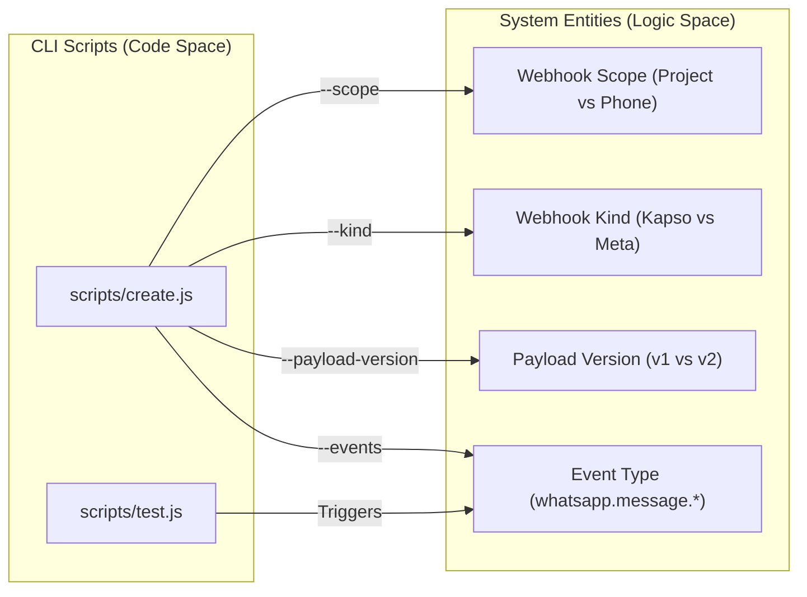
Sources: [skills/integrate-whatsapp/SKILL.md:86-103](), [skills/integrate-whatsapp/references/webhooks-event-types.md]()

## Payload Examples (v2)

### Message Received (Enriched)
[skills/integrate-whatsapp/references/webhooks-event-types.md:142-181]()
```json
{
  "message": {
    "id": "wamid.123",
    "type": "text",
    "text": { "body": "Hello" },
    "kapso": {
      "direction": "inbound",
      "status": "received",
      "content": "Hello"
    }
  },
  "conversation": {
    "id": "conv_123",
    "phone_number": "+15551234567",
    "phone_number_id": "123456789012345"
  },
  "phone_number_id": "123456789012345"
}
```

### Workflow Handoff
[skills/integrate-whatsapp/references/webhooks-event-types.md:46-62]()
```json
{
  "event": "workflow.execution.handoff",
  "project_id": "990e8400-e29b-41d4-a716-446655440004",
  "workflow_execution_id": "770e8400-e29b-41d4-a716-446655440002",
  "handoff": {
    "reason": "User requested human assistance",
    "source": "agent_tool"
  }
}
```

Sources:
* [skills/integrate-whatsapp/SKILL.md]()
* [skills/integrate-whatsapp/references/webhooks-overview.md]()
* [skills/integrate-whatsapp/references/webhooks-reference.md]()
* [skills/integrate-whatsapp/references/webhooks-event-types.md]()

---

# Page: Integrate WhatsApp Scripts Reference

# Integrate WhatsApp Scripts Reference

<details>
<summary>Relevant source files</summary>

The following files were used as context for generating this wiki page:

- [skills/integrate-whatsapp/SKILL.md](skills/integrate-whatsapp/SKILL.md)
- [skills/integrate-whatsapp/scripts/create-function.js](skills/integrate-whatsapp/scripts/create-function.js)
- [skills/integrate-whatsapp/scripts/lib/cli.js](skills/integrate-whatsapp/scripts/lib/cli.js)
- [skills/integrate-whatsapp/scripts/update-function.js](skills/integrate-whatsapp/scripts/update-function.js)

</details>


This page provides a comprehensive technical reference for the utility scripts located in `skills/integrate-whatsapp/scripts/`. These scripts serve as a fallback or automation layer for managing customers, WhatsApp templates, flows, and media when the Kapso CLI is not used directly.

## Shared Library Utilities

All scripts in this module rely on a set of common libraries located in `skills/integrate-whatsapp/scripts/lib/` to handle environment configuration, CLI argument parsing, and HTTP communication with the Kapso Platform API.

### CLI Parser (`lib/cli.js`)
The `lib/cli.js` utility provides robust parsing for command-line arguments. It supports string, boolean, numeric, and enum flags, as well as reading content from files when a `--*-file` flag is provided [skills/integrate-whatsapp/scripts/lib/cli.js:3-31]().

| Function | Description |
| :--- | :--- |
| `parseArgs` | Splits `process.argv` into `flags` (key-value) and `positionals` [skills/integrate-whatsapp/scripts/lib/cli.js:3-31](). |
| `requireStringFlag` | Retrieves a flag or throws an error if missing [skills/integrate-whatsapp/scripts/lib/cli.js:44-48](). |
| `getBooleanFlag` | Converts truthy/falsy strings (e.g., "yes", "0", "true") to booleans [skills/integrate-whatsapp/scripts/lib/cli.js:50-58](). |
| `readFlagText` | Reads content either directly from a flag or from a file path provided in a companion flag [skills/integrate-whatsapp/scripts/lib/cli.js:76-89](). |

### HTTP Client (`lib/http.js`)
The `platformRequest` function is the primary interface for communicating with the Kapso Platform API. It automatically injects the `X-API-Key` from the environment and handles JSON serialization.

**Data Flow: Script to API**
The following diagram illustrates how a script utilizes the library utilities to execute a command against the Platform API.

Title: Script Execution Data Flow
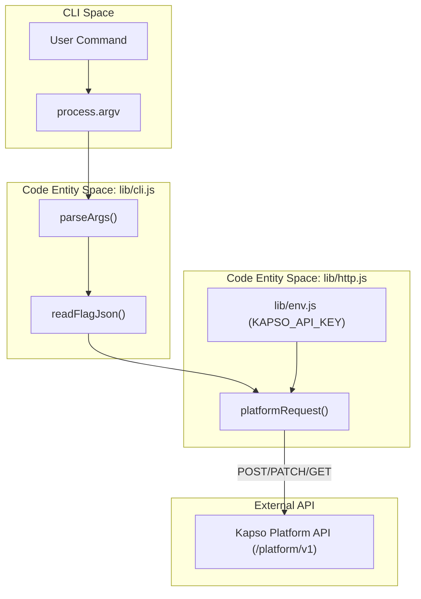
**Sources:** [skills/integrate-whatsapp/scripts/lib/cli.js:3-106](), [skills/integrate-whatsapp/scripts/lib/http.js:1-12]()

---

## Customer Management

These scripts manage the `customer` entity, which is the root container for WhatsApp Business Accounts (WABA) and phone numbers in a multi-tenant environment [skills/integrate-whatsapp/SKILL.md:45-51]().

*   **`create.js`**: Creates a new customer. Requires `--name`. Optionally accepts `--external-id` to map the Kapso customer to your internal database ID.
*   **`get.js`**: Retrieves a single customer by ID.
*   **`list.js`**: Lists all customers within the project.
*   **`delete.js`**: Removes a customer entity.

**Sources:** [skills/integrate-whatsapp/SKILL.md:38-40](), [skills/integrate-whatsapp/SKILL.md:47-48]()

---

## WhatsApp Template Management

Templates must be created and approved by Meta before they can be sent to users outside of a 24-hour session window [skills/integrate-whatsapp/SKILL.md:170-172]().

### Script Reference
*   **`create-template.mjs`**: Submits a new template definition to Meta. Requires `--business-account-id` and a JSON payload file via `--file` [skills/integrate-whatsapp/SKILL.md:166]().
*   **`submit-template.mjs`**: An alias or variation for submitting templates for approval.
*   **`update-template.mjs`**: Updates an existing template. Note that Meta has strict rules on what fields can be edited after approval.

### Template Lifecycle
Title: Template Management Workflow
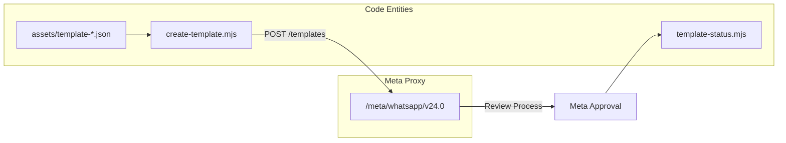
**Sources:** [skills/integrate-whatsapp/SKILL.md:117](), [skills/integrate-whatsapp/SKILL.md:162-168]()

---

## WhatsApp Flow Management

Flows allow for rich, multi-screen interactions within WhatsApp. These scripts manage the Flow definition and its lifecycle [skills/integrate-whatsapp/SKILL.md:3-4]().

*   **`create-flow.js`**: Registers a new Flow container with Meta.
*   **`update-flow-json.js`**: Updates the Flow's JSON layout (screens, components, and data requirements).
*   **`publish-flow.js`**: Transitions a Flow from `DRAFT` to `PUBLISHED` status, making it available for use in messages.

**Sources:** [skills/integrate-whatsapp/SKILL.md:3-4]()

---

## Serverless Function Management

Functions are used as data endpoints for WhatsApp Flows or as custom logic nodes in automations.

### `create-function.js`
Creates a new serverless function.
*   **Flags**:
    *   `--name`: (Required) Name of the function [skills/integrate-whatsapp/scripts/create-function.js:15]().
    *   `--code` or `--code-file`: (Required) The JavaScript source code [skills/integrate-whatsapp/scripts/create-function.js:16-21]().
    *   `--runtime-config-file`: JSON configuration for environment variables or secrets [skills/integrate-whatsapp/scripts/create-function.js:22]().
    *   `--public-endpoint`: Boolean. If true, the function can be invoked via a public URL [skills/integrate-whatsapp/scripts/create-function.js:23]().

### `update-function.js`
Updates an existing function's code or configuration.
*   **Flags**:
    *   `--function-id`: (Required) The UUID of the function to update [skills/integrate-whatsapp/scripts/update-function.js:16]().
    *   `--invoke-response-mode`: Either `passthrough` (raw response) or `wrapped` (Kapso standard envelope) [skills/integrate-whatsapp/scripts/update-function.js:25]().

**Sources:** [skills/integrate-whatsapp/scripts/create-function.js:1-43](), [skills/integrate-whatsapp/scripts/update-function.js:1-48]()

---

## Media and Messaging

*   **`media-upload.js`**: Uploads files (images, documents) to Meta's servers to obtain a `media_id` for use in messages.
*   **`send-template.mjs`**: Sends a pre-approved template message to a specific recipient [skills/integrate-whatsapp/SKILL.md:168]().
*   **`send-interactive.mjs`**: Sends interactive messages (Buttons, Lists, Flows) using a JSON payload [skills/integrate-whatsapp/SKILL.md:176]().

**Sources:** [skills/integrate-whatsapp/SKILL.md:118](), [skills/integrate-whatsapp/SKILL.md:168-176]()

---

# Page: Automate WhatsApp Skill

# Automate WhatsApp Skill

<details>
<summary>Relevant source files</summary>

The following files were used as context for generating this wiki page:

- [skills/automate-whatsapp/SKILL.md](skills/automate-whatsapp/SKILL.md)

</details>


The `automate-whatsapp` skill provides the tools and interfaces necessary to build, deploy, and manage event-driven WhatsApp automations. It centers around a directed-graph workflow engine where nodes represent actions (sending messages, calling functions, AI agents) and edges represent the execution flow.

This skill supports two primary development paths:
1.  **Local Source-Sync (Preferred):** Using the Kapso CLI and `@kapso/workflows` SDK to author workflows in TypeScript/JavaScript, which are then built and pushed to the platform [skills/automate-whatsapp/SKILL.md:14-17]().
2.  **API-Direct (Fallback):** Using provided scripts to interact directly with the platform's JSON graph representation and execution management endpoints [skills/automate-whatsapp/SKILL.md:19-23]().

### System Architecture Overview

The following diagram illustrates how natural language requirements are translated into code entities and deployed to the Kapso platform.

**Workflow Development Lifecycle**
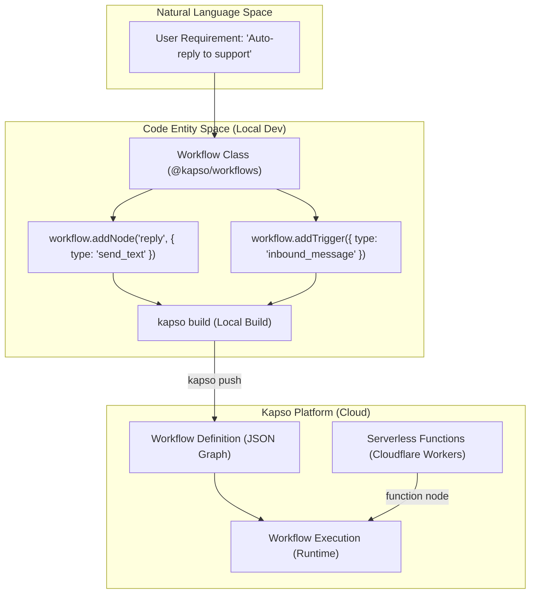
Sources: [skills/automate-whatsapp/SKILL.md:40-65](), [skills/automate-whatsapp/SKILL.md:70-73]()

---

### Workflow Concepts & Execution Model
Workflows are defined as directed graphs starting from a unique `start` node [skills/automate-whatsapp/SKILL.md:156-156](). Executions move through states such as `running`, `waiting` (for user input), or `handoff` (to a human agent). The system uses a strict execution context structure containing `vars`, `system`, `context`, and `metadata` [skills/automate-whatsapp/SKILL.md:181-186]().

For details, see [Workflow Concepts & Execution Model](#3.1).

### Node Types & Graph Schema
The workflow engine supports various node types, including messaging nodes (`send_text`, `send_interactive`), logic nodes (`decide`, `set_variable`), and integration nodes (`function`, `webhook`, `agent`) [skills/automate-whatsapp/SKILL.md:57-60](). The graph contract requires specific ID conventions and edge definitions to ensure valid execution paths.

For details, see [Node Types & Graph Schema](#3.2).

### Local Development with CLI & SDK
The `@kapso/workflows` SDK allows developers to define automation logic programmatically. The Kapso CLI facilitates the lifecycle of these workflows through commands like `kapso pull` to fetch remote state and `kapso push` to deploy local changes [skills/automate-whatsapp/SKILL.md:30-36]().

**Local vs. Remote Mapping**
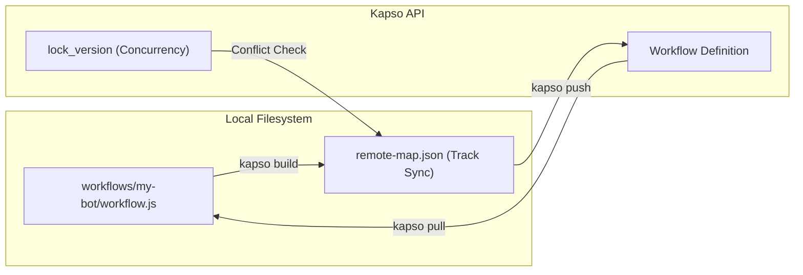
Sources: [skills/automate-whatsapp/SKILL.md:30-36](), [skills/automate-whatsapp/SKILL.md:91-99]()

For details, see [Local Development with CLI & @kapso/workflows SDK](#3.3).

### Functions: Runtime & Deployment
Kapso functions are serverless snippets (Cloudflare Workers) that can be invoked by `function` nodes or used as tools by AI agents. They follow a specific `handler(request, env)` signature and do not use standard ES modules `export` syntax in the platform runtime [skills/automate-whatsapp/SKILL.md:167-178]().

For details, see [Functions: Runtime, Contracts & Deployment](#3.4).

### Agent Nodes & Remote Sandbox
`agent` nodes integrate LLMs directly into the workflow. These agents can be equipped with a "Remote Sandbox," an ephemeral workspace where the AI can interact with GitHub repositories and run filesystem tools to perform complex coding or analysis tasks [skills/automate-whatsapp/SKILL.md:127-141]().

For details, see [Agent Nodes & Remote Sandbox](#3.5).

### Automate WhatsApp Scripts Reference
A comprehensive suite of scripts is provided in `skills/automate-whatsapp/scripts/` for managing every aspect of the automation lifecycle, from CRUD operations on workflows to inspecting live execution events [skills/automate-whatsapp/SKILL.md:191-205]().

For details, see [Automate WhatsApp Scripts Reference](#3.6).

---

# Page: Workflow Concepts & Execution Model

# Workflow Concepts & Execution Model

<details>
<summary>Relevant source files</summary>

The following files were used as context for generating this wiki page:

- [skills/automate-whatsapp/SKILL.md](skills/automate-whatsapp/SKILL.md)
- [skills/automate-whatsapp/references/triggers.md](skills/automate-whatsapp/references/triggers.md)
- [skills/automate-whatsapp/references/workflow-reference.md](skills/automate-whatsapp/references/workflow-reference.md)

</details>


The Kapso workflow engine is a directed graph-based system designed for automating WhatsApp interactions and backend logic. It separates the execution logic (the graph) from the entry points (triggers) and maintains a persistent state for every interaction.

## Core Execution Model

The engine operates on a directed graph where each **Node** represents a specific action or state, and **Edges** define the transition logic between them [skills/automate-whatsapp/references/workflow-reference.md:74-85]().

### Execution States
Every workflow execution follows a lifecycle tracked by a status field.
*   **Running**: The engine is actively processing nodes in the graph.
*   **Waiting**: Execution is paused, typically by a `wait_for_response` node, awaiting an external event (e.g., a WhatsApp reply) [skills/automate-whatsapp/assets/workflow-decision.json:44-60]().
*   **Handoff**: Control has been transferred to a human agent or external system.
*   **Ended**: The execution reached a terminal state or completed all nodes.
*   **Failed**: An error occurred during node execution or function invocation.

### Directed Graph Model
*   **Start Node**: Every graph must contain exactly one node with `id: "start"` and `data.node_type: "start"` [skills/automate-whatsapp/SKILL.md:156-156](), [skills/automate-whatsapp/references/workflow-reference.md:96-96]().
*   **Edges**: Transitions are defined by `source`, `target`, and `label`. Non-decide nodes are restricted to a single outgoing edge [skills/automate-whatsapp/references/workflow-reference.md:99-99]().
*   **Decide Branching**: Logic branching occurs only at `decide` nodes, where the edge `label` must match the `conditions[].label` defined in the node configuration [skills/automate-whatsapp/SKILL.md:160-160]().

### Concurrency & Lock Versioning
To prevent race conditions during graph updates, the platform uses a `lock_version` optimistic concurrency model. When updating a graph via `PATCH /platform/v1/workflows/:id`, the request must include the `expected-lock-version`. If the remote version has changed since the last fetch, the update is rejected [skills/automate-whatsapp/SKILL.md:91-99](), [skills/automate-whatsapp/references/workflow-reference.md:76-76]().

## Trigger Types

Triggers are independent entities that initiate a workflow execution. They are managed separately from the graph definition [skills/automate-whatsapp/references/triggers.md:3-3]().

| Trigger Type | Description | Required Fields |
| :--- | :--- | :--- |
| `inbound_message` | Fires when a user sends a message to a specific WhatsApp number. | `phone_number_id` [skills/automate-whatsapp/references/triggers.md:6-6]() |
| `api_call` | Manual initiation via the Platform API. | None [skills/automate-whatsapp/references/triggers.md:20-20]() |
| `whatsapp_event` | Fires on specific WhatsApp lifecycle events (e.g., `whatsapp.message.failed`). | `event` [skills/automate-whatsapp/references/triggers.md:8-8]() |

### Code-to-Entity Mapping: Trigger Lifecycle
This diagram shows how a WhatsApp event is routed through the system to start a `WorkflowExecution`.

```mermaid
graph TD
    subgraph "Natural Language Space"
        A["Customer sends WhatsApp Message"]
    end

    subgraph "Code Entity Space (kapso-platform)"
        B["Webhook Handler"] --> C["Trigger Matcher"]
        C -- "match phone_number_id" --> D["WorkflowTrigger (inbound_message)"]
        D -- "POST /workflow_executions" --> E["WorkflowExecution"]
        E -- "Execute Node" --> F["Graph Node: start"]
    end

    A --> B
```
Sources: [skills/automate-whatsapp/references/triggers.md:5-9](), [skills/automate-whatsapp/references/workflow-reference.md:59-60]()

## Execution Context & Variables

The execution context is a JSON object that stores data throughout the lifecycle of a workflow. It is partitioned into four primary namespaces [skills/automate-whatsapp/SKILL.md:181-186]():

1.  **`vars`**: User-defined variables used for custom business logic (e.g., `vars.customer_name`).
2.  **`system`**: Internal engine variables (e.g., `system.now`).
3.  **`context`**: Channel-specific data, such as the sender's phone number or the incoming message text.
4.  **`metadata`**: Request-level metadata.

### Variable Interpolation Syntax
Variables are accessed using double curly braces: `{{namespace.path}}`.
*   Example: `Hello {{context.sender_name}}, your ID is {{vars.user_id}}`.
*   Interpolation is supported in `send_text` messages, `decide` node conditions, and function arguments.

## Execution Flow & Node Transition

The workflow engine processes nodes sequentially until it hits a `wait_for_response` node or a terminal state.

### Execution Engine Logic
```mermaid
graph TD
    subgraph "Workflow Engine (Internal)"
        Start["START"] --> FetchNode["Fetch Node Config"]
        FetchNode --> Exec["Execute Node Logic"]
        Exec -- "Update Context" --> UpdateVars["vars / context"]
        UpdateVars --> CheckType{"Node Type?"}
        
        CheckType -- "Wait Node" --> StateWait["Set Status: WAITING"]
        CheckType -- "Standard Node" --> FindEdge["Find Next Edge"]
        CheckType -- "Decide Node" --> EvalLogic["Evaluate Conditions"]
        
        EvalLogic -- "Match Label" --> FindEdge
        FindEdge -- "Target ID" --> FetchNode
    end
```
Sources: [skills/automate-whatsapp/SKILL.md:154-163](), [skills/automate-whatsapp/references/workflow-reference.md:94-102]()

## Local Development & Source Sync

While the Platform API supports direct graph manipulation, the preferred method for managing workflows is the **Source Sync** model using the Kapso CLI and `@kapso/workflows` SDK [skills/automate-whatsapp/SKILL.md:14-17]().

1.  **`kapso pull`**: Downloads the remote graph and converts it to a local `workflow.js` or `workflow.ts` file.
2.  **`Workflow` Class**: Developers use the SDK to define nodes and edges programmatically.
3.  **`kapso push`**: Validates the local definition and updates the remote graph, handling the `lock_version` automatically [skills/automate-whatsapp/SKILL.md:69-73]().

### Example Workflow Definition (SDK)
```javascript
import { START, Workflow } from "@kapso/workflows";

const workflow = new Workflow("support-bot");

workflow.addNode(START, { position: { x: 0, y: 0 } });
workflow.addNode("greet", {
  type: "send_text",
  message: "Welcome to support!"
});
workflow.addEdge(START, "greet");

export default workflow;
```
Sources: [skills/automate-whatsapp/SKILL.md:40-65]()

---

# Page: Node Types & Graph Schema

# Node Types & Graph Schema

<details>
<summary>Relevant source files</summary>

The following files were used as context for generating this wiki page:

- [skills/automate-whatsapp/references/node-types.md](skills/automate-whatsapp/references/node-types.md)
- [skills/automate-whatsapp/references/workflow-reference.md](skills/automate-whatsapp/references/workflow-reference.md)

</details>


This page provides a technical reference for the Kapso workflow graph contract. It covers the specific JSON schemas for every node type supported by the platform, the connectivity rules for edges, and the distinction between the "Rich" graph returned by the API and the "Minimal" graph required for updates.

## Graph Contract & Structure

A workflow graph is a collection of `nodes` and `edges`. The platform uses a ReactFlow-compatible structure for representing these directed graphs [skills/automate-whatsapp/references/workflow-reference.md:74-85]().

### Node Identification & Positioning
*   **Node IDs**: Every node must have a unique `id`. The convention for new nodes is `{node_type}_{timestamp_ms}` (e.g., `send_text_1710000000000`) [skills/automate-whatsapp/references/node-types.md:39-39]().
*   **Start Node**: Every graph must contain exactly one node with the ID `start` and `node_type` `start` [skills/automate-whatsapp/references/node-types.md:48-48]().
*   **Positioning**: Nodes use an `{ x, y }` coordinate system. Graphs should be organized vertically (top-down) as nodes connect from bottom to top [skills/automate-whatsapp/references/node-types.md:28-40]().

### Edge Rules
*   **Linear Flow**: Most nodes (messaging, variables, etc.) support only one outgoing edge.
*   **Branching**: Only `decide` nodes support multiple outgoing edges. Each edge from a `decide` node must have a `label` that matches one of the node's defined `conditions` [skills/automate-whatsapp/references/node-types.md:198-198]().
*   **Validation**: The `scripts/validate-graph.js` utility enforces these rules, ensuring no orphaned edges or missing start nodes exist before deployment [skills/automate-whatsapp/references/workflow-reference.md:94-102]().

### Minimal vs. Rich Shapes
When fetching a graph via `GET /platform/v1/workflows/:id/definition`, the API returns a **Rich** shape containing computed fields like `display_name` and UI-specific `type` strings [skills/automate-whatsapp/references/workflow-reference.md:82-82](). When updating a graph via `PATCH`, you should send a **Minimal** shape; the API ignores or strips computed fields [skills/automate-whatsapp/references/workflow-reference.md:83-84]().

| Feature | Rich Shape (API Response) | Minimal Shape (API Request) |
| :--- | :--- | :--- |
| **Node Fields** | `id`, `type`, `position`, `data` | `id`, `position`, `data` |
| **Data Fields** | `node_type`, `config`, `display_name` | `node_type`, `config` |
| **Edge Fields** | `id`, `source`, `target`, `label`, `type` | `source`, `target`, `label` |

**Sources:** [skills/automate-whatsapp/references/node-types.md:22-40](), [skills/automate-whatsapp/references/workflow-reference.md:74-102]()

---

## Messaging Nodes

Messaging nodes handle outbound communication via the WhatsApp Business Platform.

### `send_text`
Sends a plain text message. Supports variable interpolation using `{{vars.name}}` syntax [skills/automate-whatsapp/references/node-types.md:50-54]().

### `send_template`
Sends a pre-approved Meta message template. Requires a `template_id` (UUID) and a mapping of positional parameters [skills/automate-whatsapp/references/node-types.md:58-72]().

### `send_interactive`
Supports four interactive subtypes defined in `config.interactive_type` [skills/automate-whatsapp/references/node-types.md:73-140]():
1.  **button**: Up to 3 quick-reply buttons.
2.  **list**: A menu with sections and rows (up to 10 rows total).
3.  **cta_url**: A button that opens a specific URL.
4.  **flow**: Triggers a Meta WhatsApp Flow. Requires `flow_id` and `flow_action_payload` specifying the initial screen.

**Sources:** [skills/automate-whatsapp/references/node-types.md:50-140]()

---

## Logic & Control Flow Nodes

### `decide`
Routes the workflow based on AI evaluation or a Function response.
*   **AI Routing**: Uses an LLM to evaluate the conversation against `conditions` (labels and descriptions) [skills/automate-whatsapp/references/node-types.md:167-180]().
*   **Function Routing**: Executes a Kapso Function; the function must return a string matching one of the `conditions[].label` values [skills/automate-whatsapp/references/node-types.md:181-195]().

### `wait_for_response`
Pauses execution until the user sends a message. The incoming message is stored in the variable defined by `save_response_to` [skills/automate-whatsapp/references/node-types.md:141-148]().

### `set_variable`
Updates the execution context. While `value_type` can vary, `string` is the standard for most interpolations [skills/automate-whatsapp/references/node-types.md:150-164]().

### `call` (Subworkflow)
Executes another workflow as a child process. Requires a `workflow_id`. If the subworkflow fails, the error can be captured in `save_error_to` [skills/automate-whatsapp/references/node-types.md:201-205]().

**Sources:** [skills/automate-whatsapp/references/node-types.md:141-205]()

---

## Integration & Agent Nodes

### `agent`
The `agent` node represents an autonomous LLM agent. It is highly configurable via `data.config` [skills/automate-whatsapp/references/node-types.md:232-246]().

*   **Delivery Modes**: 
    *   `auto_send_assistant_text`: LLM responses are sent to the user immediately.
    *   `tool_only`: LLM responses are internal. The agent must use the `send_notification_to_user` tool to communicate [skills/automate-whatsapp/references/node-types.md:250-254]().
*   **Default Tools**: Built-in capabilities like `contact_conversations` (reading history) and `enter_waiting` (pausing for input) [skills/automate-whatsapp/references/node-types.md:257-272]().
*   **Custom Tools**: Links to `webhook` tools or `mcp_servers` for external data access [skills/automate-whatsapp/references/node-types.md:273-281]().

### `function` & `webhook`
*   **function**: Invokes a Kapso serverless function by `function_id` [skills/automate-whatsapp/references/node-types.md:224-230]().
*   **webhook**: Performs a standard HTTP request. Supports custom methods, headers, and a `body_template` that allows variable interpolation [skills/automate-whatsapp/references/node-types.md:207-222]().

**Sources:** [skills/automate-whatsapp/references/node-types.md:207-281]()

---

## Entity Mapping & Data Flow

The following diagrams illustrate how graph definitions translate to execution entities and how the branching logic is enforced.

### Diagram: Graph Definition to Runtime Entities
This diagram maps the JSON schema elements to the corresponding logic in the execution engine.

```mermaid
graph TD
    subgraph "Natural Language / Design Space"
        "User Intent" --> "Condition Labels"
        "Prompting" --> "System Prompt"
    end

    subgraph "Code Entity Space (Definition)"
        NodeDef["Node JSON (data.node_type)"]
        EdgeDef["Edge JSON (source/target/label)"]
        
        NodeDef -->|type: agent| AgentConfig["Agent Config (config.provider_model_id)"]
        NodeDef -->|type: decide| DecideConfig["Decide Config (config.conditions)"]
    end

    subgraph "Execution Engine (Runtime)"
        WorkflowExec["Workflow Execution Context"]
        AgentNode["agent-executor.js logic"]
        DecideNode["decide-router.js logic"]

        AgentConfig --> AgentNode
        DecideConfig --> DecideNode
        EdgeDef -->|Match Label| DecideNode
    end

    WorkflowExec -.->|Interpolation| NodeDef
```
**Sources:** [skills/automate-whatsapp/references/node-types.md:22-40](), [skills/automate-whatsapp/references/workflow-reference.md:94-102]()

### Diagram: Branching Logic Contract
This diagram shows the strict relationship between `decide` node conditions and graph edges.

```mermaid
graph BT
    subgraph "decide Node ID: decide_123"
        C1["Condition: 'yes'"]
        C2["Condition: 'no'"]
    end

    subgraph "Edges"
        E1["Edge: source='decide_123', label='yes'"]
        E2["Edge: source='decide_123', label='no'"]
    end

    subgraph "Target Nodes"
        T1["Node ID: send_text_456"]
        T2["Node ID: call_789"]
    end

    E1 -.->|Must Match| C1
    E2 -.->|Must Match| C2
    E1 --> T1
    E2 --> T2
```
**Sources:** [skills/automate-whatsapp/references/node-types.md:167-199](), [skills/automate-whatsapp/references/workflow-reference.md:99-100]()

---

# Page: Local Development with CLI & @kapso/workflows SDK

# Local Development with CLI & @kapso/workflows SDK

<details>
<summary>Relevant source files</summary>

The following files were used as context for generating this wiki page:

- [skills/automate-whatsapp/SKILL.md](skills/automate-whatsapp/SKILL.md)
- [skills/automate-whatsapp/references/local-workflow-source.md](skills/automate-whatsapp/references/local-workflow-source.md)

</details>


The Kapso platform provides a professional development workflow that bridges the gap between local source-controlled code and remote cloud execution. This system centers around the **Kapso CLI** for synchronization and the **@kapso/workflows SDK** for defining complex automation logic using TypeScript or JavaScript.

## CLI Synchronization Workflow

The Kapso CLI manages the lifecycle of workflows and functions by syncing local files with the Kapso Platform API. It enables a "Source of Truth" model where developers can author logic in their IDE, commit to Git, and deploy via a structured build process.

### Core Commands
The development lifecycle typically follows this sequence:

1.  **`kapso login`**: Authenticates the local environment with the Kapso Platform [[skills/automate-whatsapp/SKILL.md:15-15]]().
2.  **`kapso link --project <project-id>`**: Binds the current working directory to a specific Kapso project [[skills/automate-whatsapp/references/local-workflow-source.md:11-11]]().
3.  **`kapso pull`**: Downloads the remote project state into the local directory structure [[skills/automate-whatsapp/references/local-workflow-source.md:12-12]]().
4.  **`kapso build`**: Compiles local workflow source files (`.js` or `.ts`) into the standard `definition.json` format [[skills/automate-whatsapp/references/local-workflow-source.md:66-66]]().
5.  **`kapso push`**: Uploads changed functions and workflows to the Kapso cloud [[skills/automate-whatsapp/references/local-workflow-source.md:71-71]]().

### Local Directory Structure
When `kapso pull` is executed, it populates the following structure:

| Path | Description |
| :--- | :--- |
| `kapso.yaml` | Project-level configuration. |
| `.kapso/project.json` | Metadata about the linked project. |
| `.kapso/remote-map.json` | Stores the last pulled state to detect "dirty" files and stale updates [[skills/automate-whatsapp/references/local-workflow-source.md:28-28]](). |
| `functions/<slug>/` | Contains `index.js` (logic) and `function.yaml` (metadata) [[skills/automate-whatsapp/references/local-workflow-source.md:21-22]](). |
| `workflows/<slug>/` | Contains `workflow.js/ts` (source), `definition.json` (compiled graph), and `workflow.yaml` (metadata) [[skills/automate-whatsapp/references/local-workflow-source.md:23-25]](). |

**Sources:** [[skills/automate-whatsapp/references/local-workflow-source.md:17-28]]()

---

## The @kapso/workflows SDK

The SDK allows developers to define workflows programmatically rather than editing raw JSON graphs. It provides a `Workflow` class and helper constants to ensure graph integrity.

### Key Entities
*   **`Workflow` Class**: The main container for an automation. It accepts a slug and a configuration object (name, status) [[skills/automate-whatsapp/SKILL.md:43-46]]().
*   **`START` Constant**: A reserved identifier used to mark the entry point of the workflow graph [[skills/automate-whatsapp/SKILL.md:41-41]]().
*   **`addTrigger()`**: Configures how the workflow starts (e.g., `inbound_message`) [[skills/automate-whatsapp/SKILL.md:48-51]]().
*   **`addNode()`**: Adds a functional block (e.g., `send_text`, `agent`, `function`) to the graph [[skills/automate-whatsapp/SKILL.md:57-60]]().
*   **`addEdge()`**: Connects two nodes to define the execution flow [[skills/automate-whatsapp/SKILL.md:62-62]]().

### Example Workflow Authoring
```ts
import { START, Workflow } from "@kapso/workflows";

const workflow = new Workflow("inbound-support", {
  name: "Inbound Support",
  status: "draft",
});

workflow.addTrigger({
  type: "inbound_message",
  phoneNumberId: "phone-123",
});

workflow.addNode(START, { position: { x: 100, y: 100 } });
workflow.addNode("reply", {
  type: "send_text",
  message: "Hello from local SDK!",
});

workflow.addEdge(START, "reply");

export default workflow;
```
**Sources:** [[skills/automate-whatsapp/SKILL.md:40-65]](), [[skills/automate-whatsapp/references/local-workflow-source.md:34-59]]()

---

## Data Flow: Authoring to Deployment

The following diagram illustrates how the CLI and SDK transform high-level code into a deployed Kapso workflow.

### Code to Platform Mapping
"This diagram maps local code entities to their remote counterparts in the Kapso Platform."

```mermaid
graph TD
    subgraph "Local Code Space"
        A["Workflow Class (@kapso/workflows)"] -- "defines" --> B["workflow.ts / workflow.js"]
        C["handler(request, env)"] -- "defines" --> D["functions/index.js"]
    end

    subgraph "CLI Build & Sync"
        E["kapso build"] -- "compiles source" --> F["definition.json"]
        G["kapso push"] -- "syncs files" --> H[".kapso/remote-map.json"]
    end

    subgraph "Kapso Platform Space"
        F -- "POST /workflows/:id/definition" --> I["Workflow Engine"]
        D -- "POST /functions/:id/deploy" --> J["Serverless Runtime"]
    end

    B --> E
    E --> G
    H -- "dirty check" --> G
```
**Sources:** [[skills/automate-whatsapp/references/local-workflow-source.md:63-74]](), [[skills/automate-whatsapp/SKILL.md:167-172]]()

---

## Synchronization & Safety Logic

To prevent accidental overwrites, the CLI implements a "dirty-file" check using the `remote-map.json` file.

### Pull Behavior
*   **Preservation**: `kapso pull` will not overwrite `workflow.js` or `workflow.ts` files if they exist, as these are considered user-authored source code [[skills/automate-whatsapp/references/local-workflow-source.md:77-77]]().
*   **Dirty Checks**: The CLI refuses to overwrite local versions of `workflow.yaml` or `definition.json` if they contain changes not yet synced to the remote [[skills/automate-whatsapp/references/local-workflow-source.md:79-79]]().
*   **Conflict Resolution**: Users can use `--diff` to inspect changes or `--overwrite` to force the local state to match the remote [[skills/automate-whatsapp/references/local-workflow-source.md:80-81]]().

### Workflow Lifecycle Diagram
"This diagram shows the lifecycle of a workflow definition from authoring to the remote execution environment."

```mermaid
sequenceDiagram
    participant Dev as "Developer (Local)"
    participant CLI as "Kapso CLI"
    participant Map as ".kapso/remote-map.json"
    participant API as "Kapso Platform API"

    Dev->>CLI: kapso pull
    API-->>CLI: current_definition
    CLI->>Map: Update remote hash
    CLI->>Dev: Write workflows/<slug>/

    Note over Dev, CLI: Developer edits workflow.ts

    Dev->>CLI: kapso build
    CLI->>Dev: Generate definition.json

    Dev->>CLI: kapso push
    CLI->>Map: Compare local vs remote hash
    alt is_dirty
        CLI->>Dev: Error: Local changes detected
    else is_clean
        CLI->>API: PATCH /workflows/:id
        API-->>CLI: Success (200 OK)
        CLI->>Map: Update hash
    end
```
**Sources:** [[skills/automate-whatsapp/references/local-workflow-source.md:28-28]](), [[skills/automate-whatsapp/references/local-workflow-source.md:75-82]]()

---

## Implementation Details

### The `remote-map.json`
The remote map is critical for multi-developer environments. It tracks the state of the project at the time of the last `pull`. If another developer pushes a change to the Kapso Platform, your local CLI will detect that your `remote-map.json` is out of sync with the current remote state, preventing you from overwriting their work [[skills/automate-whatsapp/references/local-workflow-source.md:28-28]]().

### Source vs. Compiled
*   **Source**: `workflow.js` or `workflow.ts`. This is where the `@kapso/workflows` SDK is used.
*   **Compiled**: `definition.json`. This is the raw JSON graph that the Kapso Workflow Engine actually executes.
*   **Metadata**: `workflow.yaml`. Contains non-graph settings like the workflow name and status [[skills/automate-whatsapp/references/local-workflow-source.md:23-25]]().

**Sources:** [[skills/automate-whatsapp/references/local-workflow-source.md:32-32]](), [[skills/automate-whatsapp/references/local-workflow-source.md:73-73]]()

---

# Page: Functions: Runtime, Contracts & Deployment

# Functions: Runtime, Contracts & Deployment

<details>
<summary>Relevant source files</summary>

The following files were used as context for generating this wiki page:

- [skills/automate-whatsapp/assets/functions-example.json](skills/automate-whatsapp/assets/functions-example.json)
- [skills/automate-whatsapp/references/functions-reference.md](skills/automate-whatsapp/references/functions-reference.md)
- [skills/automate-whatsapp/scripts/create-function.js](skills/automate-whatsapp/scripts/create-function.js)
- [skills/automate-whatsapp/scripts/lib/functions/args.js](skills/automate-whatsapp/scripts/lib/functions/args.js)
- [skills/automate-whatsapp/scripts/lib/functions/kapso-api.js](skills/automate-whatsapp/scripts/lib/functions/kapso-api.js)
- [skills/automate-whatsapp/scripts/update-function.js](skills/automate-whatsapp/scripts/update-function.js)

</details>


Kapso serverless functions provide a sandboxed JavaScript environment for executing custom logic within workflows, acting as AI tools, or serving as data endpoints for WhatsApp Flows. This page details the runtime specifications, the contracts for various invocation modes, and the lifecycle for deploying these functions to the Kapso platform.

### 1. Function Runtime & Handler Signature

Kapso functions execute in a Cloudflare Workers-like environment. Every function must define a specific entry point named `handler`.

#### Handler Signature
Functions must follow this exact signature:
```javascript
async function handler(request, env) {
  // Logic here
  return new Response(JSON.stringify({ success: true }));
}
```
*   **No Exports**: Do not use `export default` or arrow functions for the main handler [skills/automate-whatsapp/references/functions-reference.md:5-11]().
*   **Response Object**: The function must return a standard Web API `Response` object [skills/automate-whatsapp/references/functions-reference.md:11-11]().

#### Runtime APIs
*   **`request`**: A standard Fetch API `Request` object. Use `await request.json()` to parse incoming JSON payloads [skills/automate-whatsapp/references/functions-reference.md:15-15]().
*   **`env.KV`**: A key-value storage interface providing `.get(key)`, `.put(key, value)`, and `.delete(key)` [skills/automate-whatsapp/references/functions-reference.md:16-16]().
*   **`env.SECRET_NAME`**: Access to encrypted secrets configured during function creation/update [skills/automate-whatsapp/references/functions-reference.md:17-17]().

**Sources:**
- [skills/automate-whatsapp/references/functions-reference.md:5-17]()
- [skills/automate-whatsapp/assets/functions-example.json:4-4]()

---

### 2. Execution Contracts

Kapso functions are invoked in four primary contexts, each with a specific JSON payload contract.

#### 2.1 Workflow Node (Function & Decide)
When a `function` or `decide` node executes in a workflow, Kapso sends the full execution context.

**Payload Structure:**
- `execution_context`: Contains `vars` (user variables), `system` (flow metadata), `context` (channel/contact data), and `metadata` (request info) [skills/automate-whatsapp/references/functions-reference.md:55-72]().
- `available_edges`: (Decide nodes only) A list of outgoing edge labels [skills/automate-whatsapp/references/functions-reference.md:62-62]().

**Response Contract:**
- **Function Node**: Return a `vars` object to update the workflow's state [skills/automate-whatsapp/references/functions-reference.md:78-80]().
- **Decide Node**: Return `next_edge` matching one of the `available_edges` and optionally `vars` [skills/automate-whatsapp/references/functions-reference.md:88-92]().

#### 2.2 Agent Function Tools
When an `agent` node uses a function as a tool, the payload includes an `input` object (generated by the LLM) and `whatsapp_context` [skills/automate-whatsapp/references/functions-reference.md:100-108]().

#### 2.3 WhatsApp Flow Data Endpoints
Functions acting as dynamic data endpoints for WhatsApp Flows receive a `data_exchange` object. The function must respond with the standard WhatsApp Flow JSON schema (version 3.0) [skills/automate-whatsapp/references/functions-reference.md:116-139]().

### Data Flow: Natural Language to Code Entity Space
This diagram maps the logical workflow components to the code entities that handle function execution.

| Logic Space | Code Entity Space |
| :--- | :--- |
| **Workflow Logic** | `execution_context` [skills/automate-whatsapp/references/functions-reference.md:56-61]() |
| **Storage** | `env.KV` [skills/automate-whatsapp/references/functions-reference.md:16-16]() |
| **Deployment API** | `POST /platform/v1/functions` [skills/automate-whatsapp/scripts/create-function.js:59-62]() |
| **Invocation** | `endpoint_url` [skills/automate-whatsapp/references/functions-reference.md:44-44]() |

**Sources:**
- [skills/automate-whatsapp/references/functions-reference.md:50-139]()

---

### 3. Deployment & Configuration

Functions are managed via the Kapso Platform API. The deployment lifecycle involves creating the function record, uploading the code, and optionally exposing a public endpoint.

#### 3.1 Function Attributes
| Attribute | Description |
| :--- | :--- |
| `name` | Unique identifier for the function [skills/automate-whatsapp/scripts/create-function.js:50-50](). |
| `code` | The JavaScript source string containing the `handler` [skills/automate-whatsapp/scripts/create-function.js:49-49](). |
| `public_endpoint` | If `true`, the function can be called without an `X-API-Key` [skills/automate-whatsapp/references/functions-reference.md:38-46](). |
| `invoke_response_mode` | `passthrough` (returns raw function response) vs `wrapped` (legacy envelope) [skills/automate-whatsapp/references/functions-reference.md:47-48](). |

#### 3.2 Deployment Lifecycle
The following diagram illustrates the transition from local source code to a deployed Cloudflare function.

```mermaid
graph TD
  subgraph "Local Development"
    A["Source Code (.js)"] --> B["CLI Script: create-function.js"]
  end

  subgraph "Kapso Platform API"
    B --> C["POST /platform/v1/functions"]
    C --> D["Function Registry"]
    D --> E["Cloudflare Worker Deployment"]
  end

  subgraph "Runtime Invocation"
    F["Workflow Node"] -- "Internal Call" --> E
    G["WhatsApp Flow"] -- "Public URL" --> E
    E --> H["handler(request, env)"]
  end
```

**Sources:**
- [skills/automate-whatsapp/scripts/create-function.js:18-62]()
- [skills/automate-whatsapp/scripts/update-function.js:48-68]()
- [skills/automate-whatsapp/references/functions-reference.md:21-25]()

---

### 4. Integration & Invocation Modes

#### 4.1 Public vs. Private Endpoints
*   **Private**: Default state. Requires an `X-API-Key` header for invocation via `https://api.kapso.ai/platform/v1/functions/{id}/invoke` [skills/automate-whatsapp/references/functions-reference.md:44-45]().
*   **Public**: Enabled by setting `public_endpoint: true`. Required for WhatsApp Flow data endpoints which are called directly by Meta's servers [skills/automate-whatsapp/references/functions-reference.md:24-46]().

#### 4.2 Response Modes
The `invoke_response_mode` determines how the Kapso API returns the function's output:
1.  **`passthrough`**: The body, status code, and headers returned by the `handler` are forwarded directly to the caller. This is the recommended mode for new functions [skills/automate-whatsapp/references/functions-reference.md:25-47]().
2.  **`wrapped`**: A legacy mode where the function's output is wrapped in a Kapso-specific JSON envelope [skills/automate-whatsapp/references/functions-reference.md:48-48]().

### Mapping Entities to Code
This diagram associates the API request parameters with the script implementation logic.

```mermaid
classDiagram
    class KapsoRequest {
        +String baseUrl
        +String apiKey
        +kapsoRequest(path, init)
    }
    class CreateFunctionScript {
        +resolveCode(flags)
        +parseBooleanFlag(public-endpoint)
        +main()
    }
    class FunctionPayload {
        +String name
        +String code
        +Boolean public_endpoint
        +String invoke_response_mode
    }

    CreateFunctionScript ..> KapsoRequest : uses
    CreateFunctionScript ..> FunctionPayload : constructs
    KapsoRequest --|> "kapso-api.js"
    CreateFunctionScript --|> "create-function.js"
```

**Sources:**
- [skills/automate-whatsapp/scripts/lib/functions/kapso-api.js:33-74]()
- [skills/automate-whatsapp/scripts/create-function.js:28-71]()
- [skills/automate-whatsapp/scripts/update-function.js:52-63]()
- [skills/automate-whatsapp/references/functions-reference.md:29-41]()

---

# Page: Agent Nodes & Remote Sandbox

# Agent Nodes & Remote Sandbox

<details>
<summary>Relevant source files</summary>

The following files were used as context for generating this wiki page:

- [skills/automate-whatsapp/assets/agent-remote-sandbox-github-repo-example.json](skills/automate-whatsapp/assets/agent-remote-sandbox-github-repo-example.json)
- [skills/automate-whatsapp/references/agent-remote-sandbox.md](skills/automate-whatsapp/references/agent-remote-sandbox.md)
- [skills/automate-whatsapp/references/node-types.md](skills/automate-whatsapp/references/node-types.md)

</details>


Agent nodes represent the most advanced execution unit in the Kapso workflow engine. Unlike standard nodes that follow a fixed path, an agent node uses a Large Language Model (LLM) to dynamically decide which tools to call, how to process information, and when to transition to the next state. The **Remote Sandbox** extends this capability by providing an ephemeral, secure environment where the agent can execute code, inspect filesystems, and interact with cloned repositories.

## Agent Node Configuration

An agent node is defined within the workflow graph using the `agent` node type. Its behavior is governed by its `config` object, which includes model selection, prompts, and tool enablement.

### Core Attributes
*   **`provider_model_id`**: The UUID of the LLM provider. Must be retrieved via `list-provider-models.js` [skills/automate-whatsapp/references/node-types.md:239-248]().
*   **`system_prompt`**: The primary instructions for the agent, defining its persona and objectives [skills/automate-whatsapp/references/node-types.md:238]().
*   **`message_delivery_mode`**: Determines how the agent interacts with the end-user:
    *   `auto_send_assistant_text`: Standard LLM responses are automatically sent to the user as WhatsApp messages [skills/automate-whatsapp/references/node-types.md:242,251]().
    *   `tool_only`: LLM text remains internal. The agent must explicitly call the `send_notification_to_user` tool to communicate [skills/automate-whatsapp/references/node-types.md:252-253]().

### Default Tools
Kapso provides a suite of "Default Tools" that can be toggled on or off. These tools allow the agent to manipulate the workflow state and interact with the platform.

| Tool Name | Purpose |
| :--- | :--- |
| `complete_task` | Transitions the workflow to the next node in the graph (Required) [skills/automate-whatsapp/references/node-types.md:258](). |
| `handoff_to_human` | Moves the execution into a `handoff` state for manual intervention (Required) [skills/automate-whatsapp/references/node-types.md:259](). |
| `enter_waiting` | Pauses execution to wait for a user reply [skills/automate-whatsapp/references/node-types.md:260](). |
| `contact_conversations` | Allows the agent to list and read historical WhatsApp messages for the current contact [skills/automate-whatsapp/references/node-types.md:265,271](). |
| `save_variable` / `get_variable` | Persists or retrieves data from the workflow `vars` context [skills/automate-whatsapp/references/node-types.md:267-268](). |

### Custom Tools
Agents can be extended with external capabilities through three custom tool types located in the `data.config` of the node [skills/automate-whatsapp/references/node-types.md:279-281]():
1.  **Webhook Tools (`flow_agent_webhooks`)**: Define API calls with `body_schema` and `jmespath_query` for response parsing [skills/automate-whatsapp/references/node-types.md:273]().
2.  **MCP Server Tools (`flow_agent_mcp_servers`)**: Integration with Model Context Protocol servers [skills/automate-whatsapp/references/node-types.md:274]().
3.  **Function Tools (`flow_agent_function_tools`)**: Direct invocation of Kapso serverless functions [skills/automate-whatsapp/assets/agent-remote-sandbox-github-repo-example.json:24]().

**Sources:** [skills/automate-whatsapp/references/node-types.md:232-277](), [skills/automate-whatsapp/assets/agent-remote-sandbox-github-repo-example.json:1-28]()

---

## Remote Sandbox Architecture

The Remote Sandbox is a disposable, ephemeral workspace that allows agents to perform technical tasks like code analysis or file manipulation. When `sandbox_enabled` is set to `true`, the platform spins up a secure container for the duration of the agent's execution [skills/automate-whatsapp/references/agent-remote-sandbox.md:1-7]().

### Data Flow: Agent to Sandbox
The following diagram illustrates how the `AgentNode` interacts with the `RemoteSandbox` and external `GitHub` resources.

**Agent-Sandbox Integration Map**
```mermaid
graph TD
    subgraph "Natural Language Space (LLM)"
        A["Agent System Prompt"] -- "Uses Tools" --> B["Tool Dispatcher"]
    end

    subgraph "Code Entity Space (Kapso Platform)"
        B -- "Executes" --> C["bash / read / write / edit"]
        D["flow_agent_resources"] -- "Clones to" --> E["/workspace/repos/"]
        F["sandbox_network_mode"] -- "Filters" --> G["Outbound Traffic"]
    end

    subgraph "Remote Sandbox (Ephemeral Container)"
        C -- "Interacts with" --> H["Filesystem"]
        E -- "Mounted at" --> H
        H -- "Result" --> B
    end

    style A stroke-dasharray: 5 5
    style H stroke-width: 2px
```
**Sources:** [skills/automate-whatsapp/references/agent-remote-sandbox.md:1-15](), [skills/automate-whatsapp/assets/agent-remote-sandbox-github-repo-example.json:10-22]()

### Filesystem & Repository Resources
Repositories are mounted into the sandbox under a specific path convention: `/workspace/repos/<repo-slug>` [skills/automate-whatsapp/references/agent-remote-sandbox.md:47-49]().

*   **GitHub Integration**: Supports `https` and `git@` URLs [skills/automate-whatsapp/references/agent-remote-sandbox.md:38]().
*   **Authentication**: Requires a Personal Access Token (PAT). The PAT is encrypted and not returned in API responses (only a `has_pat: true` flag is shown) [skills/automate-whatsapp/references/agent-remote-sandbox.md:40-41]().
*   **Injected Tools**: Enabling the sandbox automatically injects the following tools into the agent's context: `bash`, `read`, `list_dir`, `write`, and `edit` [skills/automate-whatsapp/references/agent-remote-sandbox.md:9-13]().

### Network Security
The sandbox's outbound connectivity is managed by the `sandbox_network_mode` [skills/automate-whatsapp/references/agent-remote-sandbox.md:59]():
*   **`allow_all`**: No restrictions on outbound calls.
*   **`allow_list`**: Only hosts defined in `sandbox_allowed_outbound_hosts` are accessible. Kapso automatically includes necessary GitHub hosts if repositories are attached [skills/automate-whatsapp/references/agent-remote-sandbox.md:60-64]().

**Sources:** [skills/automate-whatsapp/references/agent-remote-sandbox.md:21-65](), [skills/automate-whatsapp/assets/agent-remote-sandbox-github-repo-example.json:10-22]()

---

## Technical Implementation Reference

### Agent Node Structure
The JSON schema for an agent node requires specific placement of tools within the `config` object.

**Node Entity Schema**
```mermaid
classDiagram
    class AgentNode {
        +String id
        +String type "flow-node"
        +AgentData data
    }
    class AgentData {
        +String node_type "agent"
        +AgentConfig config
    }
    class AgentConfig {
        +String system_prompt
        +String provider_model_id
        +Boolean sandbox_enabled
        +List flow_agent_resources
        +List flow_agent_webhooks
        +List flow_agent_mcp_servers
    }
    class Resource {
        +String resource_type "github_repository"
        +String repo_url
        +String branch
        +String pat
    }
    AgentNode *-- AgentData
    AgentData *-- AgentConfig
    AgentConfig *-- Resource
```
**Sources:** [skills/automate-whatsapp/references/node-types.md:281-300](), [skills/automate-whatsapp/assets/agent-remote-sandbox-github-repo-example.json:1-28]()

### Setup Workflow
1.  **Identify Model**: Use `node scripts/list-provider-models.js` to get a valid `provider_model_id` [skills/automate-whatsapp/references/agent-remote-sandbox.md:68]().
2.  **Define Resources**: Add GitHub repositories to `flow_agent_resources` with valid PATs [skills/automate-whatsapp/references/agent-remote-sandbox.md:71]().
3.  **Configure Sandbox**: Set `sandbox_enabled: true` and define the `sandbox_network_mode` [skills/automate-whatsapp/references/agent-remote-sandbox.md:72-73]().
4.  **Validate**: Run `node scripts/validate-graph.js --definition-file <path>` to ensure the JSON structure and node connections are correct before pushing to the platform [skills/automate-whatsapp/references/agent-remote-sandbox.md:74]().

**Sources:** [skills/automate-whatsapp/references/agent-remote-sandbox.md:66-76]()

---

# Page: Automate WhatsApp Scripts Reference

# Automate WhatsApp Scripts Reference

<details>
<summary>Relevant source files</summary>

The following files were used as context for generating this wiki page:

- [skills/automate-whatsapp/references/workflow-reference.md](skills/automate-whatsapp/references/workflow-reference.md)
- [skills/automate-whatsapp/scripts/list-execution-events.js](skills/automate-whatsapp/scripts/list-execution-events.js)
- [skills/automate-whatsapp/scripts/list-executions.js](skills/automate-whatsapp/scripts/list-executions.js)
- [skills/automate-whatsapp/scripts/update-workflow-settings.js](skills/automate-whatsapp/scripts/update-workflow-settings.js)
- [skills/automate-whatsapp/scripts/validate-graph.js](skills/automate-whatsapp/scripts/validate-graph.js)

</details>


This page provides a technical reference for the scripts located in `skills/automate-whatsapp/scripts/`. These scripts interface with the Kapso Platform API to manage workflow life cycles, graph definitions, triggers, and execution monitoring. While the Kapso CLI is the primary tool for local development, these scripts serve as a fallback for debugging, API-only environments, and fine-grained resource inspection [skills/automate-whatsapp/references/workflow-reference.md:3-8]().

## System Overview & Data Flow

The scripts operate by sending authenticated requests to the Kapso Platform API. The data flow typically involves loading environment configuration, parsing CLI arguments, and executing HTTP requests using a shared utility library.

### Logic Flow: Script Execution
The following diagram illustrates how a script moves from a CLI command to a Platform API interaction.

"Script Execution Flow"
```mermaid
graph TD
    subgraph "Local Environment"
        CLI["User Command (node scripts/...)"]
        LC["loadConfig()"]
        PA["parseArgs()"]
        RJ["requestJson()"]
    end

    subgraph "Kapso Platform API"
        API["/platform/v1/"]
        DB[("Workflow Engine DB")]
    end

    CLI --> PA
    PA --> LC
    LC --> RJ
    RJ -- "HTTPS + API Key" --> API
    API <--> DB
    API --> RJ
    RJ --> "printJson(result)"
```
**Sources:** [skills/automate-whatsapp/scripts/update-workflow-settings.js:14-63](), [skills/automate-whatsapp/references/workflow-reference.md:45-66]()

## Workflow Management Scripts

These scripts handle the CRUD operations for workflow metadata and their underlying graph definitions.

### Workflow CRUD & Settings
*   **`create-workflow.js`**: Initializes a new workflow record [skills/automate-whatsapp/references/workflow-reference.md:23]().
*   **`list-workflows.js`**: Retrieves a list of workflows for the project [skills/automate-whatsapp/references/workflow-reference.md:21]().
*   **`get-workflow.js`**: Fetches workflow metadata (name, status, `lock_version`) but excludes the graph definition [skills/automate-whatsapp/references/workflow-reference.md:22](), [skills/automate-whatsapp/references/workflow-reference.md:76]().
*   **`update-workflow-settings.js`**: Updates metadata and execution behavior. Key parameters include:
    *   `--lock-version`: Required for optimistic concurrency control [skills/automate-whatsapp/scripts/update-workflow-settings.js:26-30]().
    *   `--status`: Set to `draft`, `active`, or `archived` [skills/automate-whatsapp/scripts/update-workflow-settings.js:8]().
    *   `--message-debounce-seconds`: Controls how long the engine waits for additional messages before processing [skills/automate-whatsapp/scripts/update-workflow-settings.js:47]().
    *   `--inbound-message-read-mode`: Configures automated read receipts (`disabled`, `read_only`, `read_with_typing`) [skills/automate-whatsapp/scripts/update-workflow-settings.js:48]().

### Graph Management
*   **`get-graph.js`**: Fetches the full graph definition (nodes and edges) from `/platform/v1/workflows/:id/definition` [skills/automate-whatsapp/references/workflow-reference.md:52]().
*   **`update-graph.js`**: Pushes a new graph definition to the API. It uses the `workflow: { definition: <definition> }` envelope [skills/automate-whatsapp/references/workflow-reference.md:78-79]().
*   **`validate-graph.js`**: A local utility to verify graph integrity before deployment. It checks for:
    *   Exactly one node with `id: "start"` and `node_type: "start"` [skills/automate-whatsapp/scripts/validate-graph.js:121-126]().
    *   Valid `source` and `target` IDs for all edges [skills/automate-whatsapp/scripts/validate-graph.js:138-143]().
    *   Branching logic: Only `decide` nodes may have multiple outgoing edges [skills/automate-whatsapp/scripts/validate-graph.js:196-198]().
    *   Edge labeling: Non-decide nodes must use the label `"next"` [skills/automate-whatsapp/scripts/validate-graph.js:199-201]().

**Sources:** [skills/automate-whatsapp/scripts/update-workflow-settings.js:1-70](), [skills/automate-whatsapp/scripts/validate-graph.js:7-213](), [skills/automate-whatsapp/references/workflow-reference.md:74-85]()

## Trigger Management Scripts

Triggers define how workflows are initiated. These scripts manage the lifecycle of trigger resources.

| Script | API Endpoint | Description |
| :--- | :--- | :--- |
| `list-triggers.js` | `GET /workflows/:id/triggers` | Lists all triggers for a specific workflow [skills/automate-whatsapp/references/workflow-reference.md:55](). |
| `create-trigger.js` | `POST /workflows/:id/triggers` | Creates a new trigger (e.g., `inbound_message`) [skills/automate-whatsapp/references/workflow-reference.md:56](). |
| `update-trigger.js` | `PATCH /triggers/:id` | Modifies trigger configuration [skills/automate-whatsapp/references/workflow-reference.md:57](). |
| `delete-trigger.js` | `DELETE /triggers/:id` | Removes a trigger [skills/automate-whatsapp/references/workflow-reference.md:58](). |

> **Note:** For `inbound_message` triggers, use `list-whatsapp-phone-numbers.js` to retrieve the correct `phone_number_id` [skills/automate-whatsapp/references/workflow-reference.md:87-90]().

**Sources:** [skills/automate-whatsapp/references/workflow-reference.md:28-31](), [skills/automate-whatsapp/references/workflow-reference.md:55-58]()

## Execution Inspection Scripts

These scripts provide visibility into active and historical workflow runs.

### Execution Monitoring
*   **`list-executions.js`**: Queries executions for a workflow. Supports filtering by `status`, `waiting_reason`, and `whatsapp_conversation_id` [skills/automate-whatsapp/scripts/list-executions.js:8](). It uses **cursor pagination** (`after`, `before`, `limit`) [skills/automate-whatsapp/scripts/list-executions.js:37-38]().
*   **`get-execution.js`**: Retrieves the full state of a specific execution [skills/automate-whatsapp/references/workflow-reference.md:33]().
*   **`list-execution-events.js`**: Fetches the audit trail for an execution, showing node entry/exit and variable changes [skills/automate-whatsapp/scripts/list-execution-events.js:30-36]().
*   **`resume-execution.js`**: Manually resumes an execution that is in a `waiting` state [skills/automate-whatsapp/references/workflow-reference.md:62]().

### Data Access
*   **`get-context-value.js`**: Extracts specific values from the execution context (vars, system, or metadata) [skills/automate-whatsapp/references/workflow-reference.md:34]().

### Code Entity Mapping: Executions
This diagram maps script parameters to the underlying Platform API entities.

"Execution Inspection Mapping"
```mermaid
graph LR
    subgraph "CLI Script: list-executions.js"
        WFID["workflow-id"]
        STAT["--status"]
        CONV["--whatsapp-conversation-id"]
    end

    subgraph "Platform API: /workflow_executions"
        E_ID["execution.id"]
        E_STATE["execution.status"]
        E_CTX["execution.context"]
    end

    WFID --> E_ID
    STAT --> E_STATE
    CONV --> E_CTX
```
**Sources:** [skills/automate-whatsapp/scripts/list-executions.js:8-40](), [skills/automate-whatsapp/references/workflow-reference.md:59-64]()

## Function & Variable Scripts

### Serverless Functions
Functions are typically managed via the CLI, but the scripts allow for discovery:
*   **`list-provider-models.js`**: Lists available AI models (e.g., GPT-4o) that can be used in `agent` or `decide` nodes [skills/automate-whatsapp/references/workflow-reference.md:40]().

### Variable Constraints
The Platform API scripts include `variables-list.js`, `variables-set.js`, and `variables-delete.js`. However, **write operations (set/delete) are blocked** via the Platform API to ensure consistency with the local source-sync workflow [skills/automate-whatsapp/references/workflow-reference.md:5-6](), [skills/automate-whatsapp/references/workflow-reference.md:68]().

**Sources:** [skills/automate-whatsapp/references/workflow-reference.md:37-40](), [skills/automate-whatsapp/references/workflow-reference.md:68]()

---

# Page: Observe WhatsApp Skill

# Observe WhatsApp Skill

<details>
<summary>Relevant source files</summary>

The following files were used as context for generating this wiki page:

- [skills/observe-whatsapp/SKILL.md](skills/observe-whatsapp/SKILL.md)

</details>


The `observe-whatsapp` skill provides the operational tools and diagnostic scripts necessary for monitoring, debugging, and diagnosing WhatsApp integrations within the Kapso ecosystem. It is designed to assist developers and support engineers in investigating production issues, message delivery failures, and webhook synchronization problems [skills/observe-whatsapp/SKILL.md:1-4]().

## Overview

The skill focuses on three primary operational domains:
1.  **Message Investigation**: Tracing the lifecycle of specific messages and conversations.
2.  **Error Triage**: Analyzing API logs and webhook delivery attempts to identify failure points.
3.  **Health Checks**: Running automated diagnostics against WhatsApp Business API (WABA) assets to ensure connectivity and compliance.

### System Interaction Map

The following diagram maps the high-level operational tasks to the specific scripts and CLI commands used to execute them.

**Operational Flow to Code Entities**
```mermaid
graph TD
    subgraph "Natural Language Space"
        A["'Why didn't this message arrive?'"]
        B["'Is my phone number connected?'"]
        C["'Why are webhooks failing?'"]
    end

    subgraph "Code Entity Space (scripts/)"
        A --> A1["messages.js"]
        A --> A2["message-details.js"]
        B --> B1["whatsapp-health.js"]
        B --> B2["overview.js"]
        C --> C1["webhook-deliveries.js"]
        C --> C2["api-logs.js"]
    end

    subgraph "Kapso CLI Commands"
        A1 -.-> D1["kapso whatsapp messages list"]
        B1 -.-> D2["kapso whatsapp numbers health"]
        B2 -.-> D3["kapso status"]
    end
```
Sources: [skills/observe-whatsapp/SKILL.md:23-59]()

---

## Message & Conversation Inspection

Investigating message delivery typically starts with resolving a public display number to a canonical `phone_number_id` [skills/observe-whatsapp/SKILL.md:105-107](). This subsystem allows for deep inspection of message states (sent, delivered, read) and the retrieval of specific metadata associated with a WhatsApp Message ID (WAMID).

Key capabilities include:
*   **Listing Messages**: Filtering recent outbound and inbound traffic.
*   **Message Details**: Fetching the full JSON payload and status history for a specific WAMID.
*   **Conversation Lookup**: Identifying the conversation thread context for a specific user.

For details, see [Message & Conversation Inspection](#4.1).

Sources: [skills/observe-whatsapp/SKILL.md:25-37](), [skills/observe-whatsapp/SKILL.md:62-69]()

---

## Health Checks & Triage

The health and triage subsystem is used to diagnose systemic issues ranging from expired Meta access tokens to "LIMITED" or "BLOCKED" phone number states [skills/observe-whatsapp/SKILL.md:10-11](). 

### Diagnostic Hierarchy

The triage process follows a structured order of operations to isolate faults:
1.  **Project State**: Verifying project-level access and configuration via `overview.js`.
2.  **Number Health**: Executing a 60-second suite of checks including `phone_number_access`, `token_validity`, and `messaging_health` [skills/observe-whatsapp/SKILL.md:52-58]().
3.  **External Logs**: Inspecting `api-logs.js` and `webhook-deliveries.js` to find discrepancies between Kapso and Meta's infrastructure [skills/observe-whatsapp/SKILL.md:70-77]().

**Health Check Logic Mapping**
```mermaid
graph TD
    node_health["whatsapp-health.js"] -- "Checks" --> check1["Token Validity"]
    node_health -- "Checks" --> check2["Webhook Subscription"]
    node_health -- "Checks" --> check3["Messaging Health"]
    
    subgraph "API Log Inspection"
        log_script["api-logs.js"] --> meta_proxy["Meta Proxy Logs"]
        webhook_script["webhook-deliveries.js"] --> delivery_status["Delivery Status/Retries"]
    end
```
Sources: [skills/observe-whatsapp/SKILL.md:38-59](), [skills/observe-whatsapp/SKILL.md:70-84]()

For details, see [Health Checks & Triage](#4.2).

---

## Script Reference Summary

The skill includes a collection of standalone scripts located in the `scripts/` directory, which serve as a fallback when the Kapso CLI is unavailable or when specific low-level API log access is required [skills/observe-whatsapp/SKILL.md:18-22]().

| Category | Script | Purpose |
| :--- | :--- | :--- |
| **Messages** | `messages.js` | List and filter messages for a phone number [skills/observe-whatsapp/SKILL.md:66]() |
| | `message-details.js` | Retrieve full details for a specific WAMID [skills/observe-whatsapp/SKILL.md:67]() |
| | `lookup-conversation.js` | Find conversation objects by ID or phone [skills/observe-whatsapp/SKILL.md:68]() |
| **Triage** | `errors.js` | List and aggregate message-level errors [skills/observe-whatsapp/SKILL.md:74]() |
| | `api-logs.js` | Inspect logs from the Kapso Meta Proxy [skills/observe-whatsapp/SKILL.md:75]() |
| | `webhook-deliveries.js` | Trace webhook delivery attempts and retry states [skills/observe-whatsapp/SKILL.md:76]() |
| **Health** | `overview.js` | Summarize project and number status [skills/observe-whatsapp/SKILL.md:82]() |
| | `whatsapp-health.js` | Run deep diagnostic suite on a specific number [skills/observe-whatsapp/SKILL.md:83]() |
| **Discovery**| `openapi-explore.mjs` | Search and explore the Kapso Platform API schema [skills/observe-whatsapp/SKILL.md:89]() |

Sources: [skills/observe-whatsapp/SKILL.md:60-90]()

---

# Page: Message & Conversation Inspection

# Message & Conversation Inspection

<details>
<summary>Relevant source files</summary>

The following files were used as context for generating this wiki page:

- [skills/observe-whatsapp/SKILL.md](skills/observe-whatsapp/SKILL.md)
- [skills/observe-whatsapp/scripts/lookup-conversation.js](skills/observe-whatsapp/scripts/lookup-conversation.js)
- [skills/observe-whatsapp/scripts/messages.js](skills/observe-whatsapp/scripts/messages.js)

</details>


This page details the technical implementation and workflows for investigating message delivery and conversation states within the Kapso platform. It covers the resolution of phone numbers, listing and filtering of messages, retrieval of specific message details (WAMIDs), and the lookup of conversation contexts.

## Overview

Message and conversation inspection is part of the `observe-whatsapp` skill. It provides visibility into the lifecycle of a message—from the initial API request to final delivery status (sent, delivered, read, failed). Developers can trace these events using either the Kapso CLI (preferred) or standalone Node.js fallback scripts.

### Core Objectives
*   **Identity Resolution**: Converting human-readable display numbers to canonical `phone_number_id` values.
*   **Lifecycle Tracing**: Fetching the full history and status updates for a specific message.
*   **Context Retrieval**: Locating the conversation thread associated with a specific user or phone number.
*   **Filtering**: Searching for messages based on direction, status, or media content.

---

## Message Inspection Workflow

The inspection process typically follows a hierarchical path: first identifying the correct phone number entity, then listing messages for that entity, and finally drilling into a specific message's metadata.

### 1. Identity Resolution
Before querying messages, the system must resolve the target WhatsApp phone number.
*   **CLI**: `kapso whatsapp numbers resolve --phone-number "<display-number>"` [skills/observe-whatsapp/SKILL.md:28-28]()
*   **Logic**: This maps the E.164 formatted number to the internal `phone_number_id` required for scoped API calls.

### 2. Listing and Filtering Messages
Messages can be listed with extensive filters to isolate specific delivery issues.
*   **Implementation**: `messages.js` [skills/observe-whatsapp/scripts/messages.js:1-73]()
*   **Key Parameters**:
    *   `direction`: `inbound` or `outbound`.
    *   `status`: `pending`, `sent`, `delivered`, `read`, or `failed`.
    *   `message_type`: `text`, `image`, `audio`, `video`, `document`.
    *   `has_media`: Boolean filter for attachments.

### 3. Fetching Message Details
Retrieving a specific message provides the WAMID (WhatsApp Message ID) and granular timestamps for each status change.
*   **Implementation**: `message-details.js` [skills/observe-whatsapp/scripts/message-details.js:1-60]()
*   **Usage**: Requires a `message-id` (the Kapso internal ID or WAMID) and the `phone-number-id`.

### Data Flow: Message Retrieval
The following diagram illustrates how the CLI/Scripts interact with the Platform API to retrieve message data.

**Message Inspection Logic**
```mermaid
graph TD
    subgraph "Client Layer"
        CLI["Kapso CLI"]
        JS["messages.js"]
    end

    subgraph "API Layer (kapso-api.js)"
        KR["kapsoRequest()"]
        CONF["kapsoConfigFromEnv()"]
    end

    subgraph "Platform API"
        MSG_EP["/platform/v1/whatsapp/messages"]
        DET_EP["/platform/v1/whatsapp/messages/:id"]
    end

    CLI --> KR
    JS --> KR
    KR --> CONF
    KR -- "GET with Query Params" --> MSG_EP
    KR -- "GET by ID" --> DET_EP
```
**Sources:** [skills/observe-whatsapp/scripts/messages.js:50-53](), [skills/observe-whatsapp/scripts/lib/messages/kapso-api.js:1-50]()

---

## Conversation Inspection

Conversations group messages between a specific WhatsApp Business Account (WABA) number and a customer. Looking up a conversation is essential for understanding the state of an automation or agent interaction.

### Lookup Mechanisms
The `lookup-conversation.js` script supports three primary lookup methods [skills/observe-whatsapp/scripts/lookup-conversation.js:32-63]():
1.  **By ID**: Direct fetch using the UUID of the conversation.
2.  **By Phone Number**: Searching for the active conversation associated with a customer's E.164 number.
3.  **By Status**: Filtering conversations by `active` or `ended` states.

### Implementation Details
The lookup logic is centralized in `scripts/lookup-conversation.js`.

| Feature | Description | Code Reference |
| :--- | :--- | :--- |
| **Direct Lookup** | Fetches `/platform/v1/whatsapp/conversations/:id` | [skills/observe-whatsapp/scripts/lookup-conversation.js:38-45]() |
| **Search/Filter** | Fetches `/platform/v1/whatsapp/conversations` with query params | [skills/observe-whatsapp/scripts/lookup-conversation.js:51-64]() |
| **Pagination** | Supports `limit`, `after`, and `before` cursors | [skills/observe-whatsapp/scripts/lookup-conversation.js:57-59]() |

**Conversation Entity Mapping**
```mermaid
classDiagram
    class "kapso-api.js" {
        +kapsoRequest(config, endpoint)
        +kapsoConfigFromEnv()
    }
    class "lookup-conversation.js" {
        +main()
        +parseFlags(argv)
    }
    class "Platform API Endpoints" {
        +GET /whatsapp/conversations
        +GET /whatsapp/conversations/:id
    }

    "lookup-conversation.js" ..> "kapso-api.js" : uses
    "kapso-api.js" --> "Platform API Endpoints" : calls
```
**Sources:** [skills/observe-whatsapp/scripts/lookup-conversation.js:1-75](), [skills/observe-whatsapp/scripts/lib/messages/kapso-api.js:1-50]()

---

## Technical Reference

### CLI vs. Fallback Scripts
The `observe-whatsapp` skill provides two interfaces for inspection. The CLI is the preferred production tool, while the scripts in `scripts/` serve as a transparent fallback that demonstrates API usage.

| Action | CLI Command (Preferred) | Fallback Script |
| :--- | :--- | :--- |
| **List Messages** | `kapso whatsapp messages list` | `node scripts/messages.js` |
| **Get Message** | `kapso whatsapp messages get <id>` | `node scripts/message-details.js` |
| **Find Conversation** | `kapso whatsapp conversations list` | `node scripts/lookup-conversation.js` |

**Sources:** [skills/observe-whatsapp/SKILL.md:25-37]()

### Argument Parsing
The scripts utilize a shared utility library for consistent flag handling.
*   **File**: `scripts/lib/messages/args.js`
*   **Functions**: `parseFlags(argv)` and `hasHelpFlag(argv)` [skills/observe-whatsapp/scripts/messages.js:1-1]()

### Environment Configuration
Both interfaces rely on the following environment variables for authentication:
*   `KAPSO_API_BASE_URL`: The host of the Kapso API.
*   `KAPSO_API_KEY`: The secret key for authentication.

**Sources:** [skills/observe-whatsapp/SKILL.md:19-21](), [skills/observe-whatsapp/scripts/lib/messages/kapso-api.js:5-15]()

---

# Page: Health Checks & Triage

# Health Checks & Triage

<details>
<summary>Relevant source files</summary>

The following files were used as context for generating this wiki page:

- [skills/observe-whatsapp/SKILL.md](skills/observe-whatsapp/SKILL.md)
- [skills/observe-whatsapp/scripts/api-logs.js](skills/observe-whatsapp/scripts/api-logs.js)
- [skills/observe-whatsapp/scripts/errors.js](skills/observe-whatsapp/scripts/errors.js)
- [skills/observe-whatsapp/scripts/overview.js](skills/observe-whatsapp/scripts/overview.js)
- [skills/observe-whatsapp/scripts/webhook-deliveries.js](skills/observe-whatsapp/scripts/webhook-deliveries.js)

</details>


The `observe-whatsapp` skill provides a suite of diagnostic tools designed to monitor the operational integrity of WhatsApp Business integrations. This system allows developers to run comprehensive health checks, triage API and message delivery failures, and inspect webhook delivery lifecycles.

## 60-Second Triage Order

When an issue is reported, the following triage sequence is recommended to isolate the root cause:

1.  **Project Overview**: Confirm general connectivity and identify if errors are widespread or isolated.
2.  **Number Health**: Execute a deep-scan of the specific `phone_number_id` to check Meta-level permissions and configuration.
3.  **API & Webhook Logs**: Inspect recent request/response cycles to identify transport-level failures.
4.  **Message Investigation**: Drill down into specific `WAMID` (WhatsApp Message IDs) for delivery status.

[skills/observe-whatsapp/SKILL.md:40-59]()

### System Triage Flow

This diagram illustrates the flow from natural language diagnostic intent to the specific code entities responsible for the check.

Title: Diagnostic Triage Flow
```mermaid
graph TD
    subgraph "Natural Language Space"
        A["'Is my number working?'"]
        B["'Why did this message fail?'"]
        C["'Are webhooks arriving?'"]
    end

    subgraph "Code Entity Space"
        A --> CMD_HEALTH["kapso whatsapp numbers health"]
        CMD_HEALTH --> SCRIPT_HEALTH["scripts/whatsapp-health.js"]
        
        B --> CMD_MSG["kapso whatsapp messages get"]
        CMD_MSG --> SCRIPT_MSG["scripts/message-details.js"]
        
        C --> CMD_WEBHOOK["node scripts/webhook-deliveries.js"]
        CMD_WEBHOOK --> API_WEBHOOK["GET /platform/v1/webhook_deliveries"]
    end

    SCRIPT_HEALTH --> API_HEALTH["GET /platform/v1/whatsapp/phone_numbers/:id/health"]
    SCRIPT_MSG --> API_MSG["GET /platform/v1/whatsapp/messages/:id"]
```
Sources: [skills/observe-whatsapp/SKILL.md:23-59](), [skills/observe-whatsapp/scripts/whatsapp-health.js:83]()

---

## Phone Number Health Checks

The health check system evaluates a WhatsApp number across multiple dimensions to produce an overall status: `healthy`, `degraded`, `unhealthy`, or `error`.

### Individual Check Categories

| Check | Description |
| :--- | :--- |
| `phone_number_access` | Verifies the Kapso platform can access the number via the Meta API. |
| `token_validity` | Checks if the System User Access Token is still valid and has correct scopes. |
| `messaging_health` | Inspects the Meta "Quality Rating" and "Messaging Limit" status. |
| `webhook_verified` | Confirms the Meta App webhook is correctly pointed at Kapso. |
| `webhook_subscription` | Ensures the `messages` and `message_echoes` fields are subscribed. |
| `test_message` | (Optional) Attempts a low-level delivery check to a known recipient. |

### Entity-Level Diagnosis
The health check identifies specific Meta states:
*   **LIMITED**: Messaging limits have been reached or restricted due to low quality.
*   **BLOCKED**: The account or number has been disabled for policy violations.

Sources: [skills/observe-whatsapp/SKILL.md:50-59](), [skills/observe-whatsapp/scripts/whatsapp-health.js:83]()

---

## Webhook Delivery Inspection

Webhooks are the primary mechanism for receiving inbound messages and delivery receipts. If messages appear "stuck" or status updates are missing, the `webhook-deliveries.js` script provides a window into the delivery attempts.

### Webhook Inspection Parameters
The system allows filtering by specific delivery characteristics:
*   **Period**: Filter by `24h`, `7d`, or `30d`.
*   **Status**: Filter by `delivered`, `failed`, or `retrying`.
*   **Event**: Filter by specific types like `whatsapp.message.created`.

[skills/observe-whatsapp/scripts/webhook-deliveries.js:27-44]()

Title: Webhook Delivery & API Log Data Flow
```mermaid
graph LR
    subgraph "Kapso Platform API"
        API_LOGS["/platform/v1/api_logs"]
        WH_DELIVERIES["/platform/v1/webhook_deliveries"]
    end

    subgraph "Observation Scripts"
        direction TB
        S_LOGS["scripts/api-logs.js"]
        S_WEBHOOKS["scripts/webhook-deliveries.js"]
        S_ERRORS["scripts/errors.js"]
    end

    S_LOGS --> API_LOGS
    S_WEBHOOKS --> WH_DELIVERIES
    S_ERRORS --> API_LOGS
    S_ERRORS --> WH_DELIVERIES
    S_ERRORS --> MESSAGES["/platform/v1/whatsapp/messages"]
```
Sources: [skills/observe-whatsapp/scripts/api-logs.js:40-43](), [skills/observe-whatsapp/scripts/webhook-deliveries.js:41-44](), [skills/observe-whatsapp/scripts/errors.js:36-66]()

---

## API Log Analysis & Error Triage

The `api-logs.js` and `errors.js` scripts provide high-level visibility into the interaction between the client and the Kapso Platform.

### Unified Error Triage
The `errors.js` script aggregates failures from three distinct sources:
1.  **Message Delivery**: Outbound messages with `status=failed`.
2.  **API Calls**: Internal platform logs with `errors_only=true`.
3.  **Webhook Deliveries**: Failed attempts to push events to the developer's endpoint.

[skills/observe-whatsapp/scripts/errors.js:36-66]()

### Implementation Detail: `kapsoRequest`
All observation scripts utilize a shared utility `kapsoRequest` located in `lib/` directories (e.g., `lib/triage/kapso-api.js`) to handle authentication via `KAPSO_API_KEY` and construct requests to the `KAPSO_API_BASE_URL`.

[skills/observe-whatsapp/scripts/api-logs.js:39-43](), [skills/observe-whatsapp/scripts/overview.js:30-35]()

### Escalation Data Collection
When escalating an issue to support, the following data should be collected via the CLI or scripts:
*   The `request_id` from the `api_logs`.
*   The `phone_number_id` and the `display_phone_number`.
*   The `WAMID` of the failing message.
*   The output of `node scripts/whatsapp-health.js`.

Sources: [skills/observe-whatsapp/SKILL.md:103-107](), [skills/observe-whatsapp/scripts/api-logs.js:16](), [skills/observe-whatsapp/scripts/errors.js:16]()

---

# Page: Platform API Reference

# Platform API Reference

<details>
<summary>Relevant source files</summary>

The following files were used as context for generating this wiki page:

- [skills/automate-whatsapp/references/workflow-reference.md](skills/automate-whatsapp/references/workflow-reference.md)
- [skills/integrate-whatsapp/references/platform-api-reference.md](skills/integrate-whatsapp/references/platform-api-reference.md)

</details>


The Kapso Platform API is the unified interface for managing multi-tenant WhatsApp connections, workflow automations, and AI agents. It is divided into two primary entry points: the **Platform API** for resource management and the **Meta Proxy** for direct WhatsApp Cloud API interactions.

## API Architecture

The platform follows a RESTful architecture with a centralized authentication mechanism. It provides high-level abstractions for complex Meta Business operations while offering granular control over workflow execution states.

### Base URLs and Authentication
All requests require an `X-API-Key` header for authentication [skills/integrate-whatsapp/references/platform-api-reference.md:5-9]().

| Service | Base URL | Purpose |
| :--- | :--- | :--- |
| **Platform API** | `https://api.kapso.ai/platform/v1` | CRUD for Customers, Workflows, Functions, and Logs. |
| **Meta Proxy** | `https://api.kapso.ai/meta/whatsapp/v24.0` | Transparent proxy for WhatsApp Cloud API (Messages, Templates). |

### Global Utilities
- **OpenAPI Explorer:** Each skill module provides scripts that act as a CLI wrapper for these endpoints, located in the `scripts/` directory of each skill.
- **Pagination:** High-volume endpoints (Executions, Messages, Logs) use **cursor-based pagination**. Responses include a `paging` object with `after` and `before` cursors [skills/automate-whatsapp/references/workflow-reference.md:70-73]().
- **Concurrency:** Workflow updates utilize a `lock_version` model to prevent mid-air collisions during graph edits [skills/automate-whatsapp/references/workflow-reference.md:76]().

### API Space to Code Entity Mapping

The following diagram bridges the high-level API domains to the specific scripts and logic found in the codebase.

**Domain-to-Script Mapping**
```mermaid
graph TD
    subgraph "Natural Language Space"
        A["Customer Management"]
        B["Workflow Automation"]
        C["WhatsApp Messaging"]
    end

    subgraph "Code Entity Space (scripts/)"
        A1["create.js"]
        A2["setup-link.js"]
        B1["create-workflow.js"]
        B2["update-graph.js"]
        B3["resume-execution.js"]
        C1["create-template.mjs"]
        C2["send-message.js"]
    end

    A --> A1
    A --> A2
    B --> B1
    B --> B2
    B --> B3
    C --> C1
    C --> C2

    style A1 stroke-dasharray: 5 5
    style B1 stroke-dasharray: 5 5
    style C1 stroke-dasharray: 5 5
```
Sources: [skills/integrate-whatsapp/references/platform-api-reference.md:20-40](), [skills/automate-whatsapp/references/workflow-reference.md:16-44]()

---

## Resource Domains

### 1. Customer & Phone Number Endpoints
This domain handles multi-tenancy. It allows you to create `customer` entities and generate Meta Embedded Signup `setup_links` so your end-users can connect their own WhatsApp Business Accounts (WABA) to your platform.

**Key Operations:**
- Provisioning customers and managing their connection lifecycle.
- Retrieving `phone_number_id`s for specific customers.
- Generating secure `inbox_embeds` for UI integration.

For details, see [Customer & Phone Number Endpoints](#5.1).

### 2. Workflow, Function & Execution Endpoints
This domain manages the "Automate" capabilities of the platform. It provides endpoints for deploying serverless functions, defining directed-graph workflows, and inspecting real-time execution states.

**Key Operations:**
- **Graph Management:** Updating node definitions and edge logic via `PATCH /workflows/:id`.
- **Execution Control:** Resuming paused executions (e.g., after a `wait_for_response` node) via `/resume`.
- **Function Deployment:** Managing the lifecycle of serverless code used in `function` or `decide` nodes.

For details, see [Workflow, Function & Execution Endpoints](#5.2).

### 3. Observability & Logs
The API provides deep visibility into the communication layer.
- **API Logs:** `GET /api_logs` for request/response history [skills/integrate-whatsapp/references/platform-api-reference.md:115]().
- **Webhook Deliveries:** `GET /webhook_deliveries` to debug payload arrivals and retry statuses [skills/integrate-whatsapp/references/platform-api-reference.md:116]().
- **Message Inspection:** `GET /whatsapp/messages/:id` to track the status (sent, delivered, read) of specific WAMIDs [skills/integrate-whatsapp/references/platform-api-reference.md:48-49]().

---

## Technical Entity Relationships

This diagram illustrates how the Platform API resources relate to one another within the system backend.

**Resource Relationship Diagram**
```mermaid
erDiagram
    CUSTOMER ||--o{ WHATSAPP_PHONE_NUMBER : owns
    WHATSAPP_PHONE_NUMBER ||--o{ TRIGGER : "activates on inbound"
    TRIGGER }|--|| WORKFLOW : starts
    WORKFLOW ||--o{ WORKFLOW_EXECUTION : "instantiates"
    WORKFLOW_EXECUTION ||--o{ EXECUTION_EVENT : logs
    WORKFLOW ||--o{ FUNCTION : "calls via node"
    CUSTOMER ||--o{ INBOX_EMBED : "authorized for"
```
Sources: [skills/integrate-whatsapp/references/platform-api-reference.md:20-112](), [skills/automate-whatsapp/references/workflow-reference.md:45-68]()

---

## Usage Guidance
- **Local Development:** Prefer the Kapso CLI (`kapso push/pull`) for workflow and function edits. Use the Platform API endpoints primarily for programmatic triggers or custom dashboard integrations [skills/automate-whatsapp/references/workflow-reference.md:5-7]().
- **Variables:** Variable CRUD (Create/Update/Delete) is restricted via the Platform API to maintain graph integrity; variables should be managed through the workflow definition [skills/automate-whatsapp/references/workflow-reference.md:68]().
- **Meta Proxy:** Always use the Proxy for `template` and `media` operations to ensure Kapso can track message statuses and handle authentication headers automatically [skills/integrate-whatsapp/references/platform-api-reference.md:18-19]().

Sources: [skills/integrate-whatsapp/references/platform-api-reference.md:1-130](), [skills/automate-whatsapp/references/workflow-reference.md:1-108]()

---

# Page: Customer & Phone Number Endpoints

# Customer & Phone Number Endpoints

<details>
<summary>Relevant source files</summary>

The following files were used as context for generating this wiki page:

- [skills/integrate-whatsapp/references/platform-api-reference.md](skills/integrate-whatsapp/references/platform-api-reference.md)
- [skills/integrate-whatsapp/references/setup-links.md](skills/integrate-whatsapp/references/setup-links.md)
- [skills/integrate-whatsapp/references/whatsapp-cloud-api-js.md](skills/integrate-whatsapp/references/whatsapp-cloud-api-js.md)

</details>


This page provides a detailed technical reference for the Kapso Platform API endpoints dedicated to multi-tenant customer management and WhatsApp phone number provisioning. These endpoints enable developers to build onboarding flows where end-users connect their own WhatsApp Business accounts (WABA) to a platform.

## Overview of Multi-tenant Onboarding

The multi-tenant architecture uses a `Customer` entity as a container for WhatsApp configurations. The onboarding flow typically follows a four-step sequence:
1. **Create Customer**: Establish a unique identity for your end-user.
2. **Generate Setup Link**: Create a short-lived URL for the Meta Embedded Signup flow.
3. **Embedded Signup**: The customer authenticates with Facebook and selects/creates a WABA.
4. **Provisioning**: Kapso detects the connection via webhooks and provisions the `phone_number_id` for use.

### Data Flow: From Customer Creation to Connection

The following diagram illustrates the interaction between the Platform API, the Customer, and Meta's infrastructure during onboarding.

**Customer Onboarding Logic Flow**
```mermaid
sequenceDiagram
    participant App ["Client Application"]
    participant API ["Platform API (/platform/v1)"]
    participant Meta ["Meta Embedded Signup"]
    participant Webhook ["Kapso Webhook Handler"]

    App->>API: "POST /customers"
    API-->>App: "customer_id (UUID)"
    
    App->>API: "POST /customers/:id/setup_links"
    Note over API: "Generates JWT-backed URL"
    API-->>App: "setup_link_url"
    
    App->>Meta: "Redirect User to setup_link_url"
    Meta->>Meta: "User authenticates & selects WABA"
    
    Meta-->>Webhook: "whatsapp.connection.created (Event)"
    Webhook->>API: "Update phone_number status"
    
    Meta-->>App: "Redirect to success_redirect_url"
```
Sources: [skills/integrate-whatsapp/references/platform-api-reference.md:20-30](), [skills/integrate-whatsapp/references/setup-links.md:6-26]()

---

## Customer Management

Customers are the primary organizational unit for multi-tenancy. If you are only sending messages from your own organization's number, these endpoints can be bypassed.

### POST /customers
Creates a new customer record.
*   **Purpose**: To generate a `customer_id` required for setup links.
*   **Auth**: Requires `X-API-Key`.

### GET /whatsapp/phone_numbers
Retrieves phone numbers, with optional filtering by customer.
*   **Query Parameter**: `customer_id=<uuid>`
*   **Use Case**: Used to verify which numbers are currently active for a specific tenant.

Sources: [skills/integrate-whatsapp/references/platform-api-reference.md:31-36]()

---

## Setup Links

Setup links are the mechanism for initiating the Meta Embedded Signup flow. They are short-lived (30 days) and only one can be active per customer at a time; creating a new link automatically revokes the previous one.

### POST /customers/:id/setup_links
Generates a customized onboarding URL.

| Field | Type | Description |
| :--- | :--- | :--- |
| `success_redirect_url` | string | URL the user is sent to after successful connection. |
| `failure_redirect_url` | string | URL the user is sent to if they cancel or an error occurs. |
| `allowed_connection_types` | array | `["coexistence"]`, `["dedicated"]`, or both. |
| `provision_phone_number` | boolean | If true, Kapso provisions a number automatically. |
| `phone_number_country_isos`| array | List of ISO codes (e.g., `["US"]`) for provisioning. |
| `language` | string | `en`, `es`, `pt`, `hi`, `id`, `ar`. Defaults to browser detection. |
| `reconnect_phone_number` | string | E.164 number to refresh an existing connection. |

**Code Entity Mapping: Setup Link Configuration**
```mermaid
graph TD
    subgraph "Code Entity Space"
        Route["POST /platform/v1/customers/:id/setup_links"]
        Config["setup_link Object"]
        Theme["theme_config Object"]
    end

    subgraph "Natural Language Space"
        Link["Setup Link"]
        UI["Onboarding UI Theme"]
        Conn["Connection Type"]
    end

    Route --> Config
    Config --> Theme
    Config -- "allowed_connection_types" --> Conn
    Theme -- "primary_color" --> UI
    Link -- "success_redirect_url" --> Route
```
Sources: [skills/integrate-whatsapp/references/setup-links.md:13-24](), [skills/integrate-whatsapp/references/setup-links.md:85-91](), [skills/integrate-whatsapp/references/setup-links.md:132-145]()

### Connection Types
1.  **Coexistence**: Allows the user to continue using the WhatsApp Business App on their phone alongside the API. Limited to 5 messages/second.
2.  **Dedicated**: API-only access. Supports up to 1000 messages/second but disables the mobile app.

Sources: [skills/integrate-whatsapp/references/setup-links.md:28-40]()

---

## Phone Number Management

Once a connection is established, phone numbers are managed via the Platform API.

### POST /customers/:id/whatsapp/phone_numbers
Manually associates a phone number with a customer (rarely used if `provision_phone_number` is true in the setup link).

### Phone Number Resolution
To interact with a specific number via the SDK, you must resolve the display number to its internal `phone_number_id`.

```javascript
// Example using CLI to resolve ID
// kapso whatsapp numbers resolve --phone-number "+14155551234"
```
Sources: [skills/integrate-whatsapp/references/whatsapp-cloud-api-js.md:154-154](), [skills/integrate-whatsapp/references/platform-api-reference.md:35-36]()

---

## Inbox Embeds

The Inbox Embed API allows developers to generate secure, scoped iframe URLs for the Kapso WhatsApp Inbox.

### POST /inbox_embeds
Generates a `token` and `embed_url`.

*   **Envelope**: `inbox_embed`
*   **scope_type**:
    *   `project`: Access to all numbers in the project.
    *   `customer`: Access limited to a specific `customer_id`.
    *   `phone_number`: Access limited to a specific `phone_number_id`.
*   **Security**: The `token` is returned only once upon creation. Subsequent `GET` or `LIST` calls omit the secret.

Sources: [skills/integrate-whatsapp/references/platform-api-reference.md:53-65]()

---

## Implementation Detail: Meta Proxy

All interactions with WhatsApp (sending messages, fetching templates) should go through the Kapso Meta Proxy to ensure `X-API-Key` authentication and multi-tenant routing.

*   **Base URL**: `https://api.kapso.ai/meta/whatsapp/v24.0`
*   **SDK Usage**: The `WhatsAppClient` from `@kapso/whatsapp-cloud-api` handles the transformation of camelCase requests to the snake_case required by the Meta API.

**SDK Client Initialization**
```typescript
import { WhatsAppClient } from "@kapso/whatsapp-cloud-api";

const client = new WhatsAppClient({
  baseUrl: "https://api.kapso.ai/meta/whatsapp",
  kapsoApiKey: process.env.KAPSO_API_KEY!
});
```
Sources: [skills/integrate-whatsapp/references/whatsapp-cloud-api-js.md:19-26](), [skills/integrate-whatsapp/references/platform-api-reference.md:14-19]()

---

# Page: Workflow, Function & Execution Endpoints

# Workflow, Function & Execution Endpoints

<details>
<summary>Relevant source files</summary>

The following files were used as context for generating this wiki page:

- [skills/automate-whatsapp/references/functions-reference.md](skills/automate-whatsapp/references/functions-reference.md)
- [skills/automate-whatsapp/references/workflow-reference.md](skills/automate-whatsapp/references/workflow-reference.md)
- [skills/integrate-whatsapp/references/platform-api-reference.md](skills/integrate-whatsapp/references/platform-api-reference.md)

</details>


This page provides a detailed technical reference for the Kapso Platform automation API endpoints. It covers the management of workflow graphs, triggers, serverless functions, and the inspection of execution lifecycles.

## 1. Workflow Management

Workflows are defined as directed graphs consisting of nodes and edges. The Platform API distinguishes between workflow metadata and the graph definition.

### 1.1. Workflow CRUD & Envelopes
Workflow operations utilize specific JSON envelopes to distinguish between metadata updates and graph structural changes.

*   **GET /workflows/:id**: Returns workflow metadata (e.g., `name`, `description`, `lock_version`) but **omits** the `definition` field [skills/automate-whatsapp/references/workflow-reference.md:76-76]().
*   **GET /workflows/:id/definition**: Returns the complete workflow record, including the full graph `definition` (nodes and edges) [skills/automate-whatsapp/references/workflow-reference.md:77-77]().
*   **PATCH /workflows/:id**: Accepts two types of envelopes [skills/automate-whatsapp/references/workflow-reference.md:78-78]():
    *   `workflow`: Used for updating metadata or the graph definition (`workflow: { definition: <definition> }`) [skills/automate-whatsapp/references/workflow-reference.md:79-79]().
    *   `flow`: An alternative envelope for specific flow-based updates.

### 1.2. Graph Data Flow
The API supports a "minimal editable definition" while providing a "rich definition" for UI/CLI consumption.

| Feature | API Minimal Shape (Input) | ReactFlow/CLI Shape (Output) |
| :--- | :--- | :--- |
| **Nodes** | `id`, `position`, `data.node_type`, `data.config` | `type`, `data.display_name`, `data.node_type`, `data.config` |
| **Edges** | `source`, `target`, `label` | `id`, `type`, `source`, `target`, `label` |

**Sources:** [skills/automate-whatsapp/references/workflow-reference.md:81-83]()

### 1.3. Workflow Graph Logic Entity Map
This diagram maps the relationship between the Platform API endpoints and the underlying graph validation logic.

**Workflow Entity Architecture**
```mermaid
graph TD
    subgraph "Platform API Space"
        API_GET["GET /workflows/:id/definition"]
        API_PATCH["PATCH /workflows/:id"]
    end

    subgraph "Logic & Validation Space (scripts/validate-graph.js)"
        VAL_START["Validate Start Node (id='start')"]
        VAL_EDGES["Validate Edge Labels & Continuity"]
        VAL_DECIDE["Validate Decide Node Branching"]
    end

    subgraph "Data Storage"
        DB_WF["Workflow Record (lock_version)"]
        DB_DEF["Graph Definition (nodes/edges)"]
    end

    API_GET --> DB_DEF
    API_PATCH --> VAL_START
    VAL_START --> VAL_EDGES
    VAL_EDGES --> VAL_DECIDE
    VAL_DECIDE -- "If Valid" --> DB_DEF
    API_PATCH --> DB_WF
```
**Sources:** [skills/automate-whatsapp/references/workflow-reference.md:74-103]()

---

## 2. Trigger Management

Triggers are the entry points for workflows. They link external events (like a WhatsApp message) to a specific workflow.

*   **Inbound Message Triggers**: Require a `phone_number_id`. Users should fetch valid IDs via `GET /platform/v1/whatsapp/phone_numbers` [skills/automate-whatsapp/references/workflow-reference.md:66-66]().
*   **Endpoints**:
    *   `GET /workflows/:workflow_id/triggers`: List triggers for a workflow [skills/automate-whatsapp/references/workflow-reference.md:55-55]().
    *   `POST /workflows/:workflow_id/triggers`: Create a new trigger [skills/automate-whatsapp/references/workflow-reference.md:56-56]().
    *   `PATCH /triggers/:id`: Update trigger configuration [skills/automate-whatsapp/references/workflow-reference.md:57-57]().
    *   `DELETE /triggers/:id`: Remove a trigger [skills/automate-whatsapp/references/workflow-reference.md:58-58]().

**Sources:** [skills/automate-whatsapp/references/workflow-reference.md:28-31](), [skills/automate-whatsapp/references/workflow-reference.md:88-90]()

---

## 3. Execution Inspection & Control

Workflow executions are instances of a workflow graph being traversed.

### 3.1. Cursor Pagination
All execution and event listing endpoints use cursor-based pagination.
*   **Parameters**: `limit` (max 100), `after`, `before` [skills/automate-whatsapp/references/platform-api-reference.md:101-102]().
*   **Response**: Includes a `paging` object with `cursors` and `next`/`previous` links [skills/automate-whatsapp/references/platform-api-reference.md:103-103]().
*   **Note**: Legacy `page` / `per_page` parameters are deprecated for these endpoints [skills/automate-whatsapp/references/workflow-reference.md:71-72]().

### 3.2. Execution Lifecycle Endpoints
*   **GET /workflow_executions/:id**: Retrieve current state and context [skills/automate-whatsapp/references/workflow-reference.md:60-60]().
*   **POST /workflow_executions/:id/resume**: Manually resume an execution that is in a `waiting` or `handoff` state [skills/automate-whatsapp/references/workflow-reference.md:62-62]().
*   **GET /workflow_executions/:id/events**: Fetch the audit log of all transitions and node executions for a specific run [skills/automate-whatsapp/references/workflow-reference.md:63-63]().

**Sources:** [skills/automate-whatsapp/references/workflow-reference.md:59-64](), [skills/automate-whatsapp/references/platform-api-reference.md:101-103]()

---

## 4. Serverless Functions

Functions are standalone code snippets executed in a secure runtime, often called by `function` or `decide` nodes.

### 4.1. Runtime Contract
Functions must implement an `async function handler(request, env)` signature [skills/automate-whatsapp/references/functions-reference.md:3-9]().
*   **request**: Standard Fetch API Request object [skills/automate-whatsapp/references/functions-reference.md:15-15]().
*   **env.KV**: Access to key-value storage [skills/automate-whatsapp/references/functions-reference.md:16-16]().
*   **env.SECRET_NAME**: Access to encrypted secrets [skills/automate-whatsapp/references/functions-reference.md:17-17]().

### 4.2. Function Deployment & Invocation
*   **Deployment**: Functions must be explicitly deployed via `POST /functions/:id/deploy` before they can be invoked [skills/automate-whatsapp/references/functions-reference.md:21-22]().
*   **Invoke Response Modes**:
    *   `passthrough`: (Default for new functions) Returns the function's response body directly [skills/automate-whatsapp/references/functions-reference.md:25-25]().
    *   `wrapped`: (Legacy) Wraps the response in a Kapso-specific envelope [skills/automate-whatsapp/references/functions-reference.md:48-48]().
*   **Public Endpoints**: Setting `public_endpoint: true` allows invocation without an `X-API-Key` [skills/automate-whatsapp/references/functions-reference.md:46-46]().

### 4.3. Function Interaction Map
This diagram shows how different workflow nodes interact with the Function runtime.

**Function Invocation & Data Flow**
```mermaid
graph LR
    subgraph "Workflow Engine"
        NODE_FUNC["Function Node"]
        NODE_DECIDE["Decide Node"]
        NODE_AGENT["Agent Tool"]
    end

    subgraph "Function Runtime (handler)"
        REQ["request.json()"]
        ENV["env.KV / env.SECRETS"]
        LOGIC["User Logic"]
    end

    NODE_FUNC -- "execution_context" --> REQ
    NODE_DECIDE -- "available_edges" --> REQ
    NODE_AGENT -- "input" --> REQ
    
    LOGIC -- "vars" --> NODE_FUNC
    LOGIC -- "next_edge" --> NODE_DECIDE
    LOGIC -- "JSON response" --> NODE_AGENT
```
**Sources:** [skills/automate-whatsapp/references/functions-reference.md:50-111]()

---

## 5. Variable Management & Constraints

Workflow variables (`vars`) store state during an execution.

*   **Discovery**: `GET /platform/v1/workflows/:id/variables` allows discovery of variables used within a workflow definition [skills/automate-whatsapp/references/workflow-reference.md:54-54]().
*   **CRUD Constraints**: Direct CRUD operations on variables via the Platform API are **blocked**. Variables are managed implicitly through workflow execution (e.g., `set_variable` nodes or function returns) [skills/automate-whatsapp/references/workflow-reference.md:37-39](), [skills/automate-whatsapp/references/workflow-reference.md:68-68]().

**Sources:** [skills/automate-whatsapp/references/workflow-reference.md:5-5](), [skills/automate-whatsapp/references/workflow-reference.md:54-54]()

---

## 6. Provider Models
To configure `agent` nodes, developers can query available AI models.
*   **GET /platform/v1/provider_models**: Returns a list of supported LLM providers and model IDs (e.g., GPT-4, Claude 3) [skills/automate-whatsapp/references/workflow-reference.md:65-65]().

**Sources:** [skills/automate-whatsapp/references/platform-api-reference.md:122-124]()

---

# Page: Glossary

# Glossary

<details>
<summary>Relevant source files</summary>

The following files were used as context for generating this wiki page:

- [README.md](README.md)
- [skills/automate-whatsapp/SKILL.md](skills/automate-whatsapp/SKILL.md)
- [skills/automate-whatsapp/assets/agent-remote-sandbox-github-repo-example.json](skills/automate-whatsapp/assets/agent-remote-sandbox-github-repo-example.json)
- [skills/automate-whatsapp/references/agent-remote-sandbox.md](skills/automate-whatsapp/references/agent-remote-sandbox.md)
- [skills/automate-whatsapp/references/node-types.md](skills/automate-whatsapp/references/node-types.md)
- [skills/automate-whatsapp/references/workflow-reference.md](skills/automate-whatsapp/references/workflow-reference.md)
- [skills/integrate-whatsapp/SKILL.md](skills/integrate-whatsapp/SKILL.md)
- [skills/integrate-whatsapp/references/webhooks-event-types.md](skills/integrate-whatsapp/references/webhooks-event-types.md)
- [skills/integrate-whatsapp/references/webhooks-overview.md](skills/integrate-whatsapp/references/webhooks-overview.md)
- [skills/integrate-whatsapp/references/webhooks-reference.md](skills/integrate-whatsapp/references/webhooks-reference.md)
- [skills/observe-whatsapp/SKILL.md](skills/observe-whatsapp/SKILL.md)

</details>


This page provides a comprehensive reference of domain-specific terms, technical concepts, and implementation details within the Kapso Agent Skills codebase. It serves as a bridge between high-level business logic and the underlying code entities.

## Core Concepts

### Agent Skills Format
An open specification for packaging agent instructions, scripts, and resources.
*   **Progressive Disclosure**: A design pattern where only the skill `name` and `description` are loaded initially to save LLM context. Full instructions are fetched only when the task matches [README.md:47-48]().
*   **SKILL.md**: The entry point for every skill, containing YAML frontmatter and markdown instructions [README.md:61-80]().

### Workflow Engine
A directed graph execution system for automating WhatsApp interactions.
*   **Workflow Graph**: A collection of `nodes` and `edges` defining the execution logic [skills/automate-whatsapp/references/workflow-reference.md:78-80]().
*   **Execution**: A single instance of a workflow running for a specific contact. It maintains a state (e.g., `running`, `waiting`, `handoff`) [skills/automate-whatsapp/SKILL.md:112-115]().
*   **Lock Version**: A concurrency control mechanism. Updates to a workflow graph must provide the `expected-lock-version` to prevent overwriting intermediate changes [skills/automate-whatsapp/SKILL.md:91-94]().

### Messaging Identifiers
*   **phone_number_id**: The primary canonical identifier for a WhatsApp phone number within the Kapso platform. Used for sending messages and configuring webhooks [skills/integrate-whatsapp/SKILL.md:118-118]().
*   **business_account_id (WABA)**: The Meta-level ID for the WhatsApp Business Account, primarily used for Template CRUD operations [skills/integrate-whatsapp/SKILL.md:117-117]().
*   **WAMID**: A unique WhatsApp Message ID assigned by Meta to every inbound and outbound message [skills/observe-whatsapp/SKILL.md:30-30]().

**Sources:** [README.md:35-80](), [skills/automate-whatsapp/SKILL.md:1-100](), [skills/integrate-whatsapp/SKILL.md:110-120]()

---

## Code Entity Space: Workflows & Nodes

The following diagram maps the Natural Language concepts of automation to the specific code entities and data structures used in the `automate-whatsapp` skill.

### Automation Mapping: Natural Language to Code
```mermaid
graph TD
    subgraph "Natural Language Space"
        A["Automation Logic"]
        B["Branching Decision"]
        C["External Action"]
        D["Variable Storage"]
    end

    subgraph "Code Entity Space"
        A --> E["Workflow Class (@kapso/workflows)"]
        E --> F["workflow.addNode()"]
        E --> G["workflow.addEdge()"]
        
        B --> H["node_type: 'decide'"]
        H --> I["config.decision_type: 'ai' | 'function'"]
        
        C --> J["node_type: 'function'"]
        C --> K["node_type: 'webhook'"]
        
        D --> L["node_type: 'set_variable'"]
        L --> M["config.variable_name"]
    end
    
    style E stroke-width:2px
    style H stroke-width:2px
    style J stroke-width:2px
```
**Sources:** [skills/automate-whatsapp/SKILL.md:41-65](), [skills/automate-whatsapp/references/node-types.md:1-20]()

### Workflow Node Types
| Node Type | Description | Key Config Fields |
| :--- | :--- | :--- |
| `start` | The entry point of every workflow. Must have ID `start` [skills/automate-whatsapp/references/node-types.md:42-49](). | N/A |
| `send_text` | Sends a plain text message with variable interpolation [skills/automate-whatsapp/references/node-types.md:50-57](). | `message`, `delay_seconds` |
| `decide` | Branches execution based on AI intent or function result [skills/automate-whatsapp/references/node-types.md:165-195](). | `decision_type`, `conditions` |
| `agent` | Invokes an LLM agent with access to tools and sandboxes [skills/automate-whatsapp/references/node-types.md:232-254](). | `system_prompt`, `provider_model_id` |
| `wait_for_response` | Pauses execution until a user replies [skills/automate-whatsapp/references/node-types.md:141-148](). | `save_response_to` |
| `function` | Executes a Kapso serverless function [skills/automate-whatsapp/references/node-types.md:224-230](). | `function_id`, `save_response_to` |

**Sources:** [skills/automate-whatsapp/references/node-types.md:3-20]()

---

## Code Entity Space: Webhooks & Events

This section describes the data flow from Meta through Kapso's webhook system to the customer's endpoint.

### Webhook Data Flow
```mermaid
graph TD
    subgraph "External"
        Meta["Meta WhatsApp API"]
    end

    subgraph "Kapso Platform"
        Proxy["Meta Proxy (/meta/whatsapp/v24.0)"]
        Engine["Webhook Engine"]
    end

    subgraph "Customer Infrastructure"
        Endpoint["Webhook Endpoint"]
    end

    Meta -- "Raw Payload" --> Proxy
    Proxy -- "Event Processing" --> Engine
    Engine -- "HMAC-SHA256 Signature" --> Endpoint
    
    subgraph "Code Entities"
        Engine --> V2["Payload Version v2"]
        Engine --> ScopeP["Scope: project"]
        Engine --> ScopeN["Scope: phone_number_id"]
    end
```
**Sources:** [skills/integrate-whatsapp/SKILL.md:71-108](), [skills/integrate-whatsapp/references/webhooks-overview.md:1-24]()

### Webhook Terms
*   **Signature Verification**: The process of hashing the raw request body with a `webhook_secret_key` using HMAC-SHA256 and comparing it to the `X-Webhook-Signature` header [skills/integrate-whatsapp/references/webhooks-overview.md:35-42]().
*   **Buffering**: A feature for `whatsapp.message.received` that batches rapid messages into a single webhook delivery within a defined `buffer_window_seconds` [skills/integrate-whatsapp/references/webhooks-reference.md:51-58]().
*   **Scope**:
    *   **Project-level**: Lifecycle events like `whatsapp.phone_number.created` [skills/integrate-whatsapp/references/webhooks-reference.md:35-40]().
    *   **Phone-number-level**: Message events like `whatsapp.message.received` [skills/integrate-whatsapp/references/webhooks-reference.md:21-27]().

**Sources:** [skills/integrate-whatsapp/references/webhooks-reference.md:3-58]()

---

## Specialized Terms

### Remote Sandbox
An ephemeral, disposable workspace provided to `agent` nodes.
*   **Sandbox Tools**: Injected filesystem tools including `bash`, `read`, `write`, `list_dir`, and `edit` [skills/automate-whatsapp/references/agent-remote-sandbox.md:7-14]().
*   **Mounted Paths**: Repositories are cloned into `/workspace/repos/<repo-slug>` [skills/automate-whatsapp/references/agent-remote-sandbox.md:43-49]().
*   **Network Policy**: Controlled via `sandbox_network_mode` (`allow_all` or `allow_list`) [skills/automate-whatsapp/references/agent-remote-sandbox.md:57-65]().

### Execution Context
The standardized structure for data available during a workflow execution:
*   `vars`: User-defined variables (e.g., `vars.customer_name`) [skills/automate-whatsapp/SKILL.md:182]().
*   `system`: Internal workflow state variables [skills/automate-whatsapp/SKILL.md:183]().
*   `context`: Channel-specific data like `context.phone_number` [skills/automate-whatsapp/SKILL.md:184]().
*   `metadata`: Information about the triggering request [skills/automate-whatsapp/SKILL.md:185]().

### WhatsApp Flows
Interactive UI components within WhatsApp.
*   **Data Endpoint**: A serverless function or URL that handles `INIT` and `data_exchange` requests from the Flow [skills/integrate-whatsapp/SKILL.md:231-240]().
*   **Flow Token**: A unique identifier used to track a specific flow interaction [skills/integrate-whatsapp/SKILL.md:255]().

**Sources:** [skills/automate-whatsapp/references/agent-remote-sandbox.md:1-76](), [skills/automate-whatsapp/SKILL.md:179-186](), [skills/integrate-whatsapp/SKILL.md:231-260]()