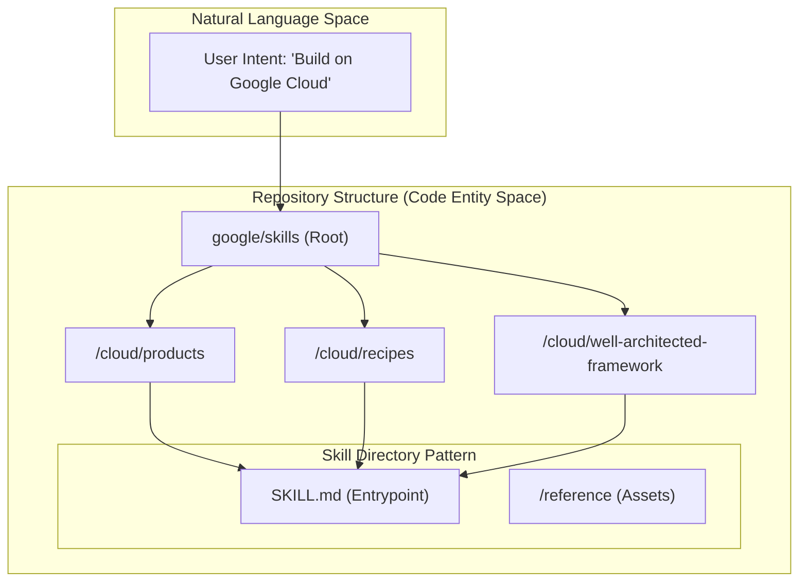
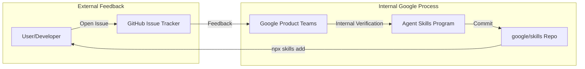

<!-- source: DeepWiki mcp.deepwiki.com · repo google/skills · page 1 Overview: google/skills Repository · fetched 2026-10-27 -->

# Overview: google/skills Repository

Relevant source files

The following files were used as context for generating this wiki page:

- [CONTRIBUTING.md](CONTRIBUTING.md)
- [LICENSE](LICENSE)
- [README.md](README.md)

The `google/skills` repository is a collection of **Agent Skills** designed for Google products and technologies, primarily focused on Google Cloud [README.md:1-5](). These skills provide structured knowledge and executable patterns that enable AI agents to interact with, manage, and architect solutions using Google's ecosystem.

The project is currently under active development and is licensed under the Apache 2.0 license [README.md:7-8, 47-50]().

### Core Purpose
The repository serves as a centralized hub for technical guidance, best practices, and operational recipes. By organizing information into "Skills," the repository allows developers and AI agents to consume modular units of knowledge tailored to specific products (like GKE or BigQuery) or cross-product workflows (like authentication or network observability).

### High-Level Architecture

The following diagram illustrates how the repository bridges high-level Google Cloud concepts to specific code entities and directory structures.

**Skill Categorization and Entity Mapping**

**Sources:** [README.md:20-34](), [CONTRIBUTING.md:25-30]()

---

### Installation and Usage

Skills are designed to be portable and easily integrated into agent environments via the `skills.sh` platform. Users can selectively install components using the `npx` command line interface [README.md:11-19]().

*   **Command:** `npx skills add google/skills`
*   **Selection:** The installer provides an interactive menu to choose specific product skills or recipes.

For a detailed step-by-step guide on setup and the contribution workflow, see **[Getting Started: Installation & Contribution](#1.1)**.

**Sources:** [README.md:11-19]()

---

### Repository Organization

The repository follows a strict directory-per-skill convention to ensure modularity and ease of consumption by AI agents. Each skill is anchored by a `SKILL.md` file, which serves as the primary specification and knowledge source [CONTRIBUTING.md:25-30]().

The content is organized into three primary pillars:
1.  **Products:** Deep dives into individual Google Cloud services (e.g., AlloyDB, Cloud Run, GKE) [README.md:22-28]().
2.  **Recipes:** End-to-end workflows that span multiple services (e.g., Onboarding, Authentication) [README.md:29-31]().
3.  **Well-Architected Framework (WAF):** Architectural guidance focused on Security, Reliability, and Cost Optimization [README.md:32-34]().

For a breakdown of the file structure and the metadata required for each skill, see **[Repository Structure & Skill Anatomy](#1.2)**.

**Sources:** [README.md:20-34](), [CONTRIBUTING.md:25-30]()

---

### Contribution Policy

To maintain technical accuracy and security alignment, this repository does not currently accept external pull requests or direct code contributions [CONTRIBUTING.md:7-11](). Instead, the community is encouraged to:
*   Report bugs or outdated SDK patterns via the [GitHub Issue Tracker](https://github.com/google/skills/issues) [README.md:38, 44]().
*   Request new skills or cross-product architectural patterns [CONTRIBUTING.md:17-19]().
*   Fork and remix the repository for specialized internal workflows [CONTRIBUTING.md:21-24]().

**Skill Delivery Workflow**

**Sources:** [README.md:38-46](), [CONTRIBUTING.md:7-19](), [CONTRIBUTING.md:25-30]()

---

### Summary of Sections

| Section | Focus |
| :--- | :--- |
| **Products** | Detailed technical specifications for Gemini API, GKE, Cloud Run, Cloud SQL, AlloyDB, BigQuery, and Firebase. |
| **Recipes** | Operational guides for cloud onboarding, authentication lifecycles, and complex network observability. |
| **Frameworks** | High-level principles and checklists for building secure, reliable, and cost-effective cloud architectures. |
| **Patterns** | Shared implementation details for IAM, Terraform, and the Model Context Protocol (MCP). |

**Sources:** [README.md:20-34]()

---

