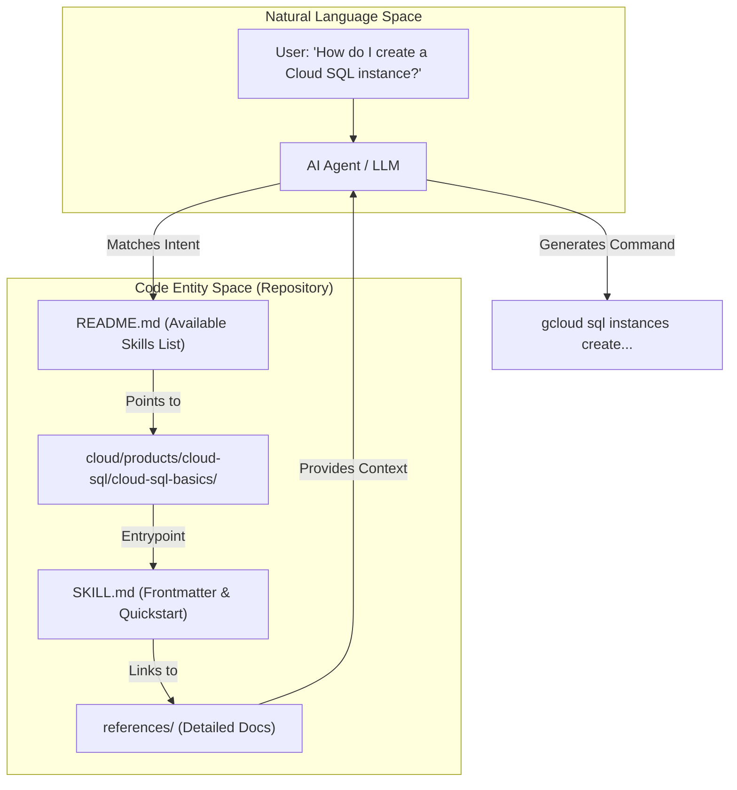
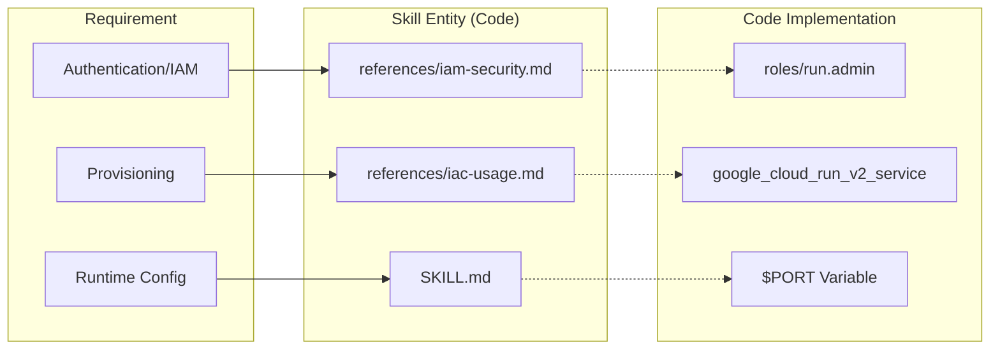

<!-- source: DeepWiki mcp.deepwiki.com · repo google/skills · page 1.2 Repository Structure & Skill Anatomy · fetched 2026-10-27 -->

# Repository Structure & Skill Anatomy

Relevant source files

The following files were used as context for generating this wiki page:

- [README.md](README.md)
- [cloud/products/cloud-run/cloud-run-basics/SKILL.md](cloud/products/cloud-run/cloud-run-basics/SKILL.md)
- [cloud/products/cloud-sql/cloud-sql-basics/SKILL.md](cloud/products/cloud-sql/cloud-sql-basics/SKILL.md)

This page details the organizational conventions of the `google/skills` repository, the internal structure of an individual "Agent Skill," and the categorization of skills into products, recipes, and architectural frameworks.

## High-Level Repository Organization

The repository follows a hierarchical structure categorized by the type of guidance provided. At the root level, skills are organized into three primary directories: `products`, `recipes`, and `well-architected-framework`.

### Top-Level Categories

| Category | Directory Path | Purpose |
| :--- | :--- | :--- |
| **Products** | `cloud/products/` | Deep-dives into specific Google Cloud services (e.g., Cloud SQL, GKE). |
| **Recipes** | `cloud/recipes/` | Multi-service workflows and end-to-end procedures (e.g., Onboarding, Authentication). |
| **WAF** | `cloud/well-architected-framework/` | High-level architectural guidance based on the Google Cloud Well-Architected Framework pillars. |

**Sources:** [README.md:20-34]()

---

## Skill Anatomy: The Directory-Per-Skill Convention

Every skill in the repository is contained within its own dedicated directory. This encapsulation ensures that all documentation, metadata, and reference materials for a specific topic (like `cloud-sql-basics`) are co-located.

### The `SKILL.md` Entrypoint

The `SKILL.md` file serves as the primary entry point for the Agent Skill. It contains two critical sections:
1.  **YAML Frontmatter**: Metadata used by the `skills.sh` platform to identify the skill name and provide a high-level description for the LLM [cloud/products/cloud-sql/cloud-sql-basics/SKILL.md:1-15]().
2.  **Core Content**: A concise "Quick Start" guide or summary of the service, designed to provide the most common commands and patterns immediately [cloud/products/cloud-sql/cloud-sql-basics/SKILL.md:30-83]().

### The `references/` Sub-directory Pattern

To keep the main `SKILL.md` concise, detailed technical information is offloaded into a `references/` sub-directory. This follows a standardized naming convention across different skills:

*   `references/iam-security.md`: Specific roles and security configurations [cloud/products/cloud-sql/cloud-sql-basics/SKILL.md:101-102]().
*   `references/iac-usage.md`: Terraform or other Infrastructure as Code snippets [cloud/products/cloud-sql/cloud-sql-basics/SKILL.md:98-99]().
*   `references/mcp-usage.md`: Documentation on how the skill interacts with Model Context Protocol servers [cloud/products/cloud-sql/cloud-sql-basics/SKILL.md:95-96]().
*   `references/cli-usage.md`: Detailed command-line interface references [cloud/products/cloud-sql/cloud-sql-basics/SKILL.md:89-90]().

### Data Flow: Skill Resolution

The following diagram illustrates how the `skills.sh` platform and an Agent interact with the repository structure to resolve a specific skill.

**Skill Discovery and Resolution Flow**

**Sources:** [README.md:20-34](), [cloud/products/cloud-sql/cloud-sql-basics/SKILL.md:1-15](), [cloud/products/cloud-sql/cloud-sql-basics/SKILL.md:84-102]()

---

## Implementation Detail: Cloud Run Example

To illustrate the anatomy in practice, consider the `cloud-run-basics` skill. It defines specific resource models and critical operational rules directly in the `SKILL.md`.

*   **Resource Models**: It defines `Services`, `Jobs`, and `Worker pools` [cloud/run/cloud-run-basics/SKILL.md:16-23]().
*   **Critical Rules**: It includes mandatory implementation details, such as the requirement to listen on `0.0.0.0` and use the `$PORT` environment variable [cloud/run/cloud-run-basics/SKILL.md:70-72]().
*   **Deployment Paths**: It provides logic for both container-based [cloud/run/cloud-run-basics/SKILL.md:74-80]() and source-based deployments [cloud/run/cloud-run-basics/SKILL.md:126-134]().

### Skill Component Mapping

The diagram below maps the conceptual requirements of a Cloud Run deployment to the specific code entities within the skill directory.

**Cloud Run Skill Entity Mapping**

**Sources:** [cloud/products/cloud-run/cloud-run-basics/SKILL.md:38-47](), [cloud/products/cloud-run/cloud-run-basics/SKILL.md:70-72](), [cloud/products/cloud-sql/cloud-sql-basics/SKILL.md:98-102]()

---

## Repository Category Definitions

### 1. Products (`cloud/products/`)
Focuses on individual service primitives. Each product skill typically includes:
*   API enablement commands (e.g., `gcloud services enable`) [cloud/products/cloud-sql/cloud-sql-basics/SKILL.md:34]().
*   Resource creation workflows [cloud/products/cloud-sql/cloud-sql-basics/SKILL.md:37-59]().
*   Connectivity and authentication patterns [cloud/products/cloud-sql/cloud-sql-basics/SKILL.md:61-82]().

### 2. Recipes (`cloud/recipes/`)
Focuses on multi-step, multi-service outcomes. Unlike product skills, recipes prioritize the "Golden Path" for a specific goal, such as setting up a new organization or establishing network observability across a project.

### 3. Well-Architected Framework (`cloud/well-architected-framework/`)
Focuses on evaluation and best practices. These skills are organized by the pillars of the Google Cloud Well-Architected Framework (Security, Reliability, Cost Optimization) and provide assessment questions and validation checklists rather than just deployment commands.

**Sources:** [README.md:22-34]()

---

