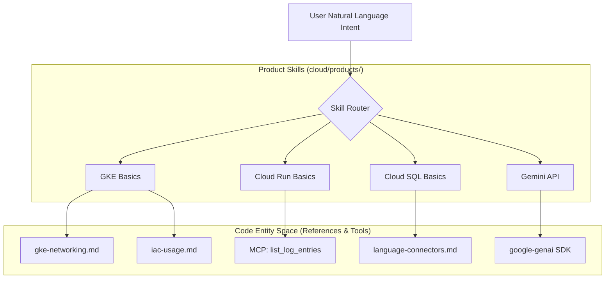
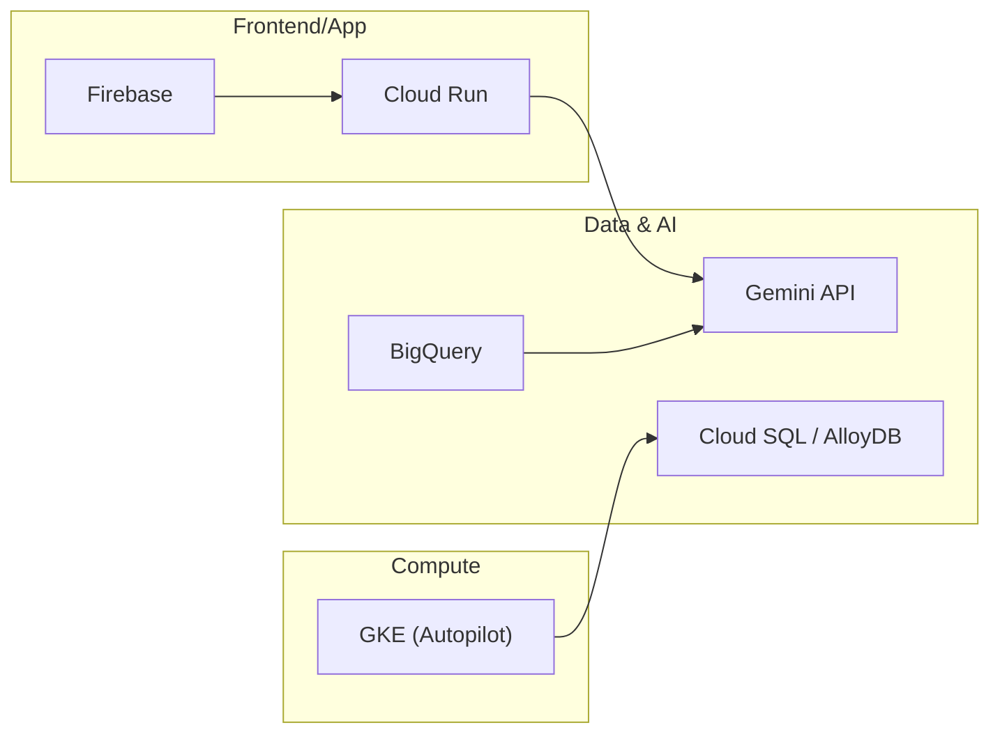

<!-- source: DeepWiki mcp.deepwiki.com · repo google/skills · page 2 Google Cloud Product Skills · fetched 2026-10-27 -->

# Google Cloud Product Skills

Relevant source files

The following files were used as context for generating this wiki page:

- [README.md](README.md)
- [cloud/products/agent-platform/gemini-api/SKILL.md](cloud/products/agent-platform/gemini-api/SKILL.md)
- [cloud/products/kubernetes-engine/gke-basics/SKILL.md](cloud/products/kubernetes-engine/gke-basics/SKILL.md)

This page provides a high-level overview of the individual Google Cloud product skills available in the `google/skills` repository. These skills are located under the `cloud/products/` directory and are designed to provide specialized knowledge, reference architectures, and automation patterns for core Google Cloud services.

Each skill includes a `SKILL.md` entry point and a `references/` subdirectory containing deep-dive documentation for specific scenarios such as networking, security, and Infrastructure as Code (IaC).

## Product Skill Architecture

The following diagram illustrates how natural language requests are mapped to specific product skills and their underlying code entities (Markdown references and MCP tools).

**Diagram: Mapping Intent to Product Entities**

Sources: [README.md:20-34](), [cloud/products/kubernetes-engine/gke-basics/SKILL.md:28-51]()

---

## 2.1 Gemini API in Agent Platform
The **Gemini Enterprise Agent Platform** (formerly Vertex AI) skill focuses on integrating Google's most advanced AI models into enterprise applications. It mandates the use of the unified `google-genai` SDK and covers high-level capabilities like multimodal understanding, context caching, and the Live Realtime API.

*   **Key Models:** `gemini-3.1-pro-preview`, `gemini-3-flash-preview`.
*   **Authentication:** Supports Application Default Credentials (ADC) and Express Mode (API Key).

For details, see [Gemini API in Agent Platform](#2.1).

Sources: [cloud/products/agent-platform/gemini-api/SKILL.md:1-22]()

---

## 2.2 Google Kubernetes Engine (GKE) Basics
The **GKE Basics** skill follows the "Golden Path" for production-ready clusters, defaulting to **Autopilot** mode. It provides a comprehensive Day-0 checklist and detailed reference modules for scaling, security, and AI/ML inference (GPUs/TPUs).

*   **Networking:** Covers VPC-native clusters and Gateway API.
*   **Security:** Focuses on Workload Identity and RBAC hardening.

For details, see [Google Kubernetes Engine (GKE) Basics](#2.2).

Sources: [cloud/products/kubernetes-engine/gke-basics/SKILL.md:10-13](), [cloud/products/kubernetes-engine/gke-basics/SKILL.md:28-48]()

---

## 2.3 Cloud Run Basics
This skill covers the serverless execution environment for containers, supporting **Services**, **Jobs**, and **Worker Pools**. It guides users through deployment paths (container image vs. source-based) and common troubleshooting for "crash-on-boot" failures.

For details, see [Cloud Run Basics](#2.3).

Sources: [README.md:25]()

---

## 2.4 Cloud SQL Basics
The **Cloud SQL** skill provides patterns for managing MySQL, PostgreSQL, and SQL Server. It emphasizes secure connectivity via the **Cloud SQL Auth Proxy** and IAM database authentication, alongside Terraform provisioning for High Availability (HA).

For details, see [Cloud SQL Basics](#2.4).

Sources: [README.md:26]()

---

## 2.5 AlloyDB Basics
**AlloyDB** is covered as a high-performance PostgreSQL-compatible database. The skill explains the disaggregated storage-compute architecture and the **AlloyDB AI** suite, including vector search and model endpoint management.

For details, see [AlloyDB Basics](#2.5).

Sources: [README.md:23]()

---

## 2.6 BigQuery Basics
The **BigQuery** skill focuses on serverless data warehousing. It covers the resource hierarchy (Datasets/Tables), BigQuery ML, and specialized AI functions like `bigquery_ai_generate`. It also includes Model Context Protocol (MCP) integration for executing SQL directly from an agent.

For details, see [BigQuery Basics](#2.6).

Sources: [README.md:24]()

---

## 2.7 Firebase Basics
The **Firebase** skill bridges the gap between client-side development and Google Cloud infrastructure. It requires the `firebase-tools` CLI and covers the tiered knowledge retrieval architecture, security rules, and project synchronization.

For details, see [Firebase Basics](#2.7).

Sources: [README.md:27]()

---

## Product Skill Relationships

The following diagram shows how these products typically interact within the codebase's reference architectures.

**Diagram: Product Interoperability**

Sources: [README.md:20-34]()

---

