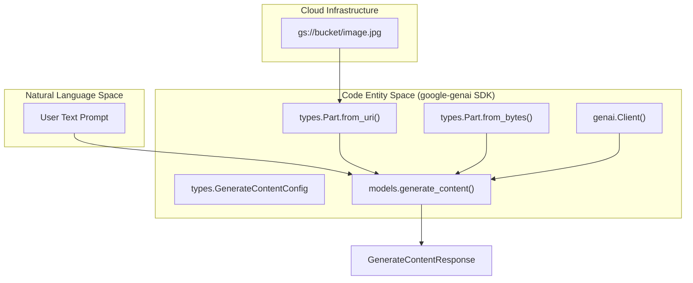
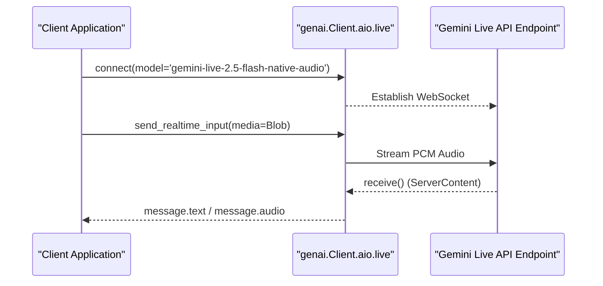

<!-- source: DeepWiki mcp.deepwiki.com · repo google/skills · page 2.1 Gemini API in Agent Platform · fetched 2026-10-27 -->

# Gemini API in Agent Platform

Relevant source files

The following files were used as context for generating this wiki page:

- [cloud/products/agent-platform/gemini-api/SKILL.md](cloud/products/agent-platform/gemini-api/SKILL.md)
- [cloud/products/agent-platform/gemini-api/references/advanced_features.md](cloud/products/agent-platform/gemini-api/references/advanced_features.md)
- [cloud/products/agent-platform/gemini-api/references/bounding_box.md](cloud/products/agent-platform/gemini-api/references/bounding_box.md)
- [cloud/products/agent-platform/gemini-api/references/embeddings.md](cloud/products/agent-platform/gemini-api/references/embeddings.md)
- [cloud/products/agent-platform/gemini-api/references/live_api.md](cloud/products/agent-platform/gemini-api/references/live_api.md)
- [cloud/products/agent-platform/gemini-api/references/media_generation.md](cloud/products/agent-platform/gemini-api/references/media_generation.md)
- [cloud/products/agent-platform/gemini-api/references/model_tuning.md](cloud/products/agent-platform/gemini-api/references/model_tuning.md)
- [cloud/products/agent-platform/gemini-api/references/safety.md](cloud/products/agent-platform/gemini-api/references/safety.md)
- [cloud/products/agent-platform/gemini-api/references/structured_and_tools.md](cloud/products/agent-platform/gemini-api/references/structured_and_tools.md)
- [cloud/products/agent-platform/gemini-api/references/text_and_multimodal.md](cloud/products/agent-platform/gemini-api/references/text_and_multimodal.md)

This page covers the Gemini Enterprise Agent Platform skill, focusing on the unified `google-genai` SDK, model tiers within the Gemini 3.x series, authentication modes, and advanced capabilities such as multimodal generation, function calling, context caching, and the Live API.

## Overview and SDKs

The Gemini Enterprise Agent Platform (formerly known as Vertex AI) provides enterprise-grade access to Google's most advanced AI models [cloud/products/agent-platform/gemini-api/SKILL.md:7-11](). The platform requires the use of the unified Gen AI SDK across multiple programming languages.

| Language | Package Name | Installation Command |
| :--- | :--- | :--- |
| **Python** | `google-genai` | `pip install google-genai` |
| **JS/TS** | `@google/genai` | `npm install @google/genai` |
| **Go** | `google.golang.org/genai` | `go get google.golang.org/genai` |
| **C#/.NET** | `Google.GenAI` | `dotnet add package Google.GenAI` |
| **Java** | `com.google.genai:google-genai` | See Maven/Gradle config |

Legacy SDKs such as `google-cloud-aiplatform`, `@google-cloud/vertexai`, and `google-generativeai` are deprecated and should be migrated to the unified SDKs listed above [cloud/products/agent-platform/gemini-api/SKILL.md:26-55]().

**Sources:**
- [cloud/products/agent-platform/gemini-api/SKILL.md:7-55]()

## Authentication & Configuration

The platform supports two primary authentication modes: Application Default Credentials (ADC) for standard Google Cloud environments and Express Mode for API-key-based access [cloud/products/agent-platform/gemini-api/SKILL.md:61-76]().

### Authentication Modes

| Mode | Key Environment Variables | Use Case |
| :--- | :--- | :--- |
| **ADC** | `GOOGLE_CLOUD_PROJECT`, `GOOGLE_GENAI_USE_VERTEXAI=true` | Standard GCP environments, Service Accounts. |
| **Express** | `GOOGLE_API_KEY`, `GOOGLE_GENAI_USE_VERTEXAI=true` | Quick prototyping, API key restricted access. |

### Client Initialization
The `genai.Client` class is the primary entry point. Initializing it without arguments allows it to automatically resolve configuration from environment variables [cloud/products/agent-platform/gemini-api/SKILL.md:78-83]().

**Sources:**
- [cloud/products/agent-platform/gemini-api/SKILL.md:57-90]()

## Model Tiers

The platform features the Gemini 3 series for production workloads. Older models (Gemini 1.0, 1.5, 2.0) are considered legacy [cloud/products/agent-platform/gemini-api/SKILL.md:94-110]().

### Gemini 3.x Series
*   **`gemini-3.1-pro-preview`**: High-complexity reasoning, coding, and research (1M token window) [cloud/products/agent-platform/gemini-api/SKILL.md:94]().
*   **`gemini-3-flash-preview`**: Fast, balanced performance for multimodal tasks (1M token window) [cloud/products/agent-platform/gemini-api/SKILL.md:96]().
*   **`gemini-3-pro-image-preview`**: Advanced image generation and editing [cloud/products/agent-platform/gemini-api/SKILL.md:97]().
*   **`gemini-live-2.5-flash-native-audio`**: Specialized for the Live Realtime API [cloud/products/agent-platform/gemini-api/SKILL.md:99]().

**Sources:**
- [cloud/products/agent-platform/gemini-api/SKILL.md:92-111]()

## Implementation Flow: Text and Multimodal

The `models.generate_content` method handles both text-only and multimodal inputs. Multimodal inputs are provided via `types.Part` objects, which can reference Google Cloud Storage URIs or local bytes [cloud/products/agent-platform/gemini-api/references/text_and_multimodal.md:48-69]().

### Multimodal Data Flow
This diagram illustrates how the `genai.Client` bridges natural language requests and file data into the model space.

**Diagram: Multimodal Content Generation Flow**

**Sources:**
- [cloud/products/agent-platform/gemini-api/references/text_and_multimodal.md:1-91]()

## Advanced Specialized Capabilities

### Function Calling and Tools
The SDK allows the model to interact with external systems via `tools`. Supported tools include:
*   **Function Calling**: Passing Python functions to `GenerateContentConfig(tools=[...])` [cloud/products/agent-platform/gemini-api/references/structured_and_tools.md:30-50]().
*   **Google Search Grounding**: Using `types.GoogleSearch()` to verify responses against live web data [cloud/products/agent-platform/gemini-api/references/structured_and_tools.md:62-79]().
*   **Code Execution**: Enabling the model to write and run Python code for precise calculations [cloud/products/agent-platform/gemini-api/references/structured_and_tools.md:89-104]().

### Context Caching
For large datasets (e.g., long PDFs or video files), `client.caches.create` stores the context to reduce latency and costs for subsequent requests [cloud/products/agent-platform/gemini-api/references/advanced_features.md:3-25]().

### Live API (Realtime)
The Live API utilizes WebSockets for bidirectional streaming. It uses `client.aio.live.connect` for low-latency voice and video interactions [cloud/products/agent-platform/gemini-api/references/live_api.md:1-28]().

**Diagram: Live API WebSocket Interaction**

**Sources:**
- [cloud/products/agent-platform/gemini-api/references/advanced_features.md:3-35]()
- [cloud/products/agent-platform/gemini-api/references/live_api.md:1-37]()
- [cloud/products/agent-platform/gemini-api/references/structured_and_tools.md:1-130]()

## Batch Prediction and Tuning

For non-interactive workloads, the platform supports asynchronous processing and model customization.

*   **Batch Prediction**: Uses `client.batches.create` to process large JSONL files stored in GCS [cloud/products/agent-platform/gemini-api/references/advanced_features.md:37-57]().
*   **Model Tuning**: Uses `client.tunings.tune` for Supervised Fine-Tuning (SFT) using `types.TuningDataset` [cloud/products/agent-platform/gemini-api/references/model_tuning.md:1-22]().

**Sources:**
- [cloud/products/agent-platform/gemini-api/references/advanced_features.md:37-57]()
- [cloud/products/agent-platform/gemini-api/references/model_tuning.md:1-38]()

---

