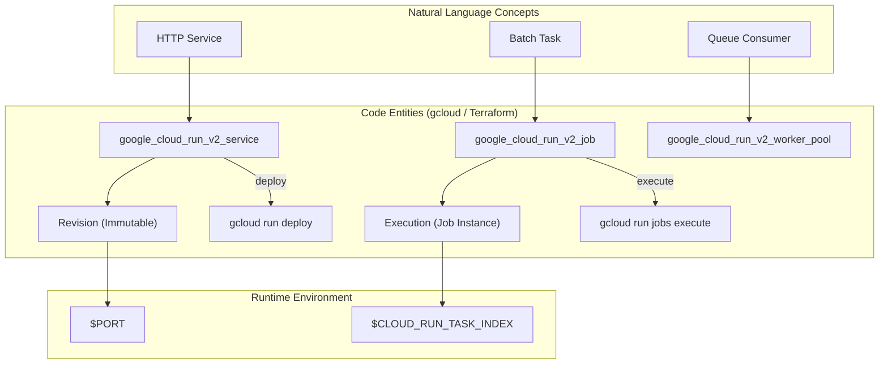
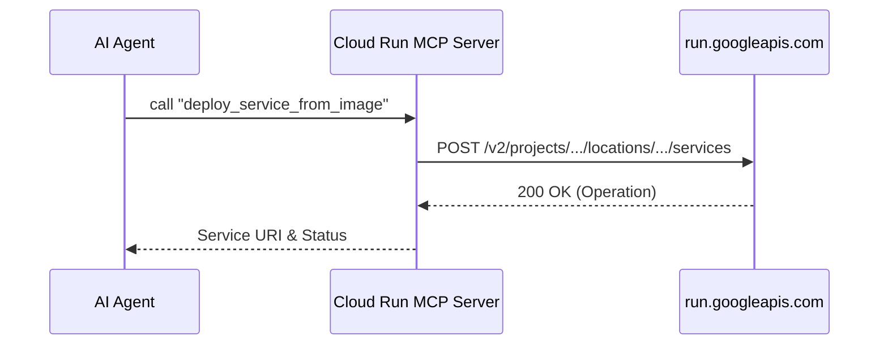

<!-- source: DeepWiki mcp.deepwiki.com · repo google/skills · page 2.3 Cloud Run Basics · fetched 2026-10-27 -->

# Cloud Run Basics

<details>
<summary>Relevant source files</summary>

The following files were used as context for generating this wiki page:

- [cloud/products/cloud-run/cloud-run-basics/SKILL.md](cloud/products/cloud-run/cloud-run-basics/SKILL.md)
- [cloud/products/cloud-run/cloud-run-basics/references/cli-usage.md](cloud/products/cloud-run/cloud-run-basics/references/cli-usage.md)
- [cloud/products/cloud-run/cloud-run-basics/references/client-library-usage.md](cloud/products/cloud-run/cloud-run-basics/references/client-library-usage.md)
- [cloud/products/cloud-run/cloud-run-basics/references/core-concepts.md](cloud/products/cloud-run/cloud-run-basics/references/core-concepts.md)
- [cloud/products/cloud-run/cloud-run-basics/references/iac-usage.md](cloud/products/cloud-run/cloud-run-basics/references/iac-usage.md)
- [cloud/products/cloud-run/cloud-run-basics/references/iam-security.md](cloud/products/cloud-run/cloud-run-basics/references/iam-security.md)
- [cloud/products/cloud-run/cloud-run-basics/references/mcp-usage.md](cloud/products/cloud-run/cloud-run-basics/references/mcp-usage.md)

</details>


Cloud Run is a fully managed application platform for running code, functions, or containers on Google Cloud's scalable infrastructure. It abstracts infrastructure management by providing serverless execution environments that scale automatically based on demand [cloud/products/cloud-run/cloud-run-basics/SKILL.md:11-14]().

## Resource Models

Cloud Run supports three primary resource types to accommodate different workload patterns:

| Resource Type | Description | Key Use Cases |
| :--- | :--- | :--- |
| **Services** | Stateless instances that autoscale based on HTTP requests or events. | Web apps, APIs, microservices [cloud/products/cloud-run/cloud-run-basics/references/core-concepts.md:11-13](). |
| **Jobs** | Parallelizable tasks that run to completion. | Data processing, DB migrations, scheduled tasks [cloud/products/cloud-run/cloud-run-basics/references/core-concepts.md:15-17](). |
| **Worker Pools** | Always-on, pull-based background processing. | Kafka consumers, Pub/Sub pull, RabbitMQ [cloud/products/cloud-run/cloud-run-basics/SKILL.md:21-23](). |

### Hierarchy and Lifecycle
Services are the top-level resource. Each deployment creates an immutable **Revision**, which is a snapshot of the configuration and container image [cloud/products/cloud-run/cloud-run-basics/references/core-concepts.md:26-30]().

Sources: [cloud/products/cloud-run/cloud-run-basics/SKILL.md:16-23](), [cloud/products/cloud-run/cloud-run-basics/references/core-concepts.md:9-47]()

## Deployment Paths

Cloud Run offers multiple paths to move from code to a running service.

### 1. Container Image Deployment
The standard path involves deploying a pre-built image from **Artifact Registry** or **Docker Hub**. Cloud Run imports the image during deployment and keeps a copy for serving revisions [cloud/products/cloud-run/cloud-run-basics/SKILL.md:74-79]().

```bash
gcloud run deploy SERVICE_NAME --image IMAGE_URL --region REGION
```

### 2. Source-to-Service (Buildpacks)
Uses Google Cloud's Buildpacks and Cloud Build to containerize source code automatically without requiring a local Docker installation [cloud/products/cloud-run/cloud-run-basics/SKILL.md:130-134]().
*   **With Dockerfile:** Cloud Build executes the Dockerfile in the cloud [cloud/products/cloud-run/cloud-run-basics/SKILL.md:149-155]().
*   **Automatic Updates:** Can be configured to use Google-managed base images that receive security patches automatically [cloud/products/cloud-run/cloud-run-basics/SKILL.md:136-147]().

### 3. No-Build Path (Preview)
Deploys artifacts directly to Cloud Run, bypassing the Cloud Build step for rapid deployment cycles [cloud/products/cloud-run/cloud-run-basics/SKILL.md:157-161]().

```bash
gcloud beta run deploy SERVICE_NAME --source APPLICATION_PATH --no-build
```

Sources: [cloud/products/cloud-run/cloud-run-basics/SKILL.md:65-171](), [cloud/products/cloud-run/cloud-run-basics/references/cli-usage.md:13-33]()

## Runtime Configuration & Environment

### The Container Contract
To avoid **crash-on-boot** failures, containers must adhere to the runtime contract:
*   **Port Listening:** The ingress container MUST listen on `0.0.0.0` (not `127.0.0.1`) [cloud/products/cloud-run/cloud-run-basics/SKILL.md:70-72]().
*   **Port Variable:** Use the injected `$PORT` environment variable (defaults to `8080`) [cloud/products/cloud-run/cloud-run-basics/references/core-concepts.md:95-96]().
*   **Architecture:** Executables must be compiled for Linux 64-bit (x86_64) [cloud/products/cloud-run/cloud-run-basics/references/core-concepts.md:66-67]().

### Resource Model Visualization

**Cloud Run Resource to Code Entity Mapping**


Sources: [cloud/products/cloud-run/cloud-run-basics/references/core-concepts.md:22-47](), [cloud/products/cloud-run/cloud-run-basics/references/iac-usage.md:12-64]()

## IAM and Security

Cloud Run uses IAM roles to control deployment and invocation.

### Required Roles for Deployment
*   `roles/run.admin`: Full control over Cloud Run resources [cloud/products/cloud-run/cloud-run-basics/references/iam-security.md:9]().
*   `roles/run.sourceDeveloper`: Required for source-based deployments [cloud/products/cloud-run/cloud-run-basics/SKILL.md:43]().
*   `roles/iam.serviceAccountUser`: To associate a service identity with the resource [cloud/products/cloud-run/cloud-run-basics/SKILL.md:44-45]().
*   `roles/run.builder`: Specifically for the Cloud Build service account to build sources [cloud/products/cloud-run/cloud-run-basics/SKILL.md:52-53]().

### Service Identity
Workloads should run as **User-managed service accounts** (e.g., `name@project.iam.gserviceaccount.com`) rather than the default Compute Engine service account to follow the principle of least privilege [cloud/products/cloud-run/cloud-run-basics/references/iam-security.md:20-28]().

Sources: [cloud/products/cloud-run/cloud-run-basics/SKILL.md:38-64](), [cloud/products/cloud-run/cloud-run-basics/references/iam-security.md:1-48]()

## Infrastructure as Code (Terraform)

Cloud Run resources are managed via the `google` provider using the `v2` resources.

### Example: Service with Public Access
```terraform
resource "google_cloud_run_v2_service" "default" {
  name     = "cloudrun-service"
  location = "us-central1"
  ingress  = "INGRESS_TRAFFIC_ALL"

  template {
    containers {
      image = "us-docker.pkg.dev/cloudrun/container/hello"
    }
  }
}

resource "google_cloud_run_v2_service_iam_member" "noauth" {
  name   = google_cloud_run_v2_service.default.name
  role   = "roles/run.invoker"
  member = "allUsers"
}
```
Sources: [cloud/products/cloud-run/cloud-run-basics/references/iac-usage.md:12-32]()

## Model Context Protocol (MCP) Usage

The Cloud Run MCP server enables AI agents to interact with Cloud Run resources using standardized tools [cloud/products/cloud-run/cloud-run-basics/references/mcp-usage.md:3-4]().

**MCP Tool Mapping**

| MCP Tool Name | Purpose | Code Equivalent |
| :--- | :--- | :--- |
| `list_services` | List all services in a project | `gcloud run services list` [cloud/products/cloud-run/cloud-run-basics/references/mcp-usage.md:12](). |
| `get_service` | Retrieve service URI and status | `gcloud run services describe` [cloud/products/cloud-run/cloud-run-basics/references/mcp-usage.md:10](). |
| `deploy_service_from_image` | Deploy a container | `gcloud run deploy --image` [cloud/products/cloud-run/cloud-run-basics/references/mcp-usage.md:14](). |
| `deploy_service_from_archive` | Deploy from source archive | Skips build step for speed [cloud/products/cloud-run/cloud-run-basics/references/mcp-usage.md:16](). |


Sources: [cloud/products/cloud-run/cloud-run-basics/references/mcp-usage.md:1-25]()

## Troubleshooting: Crash-on-Boot
If a service fails to start, verify the following:
1.  **Port Binding:** Ensure the application listens on `0.0.0.0:$PORT` [cloud/products/cloud-run/cloud-run-basics/SKILL.md:70-72]().
2.  **Logs:** Use `gcloud logging read` to inspect the container's `stdout` and `stderr` [cloud/products/cloud-run/cloud-run-basics/references/cli-usage.md:105-107]().
3.  **Permissions:** Verify the Service Account has `roles/run.invoker` if internal communication is expected [cloud/products/cloud-run/cloud-run-basics/references/iam-security.md:10]().

Sources: [cloud/products/cloud-run/cloud-run-basics/SKILL.md:70-72](), [cloud/products/cloud-run/cloud-run-basics/references/cli-usage.md:100-107]()

---

