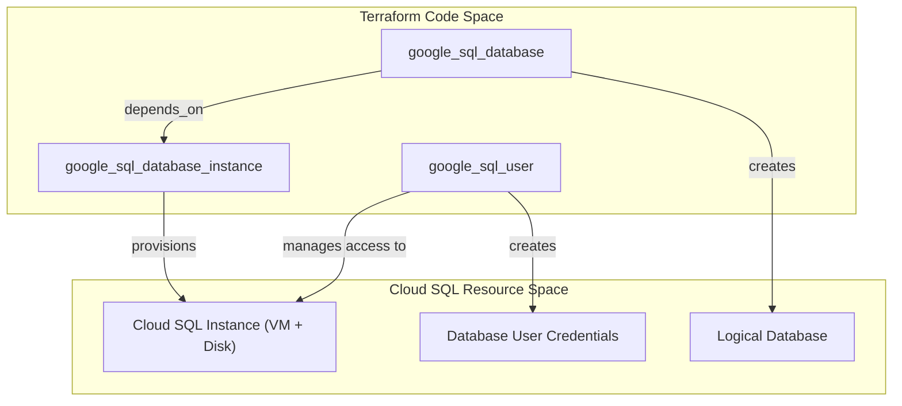
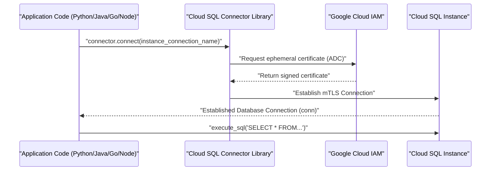

<!-- source: DeepWiki mcp.deepwiki.com · repo google/skills · page 2.4 Cloud SQL Basics · fetched 2026-10-27 -->

# Cloud SQL Basics

<details>
<summary>Relevant source files</summary>

The following files were used as context for generating this wiki page:

- [cloud/products/alloydb/alloydb-basics/references/iam-security.md](cloud/products/alloydb/alloydb-basics/references/iam-security.md)
- [cloud/products/cloud-sql/cloud-sql-basics/SKILL.md](cloud/products/cloud-sql/cloud-sql-basics/SKILL.md)
- [cloud/products/cloud-sql/cloud-sql-basics/references/cli-usage.md](cloud/products/cloud-sql/cloud-sql-basics/references/cli-usage.md)
- [cloud/products/cloud-sql/cloud-sql-basics/references/client-library-usage.md](cloud/products/cloud-sql/cloud-sql-basics/references/client-library-usage.md)
- [cloud/products/cloud-sql/cloud-sql-basics/references/core-concepts.md](cloud/products/cloud-sql/cloud-sql-basics/references/core-concepts.md)
- [cloud/products/cloud-sql/cloud-sql-basics/references/iac-usage.md](cloud/products/cloud-sql/cloud-sql-basics/references/iac-usage.md)
- [cloud/products/cloud-sql/cloud-sql-basics/references/iam-security.md](cloud/products/cloud-sql/cloud-sql-basics/references/iam-security.md)
- [cloud/products/cloud-sql/cloud-sql-basics/references/mcp-usage.md](cloud/products/cloud-sql/cloud-sql-basics/references/mcp-usage.md)

</details>


Cloud SQL is a fully managed relational database service for **MySQL**, **PostgreSQL**, and **SQL Server**. It automates infrastructure management tasks such as hardware provisioning, patch management, backups, and replication, while providing high performance and availability for applications [cloud/products/cloud-sql/cloud-sql-basics/SKILL.md:1-22]().

## Resource Hierarchy and Architecture

Cloud SQL manages third-party database engines as Google Cloud resources. Each instance is powered by a Virtual Machine (VM) running the specific database program [cloud/products/cloud-sql/cloud-sql-basics/SKILL.md:8-11](), [cloud/products/cloud-sql/cloud-sql-basics/references/core-concepts.md:19-22]().

*   **Primary Instance:** The main read/write entry point for the database [cloud/products/cloud-sql/cloud-sql-basics/references/core-concepts.md:24]().
*   **High Availability (HA):** A configuration providing a standby VM in a different zone with automatic failover to ensure reliability [cloud/products/cloud-sql/cloud-sql-basics/references/core-concepts.md:26-27]().
*   **Read Replicas:** Instances used to scale read traffic and provide local data access across different regions [cloud/products/cloud-sql/cloud-sql-basics/references/core-concepts.md:29-30]().
*   **Storage:** Utilizes scalable and durable network-attached Persistent Disks [cloud/products/cloud-sql/cloud-sql-basics/references/core-concepts.md:34-35]().

### Supported Engines
| Engine | Supported Versions |
| :--- | :--- |
| **MySQL** | 5.6, 5.7, 8.0, 8.4 [cloud/products/cloud-sql/cloud-sql-basics/references/core-concepts.md:11]() |
| **PostgreSQL** | 9.6 through 18 (Default is 18) [cloud/products/cloud-sql/cloud-sql-basics/references/core-concepts.md:13-14]() |
| **SQL Server** | 2017, 2019, 2022, 2025 (Express, Web, Standard, Enterprise) [cloud/products/cloud-sql/cloud-sql-basics/references/core-concepts.md:16-17]() |

**Sources:** [cloud/products/cloud-sql/cloud-sql-basics/SKILL.md:1-22](), [cloud/products/cloud-sql/cloud-sql-basics/references/core-concepts.md:1-40]()

---

## Infrastructure as Code (Terraform)

Cloud SQL resources are provisioned using the `google` Terraform provider. The primary resources involve the instance itself, the logical databases within it, and the database users.

### Provisioning Flow

The following diagram illustrates the relationship between Terraform resources and the resulting Cloud SQL entities.

**Diagram: Terraform to Cloud SQL Entity Mapping**

**Sources:** [cloud/products/cloud-sql/cloud-sql-basics/references/iac-usage.md:1-37]()

### Implementation Example
Citing [cloud/products/cloud-sql/cloud-sql-basics/references/iac-usage.md:13-37]():
```terraform
resource "google_sql_database_instance" "default" {
  name             = "master-instance"
  region           = "us-central1"
  database_version = "POSTGRES_15"
  settings {
    tier = "db-f1-micro"
    backup_configuration { enabled = true }
  }
}

resource "google_sql_database" "database" {
  name     = "my-database"
  instance = google_sql_database_instance.default.name
}
```

---

## Connectivity and Security

Cloud SQL supports multiple connectivity methods, prioritizing secure, encrypted paths.

### Connection Methods
1.  **Cloud SQL Auth Proxy:** The recommended method. It provides IAM-based authentication and end-to-end encryption without requiring SSL/TLS certificates or manual IP allowlisting [cloud/products/cloud-sql/cloud-sql-basics/references/iam-security.md:28-30]().
2.  **Private IP:** Traffic remains within the Google Cloud network using VPC Peering, Private Services Access (PSA), or Private Service Connect (PSC) [cloud/products/cloud-sql/cloud-sql-basics/references/iam-security.md:32-33]().
3.  **Public IP:** Requires **Authorized Networks** (CIDR restrictions) to secure the endpoint [cloud/products/cloud-sql/cloud-sql-basics/references/iam-security.md:35-36]().

### IAM Roles
| Role | Purpose |
| :--- | :--- |
| `roles/cloudsql.admin` | Full control over all Cloud SQL resources [cloud/products/cloud-sql/cloud-sql-basics/references/iam-security.md:10](). |
| `roles/cloudsql.client` | Required for connectivity via Cloud SQL Auth Proxy or App Engine [cloud/products/cloud-sql/cloud-sql-basics/references/iam-security.md:17-19](). |
| `roles/cloudsql.instanceUser` | Permission to log in to the database instance [cloud/products/cloud-sql/cloud-sql-basics/references/iam-security.md:20-21](). |

**Data Security:** Data is encrypted at rest by default. Users can opt for **Customer-Managed Encryption Keys (CMEK)** for additional control [cloud/products/cloud-sql/cloud-sql-basics/references/iam-security.md:40-41](). **IAM Database Authentication** allows logging in using IAM principals instead of static passwords for MySQL and PostgreSQL [cloud/products/cloud-sql/cloud-sql-basics/references/iam-security.md:43-45]().

**Sources:** [cloud/products/cloud-sql/cloud-sql-basics/references/iam-security.md:1-63]()

---

## Language Connectors and SDKs

Google Cloud provides language-specific connectors that handle the complexities of secure mTLS connections and IAM authentication automatically.

### Programming Interface
**Diagram: Application to Database Data Flow**

**Sources:** [cloud/products/cloud-sql/cloud-sql-basics/references/client-library-usage.md:12-109]()

### Connector Implementation Examples
*   **Python:** Uses `cloud-sql-python-connector` with drivers like `pg8000` [cloud/products/cloud-sql/cloud-sql-basics/references/client-library-usage.md:23-40]().
*   **Java:** Uses `jdbc-socket-factory-bom` to provide `postgres-socket-factory` or `mysql-socket-factory` [cloud/products/cloud-sql/cloud-sql-basics/references/client-library-usage.md:46-93]().
*   **Node.js:** Uses `@google-cloud/cloud-sql-connector` [cloud/products/cloud-sql/cloud-sql-basics/references/client-library-usage.md:100]().
*   **Go:** Uses `cloud.google.com/go/cloudsqlconn` [cloud/products/cloud-sql/cloud-sql-basics/references/client-library-usage.md:108]().

---

## Model Context Protocol (MCP) Integration

Cloud SQL can be managed by AI agents via the **Model Context Protocol (MCP)**. This allows for automated schema migrations, health auditing, and query execution [cloud/products/cloud-sql/cloud-sql-basics/references/mcp-usage.md:1-10]().

### Available MCP Tools
*   `execute_sql`: Runs DDL, DML, or DQL statements directly on the instance [cloud/products/cloud-sql/cloud-sql-basics/references/mcp-usage.md:19-20]().
*   `create_instance` / `clone_instance`: Lifecycle management of database resources [cloud/products/cloud-sql/cloud-sql-basics/references/mcp-usage.md:15-17]().
*   `import_data`: Ingests data from Cloud Storage into the instance [cloud/products/cloud-sql/cloud-sql-basics/references/mcp-usage.md:25]().
*   `list_users` / `create_user`: Manages database access identities [cloud/products/cloud-sql/cloud-sql-basics/references/mcp-usage.md:18-24]().

**Sources:** [cloud/products/cloud-sql/cloud-sql-basics/references/mcp-usage.md:1-52]()

---

