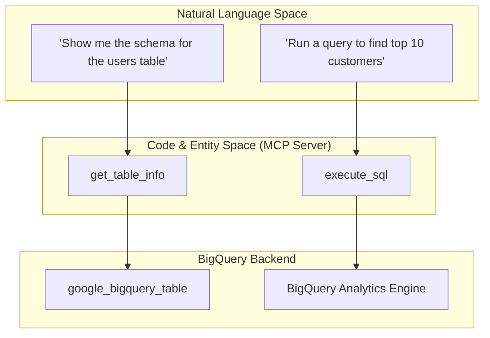
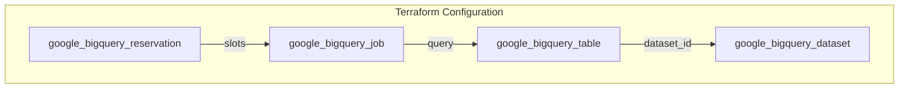

<!-- source: DeepWiki mcp.deepwiki.com · repo google/skills · page 2.6 BigQuery Basics · fetched 2026-10-27 -->

# BigQuery Basics

Relevant source files

The following files were used as context for generating this wiki page:

- [cloud/products/bigquery/bigquery-basics/SKILL.md](cloud/products/bigquery/bigquery-basics/SKILL.md)
- [cloud/products/bigquery/bigquery-basics/references/cli-usage.md](cloud/products/bigquery/bigquery-basics/references/cli-usage.md)
- [cloud/products/bigquery/bigquery-basics/references/client-library-usage.md](cloud/products/bigquery/bigquery-basics/references/client-library-usage.md)
- [cloud/products/bigquery/bigquery-basics/references/core-concepts.md](cloud/products/bigquery/bigquery-basics/references/core-concepts.md)
- [cloud/products/bigquery/bigquery-basics/references/iac-usage.md](cloud/products/bigquery/bigquery-basics/references/iac-usage.md)
- [cloud/products/bigquery/bigquery-basics/references/iam-security.md](cloud/products/bigquery/bigquery-basics/references/iam-security.md)
- [cloud/products/bigquery/bigquery-basics/references/mcp-usage.md](cloud/products/bigquery/bigquery-basics/references/mcp-usage.md)

BigQuery is a serverless, AI-ready data platform designed for high-speed analysis of massive datasets using SQL and Python. It utilizes a disaggregated architecture that separates compute (analysis) from storage, allowing both to scale independently and providing built-in capabilities for machine learning, geospatial analysis, and business intelligence [cloud/products/bigquery/bigquery-basics/SKILL.md:14-18]().

## System Architecture

BigQuery's architecture is built on a petabit-scale network connecting two primary components:
*   **BigQuery Storage:** A columnar storage format optimized for analytical queries, supporting high availability through multi-location replication [cloud/products/bigquery/bigquery-basics/references/core-concepts.md:20-22]().
*   **BigQuery Analytics:** A scalable, distributed engine that processes data within BigQuery and from external sources (federated queries) [cloud/products/bigquery/bigquery-basics/references/core-concepts.md:24-25]().

### Resource Model
BigQuery organizes resources in a strict hierarchy within the Google Cloud ecosystem:
1.  **Organization/Folder/Project:** Standard resource containers.
2.  **Dataset:** The top-level container used to organize and control access to tables and views.
3.  **Table/View:** The fundamental unit of data storage and logical representation [cloud/products/bigquery/bigquery-basics/references/core-concepts.md:29-33]().

### Data Flow: Natural Language to BigQuery Execution
The following diagram illustrates how natural language requests are translated into BigQuery operations via the Model Context Protocol (MCP) and BigQuery Studio.

**Diagram: Natural Language to BigQuery Entity Mapping**

Sources: [cloud/products/bigquery/bigquery-basics/references/mcp-usage.md:8-21](), [cloud/products/bigquery/bigquery-basics/references/iac-usage.md:26-28]()

## Core Capabilities

### BigQuery ML and AI Functions
BigQuery integrates machine learning directly into the SQL engine, allowing users to create and execute models without moving data. Advanced AI functions extend these capabilities for generative and search tasks:
*   `bigquery_ai_generate`: Generates text using LLMs [cloud/products/bigquery/bigquery-basics/SKILL.md:96-96]().
*   `bigquery_ai_search`: Performs vector-based or semantic searches [cloud/products/bigquery/bigquery-basics/SKILL.md:102-102]().
*   `bigquery_ai_forecast`: Time-series forecasting [cloud/products/bigquery/bigquery-basics/SKILL.md:95-95]().
*   `bigquery_ai_detect_anomalies`: Identifies outliers in datasets [cloud/products/bigquery/bigquery-basics/SKILL.md:94-94]().

### BigQuery Studio
BigQuery Studio serves as a unified workspace for data engineering and analysis, featuring:
*   **SQL Editor:** Includes AI-powered code completion and generation via Gemini [cloud/products/bigquery/bigquery-basics/references/core-concepts.md:61-61]().
*   **Python Notebooks:** Integrated support for Colab Enterprise and `bigframes` (BigQuery DataFrames) [cloud/products/bigquery/bigquery-basics/references/core-concepts.md:63-64]().

## Implementation & Tools

### CLI Operations (`bq`)
The `bq` tool is the primary interface for managing resources and jobs.

| Task | Command Example |
| :--- | :--- |
| Create Dataset | `bq mk --dataset --location=US my_dataset` |
| Create Table | `bq mk --table my_dataset.mytable schema.json` |
| Load Data (CSV) | `bq load --source_format=CSV my_dataset.my_table gs://bucket/data.csv` |
| Run Query | `bq query --use_legacy_sql=false 'SELECT * FROM ...'` |
| Dry Run | `bq query --use_legacy_sql=false --dry_run 'SELECT ...'` |

Sources: [cloud/products/bigquery/bigquery-basics/SKILL.md:29-61](), [cloud/products/bigquery/bigquery-basics/references/cli-usage.md:16-80]()

### Infrastructure as Code (Terraform)
BigQuery resources are provisioned using the `google_bigquery_*` resource types.

**Diagram: Terraform Resource Dependency**

Sources: [cloud/products/bigquery/bigquery-basics/references/iac-usage.md:13-63]()

### MCP Server Integration
BigQuery provides a remote Model Context Protocol (MCP) server that exposes specific tools for agents to interact with data.

*   **`list_dataset_ids`**: Retrieves project datasets [cloud/products/bigquery/bigquery-basics/references/mcp-usage.md:8-8]().
*   **`get_table_info`**: Retrieves table metadata and schema [cloud/products/bigquery/bigquery-basics/references/mcp-usage.md:11-11]().
*   **`execute_sql`**: Executes `SELECT` statements. For security, `INSERT`, `UPDATE`, and `DELETE` are restricted in this tool [cloud/products/bigquery/bigquery-basics/references/mcp-usage.md:12-15]().

## Security and IAM

BigQuery employs a granular IAM model and data governance features:
*   **Principle of Least Privilege:** Permissions should be granted at the most granular level possible (e.g., table or view level) [cloud/products/bigquery/bigquery-basics/references/iam-security.md:4-7]().
*   **Service Agents:** Internal operations use the BigQuery Service Agent: `service-PROJECT_NUMBER@gcp-sa-bigquery.iam.gserviceaccount.com` [cloud/products/bigquery/bigquery-basics/references/iam-security.md:17-18]().
*   **Column-Level Security:** Managed via policy tags [cloud/products/bigquery/bigquery-basics/references/iam-security.md:33-34]().
*   **Authorized Views:** Allows querying data without granting access to underlying source tables [cloud/products/bigquery/bigquery-basics/references/iam-security.md:45-46]().

## Pricing Model
BigQuery billing is split into two components:
1.  **Storage:** Charged per GB. Includes **Active Storage** (modified in <90 days) and **Long-term Storage** (unmodified for >90 days, ~50% price reduction) [cloud/products/bigquery/bigquery-basics/references/core-concepts.md:73-77]().
2.  **Analysis:** Billed via **On-demand** (bytes processed) or **Capacity/Reservations** (dedicated slots) [cloud/products/bigquery/bigquery-basics/references/core-concepts.md:79-80]().

Sources: [cloud/products/bigquery/bigquery-basics/references/core-concepts.md:68-83]()

---

