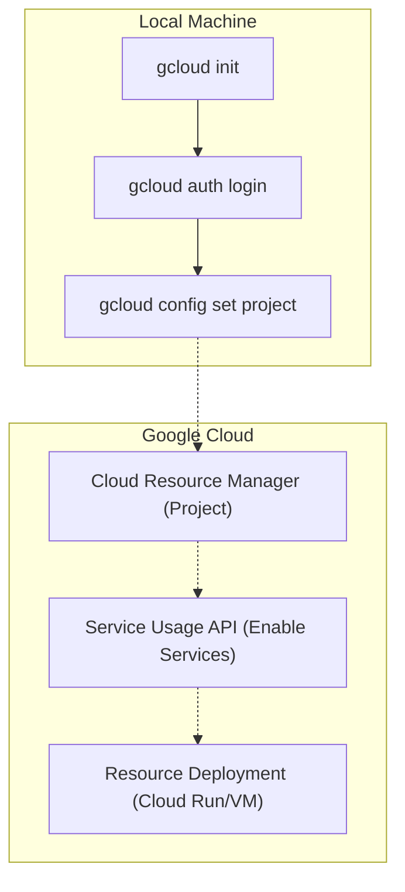
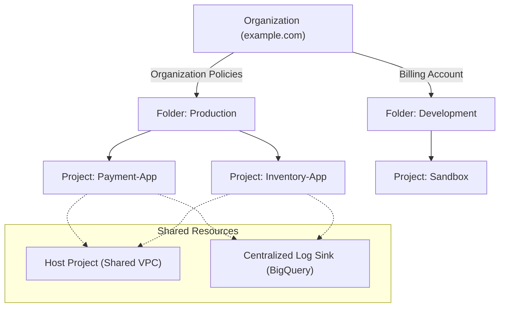

<!-- source: DeepWiki mcp.deepwiki.com · repo google/skills · page 3.1 Recipe: Onboarding to Google Cloud · fetched 2026-10-27 -->

# Recipe: Onboarding to Google Cloud

<details>
<summary>Relevant source files</summary>

The following files were used as context for generating this wiki page:

- [cloud/recipes/google-cloud-recipe-onboarding/SKILL.md](cloud/recipes/google-cloud-recipe-onboarding/SKILL.md)
- [cloud/recipes/google-cloud-recipe-onboarding/reference/google-cloud-setup.md](cloud/recipes/google-cloud-recipe-onboarding/reference/google-cloud-setup.md)

</details>


The onboarding recipe provides a dual-track approach to establishing a presence on Google Cloud. It covers the "happy path" for individual developers seeking to experiment with the Free Tier, as well as the structured "Landing Zone" approach required for enterprise-grade environments. This page details the implementation steps, resource hierarchies, and validation criteria for both tracks.

## Onboarding Tracks Overview

The repository distinguishes between two primary onboarding personas:
1.  **Individual Developer:** Focused on rapid prototyping, personal identity, and the $300 Free Trial credit [cloud/recipes/google-cloud-recipe-onboarding/SKILL.md:8-19]().
2.  **Enterprise Administrator:** Focused on building a secure, scalable foundation (Landing Zone) using Organization resources, centralized identity, and Infrastructure as Code (IaC) [cloud/recipes/google-cloud-recipe-onboarding/reference/google-cloud-setup.md:9-15]().

### Track Comparison

| Feature | Individual Developer Track | Enterprise Landing Zone Track |
| :--- | :--- | :--- |
| **Identity** | Personal Google Account (@gmail.com) | Cloud Identity or Google Workspace |
| **Root Resource** | Project | Organization Resource |
| **Billing** | Personal Credit Card / Free Trial | Corporate Billing Account / Invoicing |
| **Governance** | Manual via Console/CLI | Organization Policies & Folders |
| **Networking** | Default VPC | Shared VPC & Hybrid Connectivity |
| **Management** | `gcloud` CLI / Web Console | Terraform Blueprints (IaC) |

**Sources:** [cloud/recipes/google-cloud-recipe-onboarding/SKILL.md:14-35](), [cloud/recipes/google-cloud-recipe-onboarding/reference/google-cloud-setup.md:19-103]()

---

## Individual Developer Track: The "Happy Path"

The developer track is designed to move from account creation to a live resource deployment in minimal steps.

### Workflow: Local Environment Setup

The primary tool for developers is the `gcloud` CLI, which manages authentication and resource state.



**Implementation Steps:**
1.  **Account Activation:** Signing into the Console activates the $300 free credit [cloud/recipes/google-cloud-recipe-onboarding/SKILL.md:47-49]().
2.  **Project Creation:** Resources must reside within a Project, identified by a unique **Project ID** [cloud/recipes/google-cloud-recipe-onboarding/SKILL.md:53-62]().
3.  **CLI Initialization:** Running `gcloud init` performs login and project selection [cloud/recipes/google-cloud-recipe-onboarding/SKILL.md:82-83]().
4.  **API Enablement:** Services like Cloud Run (`run.googleapis.com`) must be explicitly enabled before deployment [cloud/recipes/google-cloud-recipe-onboarding/SKILL.md:87-91]().

**Sources:** [cloud/recipes/google-cloud-recipe-onboarding/SKILL.md:45-96]()

---

## Enterprise Track: Landing Zone Implementation

The enterprise track focuses on the **Resource Hierarchy**, which provides the structure for access control and policy inheritance.

### The Resource Hierarchy Model

The hierarchy allows for centralized management of security and billing across thousands of projects.



### Key Enterprise Components

*   **Cloud Identity:** Centralizes user management via a verified domain (e.g., `example.com`) [cloud/recipes/google-cloud-recipe-onboarding/reference/google-cloud-setup.md:23-27]().
*   **Shared VPC:** Enables a single "Host Project" to manage network topology (subnets, firewalls) while "Service Projects" deploy workloads into those subnets [cloud/recipes/google-cloud-recipe-onboarding/reference/google-cloud-setup.md:66-69]().
*   **Log Sinks:** Aggregates logs from all projects into a central BigQuery dataset for compliance and auditing [cloud/recipes/google-cloud-recipe-onboarding/reference/google-cloud-setup.md:89-93]().
*   **Organization Policies:** Enforces constraints globally, such as `iam.disableServiceAccountKeyCreation` or restricting allowed resource locations [cloud/recipes/google-cloud-recipe-onboarding/reference/google-cloud-setup.md:77-80]().

**Sources:** [cloud/recipes/google-cloud-recipe-onboarding/reference/google-cloud-setup.md:19-96]()

---

## Resource Deployment Examples

The onboarding recipe provides standard entry points for first-time deployments.

### Cloud Run Deployment
Recommended for application developers. It creates a managed service with a public URL.
```bash
gcloud run deploy hello-world \
    --image=gcr.io/cloudrun/hello \
    --platform=managed \
    --region=us-central1 \
    --allow-unauthenticated
```
[cloud/recipes/google-cloud-recipe-onboarding/SKILL.md:109-112]()

### Compute Engine VM
Recommended for infrastructure-focused users. Uses the `e2-micro` instance type for the Always Free tier [cloud/recipes/google-cloud-recipe-onboarding/SKILL.md:101-102]().

---

## Validation Criteria

A successful onboarding is verified through the following technical checks:

| Validation Target | Verification Command / Method |
| :--- | :--- |
| **Project Identity** | Presence of a valid `Project ID` [cloud/recipes/google-cloud-recipe-onboarding/SKILL.md:132]() |
| **Billing Linkage** | `gcloud beta billing projects describe PROJECT_ID` [cloud/recipes/google-cloud-recipe-onboarding/SKILL.md:133-134]() |
| **CLI Auth State** | `gcloud config list` (Checks active account and project) [cloud/recipes/google-cloud-recipe-onboarding/SKILL.md:135-136]() |
| **Resource Health** | Reachability of the deployed resource URL or IP [cloud/recipes/google-cloud-recipe-onboarding/SKILL.md:137-138]() |

**Sources:** [cloud/recipes/google-cloud-recipe-onboarding/SKILL.md:127-139]()

---

