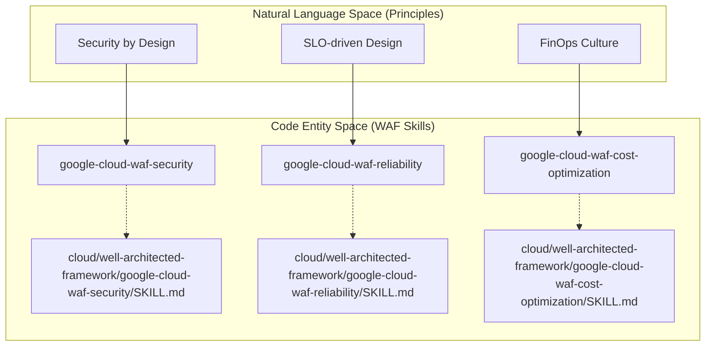
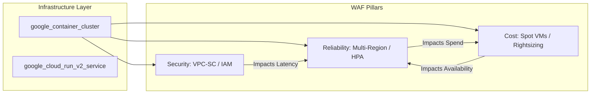

<!-- source: DeepWiki mcp.deepwiki.com · repo google/skills · page 4 Well-Architected Framework (WAF) Skills · fetched 2026-10-27 -->

# Well-Architected Framework (WAF) Skills

Relevant source files

The following files were used as context for generating this wiki page:

- [cloud/well-architected-framework/google-cloud-waf-cost-optimization/SKILL.md](cloud/well-architected-framework/google-cloud-waf-cost-optimization/SKILL.md)
- [cloud/well-architected-framework/google-cloud-waf-reliability/SKILL.md](cloud/well-architected-framework/google-cloud-waf-reliability/SKILL.md)
- [cloud/well-architected-framework/google-cloud-waf-security/SKILL.md](cloud/well-architected-framework/google-cloud-waf-security/SKILL.md)

The Well-Architected Framework (WAF) skills provide a structured methodology for evaluating and improving Google Cloud workloads. These skills are organized under the `cloud/well-architected-framework/` directory and are designed to help users build secure, reliable, and cost-efficient systems by applying Google's proven design principles.

Each WAF skill follows a **tripartite pattern**:
1.  **Principle-to-Product Mapping**: Translates high-level architectural principles into specific Google Cloud product capabilities.
2.  **Assessment Questions**: Provides a discovery framework to identify requirements and constraints.
3.  **Validation Checklist**: Offers a concrete list of technical requirements to verify compliance with the pillar's best practices.

### WAF Structural Overview

The following diagram illustrates how the WAF skills bridge the gap between abstract architectural principles and concrete implementation within the `google/skills` repository.

**WAF Knowledge Architecture**

**Sources:**
- [cloud/well-architected-framework/google-cloud-waf-security/SKILL.md:1-20]()
- [cloud/well-architected-framework/google-cloud-waf-reliability/SKILL.md:1-20]()
- [cloud/well-architected-framework/google-cloud-waf-cost-optimization/SKILL.md:1-20]()

---

### WAF: Security Pillar
The Security pillar focuses on protecting data, systems, and assets while taking advantage of cloud technologies to improve your security posture [cloud/well-architected-framework/google-cloud-waf-security/SKILL.md:10-16](). It emphasizes "Security by Design" and "Zero Trust" architectures [cloud/well-architected-framework/google-cloud-waf-security/SKILL.md:23-34]().

*   **Key Products**: IAM, Identity-Aware Proxy (IAP), VPC Service Controls, and Security Command Center [cloud/well-architected-framework/google-cloud-waf-security/SKILL.md:79-107]().
*   **Core Concepts**: Shift-left security, preemptive cyber defense, and secure AI usage [cloud/well-architected-framework/google-cloud-waf-security/SKILL.md:36-65]().

For details, see [WAF: Security Pillar](#4.1).

**Sources:**
- [cloud/well-architected-framework/google-cloud-waf-security/SKILL.md:23-72]()
- [cloud/well-architected-framework/google-cloud-waf-security/SKILL.md:79-116]()

---

### WAF: Reliability Pillar
The Reliability pillar ensures that a workload performs its intended function correctly and consistently [cloud/well-architected-framework/google-cloud-waf-reliability/SKILL.md:10-15](). This skill guides the implementation of self-healing systems and SLO-based monitoring.

*   **Key Products**: Managed Instance Groups (MIGs), GKE, Cloud Load Balancing, and Cloud Monitoring [cloud/well-architected-framework/google-cloud-waf-reliability/SKILL.md:78-84]().
*   **Core Concepts**: Horizontal scalability, graceful degradation, and blameless postmortems [cloud/well-architected-framework/google-cloud-waf-reliability/SKILL.md:39-71]().

For details, see [WAF: Reliability Pillar](#4.2).

**Sources:**
- [cloud/well-architected-framework/google-cloud-waf-reliability/SKILL.md:17-72]()
- [cloud/well-architected-framework/google-cloud-waf-reliability/SKILL.md:78-85]()

---

### WAF: Cost Optimization Pillar
The Cost Optimization pillar focuses on avoiding unnecessary costs and ensuring that cloud spending aligns with business value [cloud/well-architected-framework/google-cloud-waf-cost-optimization/SKILL.md:10-14](). It introduces the FinOps framework to the technical architecture process.

*   **Key Products**: BigQuery billing export, Recommender (Active Assist), Spot VMs, and Lifecycle Policies [cloud/well-architected-framework/google-cloud-waf-cost-optimization/SKILL.md:55-82]().
*   **Core Concepts**: Cost attribution (labeling), rightsizing, and continuous optimization [cloud/well-architected-framework/google-cloud-waf-cost-optimization/SKILL.md:34-44]().

For details, see [WAF: Cost Optimization Pillar](#4.3).

**Sources:**
- [cloud/well-architected-framework/google-cloud-waf-cost-optimization/SKILL.md:21-44]()
- [cloud/well-architected-framework/google-cloud-waf-cost-optimization/SKILL.md:51-91]()

---

### Cross-Pillar Dependencies
WAF pillars do not operate in isolation. Decisions in one pillar often impact others, creating a "trade-off" matrix that the skills help navigate.

**WAF Dependency Matrix**

| Pillar | Dependency on Product Skills | Primary Code Entity Examples |
| :--- | :--- | :--- |
| **Security** | Requires IAM & Networking | `roles/iam.serviceAccountUser`, `google_compute_subnetwork` |
| **Reliability** | Requires Compute & Ops | `google_compute_region_autoscaler`, `google_monitoring_slo` |
| **Cost** | Requires Billing & Resource Management | `google_bigquery_table` (billing export), `google_compute_resource_policy` |

**Sources:**
- [cloud/well-architected-framework/google-cloud-waf-security/SKILL.md:79-116]()
- [cloud/well-architected-framework/google-cloud-waf-reliability/SKILL.md:78-85]()
- [cloud/well-architected-framework/google-cloud-waf-cost-optimization/SKILL.md:51-91]()

---

