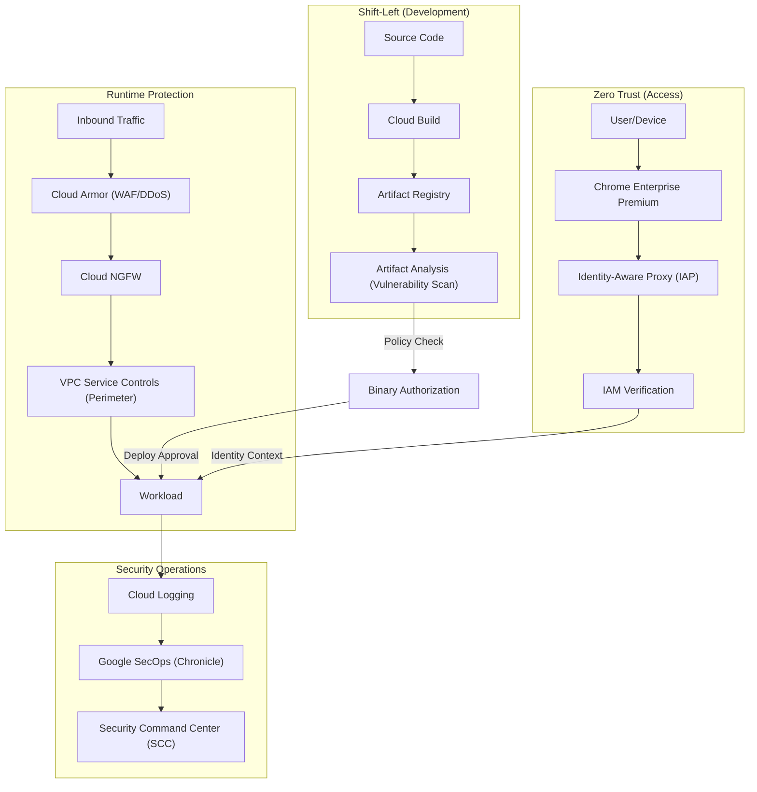
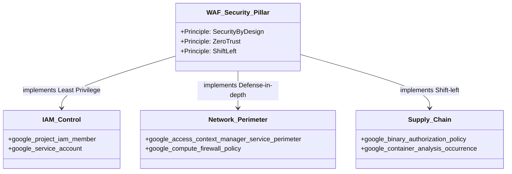

<!-- source: DeepWiki mcp.deepwiki.com · repo google/skills · page 4.1 WAF: Security Pillar · fetched 2026-10-27 -->

# WAF: Security Pillar

Relevant source files

The following files were used as context for generating this wiki page:

- [cloud/well-architected-framework/google-cloud-waf-cost-optimization/SKILL.md](cloud/well-architected-framework/google-cloud-waf-cost-optimization/SKILL.md)
- [cloud/well-architected-framework/google-cloud-waf-reliability/SKILL.md](cloud/well-architected-framework/google-cloud-waf-reliability/SKILL.md)
- [cloud/well-architected-framework/google-cloud-waf-security/SKILL.md](cloud/well-architected-framework/google-cloud-waf-security/SKILL.md)

The Security pillar of the Google Cloud Well-Architected Framework (WAF) provides a structured methodology for integrating security into every layer of a cloud workload. It focuses on maintaining the confidentiality and integrity of data and systems while ensuring compliance and privacy through a "defense-in-depth" approach [cloud/well-architected-framework/google-cloud-waf-security/SKILL.md:8-16]().

## Core Principles

The security guidance is built upon seven fundamental principles designed to shift security from an afterthought to a core architectural component.

| Principle | Description | Key Google Cloud Products |
| :--- | :--- | :--- |
| **Security by Design** | Integrate security and network considerations from the initial design phase using architecture blueprints [cloud/well-architected-framework/google-cloud-waf-security/SKILL.md:23-28](). | Blueprints, Architecture Framework |
| **Zero Trust** | Adopt a "never trust, always verify" model where access is granted based on continuous verification [cloud/well-architected-framework/google-cloud-waf-security/SKILL.md:30-34](). | IAP, Chrome Enterprise Premium |
| **Shift-left Security** | Implement security controls early in the SDLC to detect and fix bugs before deployment [cloud/well-architected-framework/google-cloud-waf-security/SKILL.md:36-42](). | Cloud Build, Binary Authorization, Artifact Registry |
| **Preemptive Cyber Defense** | Proactive threat intelligence and layered security controls [cloud/well-architected-framework/google-cloud-waf-security/SKILL.md:44-51](). | SCC, Google SecOps, Google Threat Intelligence |
| **Secure AI Usage** | Deploy AI systems responsibly using Google's Secure AI Framework (SAIF) [cloud/well-architected-framework/google-cloud-waf-security/SKILL.md:53-57](). | Vertex AI, SAIF |
| **AI for Security** | Use AI to automate remedial work and improve security hygiene [cloud/well-architected-framework/google-cloud-waf-security/SKILL.md:59-65](). | Gemini in Security, Google SecOps |
| **Compliance & Privacy** | Adhere to industry regulations and privacy requirements [cloud/well-architected-framework/google-cloud-waf-security/SKILL.md:67-72](). | Assured Workloads, Org Policy Service |

**Sources:** [cloud/well-architected-framework/google-cloud-waf-security/SKILL.md:18-73]()

## Relevant Security Products

The following products form the technical foundation for implementing the WAF Security pillar.

### Identity and Network Security
*   **IAM**: Fine-grained access control [cloud/well-architected-framework/google-cloud-waf-security/SKILL.md:81-82]().
*   **Identity-Aware Proxy (IAP)**: VPN-less secure access to applications [cloud/well-architected-framework/google-cloud-waf-security/SKILL.md:83-83]().
*   **Cloud Armor**: DDoS protection and WAF capabilities [cloud/well-architected-framework/google-cloud-waf-security/SKILL.md:88-88]().
*   **VPC Service Controls**: Defining perimeters to mitigate data exfiltration [cloud/well-architected-framework/google-cloud-waf-security/SKILL.md:89-90]().

### Data Protection and Operations
*   **Cloud KMS**: Encryption key management [cloud/well-architected-framework/google-cloud-waf-security/SKILL.md:98-98]().
*   **Confidential Computing**: Encryption of data in use (memory) [cloud/well-architected-framework/google-cloud-waf-security/SKILL.md:101-101]().
*   **Google SecOps (Chronicle)**: Security analytics and threat detection [cloud/well-architected-framework/google-cloud-waf-security/SKILL.md:105-105]().
*   **Security Command Center (SCC)**: Vulnerability and threat management [cloud/well-architected-framework/google-cloud-waf-security/SKILL.md:106-107]().

**Sources:** [cloud/well-architected-framework/google-cloud-waf-security/SKILL.md:74-116]()

## Security Data Flow and System Interaction

The following diagram illustrates how security principles map to specific Google Cloud services and the flow of security verification.

### Security Verification Lifecycle

**Sources:** [cloud/well-architected-framework/google-cloud-waf-security/SKILL.md:30-51](), [cloud/well-architected-framework/google-cloud-waf-security/SKILL.md:79-115]()

## Workload Assessment Questions

To evaluate a workload's security posture, the skill suggests targeted questions across several domains:

*   **Threat Modeling**: What tools and techniques are used to perform threat modeling during the design phase? [cloud/well-architected-framework/google-cloud-waf-security/SKILL.md:131-132]()
*   **Zero Trust**: How do you implement the principle of least privilege for users and services? [cloud/well-architected-framework/google-cloud-waf-security/SKILL.md:149-150]()
*   **Data Sovereignty**: How do you manage the geographic location of your data and ensure compliance with data residency requirements? [cloud/well-architected-framework/google-cloud-waf-security/SKILL.md:179-181]()
*   **AI Governance**: How do you manage the lifecycle of your AI models, including versioning, deployment, and decommissioning? [cloud/well-architected-framework/google-cloud-waf-security/SKILL.md:214-216]()

**Sources:** [cloud/well-architected-framework/google-cloud-waf-security/SKILL.md:117-231]()

## Validation Checklist

A workload is considered "Well-Architected" for security if it meets the following criteria:

### Identity and Access
*   **Least Privilege**: IAM roles are restricted to the minimum necessary permissions.
*   **Service Accounts**: Dedicated service accounts are used for different application components.

### Network and Data Security
*   **VPC-SC Perimeters**: Service perimeters are defined to prevent data exfiltration.
*   **Defense-in-Depth**: Multiple layers of security (WAF, NGFW, IAM) are applied.
*   **Encryption**: Data is encrypted at rest (CMEK/KMS) and in transit.

### Deployment and Operations
*   **Binary Authorization**: Only trusted, scanned images are deployed to production.
*   **Logging & Monitoring**: Audit logs are enabled and exported to a centralized security analytics platform (e.g., Google SecOps).

### Code Entity Mapping
The following diagram bridges the conceptual WAF principles to the specific resource types used in Infrastructure as Code (Terraform) or API calls within the repository's logic.

**Sources:** [cloud/well-architected-framework/google-cloud-waf-security/SKILL.md:23-51](), [cloud/well-architected-framework/google-cloud-waf-security/SKILL.md:79-115]()

---

