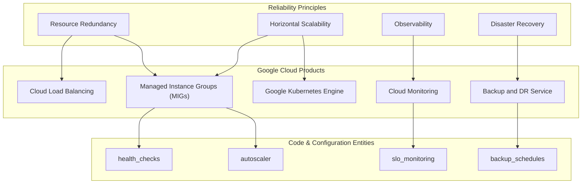
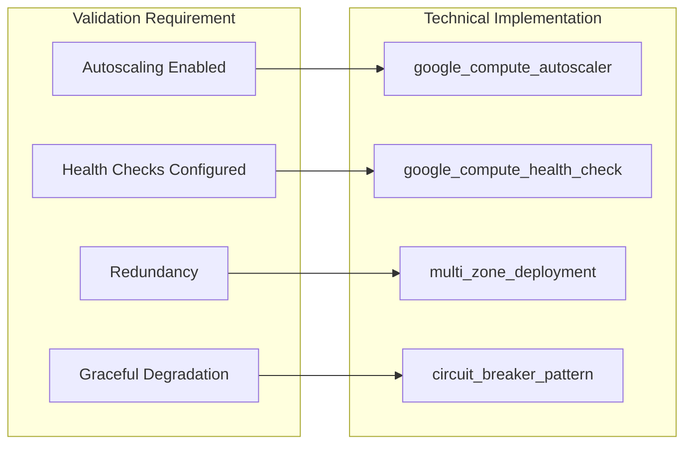

<!-- source: DeepWiki mcp.deepwiki.com · repo google/skills · page 4.2 WAF: Reliability Pillar · fetched 2026-10-27 -->

# WAF: Reliability Pillar

Relevant source files

The following files were used as context for generating this wiki page:

- [cloud/well-architected-framework/google-cloud-waf-cost-optimization/SKILL.md](cloud/well-architected-framework/google-cloud-waf-cost-optimization/SKILL.md)
- [cloud/well-architected-framework/google-cloud-waf-reliability/SKILL.md](cloud/well-architected-framework/google-cloud-waf-reliability/SKILL.md)
- [cloud/well-architected-framework/google-cloud-waf-security/SKILL.md](cloud/well-architected-framework/google-cloud-waf-security/SKILL.md)

The Reliability pillar of the Google Cloud Well-Architected Framework (WAF) provides the architectural principles and operational patterns required to build resilient, highly available, and fault-tolerant systems. A reliable system is defined by its ability to perform intended functions under stress, recover from infrastructure failures, and maintain a consistent user experience regardless of underlying disruptions [cloud/well-architected-framework/google-cloud-waf-reliability/SKILL.md:8-15]().

## Core Principles

The reliability skill is built upon nine core principles that guide the design and management of Google Cloud workloads:

*   **Define reliability based on user-experience goals**: Move beyond infrastructure metrics to focus on outcomes that matter to users [cloud/well-architected-framework/google-cloud-waf-reliability/SKILL.md:22-26]().
*   **Set realistic targets**: Balance cost and complexity by defining Service Level Objectives (SLOs) and utilizing error budgets [cloud/well-architected-framework/google-cloud-waf-reliability/SKILL.md:28-32]().
*   **Resource redundancy**: Eliminate single points of failure (SPOFs) by duplicating components across zones and regions [cloud/well-architected-framework/google-cloud-waf-reliability/SKILL.md:34-37]().
*   **Horizontal scalability**: Design for "scale-out" (adding instances) rather than "scale-up" to handle load fluctuations [cloud/well-architected-framework/google-cloud-waf-reliability/SKILL.md:39-42]().
*   **Observability-driven detection**: Use comprehensive monitoring and logging to diagnose anomalies before they impact users [cloud/well-architected-framework/google-cloud-waf-reliability/SKILL.md:44-48]().
*   **Graceful degradation**: Ensure critical functionality persists even when dependencies fail or the system is under extreme stress [cloud/well-architected-framework/google-cloud-waf-reliability/SKILL.md:50-54]().
*   **Recovery testing**: Continuously simulate failures to verify automated and manual recovery procedures [cloud/well-architected-framework/google-cloud-waf-reliability/SKILL.md:56-60]().
*   **Data loss recovery**: Regularly test backup and restore protocols against Recovery Time Objectives (RTO) and Recovery Point Objectives (RPO) [cloud/well-architected-framework/google-cloud-waf-reliability/SKILL.md:62-66]().
*   **Blameless postmortems**: Investigate outages to understand root causes and prevent recurrence without assigning blame [cloud/well-architected-framework/google-cloud-waf-reliability/SKILL.md:68-71]().

**Sources:** [cloud/well-architected-framework/google-cloud-waf-reliability/SKILL.md:18-72]()

## System Architecture & Product Integration

The following diagram maps the Reliability core principles to specific Google Cloud products and the code-level concepts used to manage them.

### Logic Flow: Principles to Implementation

**Sources:** [cloud/well-architected-framework/google-cloud-waf-reliability/SKILL.md:73-86](), [cloud/well-architected-framework/google-cloud-waf-reliability/SKILL.md:117-124]()

## Relevant Google Cloud Products

The Reliability pillar leverages a specific suite of products to ensure workload resilience:

| Category | Products | Reliability Role |
| :--- | :--- | :--- |
| **Compute** | MIGs, GKE, Cloud Run | Provides the runtime environment with built-in healing and scaling [cloud/well-architected-framework/google-cloud-waf-reliability/SKILL.md:78-79](). |
| **Networking** | Cloud Load Balancing, Cloud CDN, Cloud DNS | Distributes traffic across healthy instances and regions [cloud/well-architected-framework/google-cloud-waf-reliability/SKILL.md:80](). |
| **Storage** | Spanner, Cloud SQL HA, Cloud Storage (Multi-region) | Ensures data persistence and availability through replication [cloud/well-architected-framework/google-cloud-waf-reliability/SKILL.md:81-82](). |
| **Operations** | Cloud Monitoring, Cloud Logging, Managed Prometheus | Provides the telemetry needed for proactive failure detection [cloud/well-architected-framework/google-cloud-waf-reliability/SKILL.md:83-84](). |
| **Disaster Recovery** | Backup and DR Service, Filestore backups | Manages the lifecycle of backups and restoration testing [cloud/well-architected-framework/google-cloud-waf-reliability/SKILL.md:85](). |

**Sources:** [cloud/well-architected-framework/google-cloud-waf-reliability/SKILL.md:73-86]()

## Workload Assessment

To evaluate a workload's reliability, the following questions are used to identify gaps in the current architecture:

1.  **User Experience**: How does the organization define and measure reliability in relation to user experience? [cloud/well-architected-framework/google-cloud-waf-reliability/SKILL.md:93-94]()
2.  **Redundancy**: What is the strategy for ensuring high availability through resource redundancy (e.g., cross-zone/region)? [cloud/well-architected-framework/google-cloud-waf-reliability/SKILL.md:97-98]()
3.  **Observability**: How are metrics, logs, and traces utilized to detect potential failures before they impact users? [cloud/well-architected-framework/google-cloud-waf-reliability/SKILL.md:101-102]()
4.  **Degradation**: What measures ensure the system can gracefully degrade during high load or partial dependency failure? [cloud/well-architected-framework/google-cloud-waf-reliability/SKILL.md:105-106]()
5.  **Recovery**: How frequently does the organization test for recovery from system failures and data loss? [cloud/well-architected-framework/google-cloud-waf-reliability/SKILL.md:107-109]()

**Sources:** [cloud/well-architected-framework/google-cloud-waf-reliability/SKILL.md:87-111]()

## Validation Checklist

The following checklist provides actionable requirements for a reliable architecture:

### Implementation Mapping: Code & Config

**Sources:** [cloud/well-architected-framework/google-cloud-waf-reliability/SKILL.md:112-131]()

*   **SLOs/SLIs**: User-focused Service Level Indicators (SLIs) and Objectives (SLOs) must be explicitly defined and monitored [cloud/well-architected-framework/google-cloud-waf-reliability/SKILL.md:117]().
*   **Redundancy**: Architecture must avoid single points of failure via cross-zone or cross-region redundancy [cloud/well-architected-framework/google-cloud-waf-reliability/SKILL.md:118-119]().
*   **Autoscaling**: Automated scaling must be enabled to handle demand without manual intervention [cloud/well-architected-framework/google-cloud-waf-reliability/SKILL.md:120]().
*   **Health Checks**: Application and infrastructure health checks must be configured to trigger automated failovers [cloud/well-architected-framework/google-cloud-waf-reliability/SKILL.md:121-122]().
*   **Resilience Patterns**: The system must incorporate patterns like circuit breakers, retries with exponential backoff, and rate limiting [cloud/well-architected-framework/google-cloud-waf-reliability/SKILL.md:125-126]().
*   **Chaos Engineering**: Regular "Game Days" or chaos engineering practices should validate failure recovery [cloud/well-architected-framework/google-cloud-waf-reliability/SKILL.md:127-128]().
*   **Operations**: A formalized, blameless postmortem process must exist to ensure organizational learning [cloud/well-architected-framework/google-cloud-waf-reliability/SKILL.md:129-130]().

**Sources:** [cloud/well-architected-framework/google-cloud-waf-reliability/SKILL.md:112-131]()

---

