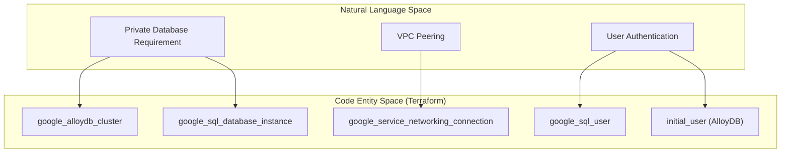
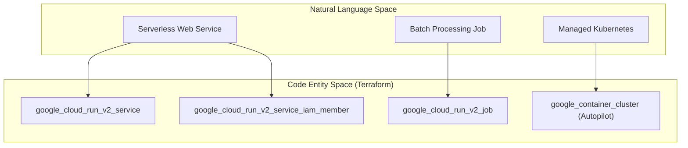

<!-- source: DeepWiki mcp.deepwiki.com · repo google/skills · page 5.3 Infrastructure as Code (Terraform) Patterns · fetched 2026-10-27 -->

# Infrastructure as Code (Terraform) Patterns

Relevant source files

The following files were used as context for generating this wiki page:

- [cloud/products/alloydb/alloydb-basics/references/iac-usage.md](cloud/products/alloydb/alloydb-basics/references/iac-usage.md)
- [cloud/products/bigquery/bigquery-basics/references/iac-usage.md](cloud/products/bigquery/bigquery-basics/references/iac-usage.md)
- [cloud/products/cloud-run/cloud-run-basics/references/iac-usage.md](cloud/products/cloud-run/cloud-run-basics/references/iac-usage.md)
- [cloud/products/cloud-sql/cloud-sql-basics/references/client-library-usage.md](cloud/products/cloud-sql/cloud-sql-basics/references/client-library-usage.md)
- [cloud/products/cloud-sql/cloud-sql-basics/references/iac-usage.md](cloud/products/cloud-sql/cloud-sql-basics/references/iac-usage.md)
- [cloud/products/firebase/firebase-basics/references/iac-usage.md](cloud/products/firebase/firebase-basics/references/iac-usage.md)
- [cloud/products/kubernetes-engine/gke-basics/references/iac-usage.md](cloud/products/kubernetes-engine/gke-basics/references/iac-usage.md)

This page documents the standardized Infrastructure as Code (IaC) patterns used across the `google/skills` repository. It focuses on the use of the HashiCorp Terraform Google Cloud provider to provision and manage resources for Cloud SQL, AlloyDB, BigQuery, Cloud Run, GKE, and Firebase. These patterns emphasize dependency management, resource hierarchy, and provider versioning to ensure consistent environment provisioning.

## Dependency Graph and Resource Hierarchy

The codebase follows a strict hierarchical pattern for resource provisioning. Resources are organized to respect Google Cloud's parent-child relationships (e.g., an AlloyDB Instance must depend on an AlloyDB Cluster).

### Database Resource Hierarchy
For managed databases, the pattern involves creating a primary container (Instance or Cluster) before provisioning logical databases or users. In the case of AlloyDB, an additional network dependency layer is required for Private Service Access.

**AlloyDB Provisioning Flow**
The following diagram illustrates the dependency chain from network allocation to instance creation.

| Resource Name | Role | File Reference |
| :--- | :--- | :--- |
| `google_compute_network` | VPC for the database | [cloud/products/alloydb/alloydb-basics/references/iac-usage.md:18-20]() |
| `google_compute_global_address` | Internal IP allocation for peering | [cloud/products/alloydb/alloydb-basics/references/iac-usage.md:22-28]() |
| `google_service_networking_connection` | Private Service Access connection | [cloud/products/alloydb/alloydb-basics/references/iac-usage.md:30-34]() |
| `google_alloydb_cluster` | Parent container for instances | [cloud/products/alloydb/alloydb-basics/references/iac-usage.md:36-48]() |
| `google_alloydb_instance` | The primary compute instance | [cloud/products/alloydb/alloydb-basics/references/iac-usage.md:50-60]() |

**Sources:**
- [cloud/products/alloydb/alloydb-basics/references/iac-usage.md:15-61]()

## Product-Specific Terraform Patterns

### Cloud SQL
Cloud SQL implementation utilizes three core resources to manage the lifecycle of a managed database. The `google_sql_database` and `google_sql_user` resources reference the `google_sql_database_instance.name` attribute to establish implicit dependencies [cloud/products/cloud-sql/cloud-sql-basics/references/iac-usage.md:27-36]().

| Resource | Key Attributes |
| :--- | :--- |
| `google_sql_database_instance` | `database_version`, `settings.tier`, `settings.backup_configuration` |
| `google_sql_database` | `instance` (reference), `name` |
| `google_sql_user` | `instance` (reference), `name`, `password` |

**Sources:**
- [cloud/products/cloud-sql/cloud-sql-basics/references/iac-usage.md:13-37]()

### BigQuery
BigQuery resources are patterned around the Dataset-Table-Reservation model. Datasets serve as the top-level container for tables and access control [cloud/products/bigquery/bigquery-basics/references/iac-usage.md:14-24]().

- **Datasets**: Managed via `google_bigquery_dataset`.
- **Tables**: Managed via `google_bigquery_table`, which includes inline JSON schema definitions [cloud/products/bigquery/bigquery-basics/references/iac-usage.md:38-53]().
- **Partitioning**: Time-based partitioning is configured within the table resource using the `time_partitioning` block [cloud/products/bigquery/bigquery-basics/references/iac-usage.md:30-32]().

**Sources:**
- [cloud/products/bigquery/bigquery-basics/references/iac-usage.md:13-55]()

### Cloud Run
The repository utilizes the Cloud Run v2 resources for modern deployments, covering Services, Jobs, and Worker Pools.

- **Services**: `google_cloud_run_v2_service` manages the container image and ingress traffic [cloud/products/cloud-run/cloud-run-basics/references/iac-usage.md:13-24]().
- **Jobs**: `google_cloud_run_v2_job` manages execution tasks [cloud/products/cloud-run/cloud-run-basics/references/iac-usage.md:37-48]() .
- **IAM**: Public access is managed through `google_cloud_run_v2_service_iam_member` targeting the `roles/run.invoker` role [cloud/products/cloud-run/cloud-run-basics/references/iac-usage.md:26-31]().

**Sources:**
- [cloud/products/cloud-run/cloud-run-basics/references/iac-usage.md:12-64]()

### Google Kubernetes Engine (GKE)
GKE patterns distinguish between the infrastructure (Google Cloud provider) and the workloads (Kubernetes provider).

- **Autopilot Mode**: The `google_container_cluster` resource is configured with `enable_autopilot = true`. In this mode, `node_config` and `initial_node_count` must be omitted to avoid provider errors [cloud/products/kubernetes-engine/gke-basics/references/iac-usage.md:21-32]().
- **Workload Management**: `kubernetes_deployment_v1` is used to manage container replicas and labels within the cluster [cloud/products/kubernetes-engine/gke-basics/references/iac-usage.md:38-64]().

**Sources:**
- [cloud/products/kubernetes-engine/gke-basics/references/iac-usage.md:8-64]()

### Firebase
Firebase provisioning follows a specific order where Firebase services are enabled on an existing Google Cloud project before specialized resources like Firestore or Security Rules are deployed.

- **Project Setup**: `google_firebase_project` enables Firebase on the project [cloud/products/firebase/firebase-basics/references/iac-usage.md:13-16]().
- **Database**: `google_firestore_database` must have `type` set to `FIRESTORE_NATIVE` [cloud/products/firebase/firebase-basics/references/iac-usage.md:32-33]().
- **Security**: `google_firebaserules_ruleset` and `google_firebaserules_release` manage the deployment of security rules [cloud/products/firebase/firebase-basics/references/iac-usage.md:34-37]().

**Sources:**
- [cloud/products/firebase/firebase-basics/references/iac-usage.md:12-38]()

## Implementation Mapping

The following diagrams map the natural language infrastructure requirements to the specific Terraform resource entities used in the codebase.

### Database and Networking Mapping
This diagram maps the requirement for a "Private Managed Database" to the specific code entities in the AlloyDB and Cloud SQL modules.

**Sources:**
- [cloud/products/alloydb/alloydb-basics/references/iac-usage.md:36-48]()
- [cloud/products/cloud-sql/cloud-sql-basics/references/iac-usage.md:14-36]()

### Compute and Access Mapping
This diagram maps "Serverless Deployment" and "Cluster Management" to the Cloud Run and GKE resources.

**Sources:**
- [cloud/products/cloud-run/cloud-run-basics/references/iac-usage.md:13-48]()
- [cloud/products/kubernetes-engine/gke-basics/references/iac-usage.md:21-32]()

## Version Management and Providers

The codebase utilizes specific provider blocks to manage resource availability:
- **Google Beta**: Required for specific Firebase and Identity Platform resources [cloud/products/firebase/firebase-basics/references/iac-usage.md:13-22]().
- **Kubernetes Provider**: Used for managing `kubernetes_deployment_v1` resources once the GKE cluster is available [cloud/products/kubernetes-engine/gke-basics/references/iac-usage.md:13-15]().

**Sources:**
- [cloud/products/firebase/firebase-basics/references/iac-usage.md:8-22]()
- [cloud/products/kubernetes-engine/gke-basics/references/iac-usage.md:8-15]()

---

