# Page: Overview: google/skills Repository

# Overview: google/skills Repository

<details>
<summary>Relevant source files</summary>

The following files were used as context for generating this wiki page:

- [CONTRIBUTING.md](CONTRIBUTING.md)
- [LICENSE](LICENSE)
- [README.md](README.md)

</details>


The `google/skills` repository is a collection of **Agent Skills** designed for Google products and technologies, primarily focused on Google Cloud [README.md:1-5](). These skills provide structured knowledge and executable patterns that enable AI agents to interact with, manage, and architect solutions using Google's ecosystem.

The project is currently under active development and is licensed under the Apache 2.0 license [README.md:7-8, 47-50]().

### Core Purpose
The repository serves as a centralized hub for technical guidance, best practices, and operational recipes. By organizing information into "Skills," the repository allows developers and AI agents to consume modular units of knowledge tailored to specific products (like GKE or BigQuery) or cross-product workflows (like authentication or network observability).

### High-Level Architecture

The following diagram illustrates how the repository bridges high-level Google Cloud concepts to specific code entities and directory structures.

**Skill Categorization and Entity Mapping**
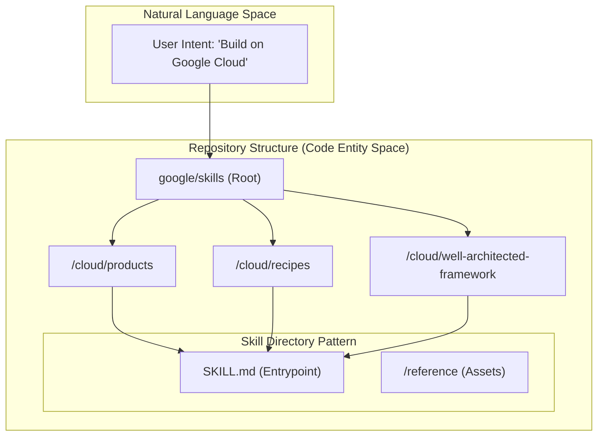
**Sources:** [README.md:20-34](), [CONTRIBUTING.md:25-30]()

---

### Installation and Usage

Skills are designed to be portable and easily integrated into agent environments via the `skills.sh` platform. Users can selectively install components using the `npx` command line interface [README.md:11-19]().

*   **Command:** `npx skills add google/skills`
*   **Selection:** The installer provides an interactive menu to choose specific product skills or recipes.

For a detailed step-by-step guide on setup and the contribution workflow, see **[Getting Started: Installation & Contribution](#1.1)**.

**Sources:** [README.md:11-19]()

---

### Repository Organization

The repository follows a strict directory-per-skill convention to ensure modularity and ease of consumption by AI agents. Each skill is anchored by a `SKILL.md` file, which serves as the primary specification and knowledge source [CONTRIBUTING.md:25-30]().

The content is organized into three primary pillars:
1.  **Products:** Deep dives into individual Google Cloud services (e.g., AlloyDB, Cloud Run, GKE) [README.md:22-28]().
2.  **Recipes:** End-to-end workflows that span multiple services (e.g., Onboarding, Authentication) [README.md:29-31]().
3.  **Well-Architected Framework (WAF):** Architectural guidance focused on Security, Reliability, and Cost Optimization [README.md:32-34]().

For a breakdown of the file structure and the metadata required for each skill, see **[Repository Structure & Skill Anatomy](#1.2)**.

**Sources:** [README.md:20-34](), [CONTRIBUTING.md:25-30]()

---

### Contribution Policy

To maintain technical accuracy and security alignment, this repository does not currently accept external pull requests or direct code contributions [CONTRIBUTING.md:7-11](). Instead, the community is encouraged to:
*   Report bugs or outdated SDK patterns via the [GitHub Issue Tracker](https://github.com/google/skills/issues) [README.md:38, 44]().
*   Request new skills or cross-product architectural patterns [CONTRIBUTING.md:17-19]().
*   Fork and remix the repository for specialized internal workflows [CONTRIBUTING.md:21-24]().

**Skill Delivery Workflow**
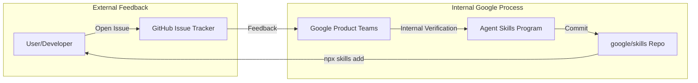
**Sources:** [README.md:38-46](), [CONTRIBUTING.md:7-19](), [CONTRIBUTING.md:25-30]()

---

### Summary of Sections

| Section | Focus |
| :--- | :--- |
| **Products** | Detailed technical specifications for Gemini API, GKE, Cloud Run, Cloud SQL, AlloyDB, BigQuery, and Firebase. |
| **Recipes** | Operational guides for cloud onboarding, authentication lifecycles, and complex network observability. |
| **Frameworks** | High-level principles and checklists for building secure, reliable, and cost-effective cloud architectures. |
| **Patterns** | Shared implementation details for IAM, Terraform, and the Model Context Protocol (MCP). |

**Sources:** [README.md:20-34]()

---

# Page: Getting Started: Installation & Contribution

# Getting Started: Installation & Contribution

<details>
<summary>Relevant source files</summary>

The following files were used as context for generating this wiki page:

- [CONTRIBUTING.md](CONTRIBUTING.md)
- [LICENSE](LICENSE)
- [README.md](README.md)

</details>


This page provides a technical guide for installing Agent Skills from the `google/skills` repository and outlines the process for contributing improvements or reporting issues. The repository serves as a centralized hub for Google Cloud product knowledge, architectural recipes, and Well-Architected Framework (WAF) guidance, distributed via the `skills.sh` platform.

## Installation via skills.sh

The `google/skills` repository is designed to be consumed by AI agents and developers using the `npx skills` CLI tool [README.md:13-15](). This tool interfaces with the [skills.sh](https://skills.sh/google/skills) platform to pull curated knowledge directly into a local environment or agent context [README.md:3-5]().

### The `npx skills add` Workflow

When executing the installation command, the CLI performs a lookup of the `google/skills` repository and presents an interactive selection menu [README.md:17-18]().

1.  **Command Execution**: Run `npx skills add google/skills` [README.md:14]().
2.  **Skill Selection**: The user selects specific skills (e.g., `BigQuery Basics`, `GKE Basics`) from the available list [README.md:20-34]().
3.  **Local Provisioning**: Selected skills are downloaded and organized according to the repository's directory structure (e.g., `cloud/products/`, `cloud/recipes/`) [README.md:22-34]().

### Data Flow: Installation to Agent Context

Installation Flow: Repository to Local Environment
```mermaid
graph TD
    subgraph "Remote Registry"
        ["skills.sh"] --> ["google/skills Repo"]
    end

    subgraph "CLI Execution"
        ["npx skills add google/skills"] --> ["Interactive Selector"]
    end

    subgraph "Local Filesystem"
        ["Interactive Selector"] --> ["./cloud/products/"]
        ["Interactive Selector"] --> ["./cloud/recipes/"]
        ["Interactive Selector"] --> ["./cloud/well-architected-framework/"]
    end

    ["google/skills Repo"] -- "Fetch Metadata" --> ["Interactive Selector"]
```

**Sources:** [README.md:1-34](), [CONTRIBUTING.md:21-23]()

## Contribution Guidelines

The `google/skills` repository maintains high standards for technical accuracy and architectural alignment. Consequently, the contribution model distinguishes between external feedback and internal Google development.

### External Contributions
External developers are encouraged to help improve the quality of the skills through the [GitHub Issue Tracker](https://github.com/google/skills/issues) [README.md:38](). 

*   **Bug Reports**: Report inaccuracies in Markdown files, outdated SDK patterns, or security anti-patterns [CONTRIBUTING.md:15-17]().
*   **Feature Requests**: Suggest new Google products or cross-product architectural patterns to be covered [CONTRIBUTING.md:17-19]().
*   **Remixing**: Users are encouraged to fork the repository and modify skills for specialized local workflows under the Apache 2.0 license [CONTRIBUTING.md:21-24]().

### Internal Contributions
For Google employees, new skills or updates must follow the internal **Agent Skills Program** guidelines [CONTRIBUTING.md:27-29](). All skills undergo a rigorous verification process to ensure they meet Google's security and technical standards [CONTRIBUTING.md:8-10]().

### Pull Request Policy
Currently, the repository **does not accept external pull requests** for direct code or content changes [CONTRIBUTING.md:7-8](). All modifications must be initiated or approved by internal Google teams following the feedback provided in the issue tracker.

**Sources:** [README.md:36-46](), [CONTRIBUTING.md:1-30]()

## Licensing and Usage

The repository is licensed under the **Apache License, Version 2.0** [README.md:47-50]().

| Aspect | Description |
| :--- | :--- |
| **Permissions** | Commercial use, modification, distribution, and private use [LICENSE:67-72](). |
| **Conditions** | Include a copy of the license and copyright notice in all distributions [LICENSE:95-97](). |
| **Limitations** | No trademark use; no liability; no warranty [LICENSE:131-132](). |

### Entity Mapping: License to Usage
The following diagram bridges the legal definitions in the `LICENSE` file to the practical entities within the `google/skills` repository.

Natural Language Space to Code Entity Space: Licensing
```mermaid
graph LR
    subgraph "Legal Definitions (LICENSE)"
        ["Work"] 
        ["Contribution"]
        ["Derivative Works"]
    end

    subgraph "Code Entities (Repository)"
        ["Markdown Skills"]
        ["SKILL.md Entrypoints"]
        ["Reference Modules"]
        ["Forks/Remixes"]
    end

    ["Work"] --- ["Markdown Skills"]
    ["Work"] --- ["SKILL.md Entrypoints"]
    ["Contribution"] --- ["Reference Modules"]
    ["Derivative Works"] --- ["Forks/Remixes"]
```

**Sources:** [LICENSE:1-132](), [README.md:47-50](), [CONTRIBUTING.md:21-24]()

## Support and Troubleshooting

Support is provided via the GitHub community and the official issue tracker.

*   **Existing Issues**: Users should search the [Issue Tracker](https://github.com/google/skills/issues) before opening new reports [README.md:38]().
*   **Documentation Accuracy**: If a skill provides an outdated CLI command or Terraform resource, it should be flagged as a bug [CONTRIBUTING.md:15-17]().

**Sources:** [README.md:36-39](), [CONTRIBUTING.md:12-20]()

---

# Page: Repository Structure & Skill Anatomy

# Repository Structure & Skill Anatomy

<details>
<summary>Relevant source files</summary>

The following files were used as context for generating this wiki page:

- [README.md](README.md)
- [cloud/products/cloud-run/cloud-run-basics/SKILL.md](cloud/products/cloud-run/cloud-run-basics/SKILL.md)
- [cloud/products/cloud-sql/cloud-sql-basics/SKILL.md](cloud/products/cloud-sql/cloud-sql-basics/SKILL.md)

</details>


This page details the organizational conventions of the `google/skills` repository, the internal structure of an individual "Agent Skill," and the categorization of skills into products, recipes, and architectural frameworks.

## High-Level Repository Organization

The repository follows a hierarchical structure categorized by the type of guidance provided. At the root level, skills are organized into three primary directories: `products`, `recipes`, and `well-architected-framework`.

### Top-Level Categories

| Category | Directory Path | Purpose |
| :--- | :--- | :--- |
| **Products** | `cloud/products/` | Deep-dives into specific Google Cloud services (e.g., Cloud SQL, GKE). |
| **Recipes** | `cloud/recipes/` | Multi-service workflows and end-to-end procedures (e.g., Onboarding, Authentication). |
| **WAF** | `cloud/well-architected-framework/` | High-level architectural guidance based on the Google Cloud Well-Architected Framework pillars. |

**Sources:** [README.md:20-34]()

---

## Skill Anatomy: The Directory-Per-Skill Convention

Every skill in the repository is contained within its own dedicated directory. This encapsulation ensures that all documentation, metadata, and reference materials for a specific topic (like `cloud-sql-basics`) are co-located.

### The `SKILL.md` Entrypoint

The `SKILL.md` file serves as the primary entry point for the Agent Skill. It contains two critical sections:
1.  **YAML Frontmatter**: Metadata used by the `skills.sh` platform to identify the skill name and provide a high-level description for the LLM [cloud/products/cloud-sql/cloud-sql-basics/SKILL.md:1-15]().
2.  **Core Content**: A concise "Quick Start" guide or summary of the service, designed to provide the most common commands and patterns immediately [cloud/products/cloud-sql/cloud-sql-basics/SKILL.md:30-83]().

### The `references/` Sub-directory Pattern

To keep the main `SKILL.md` concise, detailed technical information is offloaded into a `references/` sub-directory. This follows a standardized naming convention across different skills:

*   `references/iam-security.md`: Specific roles and security configurations [cloud/products/cloud-sql/cloud-sql-basics/SKILL.md:101-102]().
*   `references/iac-usage.md`: Terraform or other Infrastructure as Code snippets [cloud/products/cloud-sql/cloud-sql-basics/SKILL.md:98-99]().
*   `references/mcp-usage.md`: Documentation on how the skill interacts with Model Context Protocol servers [cloud/products/cloud-sql/cloud-sql-basics/SKILL.md:95-96]().
*   `references/cli-usage.md`: Detailed command-line interface references [cloud/products/cloud-sql/cloud-sql-basics/SKILL.md:89-90]().

### Data Flow: Skill Resolution

The following diagram illustrates how the `skills.sh` platform and an Agent interact with the repository structure to resolve a specific skill.

**Skill Discovery and Resolution Flow**
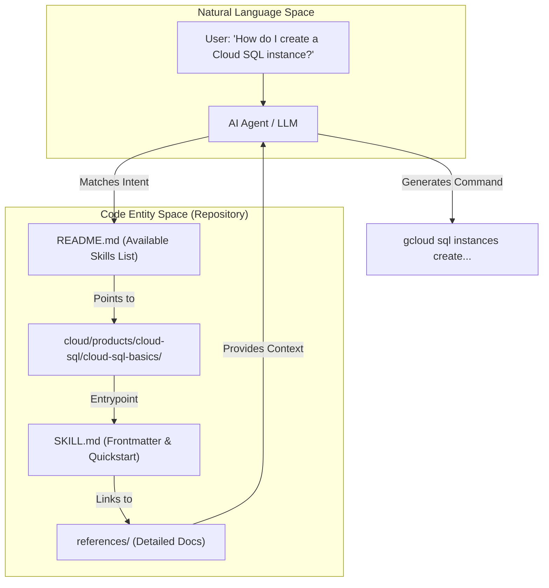
**Sources:** [README.md:20-34](), [cloud/products/cloud-sql/cloud-sql-basics/SKILL.md:1-15](), [cloud/products/cloud-sql/cloud-sql-basics/SKILL.md:84-102]()

---

## Implementation Detail: Cloud Run Example

To illustrate the anatomy in practice, consider the `cloud-run-basics` skill. It defines specific resource models and critical operational rules directly in the `SKILL.md`.

*   **Resource Models**: It defines `Services`, `Jobs`, and `Worker pools` [cloud/run/cloud-run-basics/SKILL.md:16-23]().
*   **Critical Rules**: It includes mandatory implementation details, such as the requirement to listen on `0.0.0.0` and use the `$PORT` environment variable [cloud/run/cloud-run-basics/SKILL.md:70-72]().
*   **Deployment Paths**: It provides logic for both container-based [cloud/run/cloud-run-basics/SKILL.md:74-80]() and source-based deployments [cloud/run/cloud-run-basics/SKILL.md:126-134]().

### Skill Component Mapping

The diagram below maps the conceptual requirements of a Cloud Run deployment to the specific code entities within the skill directory.

**Cloud Run Skill Entity Mapping**
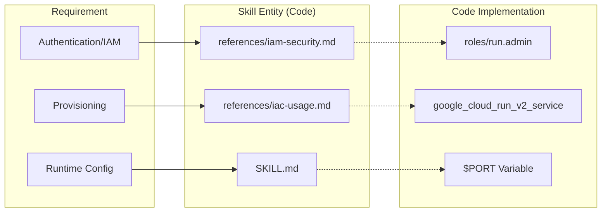
**Sources:** [cloud/products/cloud-run/cloud-run-basics/SKILL.md:38-47](), [cloud/products/cloud-run/cloud-run-basics/SKILL.md:70-72](), [cloud/products/cloud-sql/cloud-sql-basics/SKILL.md:98-102]()

---

## Repository Category Definitions

### 1. Products (`cloud/products/`)
Focuses on individual service primitives. Each product skill typically includes:
*   API enablement commands (e.g., `gcloud services enable`) [cloud/products/cloud-sql/cloud-sql-basics/SKILL.md:34]().
*   Resource creation workflows [cloud/products/cloud-sql/cloud-sql-basics/SKILL.md:37-59]().
*   Connectivity and authentication patterns [cloud/products/cloud-sql/cloud-sql-basics/SKILL.md:61-82]().

### 2. Recipes (`cloud/recipes/`)
Focuses on multi-step, multi-service outcomes. Unlike product skills, recipes prioritize the "Golden Path" for a specific goal, such as setting up a new organization or establishing network observability across a project.

### 3. Well-Architected Framework (`cloud/well-architected-framework/`)
Focuses on evaluation and best practices. These skills are organized by the pillars of the Google Cloud Well-Architected Framework (Security, Reliability, Cost Optimization) and provide assessment questions and validation checklists rather than just deployment commands.

**Sources:** [README.md:22-34]()

---

# Page: Google Cloud Product Skills

# Google Cloud Product Skills

<details>
<summary>Relevant source files</summary>

The following files were used as context for generating this wiki page:

- [README.md](README.md)
- [cloud/products/agent-platform/gemini-api/SKILL.md](cloud/products/agent-platform/gemini-api/SKILL.md)
- [cloud/products/kubernetes-engine/gke-basics/SKILL.md](cloud/products/kubernetes-engine/gke-basics/SKILL.md)

</details>


This page provides a high-level overview of the individual Google Cloud product skills available in the `google/skills` repository. These skills are located under the `cloud/products/` directory and are designed to provide specialized knowledge, reference architectures, and automation patterns for core Google Cloud services.

Each skill includes a `SKILL.md` entry point and a `references/` subdirectory containing deep-dive documentation for specific scenarios such as networking, security, and Infrastructure as Code (IaC).

## Product Skill Architecture

The following diagram illustrates how natural language requests are mapped to specific product skills and their underlying code entities (Markdown references and MCP tools).

**Diagram: Mapping Intent to Product Entities**
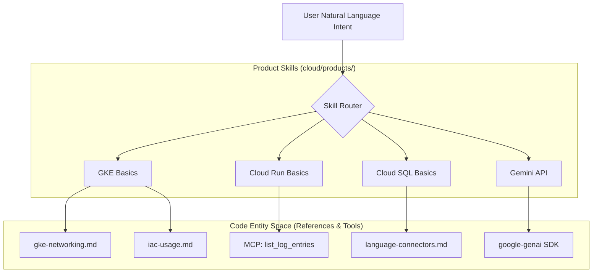
Sources: [README.md:20-34](), [cloud/products/kubernetes-engine/gke-basics/SKILL.md:28-51]()

---

## 2.1 Gemini API in Agent Platform
The **Gemini Enterprise Agent Platform** (formerly Vertex AI) skill focuses on integrating Google's most advanced AI models into enterprise applications. It mandates the use of the unified `google-genai` SDK and covers high-level capabilities like multimodal understanding, context caching, and the Live Realtime API.

*   **Key Models:** `gemini-3.1-pro-preview`, `gemini-3-flash-preview`.
*   **Authentication:** Supports Application Default Credentials (ADC) and Express Mode (API Key).

For details, see [Gemini API in Agent Platform](#2.1).

Sources: [cloud/products/agent-platform/gemini-api/SKILL.md:1-22]()

---

## 2.2 Google Kubernetes Engine (GKE) Basics
The **GKE Basics** skill follows the "Golden Path" for production-ready clusters, defaulting to **Autopilot** mode. It provides a comprehensive Day-0 checklist and detailed reference modules for scaling, security, and AI/ML inference (GPUs/TPUs).

*   **Networking:** Covers VPC-native clusters and Gateway API.
*   **Security:** Focuses on Workload Identity and RBAC hardening.

For details, see [Google Kubernetes Engine (GKE) Basics](#2.2).

Sources: [cloud/products/kubernetes-engine/gke-basics/SKILL.md:10-13](), [cloud/products/kubernetes-engine/gke-basics/SKILL.md:28-48]()

---

## 2.3 Cloud Run Basics
This skill covers the serverless execution environment for containers, supporting **Services**, **Jobs**, and **Worker Pools**. It guides users through deployment paths (container image vs. source-based) and common troubleshooting for "crash-on-boot" failures.

For details, see [Cloud Run Basics](#2.3).

Sources: [README.md:25]()

---

## 2.4 Cloud SQL Basics
The **Cloud SQL** skill provides patterns for managing MySQL, PostgreSQL, and SQL Server. It emphasizes secure connectivity via the **Cloud SQL Auth Proxy** and IAM database authentication, alongside Terraform provisioning for High Availability (HA).

For details, see [Cloud SQL Basics](#2.4).

Sources: [README.md:26]()

---

## 2.5 AlloyDB Basics
**AlloyDB** is covered as a high-performance PostgreSQL-compatible database. The skill explains the disaggregated storage-compute architecture and the **AlloyDB AI** suite, including vector search and model endpoint management.

For details, see [AlloyDB Basics](#2.5).

Sources: [README.md:23]()

---

## 2.6 BigQuery Basics
The **BigQuery** skill focuses on serverless data warehousing. It covers the resource hierarchy (Datasets/Tables), BigQuery ML, and specialized AI functions like `bigquery_ai_generate`. It also includes Model Context Protocol (MCP) integration for executing SQL directly from an agent.

For details, see [BigQuery Basics](#2.6).

Sources: [README.md:24]()

---

## 2.7 Firebase Basics
The **Firebase** skill bridges the gap between client-side development and Google Cloud infrastructure. It requires the `firebase-tools` CLI and covers the tiered knowledge retrieval architecture, security rules, and project synchronization.

For details, see [Firebase Basics](#2.7).

Sources: [README.md:27]()

---

## Product Skill Relationships

The following diagram shows how these products typically interact within the codebase's reference architectures.

**Diagram: Product Interoperability**
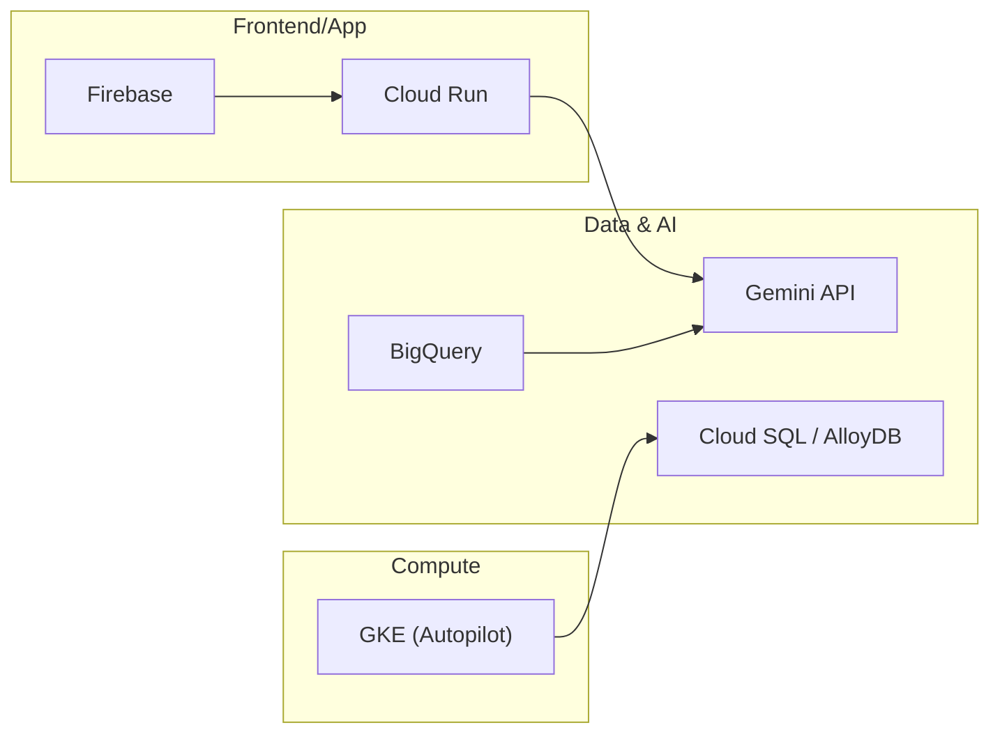
Sources: [README.md:20-34]()

---

# Page: Gemini API in Agent Platform

# Gemini API in Agent Platform

<details>
<summary>Relevant source files</summary>

The following files were used as context for generating this wiki page:

- [cloud/products/agent-platform/gemini-api/SKILL.md](cloud/products/agent-platform/gemini-api/SKILL.md)
- [cloud/products/agent-platform/gemini-api/references/advanced_features.md](cloud/products/agent-platform/gemini-api/references/advanced_features.md)
- [cloud/products/agent-platform/gemini-api/references/bounding_box.md](cloud/products/agent-platform/gemini-api/references/bounding_box.md)
- [cloud/products/agent-platform/gemini-api/references/embeddings.md](cloud/products/agent-platform/gemini-api/references/embeddings.md)
- [cloud/products/agent-platform/gemini-api/references/live_api.md](cloud/products/agent-platform/gemini-api/references/live_api.md)
- [cloud/products/agent-platform/gemini-api/references/media_generation.md](cloud/products/agent-platform/gemini-api/references/media_generation.md)
- [cloud/products/agent-platform/gemini-api/references/model_tuning.md](cloud/products/agent-platform/gemini-api/references/model_tuning.md)
- [cloud/products/agent-platform/gemini-api/references/safety.md](cloud/products/agent-platform/gemini-api/references/safety.md)
- [cloud/products/agent-platform/gemini-api/references/structured_and_tools.md](cloud/products/agent-platform/gemini-api/references/structured_and_tools.md)
- [cloud/products/agent-platform/gemini-api/references/text_and_multimodal.md](cloud/products/agent-platform/gemini-api/references/text_and_multimodal.md)

</details>


This page covers the Gemini Enterprise Agent Platform skill, focusing on the unified `google-genai` SDK, model tiers within the Gemini 3.x series, authentication modes, and advanced capabilities such as multimodal generation, function calling, context caching, and the Live API.

## Overview and SDKs

The Gemini Enterprise Agent Platform (formerly known as Vertex AI) provides enterprise-grade access to Google's most advanced AI models [cloud/products/agent-platform/gemini-api/SKILL.md:7-11](). The platform requires the use of the unified Gen AI SDK across multiple programming languages.

| Language | Package Name | Installation Command |
| :--- | :--- | :--- |
| **Python** | `google-genai` | `pip install google-genai` |
| **JS/TS** | `@google/genai` | `npm install @google/genai` |
| **Go** | `google.golang.org/genai` | `go get google.golang.org/genai` |
| **C#/.NET** | `Google.GenAI` | `dotnet add package Google.GenAI` |
| **Java** | `com.google.genai:google-genai` | See Maven/Gradle config |

Legacy SDKs such as `google-cloud-aiplatform`, `@google-cloud/vertexai`, and `google-generativeai` are deprecated and should be migrated to the unified SDKs listed above [cloud/products/agent-platform/gemini-api/SKILL.md:26-55]().

**Sources:**
- [cloud/products/agent-platform/gemini-api/SKILL.md:7-55]()

## Authentication & Configuration

The platform supports two primary authentication modes: Application Default Credentials (ADC) for standard Google Cloud environments and Express Mode for API-key-based access [cloud/products/agent-platform/gemini-api/SKILL.md:61-76]().

### Authentication Modes

| Mode | Key Environment Variables | Use Case |
| :--- | :--- | :--- |
| **ADC** | `GOOGLE_CLOUD_PROJECT`, `GOOGLE_GENAI_USE_VERTEXAI=true` | Standard GCP environments, Service Accounts. |
| **Express** | `GOOGLE_API_KEY`, `GOOGLE_GENAI_USE_VERTEXAI=true` | Quick prototyping, API key restricted access. |

### Client Initialization
The `genai.Client` class is the primary entry point. Initializing it without arguments allows it to automatically resolve configuration from environment variables [cloud/products/agent-platform/gemini-api/SKILL.md:78-83]().

**Sources:**
- [cloud/products/agent-platform/gemini-api/SKILL.md:57-90]()

## Model Tiers

The platform features the Gemini 3 series for production workloads. Older models (Gemini 1.0, 1.5, 2.0) are considered legacy [cloud/products/agent-platform/gemini-api/SKILL.md:94-110]().

### Gemini 3.x Series
*   **`gemini-3.1-pro-preview`**: High-complexity reasoning, coding, and research (1M token window) [cloud/products/agent-platform/gemini-api/SKILL.md:94]().
*   **`gemini-3-flash-preview`**: Fast, balanced performance for multimodal tasks (1M token window) [cloud/products/agent-platform/gemini-api/SKILL.md:96]().
*   **`gemini-3-pro-image-preview`**: Advanced image generation and editing [cloud/products/agent-platform/gemini-api/SKILL.md:97]().
*   **`gemini-live-2.5-flash-native-audio`**: Specialized for the Live Realtime API [cloud/products/agent-platform/gemini-api/SKILL.md:99]().

**Sources:**
- [cloud/products/agent-platform/gemini-api/SKILL.md:92-111]()

## Implementation Flow: Text and Multimodal

The `models.generate_content` method handles both text-only and multimodal inputs. Multimodal inputs are provided via `types.Part` objects, which can reference Google Cloud Storage URIs or local bytes [cloud/products/agent-platform/gemini-api/references/text_and_multimodal.md:48-69]().

### Multimodal Data Flow
This diagram illustrates how the `genai.Client` bridges natural language requests and file data into the model space.

**Diagram: Multimodal Content Generation Flow**
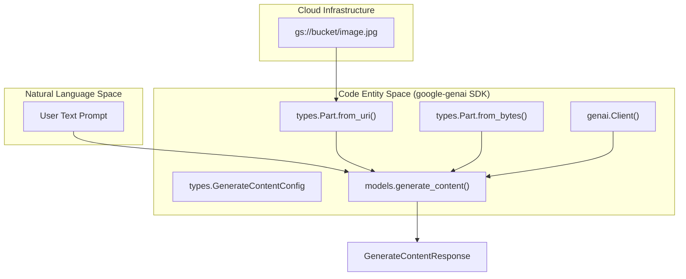

**Sources:**
- [cloud/products/agent-platform/gemini-api/references/text_and_multimodal.md:1-91]()

## Advanced Specialized Capabilities

### Function Calling and Tools
The SDK allows the model to interact with external systems via `tools`. Supported tools include:
*   **Function Calling**: Passing Python functions to `GenerateContentConfig(tools=[...])` [cloud/products/agent-platform/gemini-api/references/structured_and_tools.md:30-50]().
*   **Google Search Grounding**: Using `types.GoogleSearch()` to verify responses against live web data [cloud/products/agent-platform/gemini-api/references/structured_and_tools.md:62-79]().
*   **Code Execution**: Enabling the model to write and run Python code for precise calculations [cloud/products/agent-platform/gemini-api/references/structured_and_tools.md:89-104]().

### Context Caching
For large datasets (e.g., long PDFs or video files), `client.caches.create` stores the context to reduce latency and costs for subsequent requests [cloud/products/agent-platform/gemini-api/references/advanced_features.md:3-25]().

### Live API (Realtime)
The Live API utilizes WebSockets for bidirectional streaming. It uses `client.aio.live.connect` for low-latency voice and video interactions [cloud/products/agent-platform/gemini-api/references/live_api.md:1-28]().

**Diagram: Live API WebSocket Interaction**
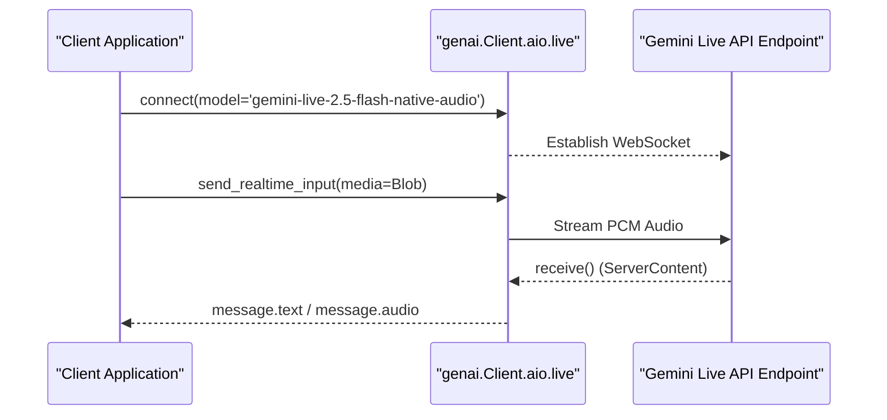

**Sources:**
- [cloud/products/agent-platform/gemini-api/references/advanced_features.md:3-35]()
- [cloud/products/agent-platform/gemini-api/references/live_api.md:1-37]()
- [cloud/products/agent-platform/gemini-api/references/structured_and_tools.md:1-130]()

## Batch Prediction and Tuning

For non-interactive workloads, the platform supports asynchronous processing and model customization.

*   **Batch Prediction**: Uses `client.batches.create` to process large JSONL files stored in GCS [cloud/products/agent-platform/gemini-api/references/advanced_features.md:37-57]().
*   **Model Tuning**: Uses `client.tunings.tune` for Supervised Fine-Tuning (SFT) using `types.TuningDataset` [cloud/products/agent-platform/gemini-api/references/model_tuning.md:1-22]().

**Sources:**
- [cloud/products/agent-platform/gemini-api/references/advanced_features.md:37-57]()
- [cloud/products/agent-platform/gemini-api/references/model_tuning.md:1-38]()

---

# Page: Google Kubernetes Engine (GKE) Basics

# Google Kubernetes Engine (GKE) Basics

<details>
<summary>Relevant source files</summary>

The following files were used as context for generating this wiki page:

- [cloud/products/kubernetes-engine/gke-basics/SKILL.md](cloud/products/kubernetes-engine/gke-basics/SKILL.md)
- [cloud/products/kubernetes-engine/gke-basics/assets/default-deny-netpol.yaml](cloud/products/kubernetes-engine/gke-basics/assets/default-deny-netpol.yaml)
- [cloud/products/kubernetes-engine/gke-basics/assets/golden-path-autopilot.yaml](cloud/products/kubernetes-engine/gke-basics/assets/golden-path-autopilot.yaml)
- [cloud/products/kubernetes-engine/gke-basics/assets/hpa-example.yaml](cloud/products/kubernetes-engine/gke-basics/assets/hpa-example.yaml)
- [cloud/products/kubernetes-engine/gke-basics/assets/vpa-example.yaml](cloud/products/kubernetes-engine/gke-basics/assets/vpa-example.yaml)
- [cloud/products/kubernetes-engine/gke-basics/assets/workload-identity-pod.yaml](cloud/products/kubernetes-engine/gke-basics/assets/workload-identity-pod.yaml)
- [cloud/products/kubernetes-engine/gke-basics/references/cli-reference.md](cloud/products/kubernetes-engine/gke-basics/references/cli-reference.md)
- [cloud/products/kubernetes-engine/gke-basics/references/client-library-usage.md](cloud/products/kubernetes-engine/gke-basics/references/client-library-usage.md)
- [cloud/products/kubernetes-engine/gke-basics/references/core-concepts.md](cloud/products/kubernetes-engine/gke-basics/references/core-concepts.md)
- [cloud/products/kubernetes-engine/gke-basics/references/gke-app-onboarding.md](cloud/products/kubernetes-engine/gke-basics/references/gke-app-onboarding.md)
- [cloud/products/kubernetes-engine/gke-basics/references/gke-backup-dr.md](cloud/products/kubernetes-engine/gke-basics/references/gke-backup-dr.md)
- [cloud/products/kubernetes-engine/gke-basics/references/gke-batch-hpc.md](cloud/products/kubernetes-engine/gke-basics/references/gke-batch-hpc.md)
- [cloud/products/kubernetes-engine/gke-basics/references/gke-cluster-creation.md](cloud/products/kubernetes-engine/gke-basics/references/gke-cluster-creation.md)
- [cloud/products/kubernetes-engine/gke-basics/references/gke-compute-classes.md](cloud/products/kubernetes-engine/gke-basics/references/gke-compute-classes.md)
- [cloud/products/kubernetes-engine/gke-basics/references/gke-cost.md](cloud/products/kubernetes-engine/gke-basics/references/gke-cost.md)
- [cloud/products/kubernetes-engine/gke-basics/references/gke-golden-path.md](cloud/products/kubernetes-engine/gke-basics/references/gke-golden-path.md)
- [cloud/products/kubernetes-engine/gke-basics/references/gke-inference.md](cloud/products/kubernetes-engine/gke-basics/references/gke-inference.md)
- [cloud/products/kubernetes-engine/gke-basics/references/gke-multitenancy.md](cloud/products/kubernetes-engine/gke-basics/references/gke-multitenancy.md)
- [cloud/products/kubernetes-engine/gke-basics/references/gke-networking.md](cloud/products/kubernetes-engine/gke-basics/references/gke-networking.md)
- [cloud/products/kubernetes-engine/gke-basics/references/gke-observability.md](cloud/products/kubernetes-engine/gke-basics/references/gke-observability.md)
- [cloud/products/kubernetes-engine/gke-basics/references/gke-scaling.md](cloud/products/kubernetes-engine/gke-basics/references/gke-scaling.md)
- [cloud/products/kubernetes-engine/gke-basics/references/gke-security.md](cloud/products/kubernetes-engine/gke-basics/references/gke-security.md)
- [cloud/products/kubernetes-engine/gke-basics/references/gke-storage.md](cloud/products/kubernetes-engine/gke-basics/references/gke-storage.md)
- [cloud/products/kubernetes-engine/gke-basics/references/gke-upgrades.md](cloud/products/kubernetes-engine/gke-basics/references/gke-upgrades.md)
- [cloud/products/kubernetes-engine/gke-basics/references/iac-usage.md](cloud/products/kubernetes-engine/gke-basics/references/iac-usage.md)
- [cloud/products/kubernetes-engine/gke-basics/references/mcp-usage.md](cloud/products/kubernetes-engine/gke-basics/references/mcp-usage.md)

</details>


Google Kubernetes Engine (GKE) is a managed Kubernetes platform for deploying, scaling, and operating containerized applications. This page covers the technical implementation of GKE within the `google/skills` repository, focusing on the **Golden Path Autopilot** configuration, networking, security, and specialized workloads like AI/ML and HPC.

## Overview and Operational Modes

GKE operates in two primary modes: **Autopilot** and **Standard**. The repository defaults to the Golden Path Autopilot configuration, which manages node provisioning, health, and security automatically [cloud/products/kubernetes-engine/gke-basics/SKILL.md:10-12]().

| Feature | Autopilot (Recommended) | Standard |
| :--- | :--- | :--- |
| **Node Management** | Fully managed by Google | User-managed node pools |
| **Scaling** | Per-pod resource requests | Cluster Autoscaler / Node Pools |
| **Security** | Hardened by default (Shielded nodes, GKE Sandbox) | User-configurable hardening |
| **Pricing** | Pay per pod request (vCPU, Mem, Storage) | Pay for Compute Engine VMs + cluster fee |

**Sources:** [cloud/products/kubernetes-engine/gke-basics/references/core-concepts.md:9-14](), [cloud/products/kubernetes-engine/gke-basics/references/core-concepts.md:48-54]()

## The Golden Path Configuration

The "Golden Path" represents a production-ready baseline for GKE clusters. It is defined as an Autopilot cluster with specific security and networking defaults [cloud/products/kubernetes-engine/gke-basics/assets/golden-path-autopilot.yaml:1-148]().

### Core Configuration Logic
The following diagram illustrates how natural language requirements map to specific GKE configuration entities in the codebase.

**Mapping Requirements to GKE Configuration**
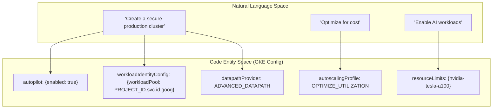
**Sources:** [cloud/products/kubernetes-engine/gke-basics/assets/golden-path-autopilot.yaml:31-47](), [cloud/products/kubernetes-engine/gke-basics/assets/golden-path-autopilot.yaml:71-76]()

## Cluster Creation and Management

Clusters are managed via three primary interfaces: GKE MCP Tools (preferred), `gcloud` CLI, and `kubectl` [cloud/products/kubernetes-engine/gke-basics/references/cli-reference.md:5-11]().

### Deployment Flow
The following diagram shows the data flow from an MCP tool call to the creation of a GKE cluster.

**GKE Resource Provisioning Flow**
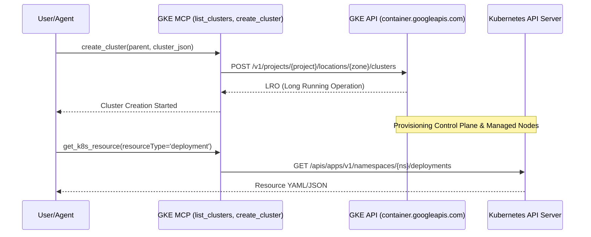
**Sources:** [cloud/products/kubernetes-engine/gke-basics/references/cli-reference.md:37-59](), [cloud/products/kubernetes-engine/gke-basics/references/cli-reference.md:116-134]()

## Networking and Security

### VPC-Native Networking
GKE clusters in the repository use **VPC-native** configurations by default [cloud/products/kubernetes-engine/gke-basics/references/core-concepts.md:22-29]().
*   **Dataplane V2**: eBPF-based networking for performance and built-in Network Policy enforcement [cloud/products/kubernetes-engine/gke-basics/assets/golden-path-autopilot.yaml:76]().
*   **Private Clusters**: Nodes have no public IPs; the control plane is accessed via private endpoints [cloud/products/kubernetes-engine/gke-basics/assets/golden-path-autopilot.yaml:59-60]().

### Identity and Hardening
*   **Workload Identity Federation**: Allows Kubernetes Service Accounts (KSA) to impersonate IAM Service Accounts (GSA), eliminating the need for static JSON keys [cloud/products/kubernetes-engine/gke-basics/references/core-concepts.md:39-40]().
*   **Secret Manager Integration**: Automatically syncs Google Cloud secrets into Kubernetes volumes with rotation [cloud/products/kubernetes-engine/gke-basics/assets/golden-path-autopilot.yaml:64-68]().
*   **Binary Authorization**: Ensures only trusted container images are deployed [cloud/products/kubernetes-engine/gke-basics/assets/golden-path-autopilot.yaml:49-50]().

**Sources:** [cloud/products/kubernetes-engine/gke-basics/assets/golden-path-autopilot.yaml:48-73](), [cloud/products/kubernetes-engine/gke-basics/assets/workload-identity-pod.yaml:1-33]()

## Scaling and Observability

GKE provides multi-dimensional scaling capabilities:

| Mechanism | Component | File Reference |
| :--- | :--- | :--- |
| **HPA** | Scales pod replicas based on CPU/Memory | [assets/hpa-example.yaml:1-26]() |
| **VPA** | Adjusts pod resource requests (CPU/Mem) | [assets/vpa-example.yaml:1-22]() |
| **NAP** | Node Auto-Provisioning for right-sizing nodes | [assets/golden-path-autopilot.yaml:37]() |

### Observability Stack
The Golden Path enables comprehensive logging and monitoring components [cloud/products/kubernetes-engine/gke-basics/assets/golden-path-autopilot.yaml:97-125]():
*   **System Components**: Control plane logs and metrics.
*   **Workloads**: Application-level logs.
*   **Managed Service for Prometheus**: Enabled by default for metrics collection.
*   **Advanced Datapath Observability**: eBPF-based metrics for network troubleshooting.

**Sources:** [cloud/products/kubernetes-engine/gke-basics/references/gke-scaling.md](), [cloud/products/kubernetes-engine/gke-basics/references/gke-observability.md]()

## Specialized Workloads

### Batch and HPC
For high-performance computing, GKE supports:
*   **Kueue**: Job queuing and resource quota management [cloud/products/kubernetes-engine/gke-basics/references/gke-batch-hpc.md:68-103]().
*   **JobSet**: Orchestrating groups of related jobs [cloud/products/kubernetes-engine/gke-basics/references/gke-batch-hpc.md:40-66]().
*   **Compact Placement**: Ensuring nodes are physically close in the data center for low-latency MPI workloads [cloud/products/kubernetes-engine/gke-basics/references/gke-batch-hpc.md:107-119]().

### AI Inference
GKE supports GPU and TPU acceleration for LLM serving (e.g., vLLM, GIQ). Resource limits for `nvidia-tesla-t4` and `nvidia-tesla-a100` are pre-configured in the Autopilot Golden Path [cloud/products/kubernetes-engine/gke-basics/assets/golden-path-autopilot.yaml:44-46]().

**Sources:** [cloud/products/kubernetes-engine/gke-basics/references/gke-batch-hpc.md:1-168](), [cloud/products/kubernetes-engine/gke-basics/references/gke-inference.md]()

## Storage and Backup

*   **CSI Drivers**: The Golden Path enables drivers for Persistent Disk, Filestore, GCS FUSE, and Parallelstore [cloud/products/kubernetes-engine/gke-basics/assets/golden-path-autopilot.yaml:12-25]().
*   **Backup for GKE**: A managed service for backing up and restoring Kubernetes configuration and persistent data [cloud/products/kubernetes-engine/gke-basics/references/gke-backup-dr.md:1-81]().

**Sources:** [cloud/products/kubernetes-engine/gke-basics/references/gke-storage.md](), [cloud/products/kubernetes-engine/gke-basics/references/gke-backup-dr.md:9-22]()

---

# Page: Cloud Run Basics

# Cloud Run Basics

<details>
<summary>Relevant source files</summary>

The following files were used as context for generating this wiki page:

- [cloud/products/cloud-run/cloud-run-basics/SKILL.md](cloud/products/cloud-run/cloud-run-basics/SKILL.md)
- [cloud/products/cloud-run/cloud-run-basics/references/cli-usage.md](cloud/products/cloud-run/cloud-run-basics/references/cli-usage.md)
- [cloud/products/cloud-run/cloud-run-basics/references/client-library-usage.md](cloud/products/cloud-run/cloud-run-basics/references/client-library-usage.md)
- [cloud/products/cloud-run/cloud-run-basics/references/core-concepts.md](cloud/products/cloud-run/cloud-run-basics/references/core-concepts.md)
- [cloud/products/cloud-run/cloud-run-basics/references/iac-usage.md](cloud/products/cloud-run/cloud-run-basics/references/iac-usage.md)
- [cloud/products/cloud-run/cloud-run-basics/references/iam-security.md](cloud/products/cloud-run/cloud-run-basics/references/iam-security.md)
- [cloud/products/cloud-run/cloud-run-basics/references/mcp-usage.md](cloud/products/cloud-run/cloud-run-basics/references/mcp-usage.md)

</details>


Cloud Run is a fully managed application platform for running code, functions, or containers on Google Cloud's scalable infrastructure. It abstracts infrastructure management by providing serverless execution environments that scale automatically based on demand [cloud/products/cloud-run/cloud-run-basics/SKILL.md:11-14]().

## Resource Models

Cloud Run supports three primary resource types to accommodate different workload patterns:

| Resource Type | Description | Key Use Cases |
| :--- | :--- | :--- |
| **Services** | Stateless instances that autoscale based on HTTP requests or events. | Web apps, APIs, microservices [cloud/products/cloud-run/cloud-run-basics/references/core-concepts.md:11-13](). |
| **Jobs** | Parallelizable tasks that run to completion. | Data processing, DB migrations, scheduled tasks [cloud/products/cloud-run/cloud-run-basics/references/core-concepts.md:15-17](). |
| **Worker Pools** | Always-on, pull-based background processing. | Kafka consumers, Pub/Sub pull, RabbitMQ [cloud/products/cloud-run/cloud-run-basics/SKILL.md:21-23](). |

### Hierarchy and Lifecycle
Services are the top-level resource. Each deployment creates an immutable **Revision**, which is a snapshot of the configuration and container image [cloud/products/cloud-run/cloud-run-basics/references/core-concepts.md:26-30]().

Sources: [cloud/products/cloud-run/cloud-run-basics/SKILL.md:16-23](), [cloud/products/cloud-run/cloud-run-basics/references/core-concepts.md:9-47]()

## Deployment Paths

Cloud Run offers multiple paths to move from code to a running service.

### 1. Container Image Deployment
The standard path involves deploying a pre-built image from **Artifact Registry** or **Docker Hub**. Cloud Run imports the image during deployment and keeps a copy for serving revisions [cloud/products/cloud-run/cloud-run-basics/SKILL.md:74-79]().

```bash
gcloud run deploy SERVICE_NAME --image IMAGE_URL --region REGION
```

### 2. Source-to-Service (Buildpacks)
Uses Google Cloud's Buildpacks and Cloud Build to containerize source code automatically without requiring a local Docker installation [cloud/products/cloud-run/cloud-run-basics/SKILL.md:130-134]().
*   **With Dockerfile:** Cloud Build executes the Dockerfile in the cloud [cloud/products/cloud-run/cloud-run-basics/SKILL.md:149-155]().
*   **Automatic Updates:** Can be configured to use Google-managed base images that receive security patches automatically [cloud/products/cloud-run/cloud-run-basics/SKILL.md:136-147]().

### 3. No-Build Path (Preview)
Deploys artifacts directly to Cloud Run, bypassing the Cloud Build step for rapid deployment cycles [cloud/products/cloud-run/cloud-run-basics/SKILL.md:157-161]().

```bash
gcloud beta run deploy SERVICE_NAME --source APPLICATION_PATH --no-build
```

Sources: [cloud/products/cloud-run/cloud-run-basics/SKILL.md:65-171](), [cloud/products/cloud-run/cloud-run-basics/references/cli-usage.md:13-33]()

## Runtime Configuration & Environment

### The Container Contract
To avoid **crash-on-boot** failures, containers must adhere to the runtime contract:
*   **Port Listening:** The ingress container MUST listen on `0.0.0.0` (not `127.0.0.1`) [cloud/products/cloud-run/cloud-run-basics/SKILL.md:70-72]().
*   **Port Variable:** Use the injected `$PORT` environment variable (defaults to `8080`) [cloud/products/cloud-run/cloud-run-basics/references/core-concepts.md:95-96]().
*   **Architecture:** Executables must be compiled for Linux 64-bit (x86_64) [cloud/products/cloud-run/cloud-run-basics/references/core-concepts.md:66-67]().

### Resource Model Visualization

**Cloud Run Resource to Code Entity Mapping**

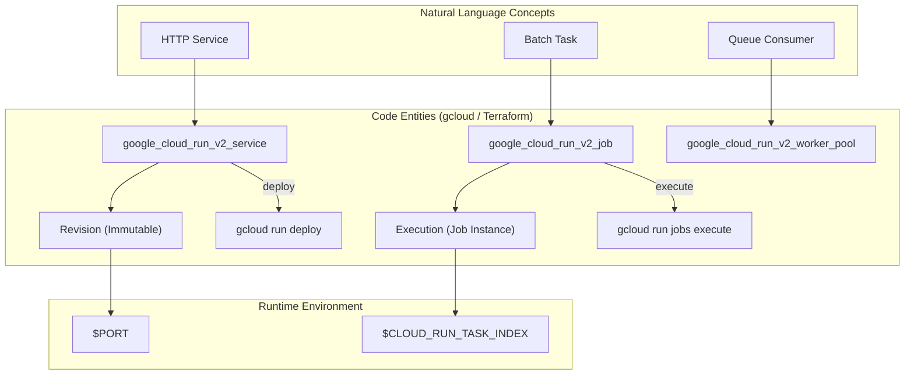
Sources: [cloud/products/cloud-run/cloud-run-basics/references/core-concepts.md:22-47](), [cloud/products/cloud-run/cloud-run-basics/references/iac-usage.md:12-64]()

## IAM and Security

Cloud Run uses IAM roles to control deployment and invocation.

### Required Roles for Deployment
*   `roles/run.admin`: Full control over Cloud Run resources [cloud/products/cloud-run/cloud-run-basics/references/iam-security.md:9]().
*   `roles/run.sourceDeveloper`: Required for source-based deployments [cloud/products/cloud-run/cloud-run-basics/SKILL.md:43]().
*   `roles/iam.serviceAccountUser`: To associate a service identity with the resource [cloud/products/cloud-run/cloud-run-basics/SKILL.md:44-45]().
*   `roles/run.builder`: Specifically for the Cloud Build service account to build sources [cloud/products/cloud-run/cloud-run-basics/SKILL.md:52-53]().

### Service Identity
Workloads should run as **User-managed service accounts** (e.g., `name@project.iam.gserviceaccount.com`) rather than the default Compute Engine service account to follow the principle of least privilege [cloud/products/cloud-run/cloud-run-basics/references/iam-security.md:20-28]().

Sources: [cloud/products/cloud-run/cloud-run-basics/SKILL.md:38-64](), [cloud/products/cloud-run/cloud-run-basics/references/iam-security.md:1-48]()

## Infrastructure as Code (Terraform)

Cloud Run resources are managed via the `google` provider using the `v2` resources.

### Example: Service with Public Access
```terraform
resource "google_cloud_run_v2_service" "default" {
  name     = "cloudrun-service"
  location = "us-central1"
  ingress  = "INGRESS_TRAFFIC_ALL"

  template {
    containers {
      image = "us-docker.pkg.dev/cloudrun/container/hello"
    }
  }
}

resource "google_cloud_run_v2_service_iam_member" "noauth" {
  name   = google_cloud_run_v2_service.default.name
  role   = "roles/run.invoker"
  member = "allUsers"
}
```
Sources: [cloud/products/cloud-run/cloud-run-basics/references/iac-usage.md:12-32]()

## Model Context Protocol (MCP) Usage

The Cloud Run MCP server enables AI agents to interact with Cloud Run resources using standardized tools [cloud/products/cloud-run/cloud-run-basics/references/mcp-usage.md:3-4]().

**MCP Tool Mapping**

| MCP Tool Name | Purpose | Code Equivalent |
| :--- | :--- | :--- |
| `list_services` | List all services in a project | `gcloud run services list` [cloud/products/cloud-run/cloud-run-basics/references/mcp-usage.md:12](). |
| `get_service` | Retrieve service URI and status | `gcloud run services describe` [cloud/products/cloud-run/cloud-run-basics/references/mcp-usage.md:10](). |
| `deploy_service_from_image` | Deploy a container | `gcloud run deploy --image` [cloud/products/cloud-run/cloud-run-basics/references/mcp-usage.md:14](). |
| `deploy_service_from_archive` | Deploy from source archive | Skips build step for speed [cloud/products/cloud-run/cloud-run-basics/references/mcp-usage.md:16](). |

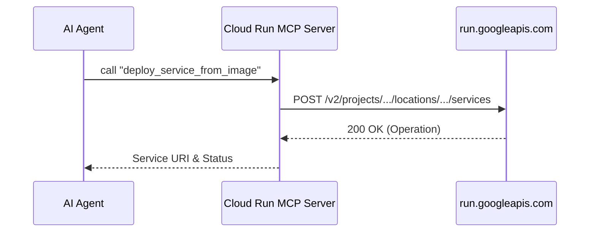
Sources: [cloud/products/cloud-run/cloud-run-basics/references/mcp-usage.md:1-25]()

## Troubleshooting: Crash-on-Boot
If a service fails to start, verify the following:
1.  **Port Binding:** Ensure the application listens on `0.0.0.0:$PORT` [cloud/products/cloud-run/cloud-run-basics/SKILL.md:70-72]().
2.  **Logs:** Use `gcloud logging read` to inspect the container's `stdout` and `stderr` [cloud/products/cloud-run/cloud-run-basics/references/cli-usage.md:105-107]().
3.  **Permissions:** Verify the Service Account has `roles/run.invoker` if internal communication is expected [cloud/products/cloud-run/cloud-run-basics/references/iam-security.md:10]().

Sources: [cloud/products/cloud-run/cloud-run-basics/SKILL.md:70-72](), [cloud/products/cloud-run/cloud-run-basics/references/cli-usage.md:100-107]()

---

# Page: Cloud SQL Basics

# Cloud SQL Basics

<details>
<summary>Relevant source files</summary>

The following files were used as context for generating this wiki page:

- [cloud/products/alloydb/alloydb-basics/references/iam-security.md](cloud/products/alloydb/alloydb-basics/references/iam-security.md)
- [cloud/products/cloud-sql/cloud-sql-basics/SKILL.md](cloud/products/cloud-sql/cloud-sql-basics/SKILL.md)
- [cloud/products/cloud-sql/cloud-sql-basics/references/cli-usage.md](cloud/products/cloud-sql/cloud-sql-basics/references/cli-usage.md)
- [cloud/products/cloud-sql/cloud-sql-basics/references/client-library-usage.md](cloud/products/cloud-sql/cloud-sql-basics/references/client-library-usage.md)
- [cloud/products/cloud-sql/cloud-sql-basics/references/core-concepts.md](cloud/products/cloud-sql/cloud-sql-basics/references/core-concepts.md)
- [cloud/products/cloud-sql/cloud-sql-basics/references/iac-usage.md](cloud/products/cloud-sql/cloud-sql-basics/references/iac-usage.md)
- [cloud/products/cloud-sql/cloud-sql-basics/references/iam-security.md](cloud/products/cloud-sql/cloud-sql-basics/references/iam-security.md)
- [cloud/products/cloud-sql/cloud-sql-basics/references/mcp-usage.md](cloud/products/cloud-sql/cloud-sql-basics/references/mcp-usage.md)

</details>


Cloud SQL is a fully managed relational database service for **MySQL**, **PostgreSQL**, and **SQL Server**. It automates infrastructure management tasks such as hardware provisioning, patch management, backups, and replication, while providing high performance and availability for applications [cloud/products/cloud-sql/cloud-sql-basics/SKILL.md:1-22]().

## Resource Hierarchy and Architecture

Cloud SQL manages third-party database engines as Google Cloud resources. Each instance is powered by a Virtual Machine (VM) running the specific database program [cloud/products/cloud-sql/cloud-sql-basics/SKILL.md:8-11](), [cloud/products/cloud-sql/cloud-sql-basics/references/core-concepts.md:19-22]().

*   **Primary Instance:** The main read/write entry point for the database [cloud/products/cloud-sql/cloud-sql-basics/references/core-concepts.md:24]().
*   **High Availability (HA):** A configuration providing a standby VM in a different zone with automatic failover to ensure reliability [cloud/products/cloud-sql/cloud-sql-basics/references/core-concepts.md:26-27]().
*   **Read Replicas:** Instances used to scale read traffic and provide local data access across different regions [cloud/products/cloud-sql/cloud-sql-basics/references/core-concepts.md:29-30]().
*   **Storage:** Utilizes scalable and durable network-attached Persistent Disks [cloud/products/cloud-sql/cloud-sql-basics/references/core-concepts.md:34-35]().

### Supported Engines
| Engine | Supported Versions |
| :--- | :--- |
| **MySQL** | 5.6, 5.7, 8.0, 8.4 [cloud/products/cloud-sql/cloud-sql-basics/references/core-concepts.md:11]() |
| **PostgreSQL** | 9.6 through 18 (Default is 18) [cloud/products/cloud-sql/cloud-sql-basics/references/core-concepts.md:13-14]() |
| **SQL Server** | 2017, 2019, 2022, 2025 (Express, Web, Standard, Enterprise) [cloud/products/cloud-sql/cloud-sql-basics/references/core-concepts.md:16-17]() |

**Sources:** [cloud/products/cloud-sql/cloud-sql-basics/SKILL.md:1-22](), [cloud/products/cloud-sql/cloud-sql-basics/references/core-concepts.md:1-40]()

---

## Infrastructure as Code (Terraform)

Cloud SQL resources are provisioned using the `google` Terraform provider. The primary resources involve the instance itself, the logical databases within it, and the database users.

### Provisioning Flow

The following diagram illustrates the relationship between Terraform resources and the resulting Cloud SQL entities.

**Diagram: Terraform to Cloud SQL Entity Mapping**
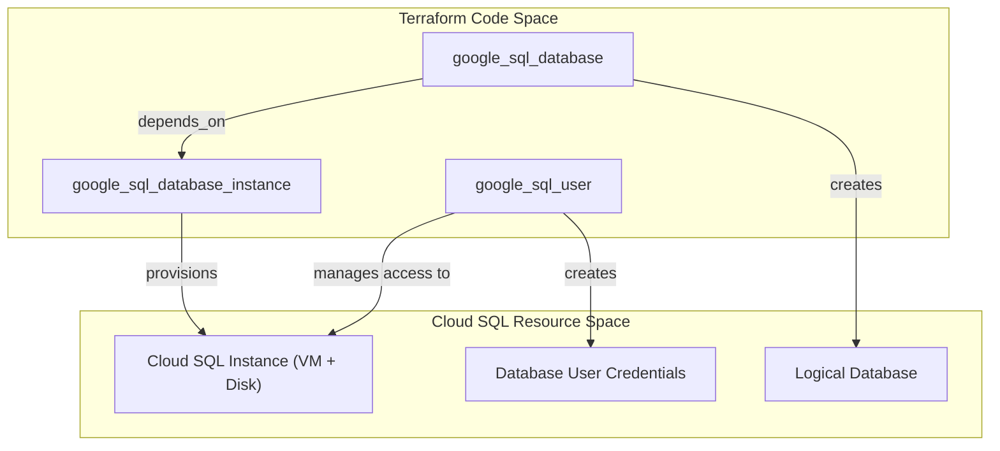
**Sources:** [cloud/products/cloud-sql/cloud-sql-basics/references/iac-usage.md:1-37]()

### Implementation Example
Citing [cloud/products/cloud-sql/cloud-sql-basics/references/iac-usage.md:13-37]():
```terraform
resource "google_sql_database_instance" "default" {
  name             = "master-instance"
  region           = "us-central1"
  database_version = "POSTGRES_15"
  settings {
    tier = "db-f1-micro"
    backup_configuration { enabled = true }
  }
}

resource "google_sql_database" "database" {
  name     = "my-database"
  instance = google_sql_database_instance.default.name
}
```

---

## Connectivity and Security

Cloud SQL supports multiple connectivity methods, prioritizing secure, encrypted paths.

### Connection Methods
1.  **Cloud SQL Auth Proxy:** The recommended method. It provides IAM-based authentication and end-to-end encryption without requiring SSL/TLS certificates or manual IP allowlisting [cloud/products/cloud-sql/cloud-sql-basics/references/iam-security.md:28-30]().
2.  **Private IP:** Traffic remains within the Google Cloud network using VPC Peering, Private Services Access (PSA), or Private Service Connect (PSC) [cloud/products/cloud-sql/cloud-sql-basics/references/iam-security.md:32-33]().
3.  **Public IP:** Requires **Authorized Networks** (CIDR restrictions) to secure the endpoint [cloud/products/cloud-sql/cloud-sql-basics/references/iam-security.md:35-36]().

### IAM Roles
| Role | Purpose |
| :--- | :--- |
| `roles/cloudsql.admin` | Full control over all Cloud SQL resources [cloud/products/cloud-sql/cloud-sql-basics/references/iam-security.md:10](). |
| `roles/cloudsql.client` | Required for connectivity via Cloud SQL Auth Proxy or App Engine [cloud/products/cloud-sql/cloud-sql-basics/references/iam-security.md:17-19](). |
| `roles/cloudsql.instanceUser` | Permission to log in to the database instance [cloud/products/cloud-sql/cloud-sql-basics/references/iam-security.md:20-21](). |

**Data Security:** Data is encrypted at rest by default. Users can opt for **Customer-Managed Encryption Keys (CMEK)** for additional control [cloud/products/cloud-sql/cloud-sql-basics/references/iam-security.md:40-41](). **IAM Database Authentication** allows logging in using IAM principals instead of static passwords for MySQL and PostgreSQL [cloud/products/cloud-sql/cloud-sql-basics/references/iam-security.md:43-45]().

**Sources:** [cloud/products/cloud-sql/cloud-sql-basics/references/iam-security.md:1-63]()

---

## Language Connectors and SDKs

Google Cloud provides language-specific connectors that handle the complexities of secure mTLS connections and IAM authentication automatically.

### Programming Interface
**Diagram: Application to Database Data Flow**
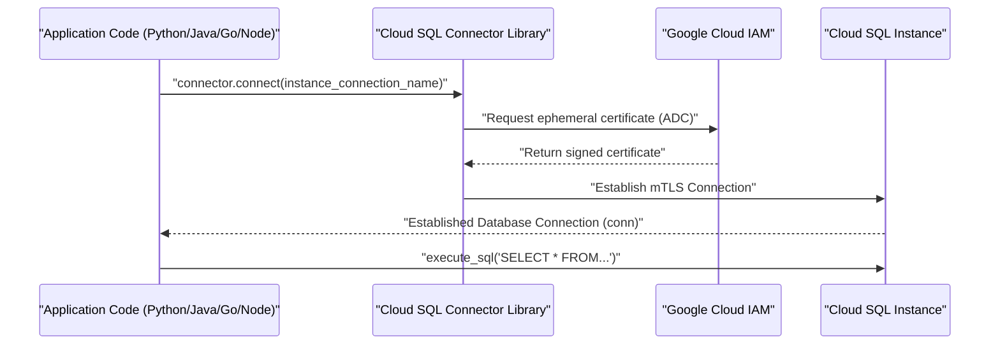
**Sources:** [cloud/products/cloud-sql/cloud-sql-basics/references/client-library-usage.md:12-109]()

### Connector Implementation Examples
*   **Python:** Uses `cloud-sql-python-connector` with drivers like `pg8000` [cloud/products/cloud-sql/cloud-sql-basics/references/client-library-usage.md:23-40]().
*   **Java:** Uses `jdbc-socket-factory-bom` to provide `postgres-socket-factory` or `mysql-socket-factory` [cloud/products/cloud-sql/cloud-sql-basics/references/client-library-usage.md:46-93]().
*   **Node.js:** Uses `@google-cloud/cloud-sql-connector` [cloud/products/cloud-sql/cloud-sql-basics/references/client-library-usage.md:100]().
*   **Go:** Uses `cloud.google.com/go/cloudsqlconn` [cloud/products/cloud-sql/cloud-sql-basics/references/client-library-usage.md:108]().

---

## Model Context Protocol (MCP) Integration

Cloud SQL can be managed by AI agents via the **Model Context Protocol (MCP)**. This allows for automated schema migrations, health auditing, and query execution [cloud/products/cloud-sql/cloud-sql-basics/references/mcp-usage.md:1-10]().

### Available MCP Tools
*   `execute_sql`: Runs DDL, DML, or DQL statements directly on the instance [cloud/products/cloud-sql/cloud-sql-basics/references/mcp-usage.md:19-20]().
*   `create_instance` / `clone_instance`: Lifecycle management of database resources [cloud/products/cloud-sql/cloud-sql-basics/references/mcp-usage.md:15-17]().
*   `import_data`: Ingests data from Cloud Storage into the instance [cloud/products/cloud-sql/cloud-sql-basics/references/mcp-usage.md:25]().
*   `list_users` / `create_user`: Manages database access identities [cloud/products/cloud-sql/cloud-sql-basics/references/mcp-usage.md:18-24]().

**Sources:** [cloud/products/cloud-sql/cloud-sql-basics/references/mcp-usage.md:1-52]()

---

# Page: AlloyDB Basics

# AlloyDB Basics

<details>
<summary>Relevant source files</summary>

The following files were used as context for generating this wiki page:

- [cloud/products/alloydb/alloydb-basics/SKILL.md](cloud/products/alloydb/alloydb-basics/SKILL.md)
- [cloud/products/alloydb/alloydb-basics/references/cli-usage.md](cloud/products/alloydb/alloydb-basics/references/cli-usage.md)
- [cloud/products/alloydb/alloydb-basics/references/client-library-usage.md](cloud/products/alloydb/alloydb-basics/references/client-library-usage.md)
- [cloud/products/alloydb/alloydb-basics/references/core-concepts.md](cloud/products/alloydb/alloydb-basics/references/core-concepts.md)
- [cloud/products/alloydb/alloydb-basics/references/iac-usage.md](cloud/products/alloydb/alloydb-basics/references/iac-usage.md)
- [cloud/products/alloydb/alloydb-basics/references/iam-security.md](cloud/products/alloydb/alloydb-basics/references/iam-security.md)
- [cloud/products/alloydb/alloydb-basics/references/mcp-usage.md](cloud/products/alloydb/alloydb-basics/references/mcp-usage.md)
- [cloud/products/cloud-sql/cloud-sql-basics/references/iam-security.md](cloud/products/cloud-sql/cloud-sql-basics/references/iam-security.md)

</details>


AlloyDB for PostgreSQL is a fully managed, PostgreSQL-compatible database service designed for enterprise-grade performance, scale, and availability [cloud/products/alloydb/alloydb-basics/SKILL.md:10-12](). It utilizes a cloud-native architecture that separates compute from storage, allowing resources to scale independently [cloud/products/alloydb/alloydb-basics/references/core-concepts.md:3-6]().

## Architecture and Resource Hierarchy

AlloyDB operates on a regional cluster-based hierarchy. A cluster is the top-level resource that contains instances and the underlying storage [cloud/products/alloydb/alloydb-basics/references/core-concepts.md:15-18]().

| Resource Level | Description |
| :--- | :--- |
| **Cluster** | A regional grouping of instances and storage. Replicates data across multiple zones for high availability [cloud/products/alloydb/alloydb-basics/references/core-concepts.md:15-18](). |
| **Primary Instance** | The main read/write instance in a cluster [cloud/products/alloydb/alloydb-basics/SKILL.md:38-43](). |
| **Read Pool Instance** | Optional instances used for scaling read workloads. Can have multiple nodes per instance [cloud/products/alloydb/alloydb-basics/references/cli-usage.md:22-24](). |
| **Storage Layer** | Disaggregated from compute; automatically scales and handles persistence independently [cloud/products/alloydb/alloydb-basics/SKILL.md:11-12](). |

### Logical Resource Flow
The following diagram illustrates the relationship between AlloyDB resource entities and the infrastructure code used to manage them.

**AlloyDB Resource Relationship**
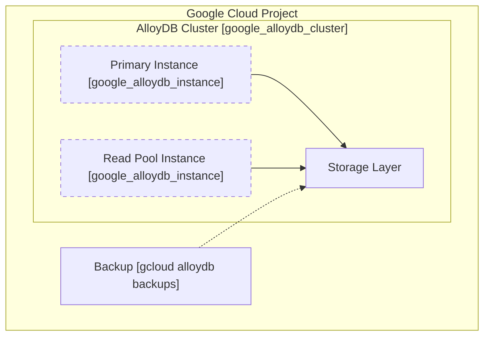
**Sources:** [cloud/products/alloydb/alloydb-basics/references/iac-usage.md:10-11](), [cloud/products/alloydb/alloydb-basics/references/cli-usage.md:19-24](), [cloud/products/alloydb/alloydb-basics/references/core-concepts.md:15-18]().

## AlloyDB AI

AlloyDB AI provides integrated features for building AI-powered applications directly within the database [cloud/products/alloydb/alloydb-basics/SKILL.md:13-16]():

*   **Vector Search:** Native support for storing and querying vector embeddings for similarity search [cloud/products/alloydb/alloydb-basics/references/core-concepts.md:10-11]().
*   **Hybrid Search:** Combines vector search with standard relational filtering.
*   **Model Endpoint Management:** Integration with Vertex AI to invoke machine learning models (forecasting, analytics) via SQL [cloud/products/alloydb/alloydb-basics/SKILL.md:15-16]().

**Sources:** [cloud/products/alloydb/alloydb-basics/SKILL.md:13-16](), [cloud/products/alloydb/alloydb-basics/references/core-concepts.md:10-11]().

## Security and Authentication

AlloyDB supports both standard PostgreSQL authentication and advanced Google Cloud security features.

### IAM Database Authentication
This is the **recommended** method for production workloads [cloud/products/alloydb/alloydb-basics/SKILL.md:33-34](). It uses IAM principals (users or service accounts) and short-lived OAuth tokens instead of static passwords [cloud/products/alloydb/alloydb-basics/references/iam-security.md:40-43]().

### Connectivity Options
*   **Private Service Connect (PSC):** Recommended for new configurations. It provides multi-VPC topologies without peering and better IP management [cloud/products/alloydb/alloydb-basics/references/iam-security.md:21-23]().
*   **Private Services Access (PSA):** Uses VPC peering to keep traffic internal to Google Cloud [cloud/products/alloydb/alloydb-basics/references/iam-security.md:24]().
*   **AlloyDB Auth Proxy:** A standalone tool that creates a secure local socket and handles mTLS (Mutual TLS) and IAM authentication automatically [cloud/products/alloydb/alloydb-basics/references/iam-security.md:53-59]().

### IAM Roles
| Role Name | Purpose |
| :--- | :--- |
| `roles/alloydb.admin` | Full control of all AlloyDB resources [cloud/products/alloydb/alloydb-basics/references/iam-security.md:12](). |
| `roles/alloydb.client` | Connectivity access to instances [cloud/products/alloydb/alloydb-basics/references/iam-security.md:13](). |
| `roles/alloydb.databaseUser` | Permission to log in via IAM authentication [cloud/products/alloydb/alloydb-basics/references/iam-security.md:14](). |

**Sources:** [cloud/products/alloydb/alloydb-basics/references/iam-security.md:12-24](), [cloud/products/alloydb/alloydb-basics/references/iam-security.md:53-59]().

## Implementation: Language Connectors

Language connectors provide an integrated, driver-level experience that automates mTLS and IAM token handling without needing a separate proxy binary [cloud/products/alloydb/alloydb-basics/references/client-library-usage.md:9-13]().

### Python Connector Example
The Python connector uses the `Connector` class from `google.cloud.alloydbconnector` to create a connection pool [cloud/products/alloydb/alloydb-basics/references/client-library-usage.md:27-32]().

```python
from google.cloud.alloydbconnector import Connector
import sqlalchemy

# INSTANCE_URI: projects/PROJECT/locations/REGION/clusters/CLUSTER/instances/INSTANCE
with Connector() as connector:
    pool = sqlalchemy.create_engine(
        "postgresql+pg8000://",
        creator=lambda: connector.connect(
            INSTANCE_URI, "pg8000", user="my-user", db="my-db"
        ),
    )
```
**Sources:** [cloud/products/alloydb/alloydb-basics/references/client-library-usage.md:25-46]().

## Infrastructure as Code (Terraform)

AlloyDB resources are provisioned using the `google_alloydb_cluster` and `google_alloydb_instance` resources [cloud/products/alloydb/alloydb-basics/references/iac-usage.md:10-11]().

**Infrastructure Code Entity Mapping**
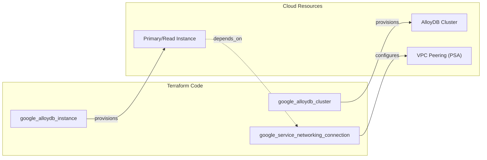
**Sources:** [cloud/products/alloydb/alloydb-basics/references/iac-usage.md:15-61]().

## MCP Server Integration

AlloyDB integrates with the Model Context Protocol (MCP) to allow AI agents to perform database operations.

*   **Endpoint:** Regional endpoints follow the pattern `https://alloydb.REGION.rep.googleapis.com/mcp` [cloud/products/alloydb/alloydb-basics/references/mcp-usage.md:8-9]().
*   **Authentication:** Requires the `roles/mcp.toolUser` role [cloud/products/alloydb/alloydb-basics/references/mcp-usage.md:17]().
*   **Capabilities:** Agents can use tools to manage clusters, monitor performance, or perform specialized health audits [cloud/products/alloydb/alloydb-basics/references/mcp-usage.md:29]().

**Sources:** [cloud/products/alloydb/alloydb-basics/references/mcp-usage.md:8-29]().

---

# Page: BigQuery Basics

# BigQuery Basics

<details>
<summary>Relevant source files</summary>

The following files were used as context for generating this wiki page:

- [cloud/products/bigquery/bigquery-basics/SKILL.md](cloud/products/bigquery/bigquery-basics/SKILL.md)
- [cloud/products/bigquery/bigquery-basics/references/cli-usage.md](cloud/products/bigquery/bigquery-basics/references/cli-usage.md)
- [cloud/products/bigquery/bigquery-basics/references/client-library-usage.md](cloud/products/bigquery/bigquery-basics/references/client-library-usage.md)
- [cloud/products/bigquery/bigquery-basics/references/core-concepts.md](cloud/products/bigquery/bigquery-basics/references/core-concepts.md)
- [cloud/products/bigquery/bigquery-basics/references/iac-usage.md](cloud/products/bigquery/bigquery-basics/references/iac-usage.md)
- [cloud/products/bigquery/bigquery-basics/references/iam-security.md](cloud/products/bigquery/bigquery-basics/references/iam-security.md)
- [cloud/products/bigquery/bigquery-basics/references/mcp-usage.md](cloud/products/bigquery/bigquery-basics/references/mcp-usage.md)

</details>


BigQuery is a serverless, AI-ready data platform designed for high-speed analysis of massive datasets using SQL and Python. It utilizes a disaggregated architecture that separates compute (analysis) from storage, allowing both to scale independently and providing built-in capabilities for machine learning, geospatial analysis, and business intelligence [cloud/products/bigquery/bigquery-basics/SKILL.md:14-18]().

## System Architecture

BigQuery's architecture is built on a petabit-scale network connecting two primary components:
*   **BigQuery Storage:** A columnar storage format optimized for analytical queries, supporting high availability through multi-location replication [cloud/products/bigquery/bigquery-basics/references/core-concepts.md:20-22]().
*   **BigQuery Analytics:** A scalable, distributed engine that processes data within BigQuery and from external sources (federated queries) [cloud/products/bigquery/bigquery-basics/references/core-concepts.md:24-25]().

### Resource Model
BigQuery organizes resources in a strict hierarchy within the Google Cloud ecosystem:
1.  **Organization/Folder/Project:** Standard resource containers.
2.  **Dataset:** The top-level container used to organize and control access to tables and views.
3.  **Table/View:** The fundamental unit of data storage and logical representation [cloud/products/bigquery/bigquery-basics/references/core-concepts.md:29-33]().

### Data Flow: Natural Language to BigQuery Execution
The following diagram illustrates how natural language requests are translated into BigQuery operations via the Model Context Protocol (MCP) and BigQuery Studio.

**Diagram: Natural Language to BigQuery Entity Mapping**
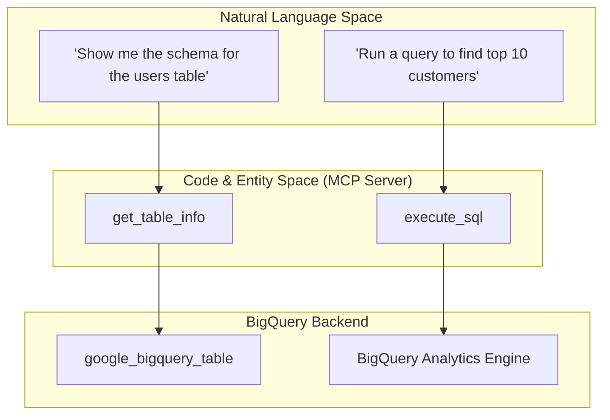
Sources: [cloud/products/bigquery/bigquery-basics/references/mcp-usage.md:8-21](), [cloud/products/bigquery/bigquery-basics/references/iac-usage.md:26-28]()

## Core Capabilities

### BigQuery ML and AI Functions
BigQuery integrates machine learning directly into the SQL engine, allowing users to create and execute models without moving data. Advanced AI functions extend these capabilities for generative and search tasks:
*   `bigquery_ai_generate`: Generates text using LLMs [cloud/products/bigquery/bigquery-basics/SKILL.md:96-96]().
*   `bigquery_ai_search`: Performs vector-based or semantic searches [cloud/products/bigquery/bigquery-basics/SKILL.md:102-102]().
*   `bigquery_ai_forecast`: Time-series forecasting [cloud/products/bigquery/bigquery-basics/SKILL.md:95-95]().
*   `bigquery_ai_detect_anomalies`: Identifies outliers in datasets [cloud/products/bigquery/bigquery-basics/SKILL.md:94-94]().

### BigQuery Studio
BigQuery Studio serves as a unified workspace for data engineering and analysis, featuring:
*   **SQL Editor:** Includes AI-powered code completion and generation via Gemini [cloud/products/bigquery/bigquery-basics/references/core-concepts.md:61-61]().
*   **Python Notebooks:** Integrated support for Colab Enterprise and `bigframes` (BigQuery DataFrames) [cloud/products/bigquery/bigquery-basics/references/core-concepts.md:63-64]().

## Implementation & Tools

### CLI Operations (`bq`)
The `bq` tool is the primary interface for managing resources and jobs.

| Task | Command Example |
| :--- | :--- |
| Create Dataset | `bq mk --dataset --location=US my_dataset` |
| Create Table | `bq mk --table my_dataset.mytable schema.json` |
| Load Data (CSV) | `bq load --source_format=CSV my_dataset.my_table gs://bucket/data.csv` |
| Run Query | `bq query --use_legacy_sql=false 'SELECT * FROM ...'` |
| Dry Run | `bq query --use_legacy_sql=false --dry_run 'SELECT ...'` |

Sources: [cloud/products/bigquery/bigquery-basics/SKILL.md:29-61](), [cloud/products/bigquery/bigquery-basics/references/cli-usage.md:16-80]()

### Infrastructure as Code (Terraform)
BigQuery resources are provisioned using the `google_bigquery_*` resource types.

**Diagram: Terraform Resource Dependency**
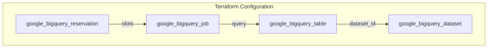
Sources: [cloud/products/bigquery/bigquery-basics/references/iac-usage.md:13-63]()

### MCP Server Integration
BigQuery provides a remote Model Context Protocol (MCP) server that exposes specific tools for agents to interact with data.

*   **`list_dataset_ids`**: Retrieves project datasets [cloud/products/bigquery/bigquery-basics/references/mcp-usage.md:8-8]().
*   **`get_table_info`**: Retrieves table metadata and schema [cloud/products/bigquery/bigquery-basics/references/mcp-usage.md:11-11]().
*   **`execute_sql`**: Executes `SELECT` statements. For security, `INSERT`, `UPDATE`, and `DELETE` are restricted in this tool [cloud/products/bigquery/bigquery-basics/references/mcp-usage.md:12-15]().

## Security and IAM

BigQuery employs a granular IAM model and data governance features:
*   **Principle of Least Privilege:** Permissions should be granted at the most granular level possible (e.g., table or view level) [cloud/products/bigquery/bigquery-basics/references/iam-security.md:4-7]().
*   **Service Agents:** Internal operations use the BigQuery Service Agent: `service-PROJECT_NUMBER@gcp-sa-bigquery.iam.gserviceaccount.com` [cloud/products/bigquery/bigquery-basics/references/iam-security.md:17-18]().
*   **Column-Level Security:** Managed via policy tags [cloud/products/bigquery/bigquery-basics/references/iam-security.md:33-34]().
*   **Authorized Views:** Allows querying data without granting access to underlying source tables [cloud/products/bigquery/bigquery-basics/references/iam-security.md:45-46]().

## Pricing Model
BigQuery billing is split into two components:
1.  **Storage:** Charged per GB. Includes **Active Storage** (modified in <90 days) and **Long-term Storage** (unmodified for >90 days, ~50% price reduction) [cloud/products/bigquery/bigquery-basics/references/core-concepts.md:73-77]().
2.  **Analysis:** Billed via **On-demand** (bytes processed) or **Capacity/Reservations** (dedicated slots) [cloud/products/bigquery/bigquery-basics/references/core-concepts.md:79-80]().

Sources: [cloud/products/bigquery/bigquery-basics/references/core-concepts.md:68-83]()

---

# Page: Firebase Basics

# Firebase Basics

<details>
<summary>Relevant source files</summary>

The following files were used as context for generating this wiki page:

- [cloud/products/firebase/firebase-basics/SKILL.md](cloud/products/firebase/firebase-basics/SKILL.md)
- [cloud/products/firebase/firebase-basics/references/additional-skills.md](cloud/products/firebase/firebase-basics/references/additional-skills.md)
- [cloud/products/firebase/firebase-basics/references/cli-usage.md](cloud/products/firebase/firebase-basics/references/cli-usage.md)
- [cloud/products/firebase/firebase-basics/references/client-library-usage.md](cloud/products/firebase/firebase-basics/references/client-library-usage.md)
- [cloud/products/firebase/firebase-basics/references/core-concepts.md](cloud/products/firebase/firebase-basics/references/core-concepts.md)
- [cloud/products/firebase/firebase-basics/references/iac-usage.md](cloud/products/firebase/firebase-basics/references/iac-usage.md)
- [cloud/products/firebase/firebase-basics/references/iam-security.md](cloud/products/firebase/firebase-basics/references/iam-security.md)
- [cloud/products/firebase/firebase-basics/references/mcp-usage.md](cloud/products/firebase/firebase-basics/references/mcp-usage.md)

</details>


The Firebase skill provides a foundational framework for managing mobile and web application backends within the Google Cloud ecosystem. It emphasizes a mandatory synchronization requirement with `firebase/agent-skills` to ensure that AI agents utilize the most current patterns for Firebase services, including Firestore, Authentication, and App Hosting [cloud/products/firebase/firebase-basics/SKILL.md:8-13]().

## Mandatory Agent Synchronization

Before implementing any Firebase-related tasks, agents must verify the environment and synchronize skills. This ensures the availability of specialized tools for drafting security rules and configuring project resources [cloud/products/firebase/firebase-basics/SKILL.md:10-13]().

### Synchronization Workflow
1.  **Runtime Check**: Verify Node.js/NPM installation [cloud/products/firebase/firebase-basics/SKILL.md:21-26]().
2.  **Skill Installation**: Execute `npx -y skills add firebase/agent-skills -y` to pull the latest reference materials and tool definitions [cloud/products/firebase/firebase-basics/SKILL.md:37-42]().
3.  **CLI Authentication**: Authenticate via `npx -y firebase-tools@latest login` [cloud/products/firebase/firebase-basics/SKILL.md:53-59]().

**Sources:**
- [cloud/products/firebase/firebase-basics/SKILL.md:8-45]()

## Firebase CLI & MCP Integration

The Firebase CLI (`firebase-tools`) serves as the primary interface for resource management. It includes a built-in **Model Context Protocol (MCP)** server that allows AI agents to interact directly with Firebase projects [cloud/products/firebase/firebase-basics/references/mcp-usage.md:1-4]().

### MCP Server Configuration
To enable the MCP server, the agent configuration (e.g., `mcp_config.json`) must include a `firebase` entry pointing to the `firebase-tools` executable with the `mcp` argument [cloud/products/firebase/firebase-basics/references/mcp-usage.md:41-54]().

| Property | Value |
| :--- | :--- |
| **Command** | `npx` |
| **Arguments** | `["-y", "firebase-tools@latest", "mcp"]` |

### CLI Context Management
Agents manage project state using the `use` command:
- **Check Active Project**: `npx -y firebase-tools@latest use` [cloud/products/firebase/firebase-basics/SKILL.md:69-70]().
- **Add Project Alias**: `npx -y firebase-tools@latest use --add <PROJECT_ID>` [cloud/products/firebase/firebase-basics/SKILL.md:82-83]().
- **Create Project**: `npx -y firebase-tools@latest projects:create <PROJECT_ID>` [cloud/products/firebase/firebase-basics/SKILL.md:88-89]().

**Sources:**
- [cloud/products/firebase/firebase-basics/references/cli-usage.md:1-10]()
- [cloud/products/firebase/firebase-basics/references/mcp-usage.md:27-54]()
- [cloud/products/firebase/firebase-basics/SKILL.md:53-89]()

## Tiered Knowledge Retrieval Architecture

The Firebase skill utilizes a tiered approach to knowledge. If local reference files do not contain the required information, agents are directed to escalate to specialized MCP servers [cloud/products/firebase/firebase-basics/SKILL.md:101-103]().

### Knowledge Flow Diagram
This diagram illustrates how the agent resolves information requests using the hierarchy of local references and remote MCP tools.

```mermaid
graph TD
    "UserRequest" --> "CheckLocalRefs[Check local references/]"
    "CheckLocalRefs" --> "Found{Found?}"
    "Found" -- "Yes" --> "ExecuteTask[Execute Firebase Task]"
    "Found" -- "No" --> "CheckSubSkills[Check firebase/agent-skills sub-skills]"
    "CheckSubSkills" --> "SubFound{Found?}"
    "SubFound" -- "Yes" --> "ExecuteTask"
    "SubFound" -- "No" --> "DevKnowledgeMCP[Call Developer Knowledge MCP: search_documents]"
    "DevKnowledgeMCP" --> "ExecuteTask"

    subgraph "Local Reference Space"
        "CheckLocalRefs"
        "core-concepts.md"
        "cli-usage.md"
    end

    subgraph "External Tool Space"
        "DevKnowledgeMCP"
    end
```
**Sources:**
- [cloud/products/firebase/firebase-basics/SKILL.md:91-103]()
- [cloud/products/firebase/firebase-basics/references/additional-skills.md:1-80]()

## Infrastructure as Code (IaC)

Firebase resources are provisioned using the `google` or `google-beta` Terraform providers. The architecture typically involves enabling Firebase on a standard Google Cloud project first [cloud/products/firebase/firebase-basics/references/iac-usage.md:8-10]().

### Key Terraform Resources
- `google_firebase_project`: Transitions a GCP project to a Firebase-enabled project [cloud/products/firebase/firebase-basics/references/iac-usage.md:29-30]().
- `google_firestore_database`: Provisions Firestore; must set `type = "FIRESTORE_NATIVE"` [cloud/products/firebase/firebase-basics/references/iac-usage.md:32-33]().
- `google_firebaserules_ruleset`: Defines the logic for Security Rules [cloud/products/firebase/firebase-basics/references/iac-usage.md:34-35]().

### Resource Dependency Mapping
The following diagram maps Terraform resources to their functional roles in a Firebase deployment.

```mermaid
graph LR
    "google_firebase_project.default" --> "google_firebase_web_app.default"
    "google_firebase_project.default" --> "google_firestore_database.default"
    "google_firebaserules_ruleset.default" --> "google_firebaserules_release.default"
    "google_firestore_database.default" -.-> "google_firebaserules_release.default"
```
**Sources:**
- [cloud/products/firebase/firebase-basics/references/iac-usage.md:12-38]()

## Security and IAM

Firebase security is bipartite: **IAM** manages administrative access to the project, while **Security Rules** manage granular client-side data access [cloud/products/firebase/firebase-basics/references/iam-security.md:3-11]().

### Administrative Roles (IAM)
| Role | Purpose |
| :--- | :--- |
| `roles/firebase.viewer` | Read-only access to resources and data [cloud/products/firebase/firebase-basics/references/iam-security.md:21](). |
| `roles/firebase.admin` | Full administrative control over all Firebase products [cloud/products/firebase/firebase-basics/references/iam-security.md:22](). |

### Security Rules
Security Rules (e.g., `firestore.rules`) are critical for protecting Firestore and Cloud Storage. They use a domain-specific language to evaluate the `request.auth` context [cloud/products/firebase/firebase-basics/references/iam-security.md:29-45]().

```javascript
// Example: Authenticated access only
service cloud.firestore {
  match /databases/{database}/documents {
    match /some_collection/{document} {
      allow read, write: if request.auth != null;
    }
  }
}
```

### App Check
App Check provides a secondary layer of defense by ensuring that only authentic, untampered devices can access Firebase backend services (Firestore, Functions, AI Logic) [cloud/products/firebase/firebase-basics/references/iam-security.md:54-59]().

**Sources:**
- [cloud/products/firebase/firebase-basics/references/iam-security.md:12-74]()

## Client and Admin SDKs

Firebase provides two distinct sets of libraries based on the execution environment [cloud/products/firebase/firebase-basics/references/client-library-usage.md:3-5]().

1.  **Client-side SDKs**: Used in mobile (iOS, Android, Flutter) and web apps. These interact with services directly and are governed by Security Rules [cloud/products/firebase/firebase-basics/references/client-library-usage.md:9-14]().
2.  **Server-side Admin SDKs**: Used in privileged environments (Node.js, Python, Go, Java). These bypass Security Rules and have full administrative access to the project [cloud/products/firebase/firebase-basics/references/client-library-usage.md:38-41]().

**Sources:**
- [cloud/products/firebase/firebase-basics/references/client-library-usage.md:1-46]()

---

# Page: Google Cloud Recipes

# Google Cloud Recipes

<details>
<summary>Relevant source files</summary>

The following files were used as context for generating this wiki page:

- [README.md](README.md)
- [cloud/recipes/google-cloud-recipe-auth/SKILL.md](cloud/recipes/google-cloud-recipe-auth/SKILL.md)
- [cloud/recipes/google-cloud-recipe-onboarding/SKILL.md](cloud/recipes/google-cloud-recipe-onboarding/SKILL.md)
- [cloud/recipes/google-cloud-recipe-onboarding/reference/google-cloud-setup.md](cloud/recipes/google-cloud-recipe-onboarding/reference/google-cloud-setup.md)

</details>


This page provides a high-level overview of the workflow-oriented "recipes" available in the `google/skills` repository. Unlike individual product skills, recipes focus on end-to-end procedures that span multiple services and address complex, multi-step operational tasks [README.md:29-31]().

## Recipe Ecosystem Overview

The recipes are designed to guide users through the lifecycle of Google Cloud adoption—from initial setup and identity management to advanced operational observability.

### Code-to-System Mapping: Recipes
The following diagram maps the logical recipe categories to their specific entry points in the codebase.

```mermaid
graph TD
    subgraph "Natural Language Space"
        A["How do I start?"]
        B["How do I log in?"]
        C["Why is my network slow?"]
    end

    subgraph "Code Entity Space (cloud/recipes/)"
        A --> ONB["google-cloud-recipe-onboarding/SKILL.md"]
        B --> AUTH["google-cloud-recipe-auth/SKILL.md"]
        C --> NET["google-cloud-networking-observability/SKILL.md"]
    end

    ONB --> REF1["reference/google-cloud-setup.md"]
    NET --> REF2["reference/mcp-tools-and-connectivity-tests.md"]
```
**Sources:** [README.md:29-31](), [cloud/recipes/google-cloud-recipe-onboarding/SKILL.md:1-6](), [cloud/recipes/google-cloud-recipe-auth/SKILL.md:1-6](), [cloud/recipes/google-cloud-networking-observability/SKILL.md:1-6]()

---

## Recipe: Onboarding to Google Cloud

This recipe provides two distinct tracks for getting started with Google Cloud. The **Individual Developer Track** focuses on a "happy path" using a personal Google Account, the $300 Free Trial, and the `gcloud` CLI to deploy a first resource like a Cloud Run service [cloud/recipes/google-cloud-recipe-onboarding/SKILL.md:8-19](). 

The **Enterprise Landing Zone Track** covers the structural foundation required for organizations, including Cloud Identity setup, the resource hierarchy (Organizations, Folders, Projects), and centralized billing [cloud/recipes/google-cloud-recipe-onboarding/reference/google-cloud-setup.md:17-40]().

**Key Components:**
*   **Project Management:** Creation and linking to billing accounts [cloud/recipes/google-cloud-recipe-onboarding/SKILL.md:51-72]().
*   **CLI Initialization:** Using `gcloud init` to configure the local environment [cloud/recipes/google-cloud-recipe-onboarding/SKILL.md:74-84]().
*   **Enterprise Foundations:** Shared VPC, Organization Policies, and Terraform-based infrastructure as code [cloud/recipes/google-cloud-recipe-onboarding/reference/google-cloud-setup.md:64-103]().

For details, see [Recipe: Onboarding to Google Cloud](#3.1).

**Sources:** [cloud/recipes/google-cloud-recipe-onboarding/SKILL.md:8-115](), [cloud/recipes/google-cloud-recipe-onboarding/reference/google-cloud-setup.md:3-103]()

---

## Recipe: Authenticating to Google Cloud

Authentication is the prerequisite for all cloud operations. This recipe details how both humans and services prove their identity to Google Cloud [cloud/recipes/google-cloud-recipe-auth/SKILL.md:8-12]().

It emphasizes the use of **Application Default Credentials (ADC)** and **Service Account Impersonation** as security best practices to avoid the risks associated with static Service Account keys [cloud/recipes/google-cloud-recipe-auth/SKILL.md:75-86]().

**Authentication Flows:**
| Entity Type | Recommended Method | Tool/Service |
| :--- | :--- | :--- |
| Human Developer | OAuth 2.0 Refresh Token | `gcloud auth login` |
| Local Code | Application Default Credentials | `gcloud auth application-default login` |
| Cloud Workload | Attached Service Account | Instance Metadata Server (Tokens) |
| External Workload | Workload Identity Federation | OIDC/SAML Exchange |

For details, see [Recipe: Authenticating to Google Cloud](#3.2).

**Sources:** [cloud/recipes/google-cloud-recipe-auth/SKILL.md:34-150]()

---

## Recipe: Google Cloud Network Observability

This recipe introduces a diagnostic framework for troubleshooting complex networking issues. It leverages the **Model Context Protocol (MCP)** to allow agents to query telemetry across multiple sources [cloud/recipes/google-cloud-networking-observability/SKILL.md:1-6]().

The framework relies on four primary telemetry sources to provide a "Primary Source of Truth" (PSOT):
1.  **VPC Flow Logs:** For traffic volume and path analysis.
2.  **Firewall Logs:** For identifying denied or allowed connections.
3.  **Cloud NAT Logs:** For troubleshooting port exhaustion.
4.  **Threat Logs:** For identifying malicious activity via Cloud IDS or Firewall Plus.

### Entity Relationship: Networking Diagnostics
This diagram illustrates how the diagnostic tools interact with Google Cloud's logging and monitoring infrastructure.

```mermaid
graph LR
    subgraph "Diagnostic Tools"
        M1["NetworkManagement MCP"]
        M2["Cloud Logging MCP"]
        M3["BigQuery MCP"]
    end

    subgraph "Telemetry Sources"
        S1["compute.googleapis.com/firewall"]
        S2["nat_flows"]
        S3["ids.googleapis.com/threat"]
    end

    M1 -- "Connectivity Tests" --> GCP["GCP Network Fabric"]
    M2 -- "list_log_entries" --> S1
    M3 -- "execute_sql" --> S2
    M3 -- "execute_sql" --> S3
```

For details, see [Recipe: Google Cloud Network Observability](#3.3).

**Sources:** [cloud/recipes/google-cloud-networking-observability/SKILL.md:1-15](), [cloud/recipes/google-cloud-networking-observability/reference/mcp-tools-and-connectivity-tests.md:1-20]()

---

# Page: Recipe: Onboarding to Google Cloud

# Recipe: Onboarding to Google Cloud

<details>
<summary>Relevant source files</summary>

The following files were used as context for generating this wiki page:

- [cloud/recipes/google-cloud-recipe-onboarding/SKILL.md](cloud/recipes/google-cloud-recipe-onboarding/SKILL.md)
- [cloud/recipes/google-cloud-recipe-onboarding/reference/google-cloud-setup.md](cloud/recipes/google-cloud-recipe-onboarding/reference/google-cloud-setup.md)

</details>


The onboarding recipe provides a dual-track approach to establishing a presence on Google Cloud. It covers the "happy path" for individual developers seeking to experiment with the Free Tier, as well as the structured "Landing Zone" approach required for enterprise-grade environments. This page details the implementation steps, resource hierarchies, and validation criteria for both tracks.

## Onboarding Tracks Overview

The repository distinguishes between two primary onboarding personas:
1.  **Individual Developer:** Focused on rapid prototyping, personal identity, and the $300 Free Trial credit [cloud/recipes/google-cloud-recipe-onboarding/SKILL.md:8-19]().
2.  **Enterprise Administrator:** Focused on building a secure, scalable foundation (Landing Zone) using Organization resources, centralized identity, and Infrastructure as Code (IaC) [cloud/recipes/google-cloud-recipe-onboarding/reference/google-cloud-setup.md:9-15]().

### Track Comparison

| Feature | Individual Developer Track | Enterprise Landing Zone Track |
| :--- | :--- | :--- |
| **Identity** | Personal Google Account (@gmail.com) | Cloud Identity or Google Workspace |
| **Root Resource** | Project | Organization Resource |
| **Billing** | Personal Credit Card / Free Trial | Corporate Billing Account / Invoicing |
| **Governance** | Manual via Console/CLI | Organization Policies & Folders |
| **Networking** | Default VPC | Shared VPC & Hybrid Connectivity |
| **Management** | `gcloud` CLI / Web Console | Terraform Blueprints (IaC) |

**Sources:** [cloud/recipes/google-cloud-recipe-onboarding/SKILL.md:14-35](), [cloud/recipes/google-cloud-recipe-onboarding/reference/google-cloud-setup.md:19-103]()

---

## Individual Developer Track: The "Happy Path"

The developer track is designed to move from account creation to a live resource deployment in minimal steps.

### Workflow: Local Environment Setup

The primary tool for developers is the `gcloud` CLI, which manages authentication and resource state.

```mermaid
graph TD
    subgraph "Local Machine"
        A["gcloud init"] --> B["gcloud auth login"]
        B --> C["gcloud config set project"]
    end
    subgraph "Google Cloud"
        C -.-> D["Cloud Resource Manager (Project)"]
        D -.-> E["Service Usage API (Enable Services)"]
        E -.-> F["Resource Deployment (Cloud Run/VM)"]
    end
```

**Implementation Steps:**
1.  **Account Activation:** Signing into the Console activates the $300 free credit [cloud/recipes/google-cloud-recipe-onboarding/SKILL.md:47-49]().
2.  **Project Creation:** Resources must reside within a Project, identified by a unique **Project ID** [cloud/recipes/google-cloud-recipe-onboarding/SKILL.md:53-62]().
3.  **CLI Initialization:** Running `gcloud init` performs login and project selection [cloud/recipes/google-cloud-recipe-onboarding/SKILL.md:82-83]().
4.  **API Enablement:** Services like Cloud Run (`run.googleapis.com`) must be explicitly enabled before deployment [cloud/recipes/google-cloud-recipe-onboarding/SKILL.md:87-91]().

**Sources:** [cloud/recipes/google-cloud-recipe-onboarding/SKILL.md:45-96]()

---

## Enterprise Track: Landing Zone Implementation

The enterprise track focuses on the **Resource Hierarchy**, which provides the structure for access control and policy inheritance.

### The Resource Hierarchy Model

The hierarchy allows for centralized management of security and billing across thousands of projects.

```mermaid
graph TD
    ORG["Organization (example.com)"] -- "Organization Policies" --> F1["Folder: Production"]
    ORG -- "Billing Account" --> F2["Folder: Development"]
    F1 --> P1["Project: Payment-App"]
    F1 --> P2["Project: Inventory-App"]
    F2 --> P3["Project: Sandbox"]
    
    subgraph "Shared Resources"
        HOST["Host Project (Shared VPC)"]
        SINK["Centralized Log Sink (BigQuery)"]
    end
    
    P1 -.-> HOST
    P2 -.-> HOST
    P1 -.-> SINK
    P2 -.-> SINK
```

### Key Enterprise Components

*   **Cloud Identity:** Centralizes user management via a verified domain (e.g., `example.com`) [cloud/recipes/google-cloud-recipe-onboarding/reference/google-cloud-setup.md:23-27]().
*   **Shared VPC:** Enables a single "Host Project" to manage network topology (subnets, firewalls) while "Service Projects" deploy workloads into those subnets [cloud/recipes/google-cloud-recipe-onboarding/reference/google-cloud-setup.md:66-69]().
*   **Log Sinks:** Aggregates logs from all projects into a central BigQuery dataset for compliance and auditing [cloud/recipes/google-cloud-recipe-onboarding/reference/google-cloud-setup.md:89-93]().
*   **Organization Policies:** Enforces constraints globally, such as `iam.disableServiceAccountKeyCreation` or restricting allowed resource locations [cloud/recipes/google-cloud-recipe-onboarding/reference/google-cloud-setup.md:77-80]().

**Sources:** [cloud/recipes/google-cloud-recipe-onboarding/reference/google-cloud-setup.md:19-96]()

---

## Resource Deployment Examples

The onboarding recipe provides standard entry points for first-time deployments.

### Cloud Run Deployment
Recommended for application developers. It creates a managed service with a public URL.
```bash
gcloud run deploy hello-world \
    --image=gcr.io/cloudrun/hello \
    --platform=managed \
    --region=us-central1 \
    --allow-unauthenticated
```
[cloud/recipes/google-cloud-recipe-onboarding/SKILL.md:109-112]()

### Compute Engine VM
Recommended for infrastructure-focused users. Uses the `e2-micro` instance type for the Always Free tier [cloud/recipes/google-cloud-recipe-onboarding/SKILL.md:101-102]().

---

## Validation Criteria

A successful onboarding is verified through the following technical checks:

| Validation Target | Verification Command / Method |
| :--- | :--- |
| **Project Identity** | Presence of a valid `Project ID` [cloud/recipes/google-cloud-recipe-onboarding/SKILL.md:132]() |
| **Billing Linkage** | `gcloud beta billing projects describe PROJECT_ID` [cloud/recipes/google-cloud-recipe-onboarding/SKILL.md:133-134]() |
| **CLI Auth State** | `gcloud config list` (Checks active account and project) [cloud/recipes/google-cloud-recipe-onboarding/SKILL.md:135-136]() |
| **Resource Health** | Reachability of the deployed resource URL or IP [cloud/recipes/google-cloud-recipe-onboarding/SKILL.md:137-138]() |

**Sources:** [cloud/recipes/google-cloud-recipe-onboarding/SKILL.md:127-139]()

---

# Page: Recipe: Authenticating to Google Cloud

# Recipe: Authenticating to Google Cloud

<details>
<summary>Relevant source files</summary>

The following files were used as context for generating this wiki page:

- [cloud/recipes/google-cloud-recipe-auth/SKILL.md](cloud/recipes/google-cloud-recipe-auth/SKILL.md)

</details>


This recipe provides technical guidance on authenticating and authorizing identities to Google Cloud services. It covers the lifecycle of Application Default Credentials (ADC), the distinction between CLI and application authentication, and secure patterns for both internal and external workloads.

## The Authentication Lifecycle

Authentication is the process of proving a **Principal's** identity [cloud/recipes/google-cloud-recipe-auth/SKILL.md:8-12](). In Google Cloud, this is primarily managed through **Application Default Credentials (ADC)**, a strategy used by Google Cloud Client Libraries to automatically find credentials [cloud/recipes/google-cloud-recipe-auth/SKILL.md:75-79]().

### ADC Resolution Order
When a client library is initialized, it searches for credentials in the following order:
1.  **Environment Variable**: The path specified in `GOOGLE_APPLICATION_CREDENTIALS` [cloud/recipes/google-cloud-recipe-auth/SKILL.md:154-154]().
2.  **User Credentials**: Credentials created via `gcloud auth application-default login` [cloud/recipes/google-cloud-recipe-auth/SKILL.md:75-79]().
3.  **Attached Service Account**: The Metadata Server on Compute Engine, GKE, or Cloud Run [cloud/recipes/google-cloud-recipe-auth/SKILL.md:125-135]().

### ADC Flow and Code Entity Mapping
The following diagram maps the logical authentication flow to the specific CLI commands and environment variables used in the codebase.

**ADC Resolution and Entity Mapping**
```mermaid
graph TD
    subgraph "Local Development Space"
        A["gcloud auth login"] -- "Sets CLI Creds" --> B["~/.config/gcloud/credentials.db"]
        C["gcloud auth application-default login"] -- "Sets ADC JSON" --> D["well-known-location/application_default_credentials.json"]
        E["GOOGLE_APPLICATION_CREDENTIALS"] -- "Points to" --> F["Service Account Key JSON"]
    end

    subgraph "Google Cloud Environment"
        G["Metadata Server"] -- "Provides" --> H["Short-lived Access Token"]
    end

    subgraph "Client Library Logic"
        I["google-cloud-sdk / Client Libs"] --> J{Check GOOGLE_APPLICATION_CREDENTIALS}
        J -- "Exists" --> F
        J -- "Empty" --> K{Check ADC JSON}
        K -- "Exists" --> D
        K -- "Empty" --> L{Check Metadata Server}
        L -- "Success" --> H
    end
```
**Sources:** [cloud/recipes/google-cloud-recipe-auth/SKILL.md:71-86](), [cloud/recipes/google-cloud-recipe-auth/SKILL.md:125-135](), [cloud/recipes/google-cloud-recipe-auth/SKILL.md:154-154]()

---

## Human vs. Application Authentication

A common point of confusion is the difference between authenticating the `gcloud` CLI and authenticating an application.

| Feature | `gcloud auth login` | `gcloud auth application-default login` |
| :--- | :--- | :--- |
| **Target** | The `gcloud` CLI itself [cloud/recipes/google-cloud-recipe-auth/SKILL.md:71-74]() | Client Libraries (Python, Go, etc.) [cloud/recipes/google-cloud-recipe-auth/SKILL.md:75-79]() |
| **Credential Type** | OAuth 2.0 Refresh Token [cloud/recipes/google-cloud-recipe-auth/SKILL.md:74-74]() | Local JSON credential file [cloud/recipes/google-cloud-recipe-auth/SKILL.md:78-79]() |
| **Typical Use** | Running `gcloud compute...` or `gsutil...` [cloud/recipes/google-cloud-recipe-auth/SKILL.md:73-73]() | Running code that uses `google-cloud-storage` [cloud/recipes/google-cloud-recipe-auth/SKILL.md:79-79]() |
| **Best Practice** | Use for manual management [cloud/recipes/google-cloud-recipe-auth/SKILL.md:71-72]() | Use for local testing of code [cloud/recipes/google-cloud-recipe-auth/SKILL.md:75-76]() |

**Sources:** [cloud/recipes/google-cloud-recipe-auth/SKILL.md:71-79]()

---

## Secure Service Identity Patterns

### Service Account Impersonation
To avoid the risks associated with long-lived Service Account keys, developers should use **Service Account Impersonation** [cloud/recipes/google-cloud-recipe-auth/SKILL.md:80-86]().

1.  **Human Auth**: Authenticate as yourself using `gcloud auth login`.
2.  **Impersonate**: Use the `--impersonate-service-account` flag with CLI commands.
3.  **Short-lived**: This generates a temporary token, eliminating the need to download JSON keys [cloud/recipes/google-cloud-recipe-auth/SKILL.md:82-85]().

### Workload Identity Federation (WIF)
For workloads running outside of Google Cloud (AWS, Azure, or On-prem), Workload Identity Federation (WIF) allows you to use external identities to access Google Cloud resources without keys [cloud/recipes/google-cloud-recipe-auth/SKILL.md:147-150]().

**Workload Identity Federation Flow**
```mermaid
sequenceDiagram
    participant AWS as "External Workload (AWS/Azure)"
    participant STS as "Google Security Token Service (STS)"
    participant IAM as "IAM Service Account"
    participant API as "Google Cloud API (e.g., BigQuery)"

    AWS->>AWS: "Generate Identity Token (e.g., AWS Signed Request)"
    AWS->>STS: "Exchange External Token for Google Federated Token"
    STS-->>AWS: "Federated Token"
    AWS->>IAM: "Exchange Federated Token for SA Access Token"
    IAM-->>AWS: "Short-lived Access Token"
    AWS->>API: "Access Resource using Access Token"
```
**Sources:** [cloud/recipes/google-cloud-recipe-auth/SKILL.md:141-150]()

---

## Advanced Authentication Scenarios

### Workload Identity for GKE
In GKE, Workload Identity maps Kubernetes Service Accounts (KSA) to Google Cloud Service Accounts (GSA) [cloud/recipes/google-cloud-recipe-auth/SKILL.md:141-145](). This ensures that a pod only has the permissions defined for its specific KSA, rather than the permissions of the underlying node [cloud/recipes/google-cloud-recipe-auth/SKILL.md:143-144]().

### OIDC Service-to-Service Flows
When one Google Cloud service (e.g., Cloud Run) calls another protected service (e.g., a private Cloud Run service), it must provide an **OpenID Connect (OIDC) ID Token** in the `Authorization: Bearer` header [cloud/recipes/google-cloud-recipe-auth/SKILL.md:151-153]().

### Identity-Aware Proxy (IAP)
IAP acts as a central authorization layer for web applications [cloud/recipes/google-cloud-recipe-auth/SKILL.md:94-97](). It intercepts requests to verify the user's identity before they reach the application, allowing for secure access to internal tools without a VPN [cloud/recipes/google-cloud-recipe-auth/SKILL.md:95-98]().

### API Key Hardening
API Keys should be used only for services that do not support IAM (e.g., Maps API) [cloud/recipes/google-cloud-recipe-auth/SKILL.md:155-157](). They must be restricted by:
*   **API Restriction**: Limiting the key to specific APIs.
*   **Application Restriction**: Limiting the key to specific IP addresses, referrers, or mobile app IDs.

**Sources:** [cloud/recipes/google-cloud-recipe-auth/SKILL.md:94-98](), [cloud/recipes/google-cloud-recipe-auth/SKILL.md:141-145](), [cloud/recipes/google-cloud-recipe-auth/SKILL.md:151-157]()

---

# Page: Recipe: Google Cloud Network Observability

# Recipe: Google Cloud Network Observability

<details>
<summary>Relevant source files</summary>

The following files were used as context for generating this wiki page:

- [cloud/recipes/google-cloud-networking-observability/SKILL.md](cloud/recipes/google-cloud-networking-observability/SKILL.md)
- [cloud/recipes/google-cloud-networking-observability/references/connectivity-tests.md](cloud/recipes/google-cloud-networking-observability/references/connectivity-tests.md)
- [cloud/recipes/google-cloud-networking-observability/references/mcp-usage.md](cloud/recipes/google-cloud-networking-observability/references/mcp-usage.md)

</details>


This recipe provides a framework for investigating Google Cloud networking issues by analyzing logs, metrics, and diagnostics. It utilizes a multi-layered telemetry approach to troubleshoot VPC Flow Logs, Cloud NAT, Firewalls, and Threat detections.

## Overview

The Networking Observability recipe is built on the **Primary Source of Truth (PSOT)** principle: identifying the most efficient data source for a specific problem and terminating the investigation as soon as a definitive result is found [cloud/recipes/google-cloud-networking-observability/SKILL.md:9-20](). 

### Core Telemetry Sources
The framework categorizes network data into five primary streams:
*   **Threat Logs**: Deep packet inspection data from Cloud Firewall Plus and Cloud IDS [cloud/recipes/google-cloud-networking-observability/SKILL.md:23-25]().
*   **VPC Flow Logs**: Sampled IP traffic for volume trends and "top talker" analysis [cloud/recipes/google-cloud-networking-observability/SKILL.md:26-27]().
*   **Firewall Logs**: Records of connection attempts matched by ALLOW or DENY rules [cloud/recipes/google-cloud-networking-observability/SKILL.md:28-29]().
*   **Cloud NAT Logs**: Audit trails for NAT translations and port exhaustion troubleshooting [cloud/recipes/google-cloud-networking-observability/SKILL.md:30-31]().
*   **Networking Metrics**: Time-series data for throughput, RTT (latency), and packet loss [cloud/recipes/google-cloud-networking-observability/SKILL.md:32-34]().

### Analysis Framework: Natural Language to Code Entities
The following diagram illustrates how user requests are mapped to specific MCP tools and BigQuery resources within the codebase.

**System Mapping: Diagnostics Workflow**
```mermaid
graph TD
    UserRequest["User Request (e.g., 'Why is my traffic dropped?')"] --> Router{"Tool Selector"}
    
    Router -->|High Volume/Trends| BQ_MCP["BigQuery MCP"]
    Router -->|Real-time Events| Log_MCP["Cloud Logging MCP"]
    Router -->|Path Analysis| NM_MCP["NetworkManagement MCP"]
    Router -->|Performance Metrics| Mon_MCP["Cloud Monitoring MCP"]

    subgraph "Code Entities (MCP Tools)"
        BQ_MCP --> execute_sql["execute_sql()"]
        Log_MCP --> list_log_entries["list_log_entries()"]
        NM_MCP --> create_conn_test["create_connectivity_test()"]
        Mon_MCP --> list_timeseries["list_timeseries()"]
    end

    subgraph "Data Sources (PSOT)"
        execute_sql --> AllLogs["_AllLogs Dataset"]
        list_log_entries --> LogStream["cloudaudit.googleapis.com/data_access"]
        create_conn_test --> PathTrace["Network Management API Trace"]
    end
```
Sources: [cloud/recipes/google-cloud-networking-observability/references/mcp-usage.md:1-82](), [cloud/recipes/google-cloud-networking-observability/SKILL.md:40-65]()

## MCP-Based Diagnostics Framework

The recipe prioritizes the use of Model Context Protocol (MCP) servers to interact with Google Cloud APIs. This provides a structured way to discover resources and execute queries without manual CLI intervention.

*   **BigQuery MCP**: The preferred source for high-volume analysis. It uses `execute_sql` to query logs exported to BigQuery [cloud/recipes/google-cloud-networking-observability/references/mcp-usage.md:8-18]().
*   **Cloud Logging MCP**: Used for real-time exploratory analysis and finding resource labels via `list_log_entries` [cloud/recipes/google-cloud-networking-observability/references/mcp-usage.md:29-38]().
*   **NetworkManagement MCP**: Executes static path analysis to identify configuration-based blocks [cloud/recipes/google-cloud-networking-observability/references/mcp-usage.md:47-58]().
*   **Cloud Monitoring MCP**: Retrieves performance metrics like RTT and throughput using `list_timeseries` [cloud/recipes/google-cloud-networking-observability/references/mcp-usage.md:66-75]().

For details on tool schemas and the `EXCLUDE_ALL_METADATA` fallback pattern, see [Network Observability: MCP Tools & Connectivity Tests](#3.3.1).

## Analysis Types

### Firewall & Threat Log Analysis
This analysis focus identifies whether traffic is being blocked by security policies. It distinguishes between standard Layer 4 firewall rules and Layer 7 threat signatures (e.g., SQL injection) detected by Cloud Firewall Plus.
*   **Primary Source**: `compute.googleapis.com/firewall` logs for rule matches.
*   **Threat Intelligence**: `firewall_threat` and `ids.googleapis.com/threat` log streams.

For details on SQL patterns for "top-blocking" rules, see [Network Observability: Firewall & Threat Log Analysis](#3.3.2).

### Cloud NAT & Port Exhaustion
When workloads cannot reach the internet, this analysis checks Cloud NAT gateways for port exhaustion or translation failures.
*   **Key Indicator**: `allocation_status=DROPPED` in `nat_flows` logs.
*   **Aggregation**: Summarizing drops by internal IP to identify impacted VMs.

For details on gateway status integration and BigQuery aggregation, see [Network Observability: Cloud NAT Analysis](#3.3.3).

## Operational Principles

The following diagram defines the decision logic for selecting the primary source of truth during an investigation.

**Decision Logic: Primary Source of Truth (PSOT)**
```mermaid
flowchart TD
    Start["Investigation Start"] --> Q1{"Is it a Path Config Issue?"}
    Q1 -- Yes --> NM_MCP_Flow["Use NetworkManagement MCP (Connectivity Tests)"]
    Q1 -- No --> Q2{"Is it Volume/Trend Analysis?"}
    
    Q2 -- Yes --> BQ_Check{"BigQuery Linked Dataset Available?"}
    BQ_Check -- Yes --> BQ_SQL["execute_sql on _AllLogs"]
    BQ_Check -- No --> Log_Search["list_log_entries (Cloud Logging)"]
    
    Q2 -- No --> Q3{"Is it Latency/Loss?"}
    Q3 -- Yes --> Mon_API["list_timeseries (Cloud Monitoring)"]
    Q3 -- No --> Log_Search
```
Sources: [cloud/recipes/google-cloud-networking-observability/SKILL.md:40-50](), [cloud/recipes/google-cloud-networking-observability/SKILL.md:117-131]()

### Key Constraints
*   **Schema Validation**: Before running BigQuery queries, the system must verify field names (e.g., `jsonPayload` vs `json_payload`) using `get_table_info` [cloud/recipes/google-cloud-networking-observability/references/mcp-usage.md:25-26]().
*   **Resource Cleanup**: Connectivity tests created via `create_connectivity_test` must be deleted using `delete_connectivity_test` immediately after results are retrieved [cloud/recipes/google-cloud-networking-observability/references/connectivity-tests.md:17-19]().
*   **Inactivity Handling**: A result of "0" or "No data found" is considered a conclusive finding and should terminate the investigation turn [cloud/recipes/google-cloud-networking-observability/SKILL.md:113-116]().

---
**Child Pages:**
*   [Network Observability: MCP Tools & Connectivity Tests](#3.3.1)
*   [Network Observability: Firewall & Threat Log Analysis](#3.3.2)
*   [Network Observability: Cloud NAT Analysis](#3.3.3)

---

# Page: Network Observability: MCP Tools & Connectivity Tests

# Network Observability: MCP Tools & Connectivity Tests

<details>
<summary>Relevant source files</summary>

The following files were used as context for generating this wiki page:

- [cloud/recipes/google-cloud-networking-observability/SKILL.md](cloud/recipes/google-cloud-networking-observability/SKILL.md)
- [cloud/recipes/google-cloud-networking-observability/references/connectivity-tests.md](cloud/recipes/google-cloud-networking-observability/references/connectivity-tests.md)
- [cloud/recipes/google-cloud-networking-observability/references/mcp-usage.md](cloud/recipes/google-cloud-networking-observability/references/mcp-usage.md)
- [cloud/recipes/google-cloud-networking-observability/references/metrics-analysis.md](cloud/recipes/google-cloud-networking-observability/references/metrics-analysis.md)
- [cloud/recipes/google-cloud-networking-observability/references/vpc-flow-analysis.md](cloud/recipes/google-cloud-networking-observability/references/vpc-flow-analysis.md)

</details>


This page details the implementation and operational workflow for the Google Cloud Networking Observability diagnostic framework. The system leverages four specialized Model Context Protocol (MCP) servers to provide a unified interface for log analysis, metric retrieval, and path diagnostics.

## MCP Server Architecture

The networking observability skill coordinates between four remote MCP servers to provide a Primary Source of Truth (PSOT) for network telemetry. This multi-source approach allows for a transition from exploratory analysis (Logging) to high-volume trend analysis (BigQuery).

### Code Entity Mapping: Natural Language to Code Space

The following diagram maps the logical diagnostic tasks to the specific MCP tools and code entities defined in the repository.

**Diagram: MCP Tool Mapping**
```mermaid
graph TD
    subgraph "Natural Language Space"
        A["'Why is my connection failing?'"]
        B["'What are my top talkers?'"]
        C["'Is there packet loss?'"]
        D["'Is the path blocked?'"]
    end

    subgraph "Code Entity Space (MCP Tools)"
        A --> E["list_log_entries"]
        B --> F["execute_sql"]
        C --> G["list_timeseries"]
        D --> H["create_connectivity_test"]
    end

    subgraph "MCP Servers"
        E -.-> L["Cloud Logging MCP"]
        F -.-> BQ["BigQuery MCP"]
        G -.-> M["Cloud Monitoring MCP"]
        H -.-> NM["NetworkManagement MCP"]
    end

    style E font-family:monospace
    style F font-family:monospace
    style G font-family:monospace
    style H font-family:monospace
```
**Sources:** [cloud/recipes/google-cloud-networking-observability/references/mcp-usage.md:1-82](), [cloud/recipes/google-cloud-networking-observability/SKILL.md:51-56]()

## Core MCP Server Details

### 1. BigQuery MCP (Preferred for Trends)
Used for high-volume aggregations and "Top-N" analysis. It is the primary tool for identifying top-blocking firewall rules or high-bandwidth IPs [cloud/recipes/google-cloud-networking-observability/SKILL.md:42-45]().
*   **Key Tools:** `list_dataset_ids`, `list_table_ids`, `get_table_info`, `execute_sql` [cloud/recipes/google-cloud-networking-observability/references/mcp-usage.md:13-18]().
*   **Workflow:** Verification of schema is mandatory before execution to handle variations like `jsonPayload` vs `json_payload` [cloud/recipes/google-cloud-networking-observability/references/vpc-flow-analysis.md:93-95]().

### 2. Cloud Logging MCP (Exploratory)
Used for real-time identification of recent events or debugging specific anomalies [cloud/recipes/google-cloud-networking-observability/references/vpc-flow-analysis.md:11-14]().
*   **Key Tools:** `list_log_entries`, `list_log_names` [cloud/recipes/google-cloud-networking-observability/references/mcp-usage.md:36-38]().
*   **Filter Standard:** Always search both `compute.googleapis.com/vpc_flows` and `networkmanagement.googleapis.com/vpc_flows` [cloud/recipes/google-cloud-networking-observability/references/vpc-flow-analysis.md:24-30]().

### 3. NetworkManagement MCP (Path Diagnostics)
Executes static analysis of the network configuration to identify routing or firewall blocks [cloud/recipes/google-cloud-networking-observability/references/connectivity-tests.md:3-6]().
*   **Key Tools:** `create_connectivity_test`, `get_connectivity_test`, `delete_connectivity_test` [cloud/recipes/google-cloud-networking-observability/references/mcp-usage.md:54-58]().

### 4. Cloud Monitoring MCP (Performance)
Provides time-series data for throughput, RTT, and packet loss [cloud/recipes/google-cloud-networking-observability/references/metrics-analysis.md:3-21]().
*   **Key Tools:** `list_metric_descriptors`, `list_timeseries` [cloud/recipes/google-cloud-networking-observability/references/mcp-usage.md:73-74]().

**Sources:** [cloud/recipes/google-cloud-networking-observability/references/mcp-usage.md:6-82](), [cloud/recipes/google-cloud-networking-observability/references/vpc-flow-analysis.md:7-18]()

## Connectivity Test Lifecycle

Connectivity tests follow a strict Create-Poll-Delete lifecycle. Because these tests are static analyses, they must be validated against the actual `RUNNING` state of the instances involved [cloud/recipes/google-cloud-networking-observability/references/connectivity-tests.md:8-12]().

**Diagram: Connectivity Test Workflow**
```mermaid
sequenceDiagram
    participant A as Agent
    participant MCP as NetworkManagement MCP
    participant GCP as Google Cloud API

    A->>MCP: create_connectivity_test(src, dest, protocol)
    MCP->>GCP: Start simulation
    loop Polling
        A->>MCP: get_connectivity_test(test_id)
        MCP->>GCP: Check status
    end
    GCP-->>A: Result (REACHABLE/UNREACHABLE)
    A->>MCP: delete_connectivity_test(test_id)
    Note over A,MCP: CRITICAL: Cleanup is mandatory
```
**Sources:** [cloud/recipes/google-cloud-networking-observability/references/connectivity-tests.md:17-30](), [cloud/recipes/google-cloud-networking-observability/references/mcp-usage.md:60-64]()

## Implementation Patterns

### Schema Validation Workflow
To prevent errors caused by inconsistent log schemas in BigQuery, the following workflow is enforced:
1.  **Validate**: Run `bq show --schema` to verify casing (e.g., `jsonPayload` vs `json_payload`) [cloud/recipes/google-cloud-networking-observability/SKILL.md:69-71]().
2.  **Dry Run**: Use `bq query --dry_run` to verify references without cost [cloud/recipes/google-cloud-networking-observability/SKILL.md:71-74]().
3.  **Execute**: Run the validated SQL [cloud/recipes/google-cloud-networking-observability/SKILL.md:74-74]().

### EXCLUDE_ALL_METADATA Fallback
Subnetworks configured with `EXCLUDE_ALL_METADATA` will result in `NULL` VM names in VPC Flow Logs [cloud/recipes/google-cloud-networking-observability/SKILL.md:46-48]().
*   **Behavior**: If a query by VM name returns no results, the system must automatically retry using the internal IP address (`jsonPayload.connection.src_ip`) [cloud/recipes/google-cloud-networking-observability/SKILL.md:48-49]().

### CLI Fallback Mechanisms
If MCP servers are unavailable, the system falls back to specific `gcloud` and `curl` templates.

| Task | Fallback Command | Notes |
| :--- | :--- | :--- |
| **Metrics** | `curl ... monitoring.googleapis.com/v3/...` | `gcloud monitoring` is restricted; use `curl` [cloud/recipes/google-cloud-networking-observability/references/metrics-analysis.md:62-64](). |
| **Logs** | `gcloud logging read ...` | Limit results to 10 for efficiency [cloud/recipes/google-cloud-networking-observability/references/vpc-flow-analysis.md:54-58](). |
| **Trends** | `bq query --use_legacy_sql=false ...` | Primary for high-volume data [cloud/recipes/google-cloud-networking-observability/references/vpc-flow-analysis.md:60-63](). |
| **Path** | `gcloud network-management connectivity-tests ...` | Follows create/describe/delete pattern [cloud/recipes/google-cloud-networking-observability/references/connectivity-tests.md:31-36](). |

**Sources:** [cloud/recipes/google-cloud-networking-observability/SKILL.md:46-74](), [cloud/recipes/google-cloud-networking-observability/references/metrics-analysis.md:47-62](), [cloud/recipes/google-cloud-networking-observability/references/vpc-flow-analysis.md:50-80]()

---

# Page: Network Observability: Firewall & Threat Log Analysis

# Network Observability: Firewall & Threat Log Analysis

<details>
<summary>Relevant source files</summary>

The following files were used as context for generating this wiki page:

- [cloud/recipes/google-cloud-networking-observability/references/firewall-analysis.md](cloud/recipes/google-cloud-networking-observability/references/firewall-analysis.md)
- [cloud/recipes/google-cloud-networking-observability/references/threat-analysis.md](cloud/recipes/google-cloud-networking-observability/references/threat-analysis.md)

</details>


This page covers the technical implementation and analysis workflows for Google Cloud firewall and threat telemetry. It details how to leverage Cloud Logging and BigQuery to analyze firewall rule actions and detect security threats using Cloud Firewall Plus and Cloud IDS.

## Firewall Rule Log Analysis

Firewall logs provide visibility into VPC traffic patterns, specifically whether traffic was permitted or blocked by configured rules. These logs are primarily associated with the `gce_subnetwork` resource type and the `compute.googleapis.com/firewall` log stream [cloud/recipes/google-cloud-networking-observability/references/firewall-analysis.md:1-4]().

### Data Flow and Log Structure
Firewall logs are ingested via Cloud Logging and can be exported to BigQuery for long-term trend analysis. The primary payload contains connection details and the specific rule reference that triggered the log entry.

| Field Name | Description |
| :--- | :--- |
| `jsonPayload.rule_details.action` | The outcome of the rule: `ALLOW` or `DENY` [cloud/recipes/google-cloud-networking-observability/references/firewall-analysis.md:87-87](). |
| `jsonPayload.rule_details.reference` | The unique name/reference of the firewall rule [cloud/recipes/google-cloud-networking-observability/references/firewall-analysis.md:88-89](). |
| `jsonPayload.connection.src_ip` | The source IP address of the packet [cloud/recipes/google-cloud-networking-observability/references/firewall-analysis.md:90-91](). |
| `jsonPayload.connection.dest_ip` | The destination IP address of the packet [cloud/recipes/google-cloud-networking-observability/references/firewall-analysis.md:90-91](). |

### Exploratory vs. Trend Analysis
The system distinguishes between two analysis modes:
1.  **Exploratory Analysis**: Uses `list_log_entries` via the Cloud Logging MCP to debug specific connection failures or investigate anomalies [cloud/recipes/google-cloud-networking-observability/references/firewall-analysis.md:12-15]().
2.  **High-Volume Trends**: Uses `execute_sql` via the BigQuery MCP to identify "top talkers" or frequently triggered deny rules [cloud/recipes/google-cloud-networking-observability/references/firewall-analysis.md:16-19]().

### Firewall Analysis Architecture
The following diagram maps the natural language analysis requests to the specific MCP tools and log filters used in the codebase.

**Firewall Log Analysis Mapping**
```mermaid
graph TD
    subgraph "Natural Language Space"
        A["'Why is my connection failing?'"]
        B["'Which rule blocks the most traffic?'"]
    end

    subgraph "Code Entity Space (MCP Tools)"
        C["list_log_entries (Cloud Logging MCP)"]
        D["execute_sql (BigQuery MCP)"]
    end

    subgraph "Log Logic"
        E["Filter: resource.type='gce_subnetwork' AND jsonPayload.rule_details.action='DENY'"]
        F["SQL: SELECT rule_details.reference, COUNT(*) GROUP BY 1"]
    end

    A --> C
    C --> E
    B --> D
    D --> F
```
Sources: [cloud/recipes/google-cloud-networking-observability/references/firewall-analysis.md:21-50]()

## Threat Log Analysis

Threat analysis monitors for malicious activity using Cloud Firewall Plus and Cloud IDS. These services generate specialized log streams that include threat signatures, severity levels, and attacker profiles [cloud/recipes/google-cloud-networking-observability/references/threat-analysis.md:1-4]().

### Log Sources
Threat data is aggregated from two primary log names [cloud/recipes/google-cloud-networking-observability/references/threat-analysis.md:17-24]():
-   `networksecurity.googleapis.com/firewall_threat` (Cloud Firewall Plus)
-   `ids.googleapis.com/threat` (Cloud IDS)

### Attacker Profiling via BigQuery
For advanced threat hunting, the `query_sql` tool is used to aggregate data. A key implementation detail is the use of `ARRAY_AGG` to sample threat types per attacker IP while maintaining a count of total attacks [cloud/recipes/google-cloud-networking-observability/references/threat-analysis.md:69-77]().

**SQL Pattern for Attacker Profiling**:
```sql
SELECT
  JSON_VALUE(json_payload.connection.clientIp) AS attacker_ip,
  COUNT(*) AS attack_count,
  ARRAY_AGG(DISTINCT JSON_VALUE(json_payload.threatDetails.threat) LIMIT 5) AS sample_threats
FROM `{project_id}.{dataset_id}._AllLogs`
WHERE log_id IN ('networksecurity.googleapis.com/firewall_threat', 'ids.googleapis.com/threat')
GROUP BY 1
ORDER BY attack_count DESC
```
Sources: [cloud/recipes/google-cloud-networking-observability/references/threat-analysis.md:70-77]()

### Threat Severity Filtering
The codebase implements strict filtering for high-priority incidents. Severity levels include `CRITICAL`, `HIGH`, `MEDIUM`, `LOW`, and `INFORMATIONAL` [cloud/recipes/google-cloud-networking-observability/references/threat-analysis.md:143-144](). Diagnostics typically focus on `HIGH` or `CRITICAL` threats where the action taken was `DENY` [cloud/recipes/google-cloud-networking-observability/references/threat-analysis.md:26-34]().

### Threat Detection Data Flow
This diagram illustrates the flow from threat detection to security analysis tools.

**Threat Analysis Data Flow**
```mermaid
graph LR
    subgraph "Detection Sources"
        CFP["Cloud Firewall Plus"]
        CIDS["Cloud IDS"]
    end

    subgraph "Telemetry Stream"
        FT["firewall_threat"]
        IT["ids.googleapis.com/threat"]
    end

    subgraph "Analysis Implementation"
        CL["list_log_entries (Severity Filter)"]
        BQ["query_sql (ARRAY_AGG Profiling)"]
    end

    CFP --> FT
    CIDS --> IT
    FT --> CL
    IT --> CL
    FT --> BQ
    IT --> BQ
```
Sources: [cloud/recipes/google-cloud-networking-observability/references/threat-analysis.md:13-34](), [cloud/recipes/google-cloud-networking-observability/references/threat-analysis.md:46-77]()

## Implementation Details

### Key Field Mapping (BigQuery vs. Logging)
When querying logs in BigQuery, the top-level column is `json_payload` (snake_case), but nested fields within the payload maintain the original `camelCase` format from the API [cloud/recipes/google-cloud-networking-observability/references/threat-analysis.md:40-44]().

| Feature | Logging Filter Path | BigQuery JSON_VALUE Path |
| :--- | :--- | :--- |
| Threat Name | `jsonPayload.threatDetails.threat` | `json_payload.threatDetails.threat` |
| Source IP | `jsonPayload.connection.clientIp` | `json_payload.connection.clientIp` |
| Action | `jsonPayload.action` | `json_payload.action` |
| Rule Name | `jsonPayload.rule_details.reference` | `json_payload.rule_details.reference` |

Sources: [cloud/recipes/google-cloud-networking-observability/references/threat-analysis.md:46-56](), [cloud/recipes/google-cloud-networking-observability/references/firewall-analysis.md:45-50]()

### CLI Fallback Mechanisms
If MCP tools are unavailable, the codebase provides direct `gcloud` and `bq` command equivalents to ensure operational continuity [cloud/recipes/google-cloud-networking-observability/references/threat-analysis.md:79-81]().

-   **gcloud logging read**: Used for immediate log retrieval with `--format json` [cloud/recipes/google-cloud-networking-observability/references/firewall-analysis.md:58-60]().
-   **bq query**: Used for running standard SQL against the `_AllLogs` view [cloud/recipes/google-cloud-networking-observability/references/firewall-analysis.md:71-83]().

Sources: [cloud/recipes/google-cloud-networking-observability/references/threat-analysis.md:79-138](), [cloud/recipes/google-cloud-networking-observability/references/firewall-analysis.md:52-83]()

---

# Page: Network Observability: Cloud NAT Analysis

# Network Observability: Cloud NAT Analysis

<details>
<summary>Relevant source files</summary>

The following files were used as context for generating this wiki page:

- [cloud/recipes/google-cloud-networking-observability/references/cloud-nat-analysis.md](cloud/recipes/google-cloud-networking-observability/references/cloud-nat-analysis.md)

</details>


The Cloud NAT Analysis module provides technical procedures for auditing egress traffic and diagnosing connectivity issues originating from private instances. It focuses on the `nat_flows` log stream to identify traffic patterns and detect critical failures such as port exhaustion.

## Overview of Cloud NAT Telemetry

Cloud NAT observability is primarily driven by the `compute.googleapis.com/nat_flows` log stream [cloud/recipes/google-cloud-networking-observability/references/cloud-nat-analysis.md:3-4](). These logs are associated with the `nat_gateway` resource type and provide a granular view of every connection processed by the gateway [cloud/recipes/google-cloud-networking-observability/references/cloud-nat-analysis.md:19-21]().

### Data Flow and Interface Selection

Depending on the volume of data and the analytical goal, two primary interfaces are used:

1.  **Cloud Logging (via `list_log_entries`)**: Used for real-time exploratory analysis and pinpointing specific connection failures [cloud/recipes/google-cloud-networking-observability/references/cloud-nat-analysis.md:8-14]().
2.  **BigQuery (via `query_sql`)**: Used for high-volume trend analysis, such as identifying the top-impacted VMs over a long duration [cloud/recipes/google-cloud-networking-observability/references/cloud-nat-analysis.md:9-31]().

### Logical Data Mapping: Natural Language to Code Entities

The following diagram maps networking concepts to the specific log fields and tools used in the codebase.

**NAT Analysis Mapping**
```mermaid
graph TD
    subgraph "Natural Language Concepts"
        A["Source VM"]
        B["NAT Exit Point"]
        C["Port Exhaustion"]
        D["Gateway Health"]
    end

    subgraph "Code Entities (Logs/Tools)"
        E["jsonPayload.gateway_details.internal_ip"]
        F["jsonPayload.gateway_details.external_ip"]
        G["allocation_status='DROPPED'"]
        H["gcloud compute routers get-status"]
    end

    A --> E
    B --> F
    C --> G
    D --> H
```
Sources: [cloud/recipes/google-cloud-networking-observability/references/cloud-nat-analysis.md:78-90]()

## Port Exhaustion Detection

Port exhaustion occurs when a NAT gateway cannot allocate a source port for a connection request. This is identified in the telemetry by the `allocation_status` field [cloud/recipes/google-cloud-networking-observability/references/cloud-nat-analysis.md:89-90]().

### Detection Workflow

To identify impacted VMs, the system aggregates logs where the status is explicitly `DROPPED` [cloud/recipes/google-cloud-networking-observability/references/cloud-nat-analysis.md:26-27](). 

The following SQL pattern is used to generate a "Top Impacted VMs" report:

```sql
SELECT
  JSON_VALUE(json_payload.gateway_details.internal_ip) AS internal_ip, 
  COUNT(*) AS drop_count 
FROM `{project_id}.{dataset_id}._AllLogs` 
WHERE log_name LIKE '%nat_flows%' 
  AND JSON_VALUE(json_payload.allocation_status) = 'DROPPED' 
GROUP BY 1 
ORDER BY drop_count DESC 
LIMIT 10
```
Sources: [cloud/recipes/google-cloud-networking-observability/references/cloud-nat-analysis.md:35-41]()

## Schema and Key Fields

The `gateway_details` object within the `jsonPayload` is the primary container for NAT metadata [cloud/recipes/google-cloud-networking-observability/references/cloud-nat-analysis.md:87-90]().

| Field | Description | Code Reference |
| :--- | :--- | :--- |
| `internal_ip` | The private IP of the source VM. | `gateway_details.internal_ip` |
| `internal_port` | The source port of the internal traffic. | `gateway_details.internal_port` |
| `external_ip` | The NAT gateway's public exit IP. | `gateway_details.external_ip` |
| `external_port` | The port allocated on the NAT gateway. | `gateway_details.external_port` |
| `allocation_status` | Status of the NAT translation (e.g., `OK`, `DROPPED`). | `jsonPayload.allocation_status` |

Sources: [cloud/recipes/google-cloud-networking-observability/references/cloud-nat-analysis.md:87-90]()

## Troubleshooting Integration

Beyond log analysis, the diagnostic workflow integrates with the `gcloud` CLI to inspect the operational state of the underlying Cloud Router [cloud/recipes/google-cloud-networking-observability/references/cloud-nat-analysis.md:78-83]().

**Diagnostic Execution Flow**
```mermaid
sequenceDiagram
    participant U as User/Agent
    participant L as Cloud Logging
    participant B as BigQuery
    participant R as Cloud Router API

    U->>L: list_log_entries (allocation_status="DROPPED")
    Note over L: Identify immediate failures
    U->>B: query_sql (Aggregate drop_count by internal_ip)
    Note over B: Identify top-impacted VMs
    U->>R: gcloud compute routers get-status
    Note over R: Check port allocation limits & gateway health
```
Sources: [cloud/recipes/google-cloud-networking-observability/references/cloud-nat-analysis.md:14-83]()

### Router Status Inspection
To correlate log-based drops with physical router limits, the following command is utilized:
`gcloud compute routers get-status {router_name} --region {region}` [cloud/recipes/google-cloud-networking-observability/references/cloud-nat-analysis.md:81-83](). This provides visibility into the current port usage and capacity of the NAT gateway associated with the router.

Sources: [cloud/recipes/google-cloud-networking-observability/references/cloud-nat-analysis.md:1-97]()

---

# Page: Well-Architected Framework (WAF) Skills

# Well-Architected Framework (WAF) Skills

<details>
<summary>Relevant source files</summary>

The following files were used as context for generating this wiki page:

- [cloud/well-architected-framework/google-cloud-waf-cost-optimization/SKILL.md](cloud/well-architected-framework/google-cloud-waf-cost-optimization/SKILL.md)
- [cloud/well-architected-framework/google-cloud-waf-reliability/SKILL.md](cloud/well-architected-framework/google-cloud-waf-reliability/SKILL.md)
- [cloud/well-architected-framework/google-cloud-waf-security/SKILL.md](cloud/well-architected-framework/google-cloud-waf-security/SKILL.md)

</details>


The Well-Architected Framework (WAF) skills provide a structured methodology for evaluating and improving Google Cloud workloads. These skills are organized under the `cloud/well-architected-framework/` directory and are designed to help users build secure, reliable, and cost-efficient systems by applying Google's proven design principles.

Each WAF skill follows a **tripartite pattern**:
1.  **Principle-to-Product Mapping**: Translates high-level architectural principles into specific Google Cloud product capabilities.
2.  **Assessment Questions**: Provides a discovery framework to identify requirements and constraints.
3.  **Validation Checklist**: Offers a concrete list of technical requirements to verify compliance with the pillar's best practices.

### WAF Structural Overview

The following diagram illustrates how the WAF skills bridge the gap between abstract architectural principles and concrete implementation within the `google/skills` repository.

**WAF Knowledge Architecture**
```mermaid
graph TD
    subgraph "Natural Language Space (Principles)"
        P1["Security by Design"]
        P2["SLO-driven Design"]
        P3["FinOps Culture"]
    end

    subgraph "Code Entity Space (WAF Skills)"
        WAF_SEC["google-cloud-waf-security"]
        WAF_REL["google-cloud-waf-reliability"]
        WAF_COST["google-cloud-waf-cost-optimization"]
        
        SKILL_SEC["cloud/well-architected-framework/google-cloud-waf-security/SKILL.md"]
        SKILL_REL["cloud/well-architected-framework/google-cloud-waf-reliability/SKILL.md"]
        SKILL_COST["cloud/well-architected-framework/google-cloud-waf-cost-optimization/SKILL.md"]
    end

    P1 --> WAF_SEC
    P2 --> WAF_REL
    P3 --> WAF_COST

    WAF_SEC -.-> SKILL_SEC
    WAF_REL -.-> SKILL_REL
    WAF_COST -.-> SKILL_COST
```
**Sources:**
- [cloud/well-architected-framework/google-cloud-waf-security/SKILL.md:1-20]()
- [cloud/well-architected-framework/google-cloud-waf-reliability/SKILL.md:1-20]()
- [cloud/well-architected-framework/google-cloud-waf-cost-optimization/SKILL.md:1-20]()

---

### WAF: Security Pillar
The Security pillar focuses on protecting data, systems, and assets while taking advantage of cloud technologies to improve your security posture [cloud/well-architected-framework/google-cloud-waf-security/SKILL.md:10-16](). It emphasizes "Security by Design" and "Zero Trust" architectures [cloud/well-architected-framework/google-cloud-waf-security/SKILL.md:23-34]().

*   **Key Products**: IAM, Identity-Aware Proxy (IAP), VPC Service Controls, and Security Command Center [cloud/well-architected-framework/google-cloud-waf-security/SKILL.md:79-107]().
*   **Core Concepts**: Shift-left security, preemptive cyber defense, and secure AI usage [cloud/well-architected-framework/google-cloud-waf-security/SKILL.md:36-65]().

For details, see [WAF: Security Pillar](#4.1).

**Sources:**
- [cloud/well-architected-framework/google-cloud-waf-security/SKILL.md:23-72]()
- [cloud/well-architected-framework/google-cloud-waf-security/SKILL.md:79-116]()

---

### WAF: Reliability Pillar
The Reliability pillar ensures that a workload performs its intended function correctly and consistently [cloud/well-architected-framework/google-cloud-waf-reliability/SKILL.md:10-15](). This skill guides the implementation of self-healing systems and SLO-based monitoring.

*   **Key Products**: Managed Instance Groups (MIGs), GKE, Cloud Load Balancing, and Cloud Monitoring [cloud/well-architected-framework/google-cloud-waf-reliability/SKILL.md:78-84]().
*   **Core Concepts**: Horizontal scalability, graceful degradation, and blameless postmortems [cloud/well-architected-framework/google-cloud-waf-reliability/SKILL.md:39-71]().

For details, see [WAF: Reliability Pillar](#4.2).

**Sources:**
- [cloud/well-architected-framework/google-cloud-waf-reliability/SKILL.md:17-72]()
- [cloud/well-architected-framework/google-cloud-waf-reliability/SKILL.md:78-85]()

---

### WAF: Cost Optimization Pillar
The Cost Optimization pillar focuses on avoiding unnecessary costs and ensuring that cloud spending aligns with business value [cloud/well-architected-framework/google-cloud-waf-cost-optimization/SKILL.md:10-14](). It introduces the FinOps framework to the technical architecture process.

*   **Key Products**: BigQuery billing export, Recommender (Active Assist), Spot VMs, and Lifecycle Policies [cloud/well-architected-framework/google-cloud-waf-cost-optimization/SKILL.md:55-82]().
*   **Core Concepts**: Cost attribution (labeling), rightsizing, and continuous optimization [cloud/well-architected-framework/google-cloud-waf-cost-optimization/SKILL.md:34-44]().

For details, see [WAF: Cost Optimization Pillar](#4.3).

**Sources:**
- [cloud/well-architected-framework/google-cloud-waf-cost-optimization/SKILL.md:21-44]()
- [cloud/well-architected-framework/google-cloud-waf-cost-optimization/SKILL.md:51-91]()

---

### Cross-Pillar Dependencies
WAF pillars do not operate in isolation. Decisions in one pillar often impact others, creating a "trade-off" matrix that the skills help navigate.

**WAF Dependency Matrix**
```mermaid
graph LR
    subgraph "Infrastructure Layer"
        GKE["google_container_cluster"]
        C_RUN["google_cloud_run_v2_service"]
    end

    subgraph "WAF Pillars"
        SEC["Security: VPC-SC / IAM"]
        REL["Reliability: Multi-Region / HPA"]
        COST["Cost: Spot VMs / Rightsizing"]
    end

    GKE --> SEC
    GKE --> REL
    GKE --> COST

    SEC -- "Impacts Latency" --> REL
    REL -- "Impacts Spend" --> COST
    COST -- "Impacts Availability" --> REL
```

| Pillar | Dependency on Product Skills | Primary Code Entity Examples |
| :--- | :--- | :--- |
| **Security** | Requires IAM & Networking | `roles/iam.serviceAccountUser`, `google_compute_subnetwork` |
| **Reliability** | Requires Compute & Ops | `google_compute_region_autoscaler`, `google_monitoring_slo` |
| **Cost** | Requires Billing & Resource Management | `google_bigquery_table` (billing export), `google_compute_resource_policy` |

**Sources:**
- [cloud/well-architected-framework/google-cloud-waf-security/SKILL.md:79-116]()
- [cloud/well-architected-framework/google-cloud-waf-reliability/SKILL.md:78-85]()
- [cloud/well-architected-framework/google-cloud-waf-cost-optimization/SKILL.md:51-91]()

---

# Page: WAF: Security Pillar

# WAF: Security Pillar

<details>
<summary>Relevant source files</summary>

The following files were used as context for generating this wiki page:

- [cloud/well-architected-framework/google-cloud-waf-cost-optimization/SKILL.md](cloud/well-architected-framework/google-cloud-waf-cost-optimization/SKILL.md)
- [cloud/well-architected-framework/google-cloud-waf-reliability/SKILL.md](cloud/well-architected-framework/google-cloud-waf-reliability/SKILL.md)
- [cloud/well-architected-framework/google-cloud-waf-security/SKILL.md](cloud/well-architected-framework/google-cloud-waf-security/SKILL.md)

</details>


The Security pillar of the Google Cloud Well-Architected Framework (WAF) provides a structured methodology for integrating security into every layer of a cloud workload. It focuses on maintaining the confidentiality and integrity of data and systems while ensuring compliance and privacy through a "defense-in-depth" approach [cloud/well-architected-framework/google-cloud-waf-security/SKILL.md:8-16]().

## Core Principles

The security guidance is built upon seven fundamental principles designed to shift security from an afterthought to a core architectural component.

| Principle | Description | Key Google Cloud Products |
| :--- | :--- | :--- |
| **Security by Design** | Integrate security and network considerations from the initial design phase using architecture blueprints [cloud/well-architected-framework/google-cloud-waf-security/SKILL.md:23-28](). | Blueprints, Architecture Framework |
| **Zero Trust** | Adopt a "never trust, always verify" model where access is granted based on continuous verification [cloud/well-architected-framework/google-cloud-waf-security/SKILL.md:30-34](). | IAP, Chrome Enterprise Premium |
| **Shift-left Security** | Implement security controls early in the SDLC to detect and fix bugs before deployment [cloud/well-architected-framework/google-cloud-waf-security/SKILL.md:36-42](). | Cloud Build, Binary Authorization, Artifact Registry |
| **Preemptive Cyber Defense** | Proactive threat intelligence and layered security controls [cloud/well-architected-framework/google-cloud-waf-security/SKILL.md:44-51](). | SCC, Google SecOps, Google Threat Intelligence |
| **Secure AI Usage** | Deploy AI systems responsibly using Google's Secure AI Framework (SAIF) [cloud/well-architected-framework/google-cloud-waf-security/SKILL.md:53-57](). | Vertex AI, SAIF |
| **AI for Security** | Use AI to automate remedial work and improve security hygiene [cloud/well-architected-framework/google-cloud-waf-security/SKILL.md:59-65](). | Gemini in Security, Google SecOps |
| **Compliance & Privacy** | Adhere to industry regulations and privacy requirements [cloud/well-architected-framework/google-cloud-waf-security/SKILL.md:67-72](). | Assured Workloads, Org Policy Service |

**Sources:** [cloud/well-architected-framework/google-cloud-waf-security/SKILL.md:18-73]()

## Relevant Security Products

The following products form the technical foundation for implementing the WAF Security pillar.

### Identity and Network Security
*   **IAM**: Fine-grained access control [cloud/well-architected-framework/google-cloud-waf-security/SKILL.md:81-82]().
*   **Identity-Aware Proxy (IAP)**: VPN-less secure access to applications [cloud/well-architected-framework/google-cloud-waf-security/SKILL.md:83-83]().
*   **Cloud Armor**: DDoS protection and WAF capabilities [cloud/well-architected-framework/google-cloud-waf-security/SKILL.md:88-88]().
*   **VPC Service Controls**: Defining perimeters to mitigate data exfiltration [cloud/well-architected-framework/google-cloud-waf-security/SKILL.md:89-90]().

### Data Protection and Operations
*   **Cloud KMS**: Encryption key management [cloud/well-architected-framework/google-cloud-waf-security/SKILL.md:98-98]().
*   **Confidential Computing**: Encryption of data in use (memory) [cloud/well-architected-framework/google-cloud-waf-security/SKILL.md:101-101]().
*   **Google SecOps (Chronicle)**: Security analytics and threat detection [cloud/well-architected-framework/google-cloud-waf-security/SKILL.md:105-105]().
*   **Security Command Center (SCC)**: Vulnerability and threat management [cloud/well-architected-framework/google-cloud-waf-security/SKILL.md:106-107]().

**Sources:** [cloud/well-architected-framework/google-cloud-waf-security/SKILL.md:74-116]()

## Security Data Flow and System Interaction

The following diagram illustrates how security principles map to specific Google Cloud services and the flow of security verification.

### Security Verification Lifecycle
```mermaid
graph TD
    subgraph "Shift-Left (Development)"
        A["Source Code"] --> B["Cloud Build"]
        B --> C["Artifact Registry"]
        C --> D["Artifact Analysis (Vulnerability Scan)"]
    end

    subgraph "Zero Trust (Access)"
        E["User/Device"] --> F["Chrome Enterprise Premium"]
        F --> G["Identity-Aware Proxy (IAP)"]
        G --> H["IAM Verification"]
    end

    subgraph "Runtime Protection"
        I["Inbound Traffic"] --> J["Cloud Armor (WAF/DDoS)"]
        J --> K["Cloud NGFW"]
        K --> L["VPC Service Controls (Perimeter)"]
        L --> M["Workload"]
    end

    subgraph "Security Operations"
        M --> N["Cloud Logging"]
        N --> O["Google SecOps (Chronicle)"]
        O --> P["Security Command Center (SCC)"]
    end

    D -- "Policy Check" --> Q["Binary Authorization"]
    Q -- "Deploy Approval" --> M
    H -- "Identity Context" --> M
```
**Sources:** [cloud/well-architected-framework/google-cloud-waf-security/SKILL.md:30-51](), [cloud/well-architected-framework/google-cloud-waf-security/SKILL.md:79-115]()

## Workload Assessment Questions

To evaluate a workload's security posture, the skill suggests targeted questions across several domains:

*   **Threat Modeling**: What tools and techniques are used to perform threat modeling during the design phase? [cloud/well-architected-framework/google-cloud-waf-security/SKILL.md:131-132]()
*   **Zero Trust**: How do you implement the principle of least privilege for users and services? [cloud/well-architected-framework/google-cloud-waf-security/SKILL.md:149-150]()
*   **Data Sovereignty**: How do you manage the geographic location of your data and ensure compliance with data residency requirements? [cloud/well-architected-framework/google-cloud-waf-security/SKILL.md:179-181]()
*   **AI Governance**: How do you manage the lifecycle of your AI models, including versioning, deployment, and decommissioning? [cloud/well-architected-framework/google-cloud-waf-security/SKILL.md:214-216]()

**Sources:** [cloud/well-architected-framework/google-cloud-waf-security/SKILL.md:117-231]()

## Validation Checklist

A workload is considered "Well-Architected" for security if it meets the following criteria:

### Identity and Access
*   **Least Privilege**: IAM roles are restricted to the minimum necessary permissions.
*   **Service Accounts**: Dedicated service accounts are used for different application components.

### Network and Data Security
*   **VPC-SC Perimeters**: Service perimeters are defined to prevent data exfiltration.
*   **Defense-in-Depth**: Multiple layers of security (WAF, NGFW, IAM) are applied.
*   **Encryption**: Data is encrypted at rest (CMEK/KMS) and in transit.

### Deployment and Operations
*   **Binary Authorization**: Only trusted, scanned images are deployed to production.
*   **Logging & Monitoring**: Audit logs are enabled and exported to a centralized security analytics platform (e.g., Google SecOps).

### Code Entity Mapping
The following diagram bridges the conceptual WAF principles to the specific resource types used in Infrastructure as Code (Terraform) or API calls within the repository's logic.

```mermaid
classDiagram
    class WAF_Security_Pillar {
        +Principle: SecurityByDesign
        +Principle: ZeroTrust
        +Principle: ShiftLeft
    }

    class IAM_Control {
        +google_project_iam_member
        +google_service_account
    }

    class Network_Perimeter {
        +google_access_context_manager_service_perimeter
        +google_compute_firewall_policy
    }

    class Supply_Chain {
        +google_binary_authorization_policy
        +google_container_analysis_occurrence
    }

    WAF_Security_Pillar --> IAM_Control : implements Least Privilege
    WAF_Security_Pillar --> Network_Perimeter : implements Defense-in-depth
    WAF_Security_Pillar --> Supply_Chain : implements Shift-left
```
**Sources:** [cloud/well-architected-framework/google-cloud-waf-security/SKILL.md:23-51](), [cloud/well-architected-framework/google-cloud-waf-security/SKILL.md:79-115]()

---

# Page: WAF: Reliability Pillar

# WAF: Reliability Pillar

<details>
<summary>Relevant source files</summary>

The following files were used as context for generating this wiki page:

- [cloud/well-architected-framework/google-cloud-waf-cost-optimization/SKILL.md](cloud/well-architected-framework/google-cloud-waf-cost-optimization/SKILL.md)
- [cloud/well-architected-framework/google-cloud-waf-reliability/SKILL.md](cloud/well-architected-framework/google-cloud-waf-reliability/SKILL.md)
- [cloud/well-architected-framework/google-cloud-waf-security/SKILL.md](cloud/well-architected-framework/google-cloud-waf-security/SKILL.md)

</details>


The Reliability pillar of the Google Cloud Well-Architected Framework (WAF) provides the architectural principles and operational patterns required to build resilient, highly available, and fault-tolerant systems. A reliable system is defined by its ability to perform intended functions under stress, recover from infrastructure failures, and maintain a consistent user experience regardless of underlying disruptions [cloud/well-architected-framework/google-cloud-waf-reliability/SKILL.md:8-15]().

## Core Principles

The reliability skill is built upon nine core principles that guide the design and management of Google Cloud workloads:

*   **Define reliability based on user-experience goals**: Move beyond infrastructure metrics to focus on outcomes that matter to users [cloud/well-architected-framework/google-cloud-waf-reliability/SKILL.md:22-26]().
*   **Set realistic targets**: Balance cost and complexity by defining Service Level Objectives (SLOs) and utilizing error budgets [cloud/well-architected-framework/google-cloud-waf-reliability/SKILL.md:28-32]().
*   **Resource redundancy**: Eliminate single points of failure (SPOFs) by duplicating components across zones and regions [cloud/well-architected-framework/google-cloud-waf-reliability/SKILL.md:34-37]().
*   **Horizontal scalability**: Design for "scale-out" (adding instances) rather than "scale-up" to handle load fluctuations [cloud/well-architected-framework/google-cloud-waf-reliability/SKILL.md:39-42]().
*   **Observability-driven detection**: Use comprehensive monitoring and logging to diagnose anomalies before they impact users [cloud/well-architected-framework/google-cloud-waf-reliability/SKILL.md:44-48]().
*   **Graceful degradation**: Ensure critical functionality persists even when dependencies fail or the system is under extreme stress [cloud/well-architected-framework/google-cloud-waf-reliability/SKILL.md:50-54]().
*   **Recovery testing**: Continuously simulate failures to verify automated and manual recovery procedures [cloud/well-architected-framework/google-cloud-waf-reliability/SKILL.md:56-60]().
*   **Data loss recovery**: Regularly test backup and restore protocols against Recovery Time Objectives (RTO) and Recovery Point Objectives (RPO) [cloud/well-architected-framework/google-cloud-waf-reliability/SKILL.md:62-66]().
*   **Blameless postmortems**: Investigate outages to understand root causes and prevent recurrence without assigning blame [cloud/well-architected-framework/google-cloud-waf-reliability/SKILL.md:68-71]().

**Sources:** [cloud/well-architected-framework/google-cloud-waf-reliability/SKILL.md:18-72]()

## System Architecture & Product Integration

The following diagram maps the Reliability core principles to specific Google Cloud products and the code-level concepts used to manage them.

### Logic Flow: Principles to Implementation
```mermaid
graph TD
    subgraph Principles ["Reliability Principles"]
        RD["Resource Redundancy"]
        HS["Horizontal Scalability"]
        OB["Observability"]
        DR["Disaster Recovery"]
    end

    subgraph Products ["Google Cloud Products"]
        MIG["Managed Instance Groups (MIGs)"]
        GKE["Google Kubernetes Engine"]
        CLB["Cloud Load Balancing"]
        CM["Cloud Monitoring"]
        BDR["Backup and DR Service"]
    end

    subgraph Code_Entities ["Code & Configuration Entities"]
        H_CHECK["health_checks"]
        AUTO_S["autoscaler"]
        SLO_M["slo_monitoring"]
        B_SCHED["backup_schedules"]
    end

    RD --> CLB
    RD --> MIG
    HS --> MIG
    HS --> GKE
    OB --> CM
    DR --> BDR

    MIG --> H_CHECK
    MIG --> AUTO_S
    CM --> SLO_M
    BDR --> B_SCHED
```
**Sources:** [cloud/well-architected-framework/google-cloud-waf-reliability/SKILL.md:73-86](), [cloud/well-architected-framework/google-cloud-waf-reliability/SKILL.md:117-124]()

## Relevant Google Cloud Products

The Reliability pillar leverages a specific suite of products to ensure workload resilience:

| Category | Products | Reliability Role |
| :--- | :--- | :--- |
| **Compute** | MIGs, GKE, Cloud Run | Provides the runtime environment with built-in healing and scaling [cloud/well-architected-framework/google-cloud-waf-reliability/SKILL.md:78-79](). |
| **Networking** | Cloud Load Balancing, Cloud CDN, Cloud DNS | Distributes traffic across healthy instances and regions [cloud/well-architected-framework/google-cloud-waf-reliability/SKILL.md:80](). |
| **Storage** | Spanner, Cloud SQL HA, Cloud Storage (Multi-region) | Ensures data persistence and availability through replication [cloud/well-architected-framework/google-cloud-waf-reliability/SKILL.md:81-82](). |
| **Operations** | Cloud Monitoring, Cloud Logging, Managed Prometheus | Provides the telemetry needed for proactive failure detection [cloud/well-architected-framework/google-cloud-waf-reliability/SKILL.md:83-84](). |
| **Disaster Recovery** | Backup and DR Service, Filestore backups | Manages the lifecycle of backups and restoration testing [cloud/well-architected-framework/google-cloud-waf-reliability/SKILL.md:85](). |

**Sources:** [cloud/well-architected-framework/google-cloud-waf-reliability/SKILL.md:73-86]()

## Workload Assessment

To evaluate a workload's reliability, the following questions are used to identify gaps in the current architecture:

1.  **User Experience**: How does the organization define and measure reliability in relation to user experience? [cloud/well-architected-framework/google-cloud-waf-reliability/SKILL.md:93-94]()
2.  **Redundancy**: What is the strategy for ensuring high availability through resource redundancy (e.g., cross-zone/region)? [cloud/well-architected-framework/google-cloud-waf-reliability/SKILL.md:97-98]()
3.  **Observability**: How are metrics, logs, and traces utilized to detect potential failures before they impact users? [cloud/well-architected-framework/google-cloud-waf-reliability/SKILL.md:101-102]()
4.  **Degradation**: What measures ensure the system can gracefully degrade during high load or partial dependency failure? [cloud/well-architected-framework/google-cloud-waf-reliability/SKILL.md:105-106]()
5.  **Recovery**: How frequently does the organization test for recovery from system failures and data loss? [cloud/well-architected-framework/google-cloud-waf-reliability/SKILL.md:107-109]()

**Sources:** [cloud/well-architected-framework/google-cloud-waf-reliability/SKILL.md:87-111]()

## Validation Checklist

The following checklist provides actionable requirements for a reliable architecture:

### Implementation Mapping: Code & Config
```mermaid
graph LR
    subgraph Checklist_Item ["Validation Requirement"]
        C1["Autoscaling Enabled"]
        C2["Health Checks Configured"]
        C3["Redundancy"]
        C4["Graceful Degradation"]
    end

    subgraph Implementation ["Technical Implementation"]
        I1["google_compute_autoscaler"]
        I2["google_compute_health_check"]
        I3["multi_zone_deployment"]
        I4["circuit_breaker_pattern"]
    end

    C1 --> I1
    C2 --> I2
    C3 --> I3
    C4 --> I4
```
**Sources:** [cloud/well-architected-framework/google-cloud-waf-reliability/SKILL.md:112-131]()

*   **SLOs/SLIs**: User-focused Service Level Indicators (SLIs) and Objectives (SLOs) must be explicitly defined and monitored [cloud/well-architected-framework/google-cloud-waf-reliability/SKILL.md:117]().
*   **Redundancy**: Architecture must avoid single points of failure via cross-zone or cross-region redundancy [cloud/well-architected-framework/google-cloud-waf-reliability/SKILL.md:118-119]().
*   **Autoscaling**: Automated scaling must be enabled to handle demand without manual intervention [cloud/well-architected-framework/google-cloud-waf-reliability/SKILL.md:120]().
*   **Health Checks**: Application and infrastructure health checks must be configured to trigger automated failovers [cloud/well-architected-framework/google-cloud-waf-reliability/SKILL.md:121-122]().
*   **Resilience Patterns**: The system must incorporate patterns like circuit breakers, retries with exponential backoff, and rate limiting [cloud/well-architected-framework/google-cloud-waf-reliability/SKILL.md:125-126]().
*   **Chaos Engineering**: Regular "Game Days" or chaos engineering practices should validate failure recovery [cloud/well-architected-framework/google-cloud-waf-reliability/SKILL.md:127-128]().
*   **Operations**: A formalized, blameless postmortem process must exist to ensure organizational learning [cloud/well-architected-framework/google-cloud-waf-reliability/SKILL.md:129-130]().

**Sources:** [cloud/well-architected-framework/google-cloud-waf-reliability/SKILL.md:112-131]()

---

# Page: WAF: Cost Optimization Pillar

# WAF: Cost Optimization Pillar

<details>
<summary>Relevant source files</summary>

The following files were used as context for generating this wiki page:

- [cloud/well-architected-framework/google-cloud-waf-cost-optimization/SKILL.md](cloud/well-architected-framework/google-cloud-waf-cost-optimization/SKILL.md)
- [cloud/well-architected-framework/google-cloud-waf-reliability/SKILL.md](cloud/well-architected-framework/google-cloud-waf-reliability/SKILL.md)
- [cloud/well-architected-framework/google-cloud-waf-security/SKILL.md](cloud/well-architected-framework/google-cloud-waf-security/SKILL.md)

</details>


The Cost Optimization pillar of the Google Cloud Well-Architected Framework (WAF) focuses on maximizing business value while minimizing cloud expenditure. This skill guides the transition from traditional Capital Expenditure (CapEx) models to a cloud-native Operational Expenditure (OpEx) model, emphasizing a culture of accountability known as FinOps [cloud/well-architected-framework/google-cloud-waf-cost-optimization/SKILL.md:8-14]().

## Core Principles

The skill is built upon four foundational principles for cost-efficient workload management:

*   **Align cloud spending with business value**: Prioritizing IT investments that contribute to revenue or operational efficiency [cloud/well-architected-framework/google-cloud-waf-cost-optimization/SKILL.md:21-26]().
*   **Foster a culture of cost awareness**: Providing teams with visibility to make informed, cost-conscious choices [cloud/well-architected-framework/google-cloud-waf-cost-optimization/SKILL.md:28-32]().
*   **Optimize resource usage**: Provisioning only necessary resources and paying only for consumption [cloud/well-architected-framework/google-cloud-waf-cost-optimization/SKILL.md:34-38]().
*   **Optimize continuously**: Iterative monitoring and proactive adjustments to address inefficiencies [cloud/well-architected-framework/google-cloud-waf-cost-optimization/SKILL.md:40-44]().

## System Architecture & Data Flow

The following diagram illustrates the flow of billing data and optimization signals through the Google Cloud ecosystem as defined by the skill's relevant products.

### Billing Data and Optimization Flow
```mermaid
graph TD
    subgraph "Data Generation"
        [Google_Cloud_Resources] -->|Usage Metrics| [Active_Assist_Recommender]
        [Google_Cloud_Resources] -->|Cost Data| [Cloud_Billing_Engine]
    end

    subgraph "Data Export & Storage"
        [Cloud_Billing_Engine] -->|BigQuery_Billing_Export| [BigQuery_Dataset]
    end

    subgraph "Analysis & Visualization"
        [BigQuery_Dataset] -->|SQL_Queries| [Looker_Studio_Dashboards]
        [Active_Assist_Recommender] -->|Rightsizing_Signals| [FinOps_Hub]
        [Cloud_Billing_Engine] -->|Budget_Thresholds| [Billing_Alerts]
    end

    subgraph "Optimization Actions"
        [FinOps_Hub] -->|Apply_CUDs| [Google_Cloud_Resources]
        [Active_Assist_Recommender] -->|Delete_Idle| [Google_Cloud_Resources]
        [Storage_Lifecycle_Policies] -->|Tier_Data| [Cloud_Storage]
    end
```
Sources: [cloud/well-architected-framework/google-cloud-waf-cost-optimization/SKILL.md:51-91]()

## Relevant Products & Implementation

The Cost Optimization skill identifies specific products to implement the core principles:

| Category | Product/Feature | Technical Role |
| :--- | :--- | :--- |
| **Visibility** | `BigQuery billing export` | Enables custom SQL analysis of granular billing data [cloud/well-architected-framework/google-cloud-waf-cost-optimization/SKILL.md:55-56](). |
| **Visibility** | `Looker Studio` | Creates shared cost dashboards for organizational transparency [cloud/well-architected-framework/google-cloud-waf-cost-optimization/SKILL.md:57-58](). |
| **Automation** | `Recommender / Active Assist` | Identifies idle resources and rightsizing opportunities automatically [cloud/well-architected-framework/google-cloud-waf-cost-optimization/SKILL.md:64-65](). |
| **Automation** | `FinOps hub` | Centralized dashboard for active savings and optimization opportunities [cloud/well-architected-framework/google-cloud-waf-cost-optimization/SKILL.md:69-70](). |
| **Infrastructure** | `Spot VMs` | Provides significant discounts for fault-tolerant, batch workloads [cloud/well-architected-framework/google-cloud-waf-cost-optimization/SKILL.md:79-80](). |
| **Infrastructure** | `CUDs` | Committed Use Discounts for stable, predictable workloads [cloud/well-architected-framework/google-cloud-waf-cost-optimization/SKILL.md:80](). |
| **Governance** | `Resource Labels` | Metadata tags (e.g., `env`, `team`) required for cost attribution [cloud/well-architected-framework/google-cloud-waf-cost-optimization/SKILL.md:88-89](). |

## Workload Assessment

To evaluate a workload's cost posture, the skill suggests several diagnostic questions:

1.  **Culture**: How do you foster a culture of cost awareness among development teams? [cloud/well-architected-framework/google-cloud-waf-cost-optimization/SKILL.md:101]()
2.  **Attribution**: How do you monitor and manage cloud costs across different projects or departments? [cloud/well-architected-framework/google-cloud-waf-cost-optimization/SKILL.md:102-103]()
3.  **Optimization**: What strategies do you use to optimize the cost of compute resources? [cloud/well-architected-framework/google-cloud-waf-cost-optimization/SKILL.md:104]()
4.  **Efficiency**: How do you ensure you are not over-provisioning resources? [cloud/well-architected-framework/google-cloud-waf-cost-optimization/SKILL.md:106]()

## Validation Checklist

The following checklist defines the technical requirements for a cost-optimized architecture:

*   **100% Resource Labeling**: Every resource must have metadata (e.g., `env`, `team`, `app`) for full cost attribution [cloud/well-architected-framework/google-cloud-waf-cost-optimization/SKILL.md:119-120]().
*   **BigQuery Billing Export**: Must be enabled and actively used for regular cost reviews [cloud/well-architected-framework/google-cloud-waf-cost-optimization/SKILL.md:121-122]().
*   **Active Budgets**: Every project or business unit must have defined budgets and active alerts [cloud/well-architected-framework/google-cloud-waf-cost-optimization/SKILL.md:123-124]().
*   **Monthly Idle Management**: Process to identify and remove unused disks, IP addresses, and idle VMs monthly [cloud/well-architected-framework/google-cloud-waf-cost-optimization/SKILL.md:129-130]().
*   **Storage Lifecycle Policies**: Active policies for all major buckets to move data to Nearline, Coldline, or Archive classes [cloud/well-architected-framework/google-cloud-waf-cost-optimization/SKILL.md:133-134]().

### Resource Lifecycle Mapping
The diagram below bridges the natural language concepts of "Optimization" to the specific technical features used to implement them.

```mermaid
graph LR
    subgraph "Natural Language Concepts"
        [C1_Cost_Attribution]
        [C2_Rightsizing]
        [C3_Data_Tiering]
        [C4_Waste_Reduction]
    end

    subgraph "Code & System Entities"
        [E1_Labels]
        [E2_Active_Assist_Recommender]
        [E3_Storage_Lifecycle_Policies]
        [E4_Billing_Quotas]
    end

    [C1_Cost_Attribution] --- [E1_Labels]
    [C2_Rightsizing] --- [E2_Active_Assist_Recommender]
    [C3_Data_Tiering] --- [E3_Storage_Lifecycle_Policies]
    [C4_Waste_Reduction] --- [E4_Billing_Quotas]
```
Sources: [cloud/well-architected-framework/google-cloud-waf-cost-optimization/SKILL.md:64-91]()

---

# Page: Cross-Cutting Concerns: IAM, Security & MCP

# Cross-Cutting Concerns: IAM, Security & MCP

<details>
<summary>Relevant source files</summary>

The following files were used as context for generating this wiki page:

- [cloud/products/alloydb/alloydb-basics/references/iam-security.md](cloud/products/alloydb/alloydb-basics/references/iam-security.md)
- [cloud/products/cloud-sql/cloud-sql-basics/references/iam-security.md](cloud/products/cloud-sql/cloud-sql-basics/references/iam-security.md)
- [cloud/recipes/google-cloud-networking-observability/SKILL.md](cloud/recipes/google-cloud-networking-observability/SKILL.md)
- [cloud/recipes/google-cloud-networking-observability/references/connectivity-tests.md](cloud/recipes/google-cloud-networking-observability/references/connectivity-tests.md)
- [cloud/recipes/google-cloud-networking-observability/references/mcp-usage.md](cloud/recipes/google-cloud-networking-observability/references/mcp-usage.md)
- [cloud/recipes/google-cloud-recipe-auth/SKILL.md](cloud/recipes/google-cloud-recipe-auth/SKILL.md)

</details>


This section outlines the architectural patterns and integration standards that span across the `google/skills` repository. By maintaining consistent conventions for Identity and Access Management (IAM), the Model Context Protocol (MCP), and Infrastructure as Code (Terraform), the repository ensures that individual product skills can be composed into complex recipes while maintaining a unified security and operational model.

## IAM & Security Patterns

Security across Google Cloud skills follows a "Least Privilege" model, standardized through predefined roles and modern connectivity patterns. High-level patterns include the transition from static credentials to IAM Database Authentication and the use of the Cloud SQL Auth Proxy or AlloyDB Connectors for mTLS-encrypted communication.

### Common Role Conventions
Most product skills categorize IAM roles into three primary tiers:
*   **Admin**: Full control over the resource (e.g., `roles/cloudsql.admin` [cloud/products/cloud-sql/cloud-sql-basics/references/iam-security.md:10-10](), `roles/alloydb.admin` [cloud/products/alloydb/alloydb-basics/references/iam-security.md:12-12]()).
*   **Client/User**: Connectivity and data access (e.g., `roles/cloudsql.client` [cloud/products/cloud-sql/cloud-sql-basics/references/iam-security.md:17-19](), `roles/alloydb.databaseUser` [cloud/products/alloydb/alloydb-basics/references/iam-security.md:14-14]()).
*   **Viewer**: Read-only metadata access (e.g., `roles/alloydb.viewer` [cloud/products/alloydb/alloydb-basics/references/iam-security.md:15-15]()).

### Security Architecture: Code to Cloud
The following diagram illustrates how application code entities interact with Google Cloud security constructs.

**Identity & Connectivity Flow**
```mermaid
graph TD
    subgraph "Application Code Space"
        A["ADC (Application Default Credentials)"]
        B["Client Libraries (Python/Go/Node.js)"]
        C["Cloud SQL Auth Proxy / Sidecar"]
    end

    subgraph "Google Cloud IAM & Networking"
        D["Service Account (Principal)"]
        E["IAM Role: roles/cloudsql.client"]
        F["Private Service Connect (PSC)"]
        G["IAM Database Authentication"]
    end

    A -->|Provides Token| B
    B -->|Connects via| C
    C -->|Uses| D
    D -->|Assigned| E
    C -->|Routes through| F
    B -->|Authenticates via| G
```
Sources: [cloud/recipes/google-cloud-recipe-auth/SKILL.md:75-80](), [cloud/products/cloud-sql/cloud-sql-basics/references/iam-security.md:28-33](), [cloud/products/alloydb/alloydb-basics/references/iam-security.md:53-62]()

For details on implementation and product-specific security, see [IAM & Security Patterns Across Skills](#5.1).

## Model Context Protocol (MCP) Integration

The Model Context Protocol (MCP) is the primary interface used by Gemini agents to interact with Google Cloud resources. Instead of executing arbitrary shell commands, agents use structured MCP tools to discover resources, query logs, and analyze network paths.

### Standardized MCP Tooling
The repository utilizes specialized MCP servers for different operational domains:
*   **BigQuery MCP**: Used for high-volume log aggregation via `execute_sql` [cloud/recipes/google-cloud-networking-observability/references/mcp-usage.md:16-18]().
*   **Cloud Logging MCP**: Used for real-time event discovery via `list_log_entries` [cloud/recipes/google-cloud-networking-observability/references/mcp-usage.md:36-37]().
*   **NetworkManagement MCP**: Used for path diagnostics via `create_connectivity_test` [cloud/recipes/google-cloud-networking-observability/references/mcp-usage.md:54-55]().

**MCP Tool to Code Mapping**
```mermaid
graph LR
    subgraph "Agent Tool Calls"
        T1["list_dataset_ids"]
        T2["execute_sql"]
        T3["create_connectivity_test"]
        T4["list_log_entries"]
    end

    subgraph "Cloud Service Endpoints"
        S1["bigquery.googleapis.com"]
        S2["logging.googleapis.com"]
        S3["networkmanagement.googleapis.com"]
    end

    T1 --> S1
    T2 --> S1
    T3 --> S3
    T4 --> S2
```
Sources: [cloud/recipes/google-cloud-networking-observability/references/mcp-usage.md:13-58](), [cloud/recipes/google-cloud-networking-observability/references/connectivity-tests.md:23-26]()

For details on configuring and using these servers, see [Model Context Protocol (MCP) Integration Pattern](#5.2).

## Infrastructure as Code (Terraform) Patterns

The repository promotes a consistent Terraform resource model for provisioning the infrastructure described in the skills. This ensures that the security patterns (like PSC and IAM Auth) are baked into the deployment by default.

Key resource patterns include:
*   **Database Provisioning**: Using `google_sql_database_instance` and `google_sql_user` with `type = "CLOUD_IAM_SERVICE_ACCOUNT"` to enforce IAM-based login [cloud/products/cloud-sql/cloud-sql-basics/references/iam-security.md:43-45]().
*   **Network Observability**: Configuring Log Sinks to export `_AllLogs` to BigQuery for use with MCP tools [cloud/recipes/google-cloud-networking-observability/SKILL.md:42-45]().
*   **Dependency Management**: Ensuring that service agents (e.g., `service-PROJECT_NUMBER@gcp-sa-alloydb.iam.gserviceaccount.com`) have the necessary permissions before resource creation [cloud/products/alloydb/alloydb-basics/references/iam-security.md:88-91]().

For details on the specific Terraform modules and dependency graphs, see [Infrastructure as Code (Terraform) Patterns](#5.3).

---

# Page: IAM & Security Patterns Across Skills

# IAM & Security Patterns Across Skills

<details>
<summary>Relevant source files</summary>

The following files were used as context for generating this wiki page:

- [cloud/products/alloydb/alloydb-basics/references/iam-security.md](cloud/products/alloydb/alloydb-basics/references/iam-security.md)
- [cloud/products/bigquery/bigquery-basics/references/iam-security.md](cloud/products/bigquery/bigquery-basics/references/iam-security.md)
- [cloud/products/cloud-run/cloud-run-basics/references/iam-security.md](cloud/products/cloud-run/cloud-run-basics/references/iam-security.md)
- [cloud/products/cloud-sql/cloud-sql-basics/references/iam-security.md](cloud/products/cloud-sql/cloud-sql-basics/references/iam-security.md)
- [cloud/products/firebase/firebase-basics/references/iam-security.md](cloud/products/firebase/firebase-basics/references/iam-security.md)
- [cloud/recipes/google-cloud-recipe-auth/SKILL.md](cloud/recipes/google-cloud-recipe-auth/SKILL.md)

</details>


This page documents the standardized Identity and Access Management (IAM) and security architectures implemented across the `google/skills` repository. It provides a technical reference for how various Google Cloud products (Cloud SQL, AlloyDB, Cloud Run, BigQuery, Firebase, and GKE) share common patterns for role naming, database authentication, network perimeter security, and service identity.

## 1. Predefined IAM Role Conventions

Across all product skills, IAM roles follow a hierarchical naming convention. This allows for consistent permission assignment regardless of the specific service being utilized.

| Pattern | Cloud SQL | AlloyDB | Cloud Run | BigQuery | Firebase |
| :--- | :--- | :--- | :--- | :--- | :--- |
| **Admin** | `roles/cloudsql.admin` | `roles/alloydb.admin` | `roles/run.admin` | `roles/bigquery.admin` | `roles/firebase.admin` |
| **Editor/Dev** | `roles/cloudsql.editor` | N/A | `roles/run.developer` | `roles/bigquery.dataEditor` | `roles/editor` |
| **Viewer** | `roles/cloudsql.viewer` | `roles/alloydb.viewer` | `roles/run.viewer` | `roles/bigquery.metadataViewer` | `roles/firebase.viewer` |
| **Client/Invoker** | `roles/cloudsql.client` | `roles/alloydb.client` | `roles/run.invoker` | N/A | N/A |

### Role Usage Patterns
*   **Admin Roles**: Provide full control over the resource lifecycle, including deletion and permission management [cloud/products/cloud-sql/cloud-sql-basics/references/iam-security.md:10-10](), [cloud/products/alloydb/alloydb-basics/references/iam-security.md:12-12]().
*   **Client/Invoker Roles**: These are specialized roles for connectivity. For example, `roles/cloudsql.client` is required for the Cloud SQL Auth Proxy to establish a secure tunnel [cloud/products/cloud-sql/cloud-sql-basics/references/iam-security.md:17-19](), while `roles/run.invoker` is required to trigger a Cloud Run service [cloud/products/cloud-run/cloud-run-basics/references/iam-security.md:10-10]().

**Sources:** [cloud/products/cloud-sql/cloud-sql-basics/references/iam-security.md:6-25](), [cloud/products/alloydb/alloydb-basics/references/iam-security.md:7-16](), [cloud/products/cloud-run/cloud-run-basics/references/iam-security.md:5-14](), [cloud/products/firebase/firebase-basics/references/iam-security.md:12-23]()

## 2. IAM Database Authentication

A key security pattern across data skills is the replacement of static passwords with IAM-based authentication. This leverages Google Cloud Identity (users or service accounts) and short-lived OAuth2 tokens.

### Implementation Details
*   **Cloud SQL**: Supports IAM authentication for MySQL and PostgreSQL [cloud/products/cloud-sql/cloud-sql-basics/references/iam-security.md:43-45](). Users must have the `roles/cloudsql.instanceUser` role [cloud/products/cloud-sql/cloud-sql-basics/references/iam-security.md:20-21]().
*   **AlloyDB**: Highly recommends IAM authentication to centralize access control and avoid secret sprawl [cloud/products/alloydb/alloydb-basics/references/iam-security.md:40-43](). It uses the `roles/alloydb.databaseUser` role [cloud/products/alloydb/alloydb-basics/references/iam-security.md:14-14]().

### Connection Flow with AlloyDB Connectors
The AlloyDB Connectors (Auth Proxy and Language Libraries) automate the exchange of IAM credentials for database access tokens and enforce mTLS.

**Diagram: IAM Auth & mTLS Data Flow**
```mermaid
sequenceDiagram
    participant App as "Application (Cloud Run/GKE)"
    participant Proxy as "AlloyDB Auth Proxy (Sidecar)"
    participant IAM as "Google Cloud IAM"
    participant DB as "AlloyDB Instance"

    App->>Proxy: "Connect (localhost:5432)"
    Proxy->>IAM: "Request OAuth2 Token (Service Account)"
    IAM-->>Proxy: "Short-lived Token"
    Proxy->>DB: "mTLS Handshake + IAM Token"
    DB-->>Proxy: "Encrypted Session Established"
    Proxy-->>App: "Database Connection"
```
**Sources:** [cloud/products/alloydb/alloydb-basics/references/iam-security.md:51-63](), [cloud/products/cloud-sql/cloud-sql-basics/references/iam-security.md:28-30]()

## 3. Network Security: PSC vs PSA

For managed services, the repository documents two primary patterns for private connectivity within a VPC.

| Feature | Private Service Connect (PSC) | Private Services Access (PSA) |
| :--- | :--- | :--- |
| **Mechanism** | Endpoint (IP) in consumer VPC | VPC Peering to Google-managed VPC |
| **Recommendation** | Recommended for new configurations [cloud/products/alloydb/alloydb-basics/references/iam-security.md:21-21]() | Legacy/Alternative [cloud/products/alloydb/alloydb-basics/references/iam-security.md:24-24]() |
| **Benefits** | Multi-VPC support, no peering limits, better IP management [cloud/products/alloydb/alloydb-basics/references/iam-security.md:22-23]() | Internal IP connectivity [cloud/products/cloud-sql/cloud-sql-basics/references/iam-security.md:32-33]() |

### VPC Service Controls (VPC-SC)
VPC-SC is used across BigQuery, AlloyDB, and Cloud SQL to define security perimeters, mitigating data exfiltration risks by ensuring services can only be accessed from authorized networks [cloud/products/bigquery/bigquery-basics/references/iam-security.md:30-31](), [cloud/products/alloydb/alloydb-basics/references/iam-security.md:29-30]().

**Sources:** [cloud/products/alloydb/alloydb-basics/references/iam-security.md:19-31](), [cloud/products/cloud-sql/cloud-sql-basics/references/iam-security.md:32-33](), [cloud/products/bigquery/bigquery-basics/references/iam-security.md:30-31]()

## 4. Service Identity Patterns

A core best practice across all skills is the use of **User-Managed Service Accounts** over default service accounts.

### Service Account Types
1.  **User-Managed Service Account**: Created by the user with minimal permissions (Principle of Least Privilege) [cloud/products/cloud-run/cloud-run-basics/references/iam-security.md:20-23]().
2.  **Default Service Accounts**: (e.g., Compute Engine default) are often over-privileged and should have automatic IAM grants disabled via organization policy [cloud/products/cloud-run/cloud-run-basics/references/iam-security.md:32-40]().
3.  **Service Agents**: Managed by Google for internal operations (e.g., `service-PROJECT_NUMBER@gcp-sa-cloud-sql.iam.gserviceaccount.com`) [cloud/products/cloud-sql/cloud-sql-basics/references/iam-security.md:58-59](), [cloud/products/alloydb/alloydb-basics/references/iam-security.md:88-91]().

### Workload Identity
For GKE, the repository promotes **Workload Identity Federation**, which maps Kubernetes Service Accounts (KSA) to Google IAM Service Accounts (GSA), eliminating the need for static JSON keys [cloud/recipes/google-cloud-recipe-auth/SKILL.md:139-145]().

**Diagram: Service Identity Mapping**
```mermaid
graph LR
    subgraph "Kubernetes Space"
        KSA["Kubernetes Service Account (KSA)"]
        Pod["Workload Pod"]
    end

    subgraph "Google Cloud IAM Space"
        GSA["IAM Service Account (GSA)"]
        Role["roles/cloudsql.client"]
    end

    Pod --> KSA
    KSA -- "Annotated/Mapped to" --> GSA
    GSA -- "Grants Access" --> Role
    Role -- "Connects to" --> SQL["Cloud SQL Instance"]

    style KSA stroke-dasharray: 5 5
    style GSA stroke-dasharray: 5 5
```
**Sources:** [cloud/products/cloud-run/cloud-run-basics/references/iam-security.md:15-43](), [cloud/recipes/google-cloud-recipe-auth/SKILL.md:108-145](), [cloud/products/cloud-sql/cloud-sql-basics/references/iam-security.md:53-62]()

## 5. Data Encryption & Compliance

Across all storage and compute services, data security is handled through two primary layers:

1.  **Encryption at Rest**:
    *   **Default**: Google-managed keys [cloud/products/bigquery/bigquery-basics/references/iam-security.md:27-28]().
    *   **CMEK**: Customer-Managed Encryption Keys are supported for Cloud SQL, AlloyDB, and BigQuery to provide greater control over key rotation and access [cloud/products/cloud-sql/cloud-sql-basics/references/iam-security.md:40-41](), [cloud/products/alloydb/alloydb-basics/references/iam-security.md:35-37](), [cloud/products/bigquery/bigquery-basics/references/iam-security.md:28-28]().
2.  **Encryption in Transit**:
    *   Enforced by default for AlloyDB [cloud/products/alloydb/alloydb-basics/references/iam-security.md:33-34]().
    *   Provided by the Cloud SQL Auth Proxy for Cloud SQL [cloud/products/cloud-sql/cloud-sql-basics/references/iam-security.md:28-30]().

**Sources:** [cloud/products/cloud-sql/cloud-sql-basics/references/iam-security.md:38-45](), [cloud/products/alloydb/alloydb-basics/references/iam-security.md:32-37](), [cloud/products/bigquery/bigquery-basics/references/iam-security.md:25-29]()

---

# Page: Model Context Protocol (MCP) Integration Pattern

# Model Context Protocol (MCP) Integration Pattern

<details>
<summary>Relevant source files</summary>

The following files were used as context for generating this wiki page:

- [cloud/products/alloydb/alloydb-basics/references/mcp-usage.md](cloud/products/alloydb/alloydb-basics/references/mcp-usage.md)
- [cloud/products/bigquery/bigquery-basics/references/mcp-usage.md](cloud/products/bigquery/bigquery-basics/references/mcp-usage.md)
- [cloud/products/cloud-run/cloud-run-basics/references/mcp-usage.md](cloud/products/cloud-run/cloud-run-basics/references/mcp-usage.md)
- [cloud/products/cloud-sql/cloud-sql-basics/references/cli-usage.md](cloud/products/cloud-sql/cloud-sql-basics/references/cli-usage.md)
- [cloud/products/cloud-sql/cloud-sql-basics/references/core-concepts.md](cloud/products/cloud-sql/cloud-sql-basics/references/core-concepts.md)
- [cloud/products/cloud-sql/cloud-sql-basics/references/mcp-usage.md](cloud/products/cloud-sql/cloud-sql-basics/references/mcp-usage.md)
- [cloud/products/firebase/firebase-basics/references/mcp-usage.md](cloud/products/firebase/firebase-basics/references/mcp-usage.md)
- [cloud/products/kubernetes-engine/gke-basics/references/mcp-usage.md](cloud/products/kubernetes-engine/gke-basics/references/mcp-usage.md)
- [cloud/recipes/google-cloud-networking-observability/SKILL.md](cloud/recipes/google-cloud-networking-observability/SKILL.md)
- [cloud/recipes/google-cloud-networking-observability/references/connectivity-tests.md](cloud/recipes/google-cloud-networking-observability/references/connectivity-tests.md)
- [cloud/recipes/google-cloud-networking-observability/references/mcp-usage.md](cloud/recipes/google-cloud-networking-observability/references/mcp-usage.md)

</details>


The Model Context Protocol (MCP) is the foundational integration layer used across all Google Cloud product skills in this repository. It provides a standardized interface for AI agents to interact with remote Google Cloud resources, execute queries, and manage infrastructure without requiring local shell access or complex CLI configurations.

## Overview of MCP in Agent Skills

MCP enables a "Tools-First" approach where the agent prioritizes structured API interactions over manual CLI execution. This pattern ensures higher reliability, better error handling, and more efficient data retrieval.

### Core Architecture
The integration follows a hub-and-spoke model where the AI agent (the MCP Client) connects to various MCP Servers. These servers are either hosted remotely by Google Cloud or run locally via the Firebase CLI or MCP Toolbox.

**Diagram: MCP Integration Data Flow**
```mermaid
graph TD
    subgraph "Agent Runtime"
        A["Gemini CLI / AI Agent"] -- "JSON-RPC" --> B["MCP Client"]
    end

    subgraph "MCP Servers"
        B -- "Remote Connection" --> C["Google Cloud MCP (Remote)"]
        B -- "Local Stdion" --> D["Firebase MCP (Local CLI)"]
        B -- "Local Stdion" --> E["MCP Toolbox"]
    end

    subgraph "Google Cloud Resources"
        C -- "Cloud API Calls" --> F["BigQuery / GKE / Cloud Run"]
        D -- "Firebase API" --> G["Firebase Projects"]
        E -- "Direct SQL/API" --> H["Cloud SQL / AlloyDB"]
    end
```
**Sources:** [cloud/products/cloud-sql/cloud-sql-basics/references/mcp-usage.md:1-10](), [cloud/products/firebase/firebase-basics/references/mcp-usage.md:1-5](), [cloud/products/kubernetes-engine/gke-basics/references/mcp-usage.md:1-7]()

## Product-Specific MCP Configurations

Each product skill leverages MCP differently, utilizing specific tools tailored to that product's resource model.

### 1. Database Services (Cloud SQL, AlloyDB, BigQuery)
Database skills use MCP to bridge the gap between natural language questions and structured data.

*   **Cloud SQL & AlloyDB**: Use MCP to manage instances and execute SQL. Tools include `execute_sql`, `create_instance`, and `list_users` [cloud/products/cloud-sql/cloud-sql-basics/references/mcp-usage.md:11-27]().
*   **BigQuery**: Primarily used for data analysis. The `execute_sql` tool is restricted to `SELECT` statements to ensure safety [cloud/products/bigquery/bigquery-basics/references/mcp-usage.md:12-21]().

### 2. Compute Services (GKE, Cloud Run)
Compute skills focus on lifecycle management and observability.

*   **GKE**: Provides 23 tools for cluster management and Kubernetes operations. It uses hierarchical resource paths (e.g., `projects/{P}/locations/{L}/clusters/{C}`) [cloud/products/kubernetes-engine/gke-basics/references/mcp-usage.md:1-18]().
*   **Cloud Run**: Enables serverless deployments via tools like `deploy_service_from_image` and `deploy_service_from_archive` [cloud/products/cloud-run/cloud-run-basics/references/mcp-usage.md:7-24]().

### 3. Networking Observability
The networking recipe uses a multi-server MCP pattern to correlate logs and metrics.

| Server | Primary Role | Key Tools |
| :--- | :--- | :--- |
| **BigQuery MCP** | High-volume log analysis | `execute_sql`, `get_table_info` |
| **Cloud Logging MCP** | Real-time event discovery | `list_log_entries`, `list_log_names` |
| **NetworkManagement MCP** | Path diagnostics | `create_connectivity_test`, `get_connectivity_test` |
| **Cloud Monitoring MCP** | Performance metrics | `list_timeseries`, `list_metric_descriptors` |

**Sources:** [cloud/recipes/google-cloud-networking-observability/references/mcp-usage.md:6-82]()

## Tool Naming & Usage Conventions

To ensure consistency across skills, the following tool naming conventions are enforced:

*   **`execute_sql`**: Used in Cloud SQL, AlloyDB, and BigQuery for running database queries [cloud/products/bigquery/bigquery-basics/references/mcp-usage.md:12-14]().
*   **`list_log_entries`**: Standard tool for retrieving Cloud Logging data [cloud/recipes/google-cloud-networking-observability/references/mcp-usage.md:36-37]().
*   **`search_documents`**: Used in AlloyDB AI and Firebase for RAG-based knowledge retrieval.
*   **`apply_k8s_manifest`**: Used in GKE for deploying resources via YAML [cloud/products/kubernetes-engine/gke-basics/references/mcp-usage.md:46]().

**Diagram: Natural Language to Code Entity Mapping**
```mermaid
sequenceDiagram
    participant User as "User (Natural Language)"
    participant Agent as "AI Agent (Skill Logic)"
    participant MCP as "MCP Server (Code Entities)"
    participant GCP as "Google Cloud API"

    User->>Agent: "Show me denied traffic in us-central1"
    Agent->>MCP: "list_dataset_ids(project_id)"
    Note over MCP: [cloud/recipes/google-cloud-networking-observability/references/mcp-usage.md:13-13]()
    MCP-->>Agent: ["_AllLogs"]
    Agent->>MCP: "execute_sql(SELECT * FROM _AllLogs.firewall WHERE action='DENY')"
    Note over MCP: [cloud/recipes/google-cloud-networking-observability/references/mcp-usage.md:16-18]()
    MCP->>GCP: "BigQuery API Query"
    GCP-->>MCP: "JSON Result Set"
    MCP-->>Agent: "Structured Data"
    Agent->>User: "I found 5 denied connections..."
```
**Sources:** [cloud/recipes/google-cloud-networking-observability/SKILL.md:42-45](), [cloud/recipes/google-cloud-networking-observability/references/mcp-usage.md:11-28]()

## Gemini CLI Extensions

Gemini CLI extensions provide specialized capabilities that go beyond standard MCP tools, such as health auditing and lifecycle management.

*   **Cloud SQL Extensions**: Specialized for PostgreSQL, MySQL, and SQL Server health checks [cloud/products/cloud-sql/cloud-sql-basics/references/mcp-usage.md:29-36]().
*   **BigQuery Data Analytics**: Advanced analytics workflows and plugin support for Claude Code [cloud/products/bigquery/bigquery-basics/references/mcp-usage.md:43-46]().
*   **AlloyDB Extension**: Focuses on performance monitoring and lifecycle management [cloud/products/alloydb/alloydb-basics/references/mcp-usage.md:29-29]().

## Implementation & Error Recovery

Skills are instructed to follow a strict "MCP First" preference: `MCP tools > gcloud CLI > kubectl/bq` [cloud/products/kubernetes-engine/gke-basics/references/mcp-usage.md:70-72]().

### Schema Verification Pattern
When using `execute_sql`, agents must verify schemas to prevent "Unrecognized name" errors:
1.  `list_dataset_ids` to find the target [cloud/recipes/google-cloud-networking-observability/references/mcp-usage.md:22-23]().
2.  `get_table_info` to verify field casing (e.g., `jsonPayload` vs `json_payload`) [cloud/recipes/google-cloud-networking-observability/references/mcp-usage.md:25-26]().
3.  `execute_sql` for final retrieval [cloud/recipes/google-cloud-networking-observability/references/mcp-usage.md:27]().

### Connectivity Test Lifecycle
For Network Management, agents must follow a Create-Poll-Delete lifecycle:
*   **Create**: `create_connectivity_test` [cloud/recipes/google-cloud-networking-observability/references/connectivity-tests.md:23-24]().
*   **Poll**: `get_connectivity_test` until results are ready [cloud/recipes/google-cloud-networking-observability/references/connectivity-tests.md:25-26]().
*   **Cleanup**: **CRITICAL** - Always call `delete_connectivity_test` before finishing the turn [cloud/recipes/google-cloud-networking-observability/references/connectivity-tests.md:17-19]().

**Sources:** [cloud/recipes/google-cloud-networking-observability/SKILL.md:66-75](), [cloud/recipes/google-cloud-networking-observability/references/connectivity-tests.md:1-30]()

---

# Page: Infrastructure as Code (Terraform) Patterns

# Infrastructure as Code (Terraform) Patterns

<details>
<summary>Relevant source files</summary>

The following files were used as context for generating this wiki page:

- [cloud/products/alloydb/alloydb-basics/references/iac-usage.md](cloud/products/alloydb/alloydb-basics/references/iac-usage.md)
- [cloud/products/bigquery/bigquery-basics/references/iac-usage.md](cloud/products/bigquery/bigquery-basics/references/iac-usage.md)
- [cloud/products/cloud-run/cloud-run-basics/references/iac-usage.md](cloud/products/cloud-run/cloud-run-basics/references/iac-usage.md)
- [cloud/products/cloud-sql/cloud-sql-basics/references/client-library-usage.md](cloud/products/cloud-sql/cloud-sql-basics/references/client-library-usage.md)
- [cloud/products/cloud-sql/cloud-sql-basics/references/iac-usage.md](cloud/products/cloud-sql/cloud-sql-basics/references/iac-usage.md)
- [cloud/products/firebase/firebase-basics/references/iac-usage.md](cloud/products/firebase/firebase-basics/references/iac-usage.md)
- [cloud/products/kubernetes-engine/gke-basics/references/iac-usage.md](cloud/products/kubernetes-engine/gke-basics/references/iac-usage.md)

</details>


This page documents the standardized Infrastructure as Code (IaC) patterns used across the `google/skills` repository. It focuses on the use of the HashiCorp Terraform Google Cloud provider to provision and manage resources for Cloud SQL, AlloyDB, BigQuery, Cloud Run, GKE, and Firebase. These patterns emphasize dependency management, resource hierarchy, and provider versioning to ensure consistent environment provisioning.

## Dependency Graph and Resource Hierarchy

The codebase follows a strict hierarchical pattern for resource provisioning. Resources are organized to respect Google Cloud's parent-child relationships (e.g., an AlloyDB Instance must depend on an AlloyDB Cluster).

### Database Resource Hierarchy
For managed databases, the pattern involves creating a primary container (Instance or Cluster) before provisioning logical databases or users. In the case of AlloyDB, an additional network dependency layer is required for Private Service Access.

**AlloyDB Provisioning Flow**
The following diagram illustrates the dependency chain from network allocation to instance creation.

| Resource Name | Role | File Reference |
| :--- | :--- | :--- |
| `google_compute_network` | VPC for the database | [cloud/products/alloydb/alloydb-basics/references/iac-usage.md:18-20]() |
| `google_compute_global_address` | Internal IP allocation for peering | [cloud/products/alloydb/alloydb-basics/references/iac-usage.md:22-28]() |
| `google_service_networking_connection` | Private Service Access connection | [cloud/products/alloydb/alloydb-basics/references/iac-usage.md:30-34]() |
| `google_alloydb_cluster` | Parent container for instances | [cloud/products/alloydb/alloydb-basics/references/iac-usage.md:36-48]() |
| `google_alloydb_instance` | The primary compute instance | [cloud/products/alloydb/alloydb-basics/references/iac-usage.md:50-60]() |

**Sources:**
- [cloud/products/alloydb/alloydb-basics/references/iac-usage.md:15-61]()

## Product-Specific Terraform Patterns

### Cloud SQL
Cloud SQL implementation utilizes three core resources to manage the lifecycle of a managed database. The `google_sql_database` and `google_sql_user` resources reference the `google_sql_database_instance.name` attribute to establish implicit dependencies [cloud/products/cloud-sql/cloud-sql-basics/references/iac-usage.md:27-36]().

| Resource | Key Attributes |
| :--- | :--- |
| `google_sql_database_instance` | `database_version`, `settings.tier`, `settings.backup_configuration` |
| `google_sql_database` | `instance` (reference), `name` |
| `google_sql_user` | `instance` (reference), `name`, `password` |

**Sources:**
- [cloud/products/cloud-sql/cloud-sql-basics/references/iac-usage.md:13-37]()

### BigQuery
BigQuery resources are patterned around the Dataset-Table-Reservation model. Datasets serve as the top-level container for tables and access control [cloud/products/bigquery/bigquery-basics/references/iac-usage.md:14-24]().

- **Datasets**: Managed via `google_bigquery_dataset`.
- **Tables**: Managed via `google_bigquery_table`, which includes inline JSON schema definitions [cloud/products/bigquery/bigquery-basics/references/iac-usage.md:38-53]().
- **Partitioning**: Time-based partitioning is configured within the table resource using the `time_partitioning` block [cloud/products/bigquery/bigquery-basics/references/iac-usage.md:30-32]().

**Sources:**
- [cloud/products/bigquery/bigquery-basics/references/iac-usage.md:13-55]()

### Cloud Run
The repository utilizes the Cloud Run v2 resources for modern deployments, covering Services, Jobs, and Worker Pools.

- **Services**: `google_cloud_run_v2_service` manages the container image and ingress traffic [cloud/products/cloud-run/cloud-run-basics/references/iac-usage.md:13-24]().
- **Jobs**: `google_cloud_run_v2_job` manages execution tasks [cloud/products/cloud-run/cloud-run-basics/references/iac-usage.md:37-48]() .
- **IAM**: Public access is managed through `google_cloud_run_v2_service_iam_member` targeting the `roles/run.invoker` role [cloud/products/cloud-run/cloud-run-basics/references/iac-usage.md:26-31]().

**Sources:**
- [cloud/products/cloud-run/cloud-run-basics/references/iac-usage.md:12-64]()

### Google Kubernetes Engine (GKE)
GKE patterns distinguish between the infrastructure (Google Cloud provider) and the workloads (Kubernetes provider).

- **Autopilot Mode**: The `google_container_cluster` resource is configured with `enable_autopilot = true`. In this mode, `node_config` and `initial_node_count` must be omitted to avoid provider errors [cloud/products/kubernetes-engine/gke-basics/references/iac-usage.md:21-32]().
- **Workload Management**: `kubernetes_deployment_v1` is used to manage container replicas and labels within the cluster [cloud/products/kubernetes-engine/gke-basics/references/iac-usage.md:38-64]().

**Sources:**
- [cloud/products/kubernetes-engine/gke-basics/references/iac-usage.md:8-64]()

### Firebase
Firebase provisioning follows a specific order where Firebase services are enabled on an existing Google Cloud project before specialized resources like Firestore or Security Rules are deployed.

- **Project Setup**: `google_firebase_project` enables Firebase on the project [cloud/products/firebase/firebase-basics/references/iac-usage.md:13-16]().
- **Database**: `google_firestore_database` must have `type` set to `FIRESTORE_NATIVE` [cloud/products/firebase/firebase-basics/references/iac-usage.md:32-33]().
- **Security**: `google_firebaserules_ruleset` and `google_firebaserules_release` manage the deployment of security rules [cloud/products/firebase/firebase-basics/references/iac-usage.md:34-37]().

**Sources:**
- [cloud/products/firebase/firebase-basics/references/iac-usage.md:12-38]()

## Implementation Mapping

The following diagrams map the natural language infrastructure requirements to the specific Terraform resource entities used in the codebase.

### Database and Networking Mapping
This diagram maps the requirement for a "Private Managed Database" to the specific code entities in the AlloyDB and Cloud SQL modules.

```mermaid
graph TD
    subgraph "Natural Language Space"
        A["Private Database Requirement"]
        B["VPC Peering"]
        C["User Authentication"]
    end

    subgraph "Code Entity Space (Terraform)"
        A --> E["google_alloydb_cluster"]
        A --> F["google_sql_database_instance"]
        B --> G["google_service_networking_connection"]
        C --> H["google_sql_user"]
        C --> I["initial_user (AlloyDB)"]
    end
```
**Sources:**
- [cloud/products/alloydb/alloydb-basics/references/iac-usage.md:36-48]()
- [cloud/products/cloud-sql/cloud-sql-basics/references/iac-usage.md:14-36]()

### Compute and Access Mapping
This diagram maps "Serverless Deployment" and "Cluster Management" to the Cloud Run and GKE resources.

```mermaid
graph TD
    subgraph "Natural Language Space"
        J["Serverless Web Service"]
        K["Batch Processing Job"]
        L["Managed Kubernetes"]
    end

    subgraph "Code Entity Space (Terraform)"
        J --> M["google_cloud_run_v2_service"]
        K --> N["google_cloud_run_v2_job"]
        L --> O["google_container_cluster (Autopilot)"]
        J --> P["google_cloud_run_v2_service_iam_member"]
    end
```
**Sources:**
- [cloud/products/cloud-run/cloud-run-basics/references/iac-usage.md:13-48]()
- [cloud/products/kubernetes-engine/gke-basics/references/iac-usage.md:21-32]()

## Version Management and Providers

The codebase utilizes specific provider blocks to manage resource availability:
- **Google Beta**: Required for specific Firebase and Identity Platform resources [cloud/products/firebase/firebase-basics/references/iac-usage.md:13-22]().
- **Kubernetes Provider**: Used for managing `kubernetes_deployment_v1` resources once the GKE cluster is available [cloud/products/kubernetes-engine/gke-basics/references/iac-usage.md:13-15]().

**Sources:**
- [cloud/products/firebase/firebase-basics/references/iac-usage.md:8-22]()
- [cloud/products/kubernetes-engine/gke-basics/references/iac-usage.md:8-15]()

---

# Page: Glossary

# Glossary

<details>
<summary>Relevant source files</summary>

The following files were used as context for generating this wiki page:

- [README.md](README.md)
- [cloud/products/agent-platform/gemini-api/SKILL.md](cloud/products/agent-platform/gemini-api/SKILL.md)
- [cloud/products/alloydb/alloydb-basics/SKILL.md](cloud/products/alloydb/alloydb-basics/SKILL.md)
- [cloud/products/alloydb/alloydb-basics/references/iam-security.md](cloud/products/alloydb/alloydb-basics/references/iam-security.md)
- [cloud/products/bigquery/bigquery-basics/SKILL.md](cloud/products/bigquery/bigquery-basics/SKILL.md)
- [cloud/products/cloud-run/cloud-run-basics/SKILL.md](cloud/products/cloud-run/cloud-run-basics/SKILL.md)
- [cloud/products/cloud-sql/cloud-sql-basics/references/iam-security.md](cloud/products/cloud-sql/cloud-sql-basics/references/iam-security.md)
- [cloud/products/firebase/firebase-basics/SKILL.md](cloud/products/firebase/firebase-basics/SKILL.md)
- [cloud/products/kubernetes-engine/gke-basics/SKILL.md](cloud/products/kubernetes-engine/gke-basics/SKILL.md)
- [cloud/recipes/google-cloud-networking-observability/SKILL.md](cloud/recipes/google-cloud-networking-observability/SKILL.md)
- [cloud/recipes/google-cloud-networking-observability/references/connectivity-tests.md](cloud/recipes/google-cloud-networking-observability/references/connectivity-tests.md)
- [cloud/recipes/google-cloud-networking-observability/references/mcp-usage.md](cloud/recipes/google-cloud-networking-observability/references/mcp-usage.md)
- [cloud/recipes/google-cloud-recipe-auth/SKILL.md](cloud/recipes/google-cloud-recipe-auth/SKILL.md)
- [cloud/well-architected-framework/google-cloud-waf-cost-optimization/SKILL.md](cloud/well-architected-framework/google-cloud-waf-cost-optimization/SKILL.md)
- [cloud/well-architected-framework/google-cloud-waf-reliability/SKILL.md](cloud/well-architected-framework/google-cloud-waf-reliability/SKILL.md)
- [cloud/well-architected-framework/google-cloud-waf-security/SKILL.md](cloud/well-architected-framework/google-cloud-waf-security/SKILL.md)

</details>


This page provides definitions for codebase-specific terms, abbreviations, and domain concepts used throughout the `google/skills` repository. It serves as a technical reference for engineers to understand the implementation details and data flow of the Agent Skills framework.

## Core System Terms

### Agent Skill
A modular unit of knowledge and instructions designed for AI agents. In this repository, each skill is defined by a directory containing a `SKILL.md` file, which acts as the primary entry point and system prompt for the agent [README.md:11-18](). Skills are categorized into `products`, `recipes`, and `well-architected-framework` [README.md:22-34]().

### skills.sh
The distribution platform and CLI tool used to install and manage skills from this repository [README.md:3-5]().
*   **Implementation**: Users install skills via `npx skills add google/skills`, which allows for selective installation of specific directories [README.md:13-18]().

### SKILL.md
The mandatory markdown file that defines the skill's identity and behavior. It typically contains frontmatter (name, description) and a structured body (Core Principles, Reference Directory, Validation Checklists) [cloud/well-architected-framework/google-cloud-waf-security/SKILL.md:1-4]().

### Reference Directory
A sub-directory (usually `./references/`) within a skill folder containing specialized technical documentation. These files are "loaded" by the agent based on specific trigger keywords or user scenarios [cloud/products/kubernetes-engine/gke-basics/SKILL.md:24-51]().

**Sources:** [README.md:1-51](), [cloud/products/kubernetes-engine/gke-basics/SKILL.md:1-54]()

---

## Technical & Infrastructure Concepts

### Model Context Protocol (MCP)
A standard protocol used across skills to connect AI agents to external data sources and tools.
*   **Usage**: Product skills like BigQuery, AlloyDB, and Firebase use remote MCP servers to perform live operations such as `execute_sql` or `search_documents` [cloud/products/bigquery/bigquery-basics/SKILL.md:75-76](), [cloud/products/firebase/firebase-basics/SKILL.md:96-96]().
*   **Gemini CLI Extension**: A specific implementation of MCP that allows the Gemini model to interact with Google Cloud resources directly via the command line [cloud/products/alloydb/alloydb-basics/SKILL.md:56-57]().

### Golden Path
A set of opinionated, production-ready default configurations.
*   **GKE Implementation**: The GKE skill defaults to the "Autopilot Golden Path," which enforces specific networking (VPC-native), security (Workload Identity), and reliability standards [cloud/products/kubernetes-engine/gke-basics/SKILL.md:10-13]().

### Disaggregated Architecture
A design pattern where compute and storage scale independently.
*   **Products**: This concept is central to **AlloyDB** [cloud/products/alloydb/alloydb-basics/SKILL.md:10-12]() and **BigQuery** [cloud/products/bigquery/bigquery-basics/SKILL.md:14-18]().

### Natural Language to Code Entity Mapping
The following diagram illustrates how high-level domain concepts in the `SKILL.md` files map to specific code entities and CLI tools used in implementation.

**Diagram: Domain to Entity Mapping**
```mermaid
graph TD
    subgraph "Natural Language Space (SKILL.md)"
        A["'Deploy Service'"]
        B["'Manage Dataset'"]
        C["'Create Cluster'"]
    end

    subgraph "Code Entity Space (CLI & API)"
        A1["gcloud run deploy"]
        B1["bq mk --dataset"]
        C1["gcloud alloydb clusters create"]
    end

    A -->|"Triggers"| A1
    B -->|"Triggers"| B1
    C -->|"Triggers"| C1

    style A1 font-family:monospace
    style B1 font-family:monospace
    style C1 font-family:monospace
```
**Sources:** [cloud/products/cloud-run/cloud-run-basics/SKILL.md:103-110](), [cloud/products/bigquery/bigquery-basics/SKILL.md:27-30](), [cloud/products/alloydb/alloydb-basics/SKILL.md:26-31]()

---

## Identity & Access Management (IAM)

### Application Default Credentials (ADC)
The strategy for automatically discovering credentials in the environment.
*   **Flow**: Used by the `google-genai` SDK to authenticate the `genai.Client()` without hard-coded keys [cloud/products/agent-platform/gemini-api/SKILL.md:61-67]().

### IAM Database Authentication
A security pattern that replaces static database passwords with short-lived OAuth tokens tied to IAM principals (Users or Service Accounts).
*   **Supported By**: Cloud SQL (MySQL/PostgreSQL) [cloud/products/cloud-sql/cloud-sql-basics/references/iam-security.md:43-46]() and AlloyDB [cloud/products/alloydb/alloydb-basics/references/iam-security.md:40-43]().

### Service Agent
A Google-managed service account that allows a Google Cloud service to access resources in your project.
*   **AlloyDB**: `service-PROJECT_NUMBER@gcp-sa-alloydb.iam.gserviceaccount.com` [cloud/products/alloydb/alloydb-basics/references/iam-security.md:88-91]().
*   **Cloud SQL**: `p[PROJECT_NUMBER]-[UNIQUE_ID]@gcp-sa-cloud-sql.iam.gserviceaccount.com` [cloud/products/cloud-sql/cloud-sql-basics/references/iam-security.md:55-57]().

**Diagram: Authentication Data Flow**
```mermaid
sequenceDiagram
    participant U as "User/App"
    participant SDK as "google-genai SDK"
    participant ADC as "Environment (ADC)"
    participant GCP as "Google Cloud API"

    U->>SDK: "genai.Client()"
    SDK->>ADC: "Check GOOGLE_APPLICATION_CREDENTIALS"
    ADC-->>SDK: "Service Account Key / Token"
    SDK->>GCP: "Request with Bearer Token"
    GCP-->>SDK: "Authorized Response"
```
**Sources:** [cloud/products/agent-platform/gemini-api/SKILL.md:57-83](), [cloud/products/cloud-sql/cloud-sql-basics/references/iam-security.md:53-63]()

---

## Product-Specific Terminology

| Term | Definition | Context/File |
| :--- | :--- | :--- |
| **AlloyDB AI** | Features including vector search, hybrid search, and model endpoint management. | [cloud/products/alloydb/alloydb-basics/SKILL.md:13-16]() |
| **Auth Proxy** | A sidecar or local process providing IAM-based secure tunnels to databases. | [cloud/products/cloud-sql/cloud-sql-basics/references/iam-security.md:28-30]() |
| **CMEK** | Customer-Managed Encryption Keys; provides control over data-at-rest encryption. | [cloud/products/alloydb/alloydb-basics/references/iam-security.md:35-37]() |
| **Express Mode** | A simplified authentication mode for Gemini API using an API key. | [cloud/products/agent-platform/gemini-api/SKILL.md:71-76]() |
| **FinOps** | A cultural practice of cloud cost management and accountability. | [cloud/well-architected-framework/google-cloud-waf-cost-optimization/SKILL.md:12-14]() |
| **Live API** | Bidirectional streaming for low-latency voice and video interactions. | [cloud/products/agent-platform/gemini-api/SKILL.md:21-21]() |
| **Worker Pools** | Always-on background workloads for pull-based processing (e.g., Kafka). | [cloud/products/cloud-run/cloud-run-basics/SKILL.md:21-23]() |

**Sources:** [cloud/products/alloydb/alloydb-basics/SKILL.md:1-16](), [cloud/products/cloud-sql/cloud-sql-basics/references/iam-security.md:1-67](), [cloud/products/agent-platform/gemini-api/SKILL.md:1-100](), [cloud/well-architected-framework/google-cloud-waf-cost-optimization/SKILL.md:1-135]()