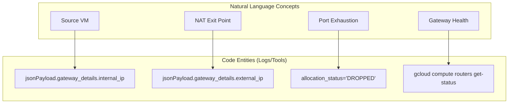
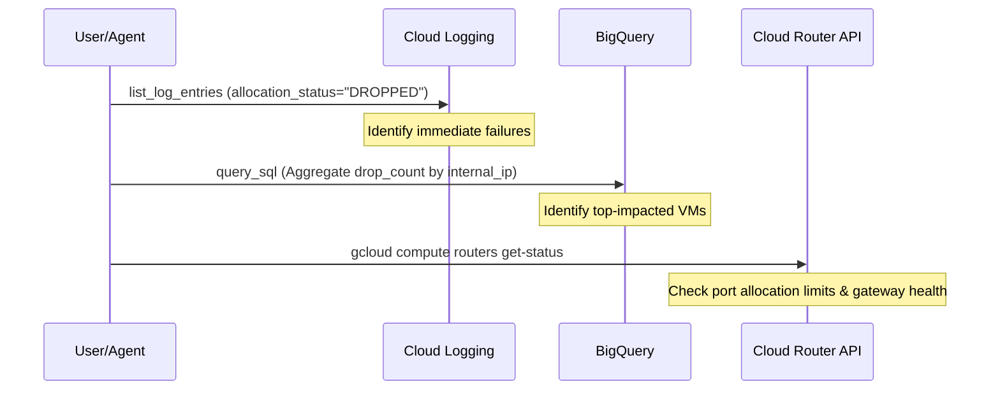

<!-- source: DeepWiki mcp.deepwiki.com · repo google/skills · extra page Network Observability: Cloud NAT Analysis · fetched 2026-10-27 -->

# Network Observability: Cloud NAT Analysis

<details>
<summary>Relevant source files</summary>

The following files were used as context for generating this wiki page:

- [cloud/recipes/google-cloud-networking-observability/references/cloud-nat-analysis.md](cloud/recipes/google-cloud-networking-observability/references/cloud-nat-analysis.md)

</details>


The Cloud NAT Analysis module provides technical procedures for auditing egress traffic and diagnosing connectivity issues originating from private instances. It focuses on the `nat_flows` log stream to identify traffic patterns and detect critical failures such as port exhaustion.

## Overview of Cloud NAT Telemetry

Cloud NAT observability is primarily driven by the `compute.googleapis.com/nat_flows` log stream [cloud/recipes/google-cloud-networking-observability/references/cloud-nat-analysis.md:3-4](). These logs are associated with the `nat_gateway` resource type and provide a granular view of every connection processed by the gateway [cloud/recipes/google-cloud-networking-observability/references/cloud-nat-analysis.md:19-21]().

### Data Flow and Interface Selection

Depending on the volume of data and the analytical goal, two primary interfaces are used:

1.  **Cloud Logging (via `list_log_entries`)**: Used for real-time exploratory analysis and pinpointing specific connection failures [cloud/recipes/google-cloud-networking-observability/references/cloud-nat-analysis.md:8-14]().
2.  **BigQuery (via `query_sql`)**: Used for high-volume trend analysis, such as identifying the top-impacted VMs over a long duration [cloud/recipes/google-cloud-networking-observability/references/cloud-nat-analysis.md:9-31]().

### Logical Data Mapping: Natural Language to Code Entities

The following diagram maps networking concepts to the specific log fields and tools used in the codebase.

**NAT Analysis Mapping**

Sources: [cloud/recipes/google-cloud-networking-observability/references/cloud-nat-analysis.md:78-90]()

## Port Exhaustion Detection

Port exhaustion occurs when a NAT gateway cannot allocate a source port for a connection request. This is identified in the telemetry by the `allocation_status` field [cloud/recipes/google-cloud-networking-observability/references/cloud-nat-analysis.md:89-90]().

### Detection Workflow

To identify impacted VMs, the system aggregates logs where the status is explicitly `DROPPED` [cloud/recipes/google-cloud-networking-observability/references/cloud-nat-analysis.md:26-27](). 

The following SQL pattern is used to generate a "Top Impacted VMs" report:

```sql
SELECT
  JSON_VALUE(json_payload.gateway_details.internal_ip) AS internal_ip, 
  COUNT(*) AS drop_count 
FROM `{project_id}.{dataset_id}._AllLogs` 
WHERE log_name LIKE '%nat_flows%' 
  AND JSON_VALUE(json_payload.allocation_status) = 'DROPPED' 
GROUP BY 1 
ORDER BY drop_count DESC 
LIMIT 10
```
Sources: [cloud/recipes/google-cloud-networking-observability/references/cloud-nat-analysis.md:35-41]()

## Schema and Key Fields

The `gateway_details` object within the `jsonPayload` is the primary container for NAT metadata [cloud/recipes/google-cloud-networking-observability/references/cloud-nat-analysis.md:87-90]().

| Field | Description | Code Reference |
| :--- | :--- | :--- |
| `internal_ip` | The private IP of the source VM. | `gateway_details.internal_ip` |
| `internal_port` | The source port of the internal traffic. | `gateway_details.internal_port` |
| `external_ip` | The NAT gateway's public exit IP. | `gateway_details.external_ip` |
| `external_port` | The port allocated on the NAT gateway. | `gateway_details.external_port` |
| `allocation_status` | Status of the NAT translation (e.g., `OK`, `DROPPED`). | `jsonPayload.allocation_status` |

Sources: [cloud/recipes/google-cloud-networking-observability/references/cloud-nat-analysis.md:87-90]()

## Troubleshooting Integration

Beyond log analysis, the diagnostic workflow integrates with the `gcloud` CLI to inspect the operational state of the underlying Cloud Router [cloud/recipes/google-cloud-networking-observability/references/cloud-nat-analysis.md:78-83]().

**Diagnostic Execution Flow**

Sources: [cloud/recipes/google-cloud-networking-observability/references/cloud-nat-analysis.md:14-83]()

### Router Status Inspection
To correlate log-based drops with physical router limits, the following command is utilized:
`gcloud compute routers get-status {router_name} --region {region}` [cloud/recipes/google-cloud-networking-observability/references/cloud-nat-analysis.md:81-83](). This provides visibility into the current port usage and capacity of the NAT gateway associated with the router.

Sources: [cloud/recipes/google-cloud-networking-observability/references/cloud-nat-analysis.md:1-97]()

---

