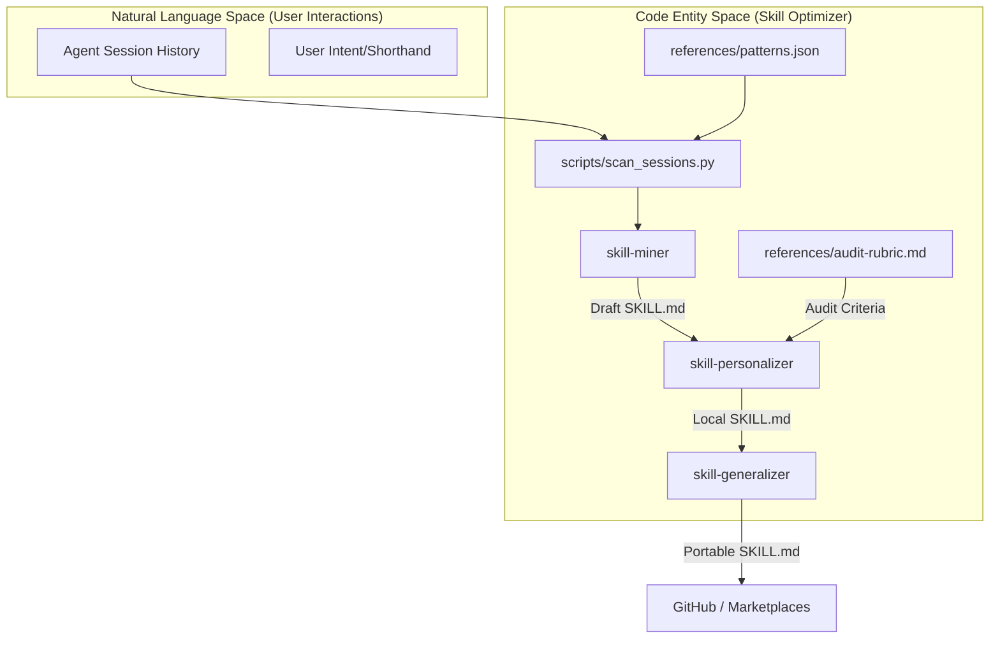
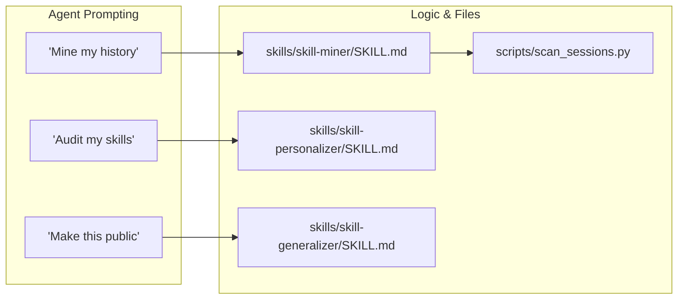

<!-- source: DeepWiki mcp.deepwiki.com · repo hqhq1025/skill-optimizer · page 1 Overview · fetched 2026-10-27 -->

# Overview

Relevant source files

The following files were used as context for generating this wiki page:

- [.claude-plugin/plugin.json](.claude-plugin/plugin.json)
- [CHANGELOG.md](CHANGELOG.md)
- [LICENSE](LICENSE)
- [README.md](README.md)
- [repo-metadata.json](repo-metadata.json)

The **Skill Optimizer** is a lifecycle toolkit designed to manage the evolution of Agent Skills—structured `SKILL.md` files that guide AI coding agents. While LLMs are proficient at code generation, they often repeat the same workflow patterns or fail to account for a user's specific local environment. This project provides a specialized three-stage pipeline to capture, refine, and share these workflows.

The project shifted from a single optimizer in v1.0.0 to a modular three-skill system in v2.0.0 [CHANGELOG.md:3-12]().

## The Three-Stage Lifecycle

Skill Optimizer divides the skill management process into three distinct functional areas:

| Goal | Skill | Optimization Direction |
| :--- | :--- | :--- |
| **Discover** | `skill-miner` | Scans session history to cluster repeated workflows into candidate skills. |
| **Refine** | `skill-personalizer` | Adapts skills to local tools, paths, and user-specific phrasing. |
| **Distribute** | `skill-generalizer` | Strips private data and prepares skills for public portability. |

Sources: [README.md:15-22](), [repo-metadata.json:10-26]()

### Lifecycle Data Flow
The following diagram illustrates how a workflow moves from raw agent interactions to a shared public artifact.

**Skill Evolution Pipeline**

Sources: [README.md:107-141](), [CHANGELOG.md:14-16]()

## Supported Agents

The toolkit is built on the **Agent Skills** open format, ensuring compatibility across major AI coding interfaces. It supports discovery in personal, project, and plugin scopes [README.md:71-79]().

*   **Codex**: Native support via `~/.codex/skills/`.
*   **Claude Code**: Supports native skills in `~/.claude/skills/`.
*   **Cursor**: Discoverable via `.agents/skills/` or `.cursor/skills/`.
*   **OpenCode**: Native `skill` tool integration.
*   **Gemini CLI**: Compatible with the Agent Skills open format.

For detailed setup instructions, see [Getting Started & Installation](#1.1).

Sources: [README.md:71-81](), [repo-metadata.json:27-34]()

## System Architecture

The project bridges high-level user instructions with deterministic scripts and structured rubrics. 

**Component Mapping**

Sources: [README.md:83-106](), [repo-metadata.json:11-26]()

### Key Components
*   **`skill-miner`**: Uses `scripts/scan_sessions.py` to perform a deterministic scan of Codex archives, Claude Code logs, and Gemini task files [README.md:115-116](). For details, see [Architecture & Lifecycle Pipeline](#1.2).
*   **`skill-personalizer`**: Inherits the v1.0.0 audit checks, focusing on trigger fit, token economics, and environment consistency [README.md:140]().
*   **`skill-generalizer`**: Focuses on removing internal repository facts and generalizing examples for cross-agent portability [README.md:127-133]().

## Navigation Guide

*   **[Getting Started & Installation](#1.1)**: How to install the package and configure your agent.
*   **[Architecture & Lifecycle Pipeline](#1.2)**: Deep dive into the Mine → Personalize → Generalize flow.
*   **[Research Background & Design Rationale](#1.3)**: The academic foundations (Voyager, ExpeL, etc.) that inform the project's design.

For developers looking for machine-readable context, the repository includes `llms.txt`, `llms-full.txt`, and `repo-metadata.json` [README.md:156-162]().

---

