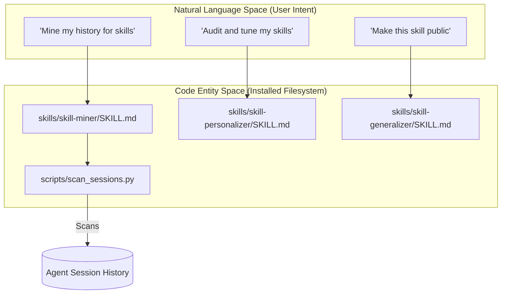
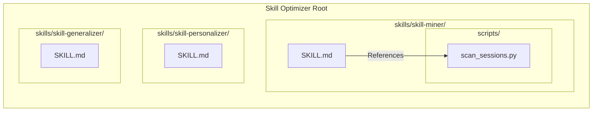

<!-- source: DeepWiki mcp.deepwiki.com · repo hqhq1025/skill-optimizer · page 1.1 Getting Started & Installation · fetched 2026-10-27 -->

# Getting Started & Installation

<details>
<summary>Relevant source files</summary>

The following files were used as context for generating this wiki page:

- [README.md](README.md)
- [README.zh-CN.md](README.zh-CN.md)
- [llms.txt](llms.txt)

</details>


This page provides a technical guide for installing and initializing the **Skill Optimizer** suite. Skill Optimizer is a lifecycle toolkit designed to manage the evolution of agent capabilities through three distinct phases: discovery (`skill-miner`), adaptation (`skill-personalizer`), and publication (`skill-generalizer`) [README.md:5-11]().

## Installation Overview

Skill Optimizer is distributed as a set of `SKILL.md` packages compatible with agents that support the **Agent Skills** folder convention [README.md:142-151](). Installation involves placing the skill directories into specific paths where the agent's discovery engine can index them.

### Supported Agents & Paths

The following table defines the recommended installation targets for supported coding agents:

| Agent | Support Level | Recommended Installation Path |
| :--- | :--- | :--- |
| **Codex** | Native Agent Skills + Plugin Metadata | `~/.codex/skills/` |
| **Claude Code** | Native (Personal, Project, Plugin scopes) | `~/.claude/skills/` |
| **Cursor** | Native Agent Skills & Rules | `.cursor/skills/` or `~/.agents/skills/` |
| **OpenCode** | Native `skill` tool | `~/.config/opencode/skills/` |
| **Gemini CLI** | `GEMINI.md` context mechanism | `.agents/skills/` |

**Sources:** [README.md:71-81](), [README.md:142-151]()

---

## Installation Methods

### 1. Natural Language Installation (Recommended)
Most modern agents can perform self-installation if provided with the repository URL. This triggers the agent to clone the repository and move the relevant directories to its internal skill storage.

**Claude Code:**
```text
Install the skills from https://github.com/hqhq1025/skill-optimizer
```

**Codex:**
```text
Install the skills from https://github.com/hqhq1025/skill-optimizer into ~/.codex/skills/
```

**General Agent Skills compatible agents:**
```text
Install the skills from https://github.com/hqhq1025/skill-optimizer into ~/.agents/skills/
```

**Sources:** [README.md:25-46]()

### 2. Manual CLI Installation
For environments where the agent lacks filesystem write permissions for its own configuration directory, use the following shell sequence to deploy the full suite:

```bash
# Clone the repository to a temporary location
git clone https://github.com/hqhq1025/skill-optimizer.git /tmp/skill-optimizer

# Create the target directory (example for generic agents)
mkdir -p ~/.agents/skills

# Copy the three core skill packages
cp -r /tmp/skill-optimizer/skills/skill-miner ~/.agents/skills/
cp -r /tmp/skill-optimizer/skills/skill-personalizer ~/.agents/skills/
cp -r /tmp/skill-optimizer/skills/skill-generalizer ~/.agents/skills/

# Cleanup
rm -rf /tmp/skill-optimizer
```

**Sources:** [README.md:47-67]()

---

## Technical Architecture & Data Flow

The installation places three primary entities into the agent's runtime environment. These entities interact with the local filesystem and session history to manage the skill lifecycle.

### Natural Language to Code Entity Mapping
The following diagram illustrates how natural language intents provided by the user map to specific code entities and scripts within the installed package.

**Intent Mapping and Execution Flow**

**Sources:** [README.md:83-106](), [README.md:109-115](), [llms.txt:7-11]()

### Directory Structure & Convention
Once installed, the `skills/` directory follows a standardized layout to ensure cross-agent compatibility. Each skill is self-contained.

**Skill Package Internal Structure**

**Sources:** [README.md:107-141](), [llms.txt:23-25]()

---

## First-Use Prompts

After installation, verify the setup by invoking the primary workflows. These prompts trigger the `SKILL.md` instructions loaded into the agent's context.

### 1. Mining Discovery
To identify recurring patterns in your work that should be automated:
> "Mine my coding-agent history and find repeated workflows that should become skills."

This command utilizes `skill-miner` to invoke `scripts/scan_sessions.py` [README.md:87-89](), [README.md:115-116]().

### 2. Personalization & Auditing
To optimize a skill you just created or downloaded:
> "I downloaded this skill. Tune it to my local workflow and usage habits."

This triggers `skill-personalizer` to perform audit checks on trigger fit, environment consistency, and tool preferences [README.md:99-101](), [README.md:134-141]().

### 3. Generalization for Export
To prepare a local skill for a GitHub repository:
> "Turn this local skill into a public GitHub-ready skill."

This invokes `skill-generalizer` to strip private paths and credentials while standardizing frontmatter [README.md:95-97](), [README.md:127-133]().

**Sources:** [README.md:83-106](), [README.md:107-141]()

---

