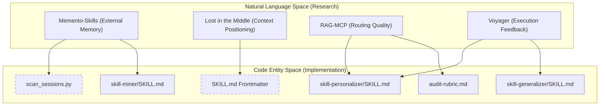
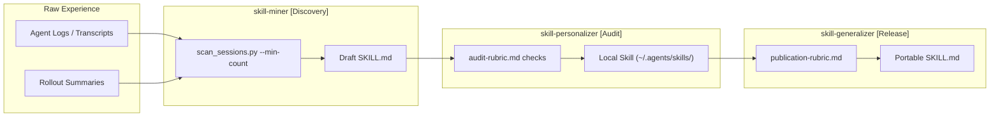

<!-- source: DeepWiki mcp.deepwiki.com · repo hqhq1025/skill-optimizer · page 1.3 Research Background & Design Rationale · fetched 2026-10-27 -->

# Research Background & Design Rationale

Relevant source files

The following files were used as context for generating this wiki page:

- [CITATION.cff](CITATION.cff)
- [docs/research-background.md](docs/research-background.md)
- [llms-full.txt](llms-full.txt)

This page details the academic and empirical foundations of the Skill Optimizer toolkit. It explains how specific research insights from the fields of LLM agents, externalized memory, and long-context modeling directly inform the architecture of the `skill-miner`, `skill-personalizer`, and `skill-generalizer` components.

## Theoretical Foundations

The Skill Optimizer project is built upon the premise that agent capabilities should be treated as lifecycle-managed infrastructure rather than static prompts [docs/research-background.md:3-3](). By externalizing experience into reusable artifacts, agents can improve without the need for expensive model weight updates.

### 1. Externalized Memory & Skill Libraries
Research in **Memento-Skills**, **Reflexion**, and **ExpeL** demonstrates that agents can improve performance by storing feedback and structured workflows in external memory [docs/research-background.md:10-10]().

*   **Design Decision:** The `skill-miner` acts as the primary "Acquisition" engine, scanning session histories and rollout summaries to extract repeated workflows [llms-full.txt:13-15]().
*   **Implementation:** Instead of manual prompt engineering, the system uses `scan_sessions.py` to deterministically identify candidate signals from raw logs [llms-full.txt:43-47]().

### 2. Iterative Refinement & Verification
**Voyager** highlighted the importance of execution feedback and self-verification in building durable skill libraries [docs/research-background.md:13-13]().

*   **Design Decision:** The `skill-personalizer` includes explicit "workflow completion" and "environment consistency" checks [llms-full.txt:18-19]().
*   **Implementation:** The `audit-rubric.md` (referenced in the personalization lifecycle) requires evidence of successful execution before a skill is considered stable [docs/research-background.md:13-13]().

### 3. Routing Quality & Retrieval Accuracy
**RAG-MCP** and research into **MCP tool descriptions** suggest that as a skill library grows, the primary bottleneck becomes "routing quality" (triggering the right skill at the right time) rather than the content of the skill itself [docs/research-background.md:11-11]().

*   **Design Decision:** The toolkit prioritizes "Trigger Fit" and "Undertrigger/Overtrigger" audits over simple text editing [llms-full.txt:18-19]().
*   **Implementation:** The `skill-personalizer` focuses on tuning descriptions to prevent cross-skill conflicts and prompt bloat [docs/research-background.md:11-11]().

### 4. Long-Context Management
The **"Lost in the Middle"** phenomenon shows that LLMs utilize information most effectively at the beginning or end of a prompt [docs/research-background.md:12-12]().

*   **Design Decision:** `SKILL.md` files utilize a strict frontmatter-first structure to ensure critical trigger and safety details are presented to the agent immediately [docs/research-background.md:12-12]().
*   **Implementation:** Detailed logic is offloaded to the `references/` or `scripts/` directories to keep the main skill definition concise [docs/research-background.md:9-9]().

**Sources:** [docs/research-background.md:1-15](), [llms-full.txt:67-77]()

---

## Mapping Research to Code Entities

The following diagram bridges the gap between high-level research concepts and the specific files and functions implemented in the repository.

### Research-to-Implementation Mapping

**Sources:** [docs/research-background.md:7-14](), [llms-full.txt:11-23](), [llms-full.txt:67-77]()

---

## Design Rationale: The Three-Stage Lifecycle

The toolkit enforces a separation of concerns between discovery, tuning, and sharing. This design is informed by the "Agent Skills for LLMs" survey, which argues for lifecycle governance and security in community skills [docs/research-background.md:14-14]().

| Stage | Research Driver | Implementation Focus | Key Artifacts |
| :--- | :--- | :--- | :--- |
| **Mine** | *ExpeL / Memento-Skills* | Deterministic signal detection from logs. | `scan_sessions.py`, `patterns.json` |
| **Personalize** | *RAG-MCP / Reflexion* | Local environment fit and routing accuracy. | `audit-rubric.md`, `skill-personalizer` |
| **Generalize** | *Security / Governance* | Redaction and platform portability. | `publication-rubric.md`, `skill-generalizer` |

### Data Flow: From Session History to Public Skill

The following diagram illustrates how raw data transitions through the system, mapping specific script arguments and rubric checks to the data flow.

**Sources:** [llms-full.txt:11-23](), [llms-full.txt:43-65](), [docs/research-background.md:30-36]()

---

## Design Claims & Constraints

1.  **Portability over Monoliths:** Skills are stored as individual `SKILL.md` files with conservative frontmatter to ensure they work across Codex, Claude Code, Cursor, and OpenCode [llms-full.txt:79-80]().
2.  **Deterministic Mining:** While LLMs are used for candidate evaluation, the initial discovery is handled by `scan_sessions.py` to ensure consistency and efficiency [docs/research-background.md:34-34]().
3.  **Privacy First:** The `skill-miner` is designed to emit sanitized summaries. Raw transcripts remain local by default, addressing the security concerns raised in the "Agent Skills for LLMs" survey [llms-full.txt:82-84](), [docs/research-background.md:14-14]().
4.  **Audit-Centric Tuning:** The `skill-personalizer` does not just "fix" a skill; it audits it against nine specific dimensions, including token economics and cross-skill conflicts [llms-full.txt:18-19]().

**Sources:** [docs/research-background.md:7-15](), [llms-full.txt:78-85]()

---

