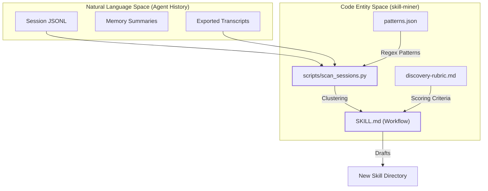
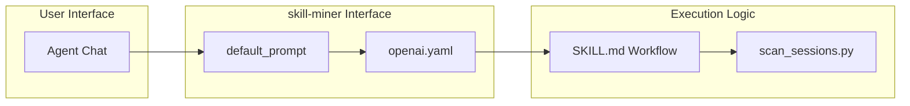

<!-- source: DeepWiki mcp.deepwiki.com · repo hqhq1025/skill-optimizer · page 2 skill-miner · fetched 2026-10-27 -->

# skill-miner

Relevant source files

The following files were used as context for generating this wiki page:

- [skills/skill-miner/SKILL.md](skills/skill-miner/SKILL.md)
- [skills/skill-miner/agents/openai.yaml](skills/skill-miner/agents/openai.yaml)

The `skill-miner` component is the discovery engine of the Skill Optimizer lifecycle. Its primary purpose is to analyze agent session history, archived transcripts, and local project work to identify recurring workflows that are candidates for formalization into new Agent Skills. Instead of brainstorming skills from scratch, `skill-miner` uses empirical evidence from real-world usage to ensure new skills address actual friction points and repeated manual tasks.

## Purpose and Scope

`skill-miner` acts as the entry point for the "Mine" stage of the Mine → Personalize → Generalize pipeline. It is designed to bridge the gap between raw session logs and structured skill definitions.

- **Objective**: Discover reusable techniques, extract them from project-specific contexts, and score them based on their potential value as a permanent skill [skills/skill-miner/SKILL.md:10-10]().
- **When to Invoke**: Use this component when a user wants to scan past coding-agent sessions, when a team needs a backlog of skills based on actual work, or when recurring procedures are identified in project notes but haven't been packaged yet [skills/skill-miner/SKILL.md:14-17]().
- **Exclusions**: It should not be used for tuning existing skills (use `skill-personalizer`) or publishing private skills (use `skill-generalizer`) [skills/skill-miner/SKILL.md:19-19]().

### Component Architecture

The following diagram illustrates how the `skill-miner` component interacts with session data and the broader codebase to produce skill candidates.

**Figure 1: Skill Mining Data Flow**

Sources: [skills/skill-miner/SKILL.md:23-28](), [skills/skill-miner/SKILL.md:43-46]()

## Core Components

The mining process is governed by three primary sub-components that manage data ingestion, pattern matching, and qualitative evaluation.

### 1. SKILL.md & Workflow
The `skill-miner` is itself an Agent Skill defined in its own `SKILL.md`. It provides the LLM with an eight-step workflow to locate evidence, run the deterministic scanner, cluster work by intent, and score candidates [skills/skill-miner/SKILL.md:21-30](). It includes specific "Evidence Rules" to ensure that findings are justified by quotes or summaries without exposing sensitive content [skills/skill-miner/SKILL.md:32-40]().

For details, see [skill-miner: SKILL.md & Workflow](#2.1).

### 2. scan_sessions.py: Session Scanner
This Python script provides a deterministic first pass over local session files. It supports various data sources including Codex JSONL, Claude Code, and Gemini task files [skills/skill-miner/SKILL.md:45-46](). The script allows users to filter by date ranges, minimum occurrence counts, and specific workflow patterns.

For details, see [scan_sessions.py: Session Scanner](#2.2).

### 3. Discovery Rubric & Patterns
The discovery process is guided by two reference files:
- **`discovery-rubric.md`**: Provides the scoring system (1–5 scale) and dimensions (recurrence, friction, risk, portability) used to evaluate if a candidate is worth developing [skills/skill-miner/SKILL.md:27-27](), [skills/skill-miner/SKILL.md:43-43]().
- **`patterns.json`**: Contains the regex-based definitions for identifying specific workflows during the scanning phase.

For details, see [skill-miner: Discovery Rubric & Patterns](#2.3).

## Integration and Interface

The `skill-miner` is exposed to agents via a standard interface configuration, allowing it to be triggered by natural language requests such as "Scan my coding-agent history" [skills/skill-miner/agents/openai.yaml:4-4]().

**Figure 2: System Integration**

Sources: [skills/skill-miner/agents/openai.yaml:1-5](), [skills/skill-miner/SKILL.md:21-31]()

- **Display Name**: Skill Miner [skills/skill-miner/agents/openai.yaml:2-2]()
- **Short Description**: Mine agent history for reusable skill candidates [skills/skill-miner/agents/openai.yaml:3-3]()

Sources:
- [skills/skill-miner/SKILL.md:1-46]()
- [skills/skill-miner/agents/openai.yaml:1-5]()

---

