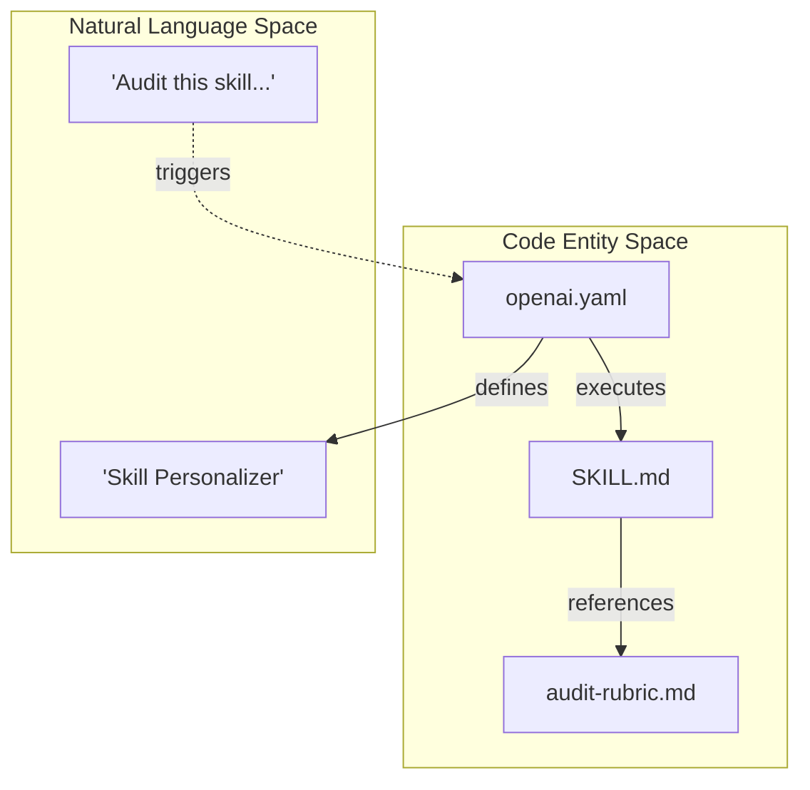

<!-- source: DeepWiki mcp.deepwiki.com · repo hqhq1025/skill-optimizer · page 3 skill-personalizer · fetched 2026-10-27 -->

# skill-personalizer

Relevant source files

The following files were used as context for generating this wiki page:

- [skills/skill-personalizer/SKILL.md](skills/skill-personalizer/SKILL.md)
- [skills/skill-personalizer/agents/openai.yaml](skills/skill-personalizer/agents/openai.yaml)

The `skill-personalizer` is a core component of the Skill Optimizer lifecycle designed to bridge the gap between generic skill templates and a user's specific local environment. While `skill-miner` discovers new capabilities and `skill-generalizer` prepares them for public sharing, the personalizer focuses on **local optimization**: ensuring a skill triggers at the right time, uses the correct local paths, and respects the user's preferred tools and phrasing.

## Purpose and Scope

The primary objective of `skill-personalizer` is to audit and tune skills—whether they are newly mined, downloaded from a community repository, or forked—to fit a user's real-world setup [skills/skill-personalizer/SKILL.md:8-10](). It transforms a "generic" skill into a "private" skill that is highly efficient for a specific developer's machine and habits.

### When to Use
| Scenario | Use `skill-personalizer`? | Alternative |
| :--- | :--- | :--- |
| Adapting a GitHub skill to local aliases/paths | **Yes** | - |
| Skill triggers too often (overtriggering) | **Yes** | - |
| Skill misses obvious user requests (undertriggering) | **Yes** | - |
| Preparing a skill for public release | No | `skill-generalizer` |
| Extracting a brand new skill from session logs | No | `skill-miner` |

Sources: [skills/skill-personalizer/SKILL.md:12-19]()

## Component Architecture

The `skill-personalizer` operates as an agentic workflow defined within a `SKILL.md` file. It utilizes a diagnostic rubric to evaluate existing skills and provides a structured process for modification.

### Agent Interface
For agents supporting YAML-based metadata (like Codex), the component provides a display configuration to standardize how the personalizer is invoked.

**OpenAI Interface Configuration**

Sources: [skills/skill-personalizer/agents/openai.yaml:1-5](), [skills/skill-personalizer/SKILL.md:42-45]()

## Core Workflow

The personalization process follows an eight-step sequence to ensure that local adaptations do not break the underlying utility of the skill:

1.  **Inspection**: Reviewing the target skill alongside local memories and session evidence [skills/skill-personalizer/SKILL.md:23-23]().
2.  **Audit**: Running diagnostic checks using the [skill-personalizer: Audit Rubric](#3.2) to identify friction points [skills/skill-personalizer/SKILL.md:24-24]().
3.  **Contextualization**: Identifying specific local tools, directories, and recurring user phrasing [skills/skill-personalizer/SKILL.md:25-25]().
4.  **Trigger Alignment**: Comparing trigger conditions against actual user requests to reduce noise [skills/skill-personalizer/SKILL.md:26-26]().
5.  **Refinement**: Editing the skill to include local defaults and safety boundaries [skills/skill-personalizer/SKILL.md:27-28]().
6.  **Validation**: Verifying the new version with realistic prompts [skills/skill-personalizer/SKILL.md:30-30]().

Sources: [skills/skill-personalizer/SKILL.md:21-31]()

## Key Personalization Rules

To maintain high-quality skills, the personalizer adheres to specific constraints:
*   **Utility over Privacy**: Personal details are only included if they directly improve execution (e.g., a specific project path) [skills/skill-personalizer/SKILL.md:34-34]().
*   **Anti-Fragility**: Avoid adding "brittle fallbacks" that mask a broken local environment; the skill should fix the workflow, not hide errors [skills/skill-personalizer/SKILL.md:35-35]().
*   **Evidence-Based**: Prefer real session evidence over generic "best practices" [skills/skill-personalizer/SKILL.md:36-36]().
*   **Attribution**: When editing third-party skills, upstream licenses and attributions must remain intact [skills/skill-personalizer/SKILL.md:38-38]().

Sources: [skills/skill-personalizer/SKILL.md:32-39]()

## Child Pages

For detailed technical specifications and rubrics, refer to the following sub-pages:

*   **[skill-personalizer: SKILL.md & Workflow](#3.1)**
    Detailed walkthrough of the personalization logic, trigger conditions, and the validation steps required to finalize a local skill.
*   **[skill-personalizer: Audit Rubric](#3.2)**
    Full reference for `audit-rubric.md`, covering the nine dimensions of skill quality, including trigger fit, token economics, and cross-skill conflicts.

---

