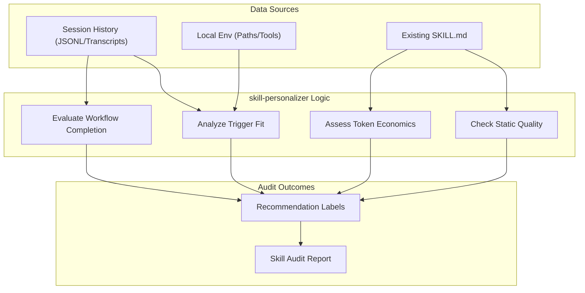
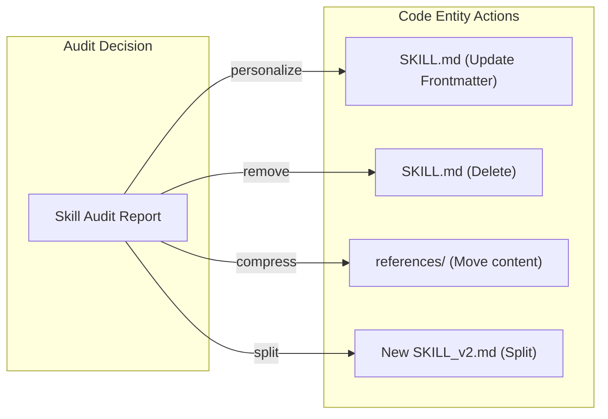

<!-- source: DeepWiki mcp.deepwiki.com · repo hqhq1025/skill-optimizer · page 3.2 skill-personalizer: Audit Rubric · fetched 2026-10-27 -->

# skill-personalizer: Audit Rubric

Relevant source files

The following files were used as context for generating this wiki page:

- [skills/skill-personalizer/references/audit-rubric.md](skills/skill-personalizer/references/audit-rubric.md)
- [skills/skill-personalizer/references/personalization-rubric.md](skills/skill-personalizer/references/personalization-rubric.md)

The `skill-personalizer` audit rubric provides a structured framework for evaluating existing skills against real-world usage data. It serves as the analytical foundation for the personalization phase, identifying whether a skill should be kept, modified, or removed based on nine specific dimensions of performance and quality.

## Purpose and Scope

The audit process is triggered when a user identifies performance issues such as "noisy" behavior, failure to trigger (undertriggering), or conflicts between multiple skills [skills/skill-personalizer/references/audit-rubric.md:3-4](). The scope of an audit includes analyzing active and archived sessions, rollout summaries, and environment-specific configurations to ensure the skill is both technically sound and contextually relevant [skills/skill-personalizer/references/audit-rubric.md:7-7]().

## The Nine Audit Dimensions

The audit rubric defines nine dimensions to evaluate the health and utility of a skill.

| Dimension | Technical Check |
| :--- | :--- |
| **Trigger fit** | Validates if the `description` field in the YAML frontmatter matches actual user phrasing and semantic retrieval terms [skills/skill-personalizer/references/audit-rubric.md:15-15](). |
| **Undertrigger** | Identifies instances where the user requested a capability, but the skill was not retrieved or followed [skills/skill-personalizer/references/audit-rubric.md:16-16](). |
| **Overtrigger** | Detects if the skill fires for neighboring tasks where it is unnecessary, causing friction [skills/skill-personalizer/references/audit-rubric.md:17-17](). |
| **User reaction** | Analyzes session logs for user acceptance, corrections, rejections, or topic switching after a skill is invoked [skills/skill-personalizer/references/audit-rubric.md:18-18](). |
| **Workflow completion** | Verifies if the agent executed the stated steps in the `SKILL.md` or stopped prematurely [skills/skill-personalizer/references/audit-rubric.md:19-19](). |
| **Static quality** | Evaluates structural integrity: frontmatter, word count, and progressive disclosure [skills/skill-personalizer/references/audit-rubric.md:20-20](). |
| **Cross-skill conflicts** | Scans for trigger overlaps, duplicated workflows, or contradictory instructions across the skill library [skills/skill-personalizer/references/audit-rubric.md:21-21](). |
| **Environment consistency** | Confirms that referenced paths, tools, and commands exist in the user's local environment [skills/skill-personalizer/references/audit-rubric.md:22-22](). |
| **Token economics** | Assesses if large skills should be compressed or moved to `references/` to save context window space [skills/skill-personalizer/references/audit-rubric.md:23-23](). |

**Sources:** [skills/skill-personalizer/references/audit-rubric.md:11-23]()

## Audit Data Flow and Logic

The following diagram illustrates how the `skill-personalizer` processes raw session data and environment state through the audit rubric to generate a recommendation.

### Audit Process Logic

**Sources:** [skills/skill-personalizer/references/audit-rubric.md:7-23](), [skills/skill-personalizer/references/personalization-rubric.md:5-15]()

## Static Quality Checklist

A skill must meet specific structural requirements to pass the "Static Quality" dimension. These rules ensure cross-agent compatibility and prompt efficiency.

*   **Naming:** Use lowercase hyphen-case for the `name` field [skills/skill-personalizer/references/audit-rubric.md:28-28]().
*   **Description:** Must start with `Use when` and focus on trigger conditions rather than the internal workflow [skills/skill-personalizer/references/audit-rubric.md:29-29]().
*   **Front-loading:** Place the strongest trigger terms and critical safety rules at the top of the file [skills/skill-personalizer/references/audit-rubric.md:30-33]().
*   **Conciseness:** Keep the main `SKILL.md` brief; move long examples or scripts into bundled resources [skills/skill-personalizer/references/audit-rubric.md:31-31]().
*   **Tone:** Avoid narrative postmortems (e.g., "in one session we found") and excessive emphasis (MUST/NEVER); use concrete rules [skills/skill-personalizer/references/audit-rubric.md:34-35]().

**Sources:** [skills/skill-personalizer/references/audit-rubric.md:25-36]()

## Research-Backed Heuristics

The rubric incorporates heuristics derived from LLM behavior research (e.g., "Lost in the Middle") and agentic workflows (e.g., Voyager/ExpeL).

1.  **Compounding Risk:** Undertriggering is treated as a high-priority failure because skills that aren't retrieved cannot gather feedback for improvement [skills/skill-personalizer/references/audit-rubric.md:39-39]().
2.  **Context Density:** Prioritize narrow, relevant context over large, "kitchen-sink" skills to prevent prompt dilution [skills/skill-personalizer/references/audit-rubric.md:40-40]().
3.  **Positioning Bias:** Front-load triggers because long-context models often miss information buried in the middle of a document [skills/skill-personalizer/references/audit-rubric.md:41-41]().
4.  **Evidence Requirement:** Durable skills must be based on validated practices found in session history, not imagined workflows [skills/skill-personalizer/references/audit-rubric.md:42-42]().

**Sources:** [skills/skill-personalizer/references/audit-rubric.md:37-45]()

## Audit Report and Recommendation Labels

The output of an audit is a **Skill Audit Report** [skills/skill-personalizer/references/audit-rubric.md:49-72](). This report assigns one of the following recommendation labels to each audited skill:

| Label | Meaning |
| :--- | :--- |
| `keep` | The skill is healthy and strategically useful [skills/skill-personalizer/references/audit-rubric.md:76-76](). |
| `personalize` | The skill is valuable but requires local paths, phrasing, or workflow defaults [skills/skill-personalizer/references/audit-rubric.md:77-77](). |
| `generalize` | The skill is reusable but currently contains too much personal data for public sharing [skills/skill-personalizer/references/audit-rubric.md:78-78](). |
| `split` | The skill contains multiple unrelated workflows and should be divided [skills/skill-personalizer/references/audit-rubric.md:79-79](). |
| `compress` | The skill is too large for its value; move details to references/scripts [skills/skill-personalizer/references/audit-rubric.md:80-80](). |
| `remove` | No evidence of need, the skill is obsolete, or it is unsafe [skills/skill-personalizer/references/audit-rubric.md:81-81](). |

### Mapping Recommendations to File Entities
The following diagram maps the audit recommendations to the resulting file system changes.

**Sources:** [skills/skill-personalizer/references/audit-rubric.md:74-82]()

---

