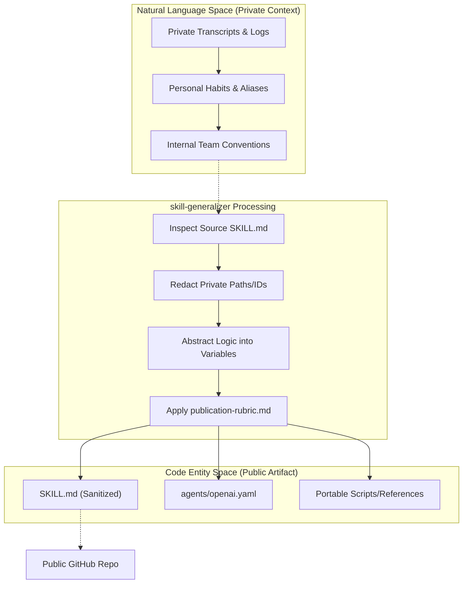

<!-- source: DeepWiki mcp.deepwiki.com · repo hqhq1025/skill-optimizer · page 4 skill-generalizer · fetched 2026-10-27 -->

# skill-generalizer

Relevant source files

The following files were used as context for generating this wiki page:

- [skills/skill-generalizer/SKILL.md](skills/skill-generalizer/SKILL.md)
- [skills/skill-generalizer/agents/openai.yaml](skills/skill-generalizer/agents/openai.yaml)

The `skill-generalizer` is the final stage in the skill lifecycle, responsible for transforming local, private, or environment-specific Agent Skills into portable, public-facing artifacts [skills/skill-generalizer/SKILL.md:1-4](). While `skill-miner` discovers capabilities and `skill-personalizer` tunes them for an individual, the generalizer focuses on redaction, portability, and cross-platform compatibility to ensure a skill is useful to others without leaking private context [skills/skill-generalizer/SKILL.md:10-16]().

## Purpose and Scope

The primary objective of this component is to preserve the reusable technical logic of a skill while stripping away personal habits, internal hostnames, credentials, and machine-specific paths [skills/skill-generalizer/SKILL.md:10-10](). 

### When to Use
- **Public Sharing:** Preparing a skill for GitHub, marketplaces, or open-source contribution [skills/skill-generalizer/SKILL.md:14-14]().
- **Team Distribution:** Moving a skill from a single developer's workflow to a shared team repository [skills/skill-generalizer/SKILL.md:3-3]().
- **Sanitization:** When a skill contains traces of private transcripts, account IDs, or project-specific facts that should not be exposed [skills/skill-generalizer/SKILL.md:25-25]().

> [!IMPORTANT]
> Do not use `skill-generalizer` for tuning a skill for your own machine; use `skill-personalizer` for that purpose [skills/skill-generalizer/SKILL.md:18-18]().

**Sources:**
- [skills/skill-generalizer/SKILL.md:1-18]()

---

## Technical Workflow Overview

The generalization process bridges the gap between a "working local script" and a "standardized agent capability." It involves a nine-step workflow that transitions from source inspection to publication-ready packaging [skills/skill-generalizer/SKILL.md:22-30]().

### Generalization Logic Flow

The following diagram illustrates how the `skill-generalizer` processes private entities into public-facing code entities.

**Sources:**
- [skills/skill-generalizer/SKILL.md:22-30]()
- [skills/skill-generalizer/agents/openai.yaml:1-5]()

---

## Component Relationships

The `skill-generalizer` relies on two primary reference documents to ensure the quality and reach of the generated skill.

### 1. Publication & Redaction
The process uses a specific rubric to evaluate if a skill is truly ready for "strangers" to use. This involves checking frontmatter descriptions, ensuring examples are generic, and verifying that essential personal details have been converted into configurable variables [skills/skill-generalizer/SKILL.md:34-38]().
- For details, see [skill-generalizer: SKILL.md & Workflow](#4.1).

### 2. Platform Portability
Since different agents (Codex, Claude Code, Cursor, etc.) have different execution environments, the generalizer must validate support claims against known compatibility shapes [skills/skill-generalizer/SKILL.md:44-44](). This ensures that install instructions and path placeholders work across various platforms.
- For details, see [skill-generalizer: Publication Rubric & Platform Compatibility](#4.2).

### Agent Interface Metadata
For agents like Codex, the generalizer includes specific metadata to define how the skill appears in the UI.

| File Path | Entity | Purpose |
| :--- | :--- | :--- |
| `skills/skill-generalizer/agents/openai.yaml` | `display_name` | The public-facing name of the tool [skills/skill-generalizer/agents/openai.yaml:2-2](). |
| `skills/skill-generalizer/agents/openai.yaml` | `default_prompt` | The instruction used to trigger the generalization logic [skills/skill-generalizer/agents/openai.yaml:4-4](). |

**Sources:**
- [skills/skill-generalizer/SKILL.md:32-45]()
- [skills/skill-generalizer/agents/openai.yaml:1-5]()

---

## Child Pages

- **[skill-generalizer: SKILL.md & Workflow](#4.1)**
  Detailed walkthrough of the nine-step generalization workflow, redaction rules for private data, and the specific formatting requirements for public `SKILL.md` files.
- **[skill-generalizer: Publication Rubric & Platform Compatibility](#4.2)**
  Full reference for the `publication-rubric.md` (safety passes and packaging) and `platform-compatibility.md` (cross-agent support and install paths).

---

