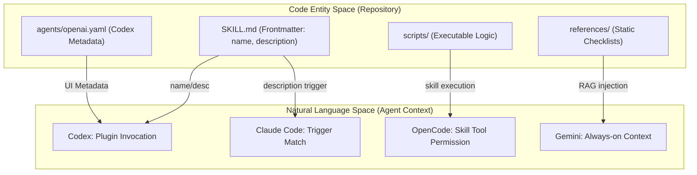
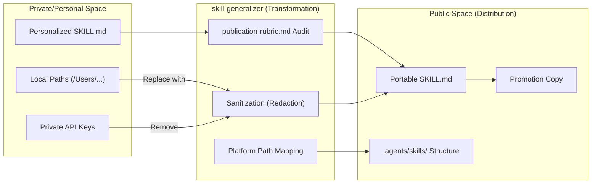

<!-- source: DeepWiki mcp.deepwiki.com · repo hqhq1025/skill-optimizer · page 4.2 skill-generalizer: Publication Rubric & Platform Compatibility · fetched 2026-10-27 -->

# skill-generalizer: Publication Rubric & Platform Compatibility

Relevant source files

The following files were used as context for generating this wiki page:

- [skills/skill-generalizer/references/platform-compatibility.md](skills/skill-generalizer/references/platform-compatibility.md)
- [skills/skill-generalizer/references/publication-rubric.md](skills/skill-generalizer/references/publication-rubric.md)

The `skill-generalizer` component is the final stage in the skill lifecycle, responsible for transforming personalized, private skills into portable, public-facing artifacts. This page provides the technical reference for the `publication-rubric.md` and `platform-compatibility.md` files, which govern the classification of content, safety auditing, and cross-agent deployment strategies.

## Publication Rubric: Content Classification & Safety

The publication rubric ensures that skills are sanitized of private data and structured for high portability. It acts as a gatekeeper for the `skill-generalizer` workflow, moving from specific session-based evidence to reusable judgment patterns.

### Content Classification Table
Before a skill is published, its components must be inventoried and classified according to the following treatment rules:

| Class | Keep? | Treatment |
| :--- | :--- | :--- |
| **Reusable workflow** | Yes | Keep and tighten. |
| **Tool-specific command** | Usually | Keep if portable; otherwise document setup. |
| **Personal preference** | Maybe | Generalize into an option or remove. |
| **Private path or host** | No | Replace with placeholder or setup variable. |
| **Credential, token, cookie, key** | No | Remove entirely. |
| **Transcript quote** | Rarely | Summarize or sanitize. |
| **One-project fact** | Usually no | Move to an example only if generic. |

Sources: [skills/skill-generalizer/references/publication-rubric.md:9-20]()

### Generalization & Safety Passes
The generalization process involves a critical review of the skill's logic to ensure it does not depend on the author's local environment.

**Generalization Pass Questions:**
*   Could a new user understand when this skill applies from the description alone? [skills/skill-generalizer/references/publication-rubric.md:25-25]()
*   Does the skill require the author's exact machine, aliases, repos, or memories? [skills/skill-generalizer/references/publication-rubric.md:26-26]()
*   Are there hidden prerequisites that should become setup instructions? [skills/skill-generalizer/references/publication-rubric.md:27-27]()

**Public Safety Pass (Redaction Requirements):**
*   **Paths:** Remove absolute home paths (e.g., `/Users/<name>/...`). [skills/skill-generalizer/references/publication-rubric.md:35-35]()
*   **Infrastructure:** Remove internal hostnames, SSH aliases, VPN URLs, and private org/repo names. [skills/skill-generalizer/references/publication-rubric.md:36-36]()
*   **PII:** Remove email addresses, phone numbers, calendars, and account IDs. [skills/skill-generalizer/references/publication-rubric.md:37-37]()
*   **Secrets:** Remove cookies, tokens, API keys, and OAuth scopes. [skills/skill-generalizer/references/publication-rubric.md:38-38]()

**Placeholder Standardization:**
The system uses standardized placeholders to replace redacted data: `<workspace>`, `<repo>`, `<skill-name>`, `<agent-skills-dir>`, and `<platform-config>`. [skills/skill-generalizer/references/publication-rubric.md:41-41]()

### Packaging Checklist
Final verification before release requires adherence to the following structural rules:
*   **Naming:** Skill name must be lowercase hyphen-case. [skills/skill-generalizer/references/publication-rubric.md:47-47]()
*   **Triggers:** The `description` in frontmatter must start with `Use when` and contain only trigger conditions. [skills/skill-generalizer/references/publication-rubric.md:48-48]()
*   **Separation of Concerns:** Long checklists, scripts, and templates must live in bundled resources (e.g., `references/` or `scripts/`), not in the main `SKILL.md`. [skills/skill-generalizer/references/publication-rubric.md:50-50]()

Sources: [skills/skill-generalizer/references/publication-rubric.md:21-53]()

## Platform Compatibility

Skills are designed to be "Agent-Agnostic" at the core but require specific installation paths and metadata handling to function across different AI coding assistants.

### Native Support Shape
The following table describes how various agents consume the `SKILL.md` format and where they expect files to be located.

| Agent | Support Shape | Default Install Path |
| :--- | :--- | :--- |
| **Codex** | Native Agent Skills; plugins are the distribution unit. Supports `agents/openai.yaml`. | `~/.codex/skills/` (user), `.agents/skills/` (repo) |
| **Claude Code** | Native skills; uses descriptions for application decisions. | `~/.claude/skills/` (personal), `.claude/skills/` (project) |
| **Cursor** | Native Agent Skills; works alongside rules and commands. | `.agents/skills/` or `.cursor/skills/` |
| **OpenCode** | Native `skill` tool; supports multiple compatibility paths. | `.agents/skills/` or `~/.config/opencode/skills/` |
| **Gemini CLI** | Open format; uses `GEMINI.md` for always-on context. | `.agents/skills/` or installer-managed paths |

Sources: [skills/skill-generalizer/references/platform-compatibility.md:7-13]()

### Cross-Agent Portability Mapping
The following diagram illustrates how the generalized "Code Entity Space" (the files in the repository) maps to the "Natural Language Space" (the agent's interpretation) across different platforms.

**Skill Discovery and Execution Flow**

Sources: [skills/skill-generalizer/references/platform-compatibility.md:9-13](), [skills/skill-generalizer/references/publication-rubric.md:45-50]()

### Release Guidance
To maintain portability, developers should follow these constraints:
1.  **Conservative Frontmatter:** Only `name` and `description` are guaranteed to be cross-compatible. [skills/skill-generalizer/references/platform-compatibility.md:20-20]()
2.  **External Metadata:** Platform-specific metadata (like `openai.yaml`) must be kept in optional files, never inside the shared `SKILL.md`. [skills/skill-generalizer/references/platform-compatibility.md:21-21]()
3.  **Path Preference:** Use `.agents/skills/<name>/SKILL.md` as the primary path for portable repo-level skills. [skills/skill-generalizer/references/platform-compatibility.md:17-17]()

## Promotion and Distribution

The rubric defines how to write public-facing documentation for the skill to ensure users understand the scope and limitations.

**Promotion Copy Requirements:**
*   Identify the target audience and the specific problem solved. [skills/skill-generalizer/references/publication-rubric.md:58-59]()
*   List the evidence or workflow used to derive the skill. [skills/skill-generalizer/references/publication-rubric.md:60-60]()
*   Explicitly state what is **intentionally not included** to manage expectations. [skills/skill-generalizer/references/publication-rubric.md:62-62]()
*   Avoid "hype" or claims of deterministic automation; skills are instructional, not autonomous programs. [skills/skill-generalizer/references/publication-rubric.md:64-64]()

### Data Flow: From Private Session to Public Release
The following diagram maps the transition from a local environment to a public distribution.

**Generalization Pipeline**

Sources: [skills/skill-generalizer/references/publication-rubric.md:5-41](), [skills/skill-generalizer/references/platform-compatibility.md:15-24]()

---

