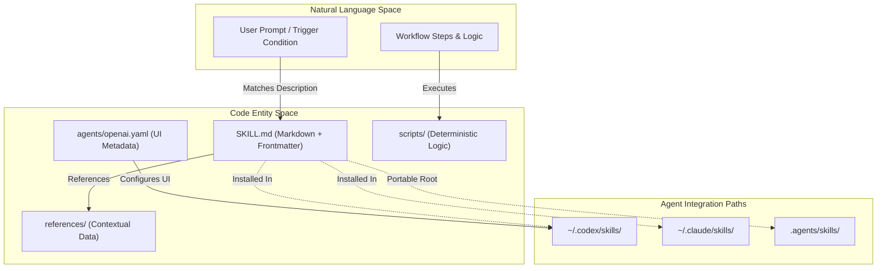
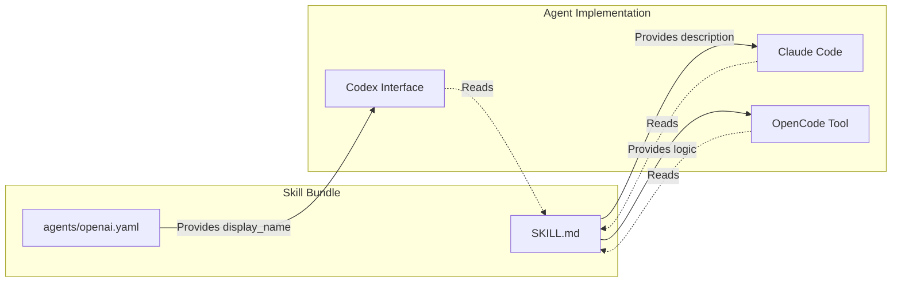

<!-- source: DeepWiki mcp.deepwiki.com · repo hqhq1025/skill-optimizer · page 5 SKILL.md Format & Agent Integration · fetched 2026-10-27 -->

# SKILL.md Format & Agent Integration

Relevant source files

The following files were used as context for generating this wiki page:

- [skills/skill-generalizer/agents/openai.yaml](skills/skill-generalizer/agents/openai.yaml)
- [skills/skill-generalizer/references/platform-compatibility.md](skills/skill-generalizer/references/platform-compatibility.md)
- [skills/skill-miner/agents/openai.yaml](skills/skill-miner/agents/openai.yaml)
- [skills/skill-personalizer/agents/openai.yaml](skills/skill-personalizer/agents/openai.yaml)

The `SKILL.md` file is the primary unit of workflow definition within the Skill Optimizer ecosystem. It serves as a bridge between Natural Language instructions and executable Code Entities, designed to be consumed by both human developers and LLM-based coding agents. This page defines the structure of a skill package and how it integrates with various agent environments.

### The Skill Package Structure

A standardized skill is not just a single Markdown file; it is a directory structure (a "bundle") that provides the agent with all necessary context, scripts, and metadata to execute a specific workflow.

| Component | Path | Purpose |
| :--- | :--- | :--- |
| **Core Logic** | `SKILL.md` | The primary instruction set, triggers, and workflow steps. |
| **Metadata** | `agents/openai.yaml` | UI-specific metadata for agents like Codex [skills/skill-generalizer/agents/openai.yaml:1-5](). |
| **Resources** | `references/` | Supporting documentation, rubrics, or pattern files used by the skill. |
| **Logic** | `scripts/` | Deterministic scripts (e.g., Python, Bash) called by the agent during the workflow. |

### SKILL.md Frontmatter & Body

The `SKILL.md` file uses a YAML frontmatter block for basic identification. To maintain cross-agent portability, the frontmatter is kept conservative, focusing on fields recognized by the broadest range of tools [skills/skill-generalizer/references/platform-compatibility.md:20-20]().

*   **`name`**: A unique, slug-style identifier for the skill.
*   **`description`**: A concise summary used by agents to decide when to trigger the skill [skills/skill-generalizer/references/platform-compatibility.md:10-10]().

The body of the file typically follows a standardized lifecycle (e.g., Trigger → Steps → Verification) to ensure the agent maintains state throughout the task.

### Natural Language to Code Entity Mapping

The following diagram illustrates how the abstract "Skill" concept in Natural Language space maps to concrete file entities and agent-specific discovery paths in the Code Entity space.

**Skill Discovery and Execution Map**

**Sources:** [skills/skill-generalizer/references/platform-compatibility.md:7-13](), [skills/skill-miner/agents/openai.yaml:1-5]().

### Agent Integration & Metadata

Different agents have varying levels of support for the skill format. While `SKILL.md` provides the instructions, the `agents/` directory holds platform-specific overrides.

#### Codex UI Metadata (`openai.yaml`)
For the Codex agent, an `openai.yaml` file in the `agents/` directory defines how the skill appears in the sidebar or command palette. It includes:
*   `display_name`: The human-readable title [skills/skill-miner/agents/openai.yaml:2-2]().
*   `short_description`: A one-sentence summary [skills/skill-personalizer/agents/openai.yaml:3-3]().
*   `default_prompt`: The initial instruction sent to the agent when the skill is manually invoked [skills/skill-generalizer/agents/openai.yaml:4-4]().

#### Cross-Agent Discovery
To ensure a skill is "portable," it should be placed in a directory structure that multiple agents can scan. The recommended portable path is `.agents/skills/<skill-name>/SKILL.md` [skills/skill-generalizer/references/platform-compatibility.md:17-17]().

**Agent Metadata Association**

**Sources:** [skills/skill-generalizer/references/platform-compatibility.md:9-12](), [skills/skill-miner/agents/openai.yaml:1-4]().

---

### Child Pages

#### [Supported Agents & Install Paths](#5.1)
Detailed installation guides for Codex, Claude Code, Cursor, OpenCode, and Gemini CLI. Covers native support shapes and recommended local vs. project-level install paths. For details, see [Supported Agents & Install Paths](#5.1).

#### [Machine-Readable Project Files](#5.2)
Reference for the metadata layer that allows agents to understand the repository as a whole, including `llms.txt`, `repo-metadata.json`, and site-data configurations. For details, see [Machine-Readable Project Files](#5.2).

**Sources:**
- [skills/skill-generalizer/references/platform-compatibility.md:1-24]()
- [skills/skill-miner/agents/openai.yaml:1-5]()
- [skills/skill-personalizer/agents/openai.yaml:1-5]()
- [skills/skill-generalizer/agents/openai.yaml:1-5]()

---

