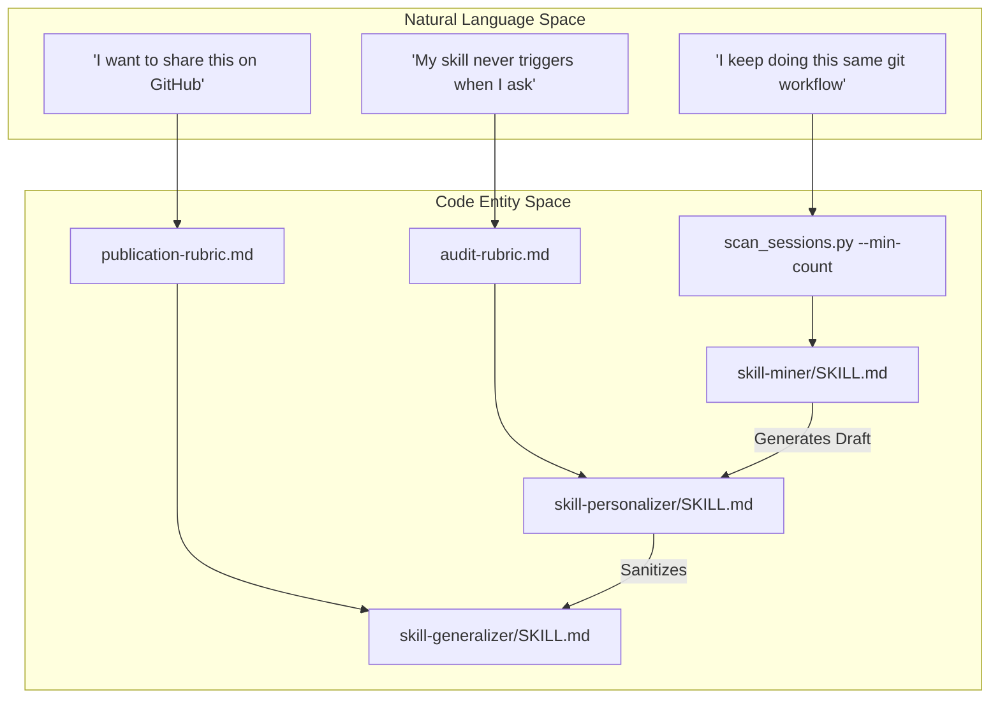

<!-- source: DeepWiki mcp.deepwiki.com · repo hqhq1025/skill-optimizer · page 7 Glossary · fetched 2026-10-27 -->

# Glossary

<details>
<summary>Relevant source files</summary>

The following files were used as context for generating this wiki page:

- [README.md](README.md)
- [docs/research-background.md](docs/research-background.md)
- [llms-full.txt](llms-full.txt)
- [skills/skill-generalizer/references/platform-compatibility.md](skills/skill-generalizer/references/platform-compatibility.md)
- [skills/skill-generalizer/references/publication-rubric.md](skills/skill-generalizer/references/publication-rubric.md)
- [skills/skill-miner/SKILL.md](skills/skill-miner/SKILL.md)
- [skills/skill-personalizer/references/audit-rubric.md](skills/skill-personalizer/references/audit-rubric.md)

</details>


This glossary defines the technical terms, architectural components, and domain-specific jargon used within the Skill Optimizer codebase. It serves as a reference for onboarding engineers to understand the mapping between natural language concepts and their implementation in the code.

## Core Concepts & Lifecycle

The Skill Optimizer operates on a three-stage lifecycle model designed to manage the evolution of agent capabilities from raw history to public distribution.

| Term | Definition | Implementation / Code Pointer |
| :--- | :--- | :--- |
| **Skill** | A structured directory containing a `SKILL.md` file and optional resources that provide an LLM agent with specific workflow instructions. | `skills/` directory structure [README.md:81-81]() |
| **Mining** | The process of scanning agent logs and session history to identify repeated patterns that should be formalized into skills. | `skill-miner` [skills/skill-miner/SKILL.md:10-10]() |
| **Personalization** | The act of auditing and tuning a skill to fit a specific user's local environment, tools, and phrasing. | `skill-personalizer` [skills/skill-personalizer/references/audit-rubric.md:3-3]() |
| **Generalization** | The process of removing private data and local dependencies from a skill to make it portable for public sharing. | `skill-generalizer` [skills/skill-generalizer/references/publication-rubric.md:21-21]() |
| **Trigger Fit** | A measure of how well a skill's `description` matches the natural language queries or intents expressed by a user. | `audit-rubric.md` dimension [skills/skill-personalizer/references/audit-rubric.md:15-15]() |

**Sources:** [README.md:7-9](), [llms-full.txt:13-23](), [skills/skill-miner/SKILL.md:10-11]()

## Technical Components

### Deterministic Session Scanner
The `scan_sessions.py` script is the primary tool for extracting data from various agent platforms. It avoids LLM hallucinations by using deterministic parsing and regex-based pattern matching.

**Key Functions and Arguments:**
*   `--days`: Limits the scan to a specific temporal window. [README.md:121-121]()
*   `--min-count`: The threshold of repetitions required before a workflow is flagged as a "candidate." [README.md:121-121]()
*   `--patterns`: A JSON configuration file defining regex patterns for specific workflows. [README.md:123-123]()
*   `--export`: Flag to ingest third-party JSON exports (e.g., Cursor chat). [llms-full.txt:51-53]()

### Rubrics
Rubrics are reference documents used by the agent to maintain consistency during the optimization process.
*   **Discovery Rubric**: Used by `skill-miner` to score candidates (1–5 scale). [skills/skill-miner/SKILL.md:41-43]()
*   **Audit Rubric**: Used by `skill-personalizer` to evaluate trigger fit, overtriggering, and token economics. [skills/skill-personalizer/references/audit-rubric.md:11-24]()
*   **Publication Rubric**: Used by `skill-generalizer` to ensure safety (redaction) and portability. [skills/skill-generalizer/references/publication-rubric.md:1-4]()

**Sources:** [README.md:115-125](), [skills/skill-miner/SKILL.md:45-46](), [skills/skill-personalizer/references/audit-rubric.md:1-24]()

## Natural Language to Code Mapping

The following diagrams bridge the gap between user-facing concepts and the specific files or scripts that handle them.

### Lifecycle Data Flow
This diagram shows how user session data transitions through the system components.


**Sources:** [README.md:17-21](), [llms-full.txt:11-23](), [skills/skill-miner/SKILL.md:21-30]()

### Agent Integration Mapping
This diagram maps the generic concept of an "Agent" to the specific implementation paths and metadata files used in the codebase.

```mermaid
graph LR
    subgraph "System Names"
        "Agent Skills Folder"
        "Codex Metadata"
        "Project Context"
        "Global Skills"
    end

    subgraph "Code Entities"
        "Agent Skills Folder" --> PATH1[".agents/skills/"]
        "Codex Metadata" --> FILE1["agents/openai.yaml"]
        "Project Context" --> FILE2["GEMINI.md"]
        "Global Skills" --> PATH2["~/.claude/skills/"]
    end
```
**Sources:** [README.md:71-81](), [skills/skill-generalizer/references/platform-compatibility.md:5-13]()

## Detailed Terminology Table

| Term | Implementation Detail | Source |
| :--- | :--- | :--- |
| **Candidate** | A workflow identified by `skill-miner` that meets the `min-count` threshold but has not yet been formalized. | [skills/skill-miner/SKILL.md:21-30]() |
| **Evidence** | Sanitized snippets or counts from `scan_sessions.py` used to justify a skill's existence. | [skills/skill-miner/SKILL.md:32-40]() |
| **Frontmatter** | The YAML block at the top of a `SKILL.md` file containing `name` and `description`. | [skills/skill-generalizer/references/publication-rubric.md:44-46]() |
| **Overtrigger** | A failure mode where a skill fires for tasks where it is not relevant, causing "prompt bloat." | [skills/skill-personalizer/references/audit-rubric.md:17-17]() |
| **P0/P1/P2 Fixes** | Priority levels used in the `Skill Audit Report` to categorize personalization tasks. | [skills/skill-personalizer/references/audit-rubric.md:57-64]() |
| **Progressive Disclosure** | The design principle of keeping the main `SKILL.md` short and moving details to `references/` or `scripts/`. | [docs/research-background.md:9-9]() |
| **Token Economics** | The practice of compressing or splitting skills to minimize the consumption of the LLM's context window. | [skills/skill-personalizer/references/audit-rubric.md:23-23]() |
| **Undertrigger** | A failure mode where a user intent exists but the agent fails to retrieve the relevant skill. | [skills/skill-personalizer/references/audit-rubric.md:16-16]() |

**Sources:** [docs/research-background.md:7-14](), [skills/skill-personalizer/references/audit-rubric.md:11-24](), [skills/skill-generalizer/references/publication-rubric.md:43-52]()