# Page: Overview

# Overview

<details>
<summary>Relevant source files</summary>

The following files were used as context for generating this wiki page:

- [.claude-plugin/plugin.json](.claude-plugin/plugin.json)
- [CHANGELOG.md](CHANGELOG.md)
- [LICENSE](LICENSE)
- [README.md](README.md)
- [repo-metadata.json](repo-metadata.json)

</details>


The **Skill Optimizer** is a lifecycle toolkit designed to manage the evolution of Agent Skills—structured `SKILL.md` files that guide AI coding agents. While LLMs are proficient at code generation, they often repeat the same workflow patterns or fail to account for a user's specific local environment. This project provides a specialized three-stage pipeline to capture, refine, and share these workflows.

The project shifted from a single optimizer in v1.0.0 to a modular three-skill system in v2.0.0 [CHANGELOG.md:3-12]().

## The Three-Stage Lifecycle

Skill Optimizer divides the skill management process into three distinct functional areas:

| Goal | Skill | Optimization Direction |
| :--- | :--- | :--- |
| **Discover** | `skill-miner` | Scans session history to cluster repeated workflows into candidate skills. |
| **Refine** | `skill-personalizer` | Adapts skills to local tools, paths, and user-specific phrasing. |
| **Distribute** | `skill-generalizer` | Strips private data and prepares skills for public portability. |

Sources: [README.md:15-22](), [repo-metadata.json:10-26]()

### Lifecycle Data Flow
The following diagram illustrates how a workflow moves from raw agent interactions to a shared public artifact.

**Skill Evolution Pipeline**
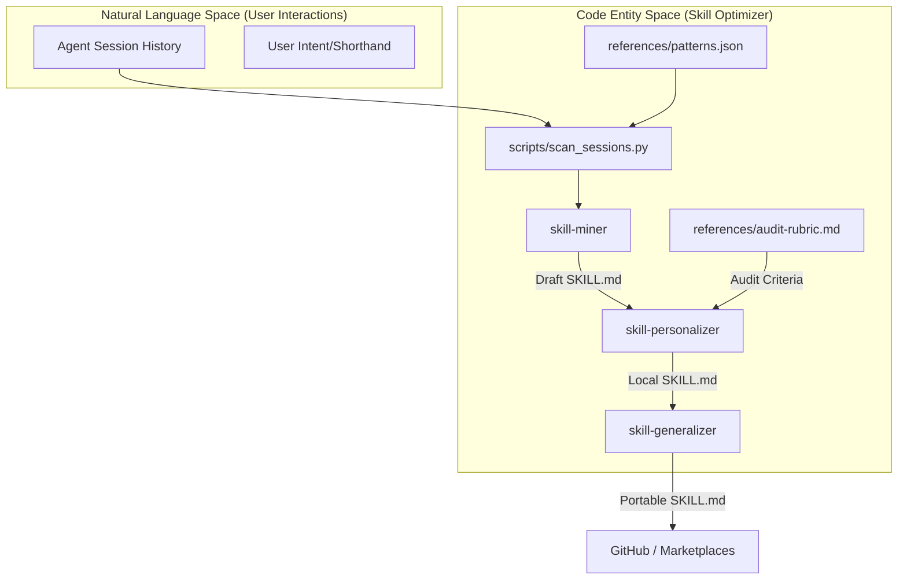
Sources: [README.md:107-141](), [CHANGELOG.md:14-16]()

## Supported Agents

The toolkit is built on the **Agent Skills** open format, ensuring compatibility across major AI coding interfaces. It supports discovery in personal, project, and plugin scopes [README.md:71-79]().

*   **Codex**: Native support via `~/.codex/skills/`.
*   **Claude Code**: Supports native skills in `~/.claude/skills/`.
*   **Cursor**: Discoverable via `.agents/skills/` or `.cursor/skills/`.
*   **OpenCode**: Native `skill` tool integration.
*   **Gemini CLI**: Compatible with the Agent Skills open format.

For detailed setup instructions, see [Getting Started & Installation](#1.1).

Sources: [README.md:71-81](), [repo-metadata.json:27-34]()

## System Architecture

The project bridges high-level user instructions with deterministic scripts and structured rubrics. 

**Component Mapping**
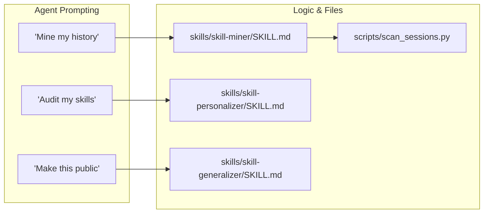
Sources: [README.md:83-106](), [repo-metadata.json:11-26]()

### Key Components
*   **`skill-miner`**: Uses `scripts/scan_sessions.py` to perform a deterministic scan of Codex archives, Claude Code logs, and Gemini task files [README.md:115-116](). For details, see [Architecture & Lifecycle Pipeline](#1.2).
*   **`skill-personalizer`**: Inherits the v1.0.0 audit checks, focusing on trigger fit, token economics, and environment consistency [README.md:140]().
*   **`skill-generalizer`**: Focuses on removing internal repository facts and generalizing examples for cross-agent portability [README.md:127-133]().

## Navigation Guide

*   **[Getting Started & Installation](#1.1)**: How to install the package and configure your agent.
*   **[Architecture & Lifecycle Pipeline](#1.2)**: Deep dive into the Mine → Personalize → Generalize flow.
*   **[Research Background & Design Rationale](#1.3)**: The academic foundations (Voyager, ExpeL, etc.) that inform the project's design.

For developers looking for machine-readable context, the repository includes `llms.txt`, `llms-full.txt`, and `repo-metadata.json` [README.md:156-162]().

---

# Page: Getting Started & Installation

# Getting Started & Installation

<details>
<summary>Relevant source files</summary>

The following files were used as context for generating this wiki page:

- [README.md](README.md)
- [README.zh-CN.md](README.zh-CN.md)
- [llms.txt](llms.txt)

</details>


This page provides a technical guide for installing and initializing the **Skill Optimizer** suite. Skill Optimizer is a lifecycle toolkit designed to manage the evolution of agent capabilities through three distinct phases: discovery (`skill-miner`), adaptation (`skill-personalizer`), and publication (`skill-generalizer`) [README.md:5-11]().

## Installation Overview

Skill Optimizer is distributed as a set of `SKILL.md` packages compatible with agents that support the **Agent Skills** folder convention [README.md:142-151](). Installation involves placing the skill directories into specific paths where the agent's discovery engine can index them.

### Supported Agents & Paths

The following table defines the recommended installation targets for supported coding agents:

| Agent | Support Level | Recommended Installation Path |
| :--- | :--- | :--- |
| **Codex** | Native Agent Skills + Plugin Metadata | `~/.codex/skills/` |
| **Claude Code** | Native (Personal, Project, Plugin scopes) | `~/.claude/skills/` |
| **Cursor** | Native Agent Skills & Rules | `.cursor/skills/` or `~/.agents/skills/` |
| **OpenCode** | Native `skill` tool | `~/.config/opencode/skills/` |
| **Gemini CLI** | `GEMINI.md` context mechanism | `.agents/skills/` |

**Sources:** [README.md:71-81](), [README.md:142-151]()

---

## Installation Methods

### 1. Natural Language Installation (Recommended)
Most modern agents can perform self-installation if provided with the repository URL. This triggers the agent to clone the repository and move the relevant directories to its internal skill storage.

**Claude Code:**
```text
Install the skills from https://github.com/hqhq1025/skill-optimizer
```

**Codex:**
```text
Install the skills from https://github.com/hqhq1025/skill-optimizer into ~/.codex/skills/
```

**General Agent Skills compatible agents:**
```text
Install the skills from https://github.com/hqhq1025/skill-optimizer into ~/.agents/skills/
```

**Sources:** [README.md:25-46]()

### 2. Manual CLI Installation
For environments where the agent lacks filesystem write permissions for its own configuration directory, use the following shell sequence to deploy the full suite:

```bash
# Clone the repository to a temporary location
git clone https://github.com/hqhq1025/skill-optimizer.git /tmp/skill-optimizer

# Create the target directory (example for generic agents)
mkdir -p ~/.agents/skills

# Copy the three core skill packages
cp -r /tmp/skill-optimizer/skills/skill-miner ~/.agents/skills/
cp -r /tmp/skill-optimizer/skills/skill-personalizer ~/.agents/skills/
cp -r /tmp/skill-optimizer/skills/skill-generalizer ~/.agents/skills/

# Cleanup
rm -rf /tmp/skill-optimizer
```

**Sources:** [README.md:47-67]()

---

## Technical Architecture & Data Flow

The installation places three primary entities into the agent's runtime environment. These entities interact with the local filesystem and session history to manage the skill lifecycle.

### Natural Language to Code Entity Mapping
The following diagram illustrates how natural language intents provided by the user map to specific code entities and scripts within the installed package.

**Intent Mapping and Execution Flow**
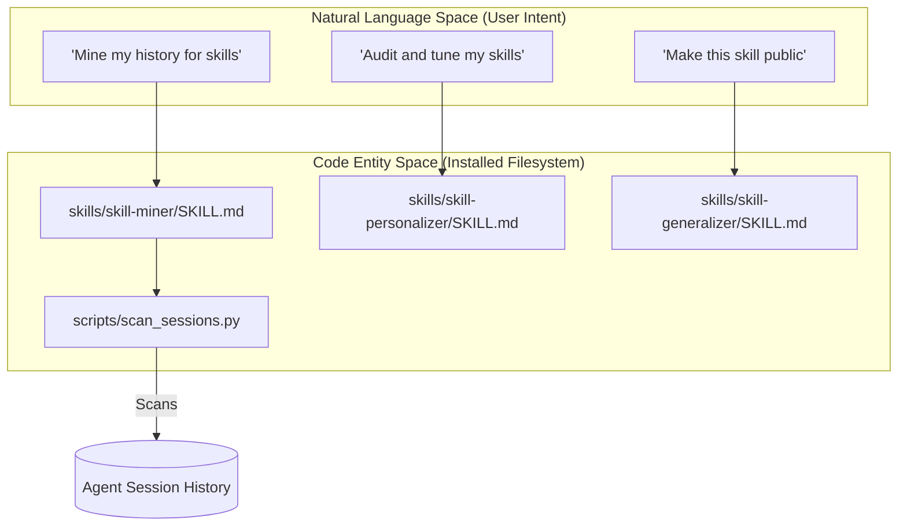
**Sources:** [README.md:83-106](), [README.md:109-115](), [llms.txt:7-11]()

### Directory Structure & Convention
Once installed, the `skills/` directory follows a standardized layout to ensure cross-agent compatibility. Each skill is self-contained.

**Skill Package Internal Structure**
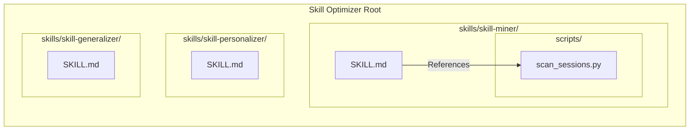
**Sources:** [README.md:107-141](), [llms.txt:23-25]()

---

## First-Use Prompts

After installation, verify the setup by invoking the primary workflows. These prompts trigger the `SKILL.md` instructions loaded into the agent's context.

### 1. Mining Discovery
To identify recurring patterns in your work that should be automated:
> "Mine my coding-agent history and find repeated workflows that should become skills."

This command utilizes `skill-miner` to invoke `scripts/scan_sessions.py` [README.md:87-89](), [README.md:115-116]().

### 2. Personalization & Auditing
To optimize a skill you just created or downloaded:
> "I downloaded this skill. Tune it to my local workflow and usage habits."

This triggers `skill-personalizer` to perform audit checks on trigger fit, environment consistency, and tool preferences [README.md:99-101](), [README.md:134-141]().

### 3. Generalization for Export
To prepare a local skill for a GitHub repository:
> "Turn this local skill into a public GitHub-ready skill."

This invokes `skill-generalizer` to strip private paths and credentials while standardizing frontmatter [README.md:95-97](), [README.md:127-133]().

**Sources:** [README.md:83-106](), [README.md:107-141]()

---

# Page: Architecture & Lifecycle Pipeline

# Architecture & Lifecycle Pipeline

<details>
<summary>Relevant source files</summary>

The following files were used as context for generating this wiki page:

- [.claude-plugin/plugin.json](.claude-plugin/plugin.json)
- [CHANGELOG.md](CHANGELOG.md)
- [LICENSE](LICENSE)
- [llms-full.txt](llms-full.txt)
- [llms.txt](llms.txt)

</details>


The Skill Optimizer architecture is built around a three-stage lifecycle: **Mine**, **Personalize**, and **Generalize**. This pipeline transforms raw, ephemeral agent interactions into structured, high-quality, and portable `SKILL.md` artifacts [llms-full.txt:11-23](). By decoupling discovery from refinement and publication, the system ensures that skills are grounded in actual usage history before being tuned for local environments or shared with the community.

## The Three-Stage Lifecycle

The pipeline follows a linear progression for new skills, though existing skills can enter at the Personalize or Generalize stages [CHANGELOG.md:9-13]().

### 1. Mine (Discovery)
The `skill-miner` component identifies repeated workflows from coding-agent histories, archived sessions, and exported transcripts [llms.txt:9-9](). It uses a deterministic scanner to find patterns that warrant formalization into a skill [CHANGELOG.md:14-16]().

### 2. Personalize (Audit & Tuning)
The `skill-personalizer` takes a candidate or existing skill and audits it against local environmental factors. This includes tuning triggers, paths, aliases, and user-specific validation habits [llms-full.txt:18-19](). It inherits the core "optimizer" logic from previous versions to fix trigger fit and token economics [CHANGELOG.md:13-13]().

### 3. Generalize (Publication)
The `skill-generalizer` prepares skills for public distribution. It strips private data (credentials, hostnames, local paths) and ensures the skill is compatible across different agents like Codex, Claude Code, and Cursor [llms-full.txt:21-23]().

### Data Flow Overview

The following diagram illustrates the flow from raw agent logs to a finalized public skill.

**Diagram: Skill Lifecycle Data Flow**
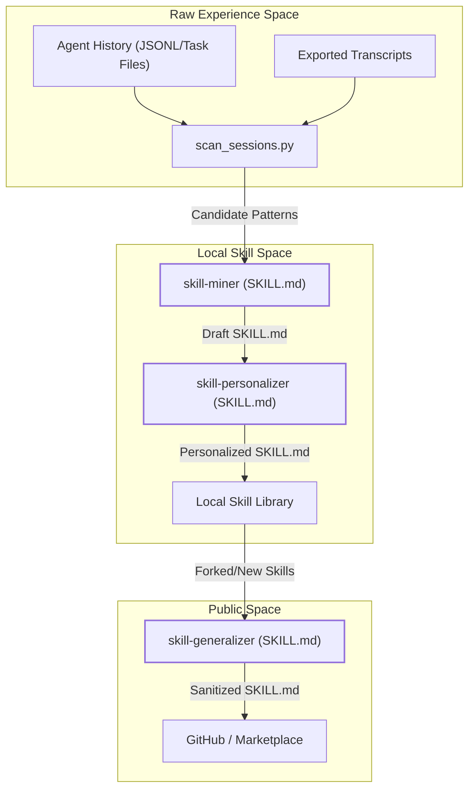
**Sources:** [llms.txt:7-11](), [llms-full.txt:11-23](), [CHANGELOG.md:9-16]()

---

## Technical Implementation & Entity Mapping

The architecture bridges the gap between high-level lifecycle concepts and specific code entities. Each stage is implemented as a standalone `SKILL.md` package that an agent can execute [llms.txt:7-11]().

### Entity Mapping: Natural Language to Code
This table maps lifecycle concepts to their corresponding file system entities and classes.

| Lifecycle Stage | Logical Entity | Code Entity / Path |
| :--- | :--- | :--- |
| **Mine** | Session Scanner | `skills/skill-miner/scripts/scan_sessions.py` |
| **Mine** | Workflow Patterns | `skills/skill-miner/references/patterns.json` |
| **Personalize** | Audit Logic | `skills/skill-personalizer/SKILL.md` |
| **Generalize** | Publication Rules | `skills/skill-generalizer/SKILL.md` |
| **Integration** | Codex Metadata | `agents/openai.yaml` |
| **Integration** | Claude Metadata | `.claude-plugin/plugin.json` |

**Sources:** [CHANGELOG.md:14-20](), [llms.txt:23-25](), [.claude-plugin/plugin.json:1-4]()

### Detailed Pipeline Logic

The transition between stages is managed by the agent interpreting the `SKILL.md` files. The deterministic `scan_sessions.py` script serves as the entry point for the "Mine" stage, extracting data into a format the LLM can process [llms-full.txt:43-47]().

**Diagram: Code Entity Interaction**
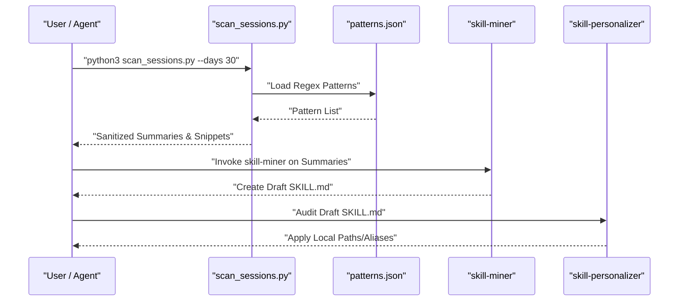
**Sources:** [llms-full.txt:43-59](), [CHANGELOG.md:14-16](), [llms-full.txt:82-84]()

---

## Component Roles

### skill-miner
*   **Role**: Pattern Recognition.
*   **Input**: `scan_sessions.py` output, raw history, rollout summaries [llms-full.txt:15-15]().
*   **Output**: A draft `SKILL.md` with defined triggers and a workflow skeleton.
*   **Key Files**: `skills/skill-miner/SKILL.md`, `skills/skill-miner/scripts/scan_sessions.py` [llms.txt:23-23]().

### skill-personalizer
*   **Role**: Optimization & Grounding.
*   **Input**: Any `SKILL.md` (draft, forked, or existing).
*   **Audit Dimensions**: Trigger fit, undertrigger, overtrigger, user reaction, workflow completion, static quality, cross-skill conflicts, environment consistency, and token economics [llms-full.txt:19-19]().
*   **Key Files**: `skills/skill-personalizer/SKILL.md` [llms.txt:24-24]().

### skill-generalizer
*   **Role**: Sanitization & Portability.
*   **Input**: A local/personal skill.
*   **Actions**: Removes private paths, hostnames, and platform-specific assumptions [llms-full.txt:23-23]().
*   **Key Files**: `skills/skill-generalizer/SKILL.md` [llms.txt:25-25]().

**Sources:** [llms.txt:9-11](), [llms-full.txt:13-23](), [CHANGELOG.md:9-13]()

---

# Page: Research Background & Design Rationale

# Research Background & Design Rationale

<details>
<summary>Relevant source files</summary>

The following files were used as context for generating this wiki page:

- [CITATION.cff](CITATION.cff)
- [docs/research-background.md](docs/research-background.md)
- [llms-full.txt](llms-full.txt)

</details>


This page details the academic and empirical foundations of the Skill Optimizer toolkit. It explains how specific research insights from the fields of LLM agents, externalized memory, and long-context modeling directly inform the architecture of the `skill-miner`, `skill-personalizer`, and `skill-generalizer` components.

## Theoretical Foundations

The Skill Optimizer project is built upon the premise that agent capabilities should be treated as lifecycle-managed infrastructure rather than static prompts [docs/research-background.md:3-3](). By externalizing experience into reusable artifacts, agents can improve without the need for expensive model weight updates.

### 1. Externalized Memory & Skill Libraries
Research in **Memento-Skills**, **Reflexion**, and **ExpeL** demonstrates that agents can improve performance by storing feedback and structured workflows in external memory [docs/research-background.md:10-10]().

*   **Design Decision:** The `skill-miner` acts as the primary "Acquisition" engine, scanning session histories and rollout summaries to extract repeated workflows [llms-full.txt:13-15]().
*   **Implementation:** Instead of manual prompt engineering, the system uses `scan_sessions.py` to deterministically identify candidate signals from raw logs [llms-full.txt:43-47]().

### 2. Iterative Refinement & Verification
**Voyager** highlighted the importance of execution feedback and self-verification in building durable skill libraries [docs/research-background.md:13-13]().

*   **Design Decision:** The `skill-personalizer` includes explicit "workflow completion" and "environment consistency" checks [llms-full.txt:18-19]().
*   **Implementation:** The `audit-rubric.md` (referenced in the personalization lifecycle) requires evidence of successful execution before a skill is considered stable [docs/research-background.md:13-13]().

### 3. Routing Quality & Retrieval Accuracy
**RAG-MCP** and research into **MCP tool descriptions** suggest that as a skill library grows, the primary bottleneck becomes "routing quality" (triggering the right skill at the right time) rather than the content of the skill itself [docs/research-background.md:11-11]().

*   **Design Decision:** The toolkit prioritizes "Trigger Fit" and "Undertrigger/Overtrigger" audits over simple text editing [llms-full.txt:18-19]().
*   **Implementation:** The `skill-personalizer` focuses on tuning descriptions to prevent cross-skill conflicts and prompt bloat [docs/research-background.md:11-11]().

### 4. Long-Context Management
The **"Lost in the Middle"** phenomenon shows that LLMs utilize information most effectively at the beginning or end of a prompt [docs/research-background.md:12-12]().

*   **Design Decision:** `SKILL.md` files utilize a strict frontmatter-first structure to ensure critical trigger and safety details are presented to the agent immediately [docs/research-background.md:12-12]().
*   **Implementation:** Detailed logic is offloaded to the `references/` or `scripts/` directories to keep the main skill definition concise [docs/research-background.md:9-9]().

**Sources:** [docs/research-background.md:1-15](), [llms-full.txt:67-77]()

---

## Mapping Research to Code Entities

The following diagram bridges the gap between high-level research concepts and the specific files and functions implemented in the repository.

### Research-to-Implementation Mapping

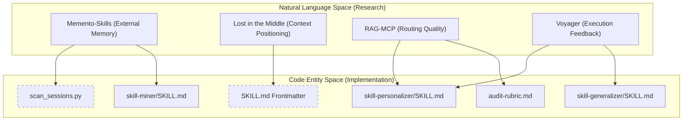

**Sources:** [docs/research-background.md:7-14](), [llms-full.txt:11-23](), [llms-full.txt:67-77]()

---

## Design Rationale: The Three-Stage Lifecycle

The toolkit enforces a separation of concerns between discovery, tuning, and sharing. This design is informed by the "Agent Skills for LLMs" survey, which argues for lifecycle governance and security in community skills [docs/research-background.md:14-14]().

| Stage | Research Driver | Implementation Focus | Key Artifacts |
| :--- | :--- | :--- | :--- |
| **Mine** | *ExpeL / Memento-Skills* | Deterministic signal detection from logs. | `scan_sessions.py`, `patterns.json` |
| **Personalize** | *RAG-MCP / Reflexion* | Local environment fit and routing accuracy. | `audit-rubric.md`, `skill-personalizer` |
| **Generalize** | *Security / Governance* | Redaction and platform portability. | `publication-rubric.md`, `skill-generalizer` |

### Data Flow: From Session History to Public Skill

The following diagram illustrates how raw data transitions through the system, mapping specific script arguments and rubric checks to the data flow.

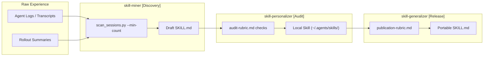

**Sources:** [llms-full.txt:11-23](), [llms-full.txt:43-65](), [docs/research-background.md:30-36]()

---

## Design Claims & Constraints

1.  **Portability over Monoliths:** Skills are stored as individual `SKILL.md` files with conservative frontmatter to ensure they work across Codex, Claude Code, Cursor, and OpenCode [llms-full.txt:79-80]().
2.  **Deterministic Mining:** While LLMs are used for candidate evaluation, the initial discovery is handled by `scan_sessions.py` to ensure consistency and efficiency [docs/research-background.md:34-34]().
3.  **Privacy First:** The `skill-miner` is designed to emit sanitized summaries. Raw transcripts remain local by default, addressing the security concerns raised in the "Agent Skills for LLMs" survey [llms-full.txt:82-84](), [docs/research-background.md:14-14]().
4.  **Audit-Centric Tuning:** The `skill-personalizer` does not just "fix" a skill; it audits it against nine specific dimensions, including token economics and cross-skill conflicts [llms-full.txt:18-19]().

**Sources:** [docs/research-background.md:7-15](), [llms-full.txt:78-85]()

---

# Page: skill-miner

# skill-miner

<details>
<summary>Relevant source files</summary>

The following files were used as context for generating this wiki page:

- [skills/skill-miner/SKILL.md](skills/skill-miner/SKILL.md)
- [skills/skill-miner/agents/openai.yaml](skills/skill-miner/agents/openai.yaml)

</details>


The `skill-miner` component is the discovery engine of the Skill Optimizer lifecycle. Its primary purpose is to analyze agent session history, archived transcripts, and local project work to identify recurring workflows that are candidates for formalization into new Agent Skills. Instead of brainstorming skills from scratch, `skill-miner` uses empirical evidence from real-world usage to ensure new skills address actual friction points and repeated manual tasks.

## Purpose and Scope

`skill-miner` acts as the entry point for the "Mine" stage of the Mine → Personalize → Generalize pipeline. It is designed to bridge the gap between raw session logs and structured skill definitions.

- **Objective**: Discover reusable techniques, extract them from project-specific contexts, and score them based on their potential value as a permanent skill [skills/skill-miner/SKILL.md:10-10]().
- **When to Invoke**: Use this component when a user wants to scan past coding-agent sessions, when a team needs a backlog of skills based on actual work, or when recurring procedures are identified in project notes but haven't been packaged yet [skills/skill-miner/SKILL.md:14-17]().
- **Exclusions**: It should not be used for tuning existing skills (use `skill-personalizer`) or publishing private skills (use `skill-generalizer`) [skills/skill-miner/SKILL.md:19-19]().

### Component Architecture

The following diagram illustrates how the `skill-miner` component interacts with session data and the broader codebase to produce skill candidates.

**Figure 1: Skill Mining Data Flow**
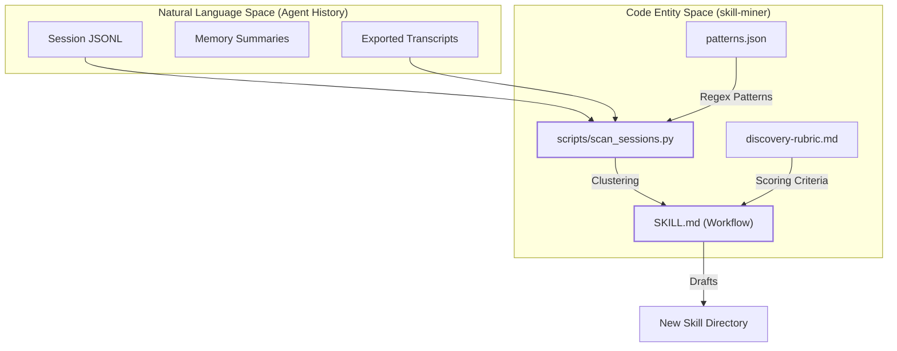
Sources: [skills/skill-miner/SKILL.md:23-28](), [skills/skill-miner/SKILL.md:43-46]()

## Core Components

The mining process is governed by three primary sub-components that manage data ingestion, pattern matching, and qualitative evaluation.

### 1. SKILL.md & Workflow
The `skill-miner` is itself an Agent Skill defined in its own `SKILL.md`. It provides the LLM with an eight-step workflow to locate evidence, run the deterministic scanner, cluster work by intent, and score candidates [skills/skill-miner/SKILL.md:21-30](). It includes specific "Evidence Rules" to ensure that findings are justified by quotes or summaries without exposing sensitive content [skills/skill-miner/SKILL.md:32-40]().

For details, see [skill-miner: SKILL.md & Workflow](#2.1).

### 2. scan_sessions.py: Session Scanner
This Python script provides a deterministic first pass over local session files. It supports various data sources including Codex JSONL, Claude Code, and Gemini task files [skills/skill-miner/SKILL.md:45-46](). The script allows users to filter by date ranges, minimum occurrence counts, and specific workflow patterns.

For details, see [scan_sessions.py: Session Scanner](#2.2).

### 3. Discovery Rubric & Patterns
The discovery process is guided by two reference files:
- **`discovery-rubric.md`**: Provides the scoring system (1–5 scale) and dimensions (recurrence, friction, risk, portability) used to evaluate if a candidate is worth developing [skills/skill-miner/SKILL.md:27-27](), [skills/skill-miner/SKILL.md:43-43]().
- **`patterns.json`**: Contains the regex-based definitions for identifying specific workflows during the scanning phase.

For details, see [skill-miner: Discovery Rubric & Patterns](#2.3).

## Integration and Interface

The `skill-miner` is exposed to agents via a standard interface configuration, allowing it to be triggered by natural language requests such as "Scan my coding-agent history" [skills/skill-miner/agents/openai.yaml:4-4]().

**Figure 2: System Integration**
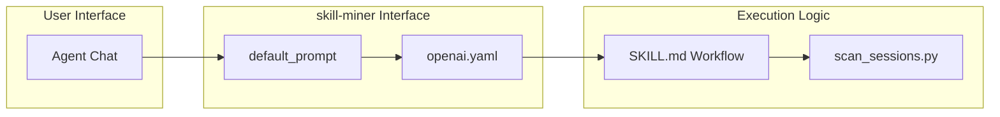
Sources: [skills/skill-miner/agents/openai.yaml:1-5](), [skills/skill-miner/SKILL.md:21-31]()

- **Display Name**: Skill Miner [skills/skill-miner/agents/openai.yaml:2-2]()
- **Short Description**: Mine agent history for reusable skill candidates [skills/skill-miner/agents/openai.yaml:3-3]()

Sources:
- [skills/skill-miner/SKILL.md:1-46]()
- [skills/skill-miner/agents/openai.yaml:1-5]()

---

# Page: skill-miner: SKILL.md & Workflow

# skill-miner: SKILL.md & Workflow

<details>
<summary>Relevant source files</summary>

The following files were used as context for generating this wiki page:

- [skills/skill-miner/SKILL.md](skills/skill-miner/SKILL.md)
- [skills/skill-miner/references/discovery-rubric.md](skills/skill-miner/references/discovery-rubric.md)

</details>


The `skill-miner` is the entry point of the Skill Optimizer lifecycle. Its purpose is to discover candidate skills by analyzing agent session history, archived transcripts, and repeated local work patterns. By extracting reusable techniques from real-world usage, it transforms manual, repetitive tasks into structured, documented Agent Skills.

## Overview and Trigger Conditions

The `skill-miner` is invoked when a user or team needs to move from ad-hoc task execution to a systematic automation backlog. It focuses on identifying workflows that have already occurred naturally in the user's environment.

### When To Use
*   **Session Scanning:** When a user wants to scan past coding-agent sessions for repeated workflows [skills/skill-miner/SKILL.md:14-14]().
*   **Manual Task Fatigue:** When a user suspects they are manually asking agents to perform similar tasks repeatedly [skills/skill-miner/SKILL.md:15-15]().
*   **Evidence-Based Backlog:** When a team requires a backlog of skills based on actual historical data rather than brainstorming [skills/skill-miner/SKILL.md:16-16]().
*   **Unpackaged Procedures:** When existing memories, session logs, or project notes contain recurring procedures that lack a formal package [skills/skill-miner/SKILL.md:17-17]().

**Constraint:** Do not use `skill-miner` to tune existing skills (use `skill-personalizer`) or to publish private skills (use `skill-generalizer`) [skills/skill-miner/SKILL.md:19-19]().

Sources: [skills/skill-miner/SKILL.md:1-20]()

---

## The Eight-Step Mining Workflow

The mining process follows a structured sequence to move from raw data to a draft skill.

### Mining Workflow Diagram
This diagram maps the logical workflow steps to the technical entities and scripts involved in the process.

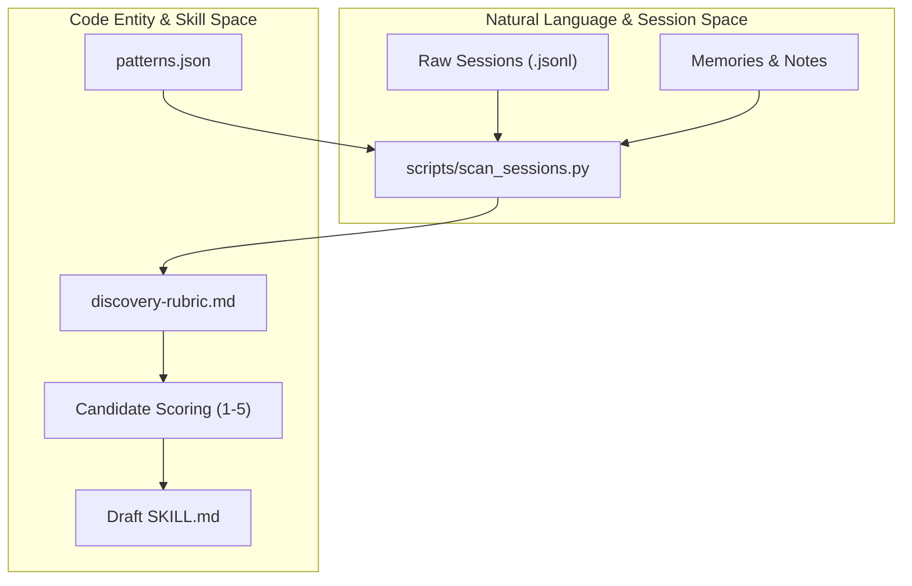

### Workflow Steps
1.  **Locate Evidence:** Gather session JSONL files, memory summaries, repo notes, and repeated scripts [skills/skill-miner/SKILL.md:23-23]().
2.  **Sanitized Clustering:** Run `scripts/scan_sessions.py` to generate a first-pass report of activity clusters [skills/skill-miner/SKILL.md:24-24]().
3.  **Cluster Analysis:** Group work by intent, trigger phrasing, tools used, and verification patterns [skills/skill-miner/SKILL.md:25-25]().
4.  **Filtering:** Remove one-off tasks or generic coding knowledge that belongs in base models or `AGENTS.md` [skills/skill-miner/SKILL.md:26-26]().
5.  **Scoring:** Evaluate candidates based on recurrence, friction, risk, and portability [skills/skill-miner/SKILL.md:27-27]().
6.  **Drafting:** Create concise skill names, trigger descriptions, and workflow outlines for high-scoring candidates [skills/skill-miner/SKILL.md:28-28]().
7.  **Recommendation:** Determine if the skill should remain personal or be generalized for public use [skills/skill-miner/SKILL.md:29-29]().
8.  **Creation:** Build the skill folder structure and verify the frontmatter/layout [skills/skill-miner/SKILL.md:30-30]().

Sources: [skills/skill-miner/SKILL.md:21-31]()

---

## Evidence Sources & Scanning

The `skill-miner` identifies evidence across multiple agent platforms. The `scan_sessions.py` script acts as the deterministic engine for this discovery.

### Evidence Mapping
| Source | Path Example | Data Extracted |
| :--- | :--- | :--- |
| **Codex** | `~/.codex/sessions/**/*.jsonl` | User asks, tool patterns, repeated fixes [skills/skill-miner/references/discovery-rubric.md:11-11](). |
| **Claude Code** | `~/.claude/projects/**/*.jsonl` | Tool calls, skill usage, rejected workflows [skills/skill-miner/references/discovery-rubric.md:14-14](). |
| **Gemini** | `~/.gemini/` | Task files, implementation plans [skills/skill-miner/references/discovery-rubric.md:16-16](). |
| **Project Notes** | `AGENTS.md`, `CLAUDE.md` | Already documented local workflows [skills/skill-miner/references/discovery-rubric.md:19-19](). |

### Technical Implementation: scan_sessions.py
The scanner uses `references/patterns.json` to identify workflows via regex. It supports several flags for data ingestion:
*   `--days 30`: Limits the scan to recent history [skills/skill-miner/references/discovery-rubric.md:27-27]().
*   `--export`: Imports transcripts from agents without stable local history formats (e.g., Cursor, OpenCode) [skills/skill-miner/references/discovery-rubric.md:33-33]().
*   `--patterns`: Allows using a custom pattern file for personalized discovery [skills/skill-miner/references/discovery-rubric.md:39-39]().

Sources: [skills/skill-miner/references/discovery-rubric.md:5-45]()

---

## Candidate Scoring & Evaluation

Not every repeated task warrants a skill. Candidates are scored on a 1–5 scale to determine priority.

### Scoring Rubric
| Score | Meaning | Action |
| :--- | :--- | :--- |
| **5** | High-value, non-obvious, likely mishandled by vanilla agents. | Create Immediately |
| **4** | Repeated and useful with clear triggers. | Create |
| **3** | Plausible, but requires more evidence or narrower scope. | Backlog |
| **2** | Project-specific or better suited as documentation. | Skip |
| **1** | Generic, risky, or one-off. | Skip |

### Signal Detection
Strong candidates are identified by:
*   **Recurrence:** User asked for the same work at least 3 times [skills/skill-miner/references/discovery-rubric.md:50-50]().
*   **Sequencing:** Workflow requires non-obvious local judgment or multi-step sequencing [skills/skill-miner/references/discovery-rubric.md:51-51]().
*   **Agent Failure:** Agents frequently miss steps or stop before verification [skills/skill-miner/references/discovery-rubric.md:52-52]().
*   **Cross-Tooling:** Task involves multiple tools (Shell, GitHub, Browser, SSH) [skills/skill-miner/references/discovery-rubric.md:53-53]().

Sources: [skills/skill-miner/references/discovery-rubric.md:46-88]()

---

## Evidence Rules & Creation Standards

When finalizing a skill draft, the `skill-miner` must adhere to strict evidence and formatting rules to ensure privacy and utility.

### Data Flow: From Session to SKILL.md
This diagram illustrates how raw session data is filtered and structured into the final `SKILL.md` format.

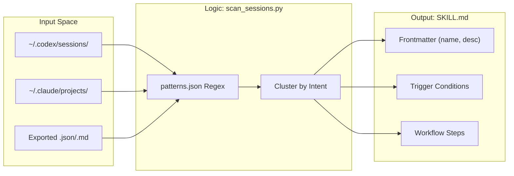

### Critical Rules
*   **Privacy:** Do not expose sensitive transcript content; summarize or sanitize raw evidence [skills/skill-miner/SKILL.md:35-35]().
*   **Precision:** Avoid broad clusters like `debug` or `frontend`. Create skills only from narrow, confirmed workflows [skills/skill-miner/references/discovery-rubric.md:102-102]().
*   **Validation:** Before creating, manually inspect at least 5 positive and 3 near-miss examples to tighten trigger regexes [skills/skill-miner/references/discovery-rubric.md:44-44]().
*   **Structure:** Keep `SKILL.md` frontmatter limited to `name` and `description`. Move long examples or scripts into a `references/` or `scripts/` subfolder [skills/skill-miner/references/discovery-rubric.md:114-116]().

Sources: [skills/skill-miner/SKILL.md:32-40](), [skills/skill-miner/references/discovery-rubric.md:89-119]()

---

# Page: scan_sessions.py: Session Scanner

# scan_sessions.py: Session Scanner

<details>
<summary>Relevant source files</summary>

The following files were used as context for generating this wiki page:

- [skills/skill-miner/references/patterns.json](skills/skill-miner/references/patterns.json)
- [skills/skill-miner/scripts/scan_sessions.py](skills/skill-miner/scripts/scan_sessions.py)

</details>


The `scan_sessions.py` script is a deterministic discovery tool designed to bridge the gap between raw agent activity and structured skill candidates. It functions as the primary ingestion engine for the **Mine** stage of the skill lifecycle, scanning local directories and exported transcripts to identify recurring workflow patterns.

## Purpose and Scope

The scanner does not perform full transcript exportation; instead, it emits sanitized metadata and short snippets to serve as a first-pass miner for skill candidates [skills/skill-miner/scripts/scan_sessions.py:2-6](). By analyzing the frequency of specific tool usage and intent-based keyword matching, it provides the evidence required for the `discovery-rubric.md` to score and categorize potential skills.

## Architecture and Data Flow

The script follows a linear pipeline: gathering files from multiple agent-specific directories, parsing heterogeneous formats into a unified `SessionRecord`, and finally aggregating these records into a summarized report.

### Data Ingestion Pipeline

The scanner supports a wide array of data sources, ranging from local agent databases to manual exports.

| Source Type | Default Path / Pattern | Code Entity |
| :--- | :--- | :--- |
| **Codex** | `~/.codex/sessions`, `~/.codex/memories/rollout_summaries` | `parse_codex`, `parse_rollout` |
| **Claude Code** | `~/.claude/projects`, `~/.claude/sessions` | `parse_claude_project`, `parse_claude_session` |
| **Gemini** | `~/.gemini` (Task files) | `parse_gemini_task` |
| **Generic Exports** | `.jsonl`, `.json`, `.md`, `.txt` | `parse_generic_export` |

**Data Flow Diagram**

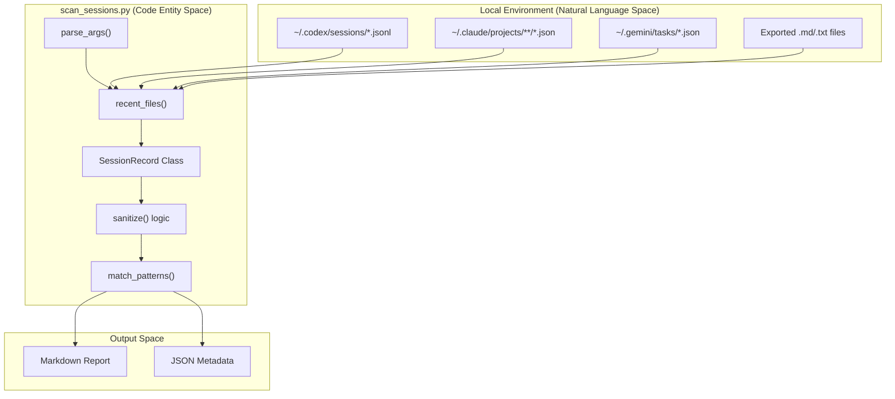
Sources: [skills/skill-miner/scripts/scan_sessions.py:44-57](), [skills/skill-miner/scripts/scan_sessions.py:59-86](), [skills/skill-miner/scripts/scan_sessions.py:103-120]()

## Key Implementation Details

### SessionRecord Dataclass
The `SessionRecord` class is the internal representation of a coding session. It normalizes data across platforms, capturing the working directory (`cwd`), user messages, assistant responses, and a `Counter` of tool invocations [skills/skill-miner/scripts/scan_sessions.py:44-52]().

### Sanitization Logic
To ensure privacy before any LLM processing, the `sanitize()` function applies several regex-based filters:
*   **User Paths**: Replaces `/Users/username` with `/Users/<user>` [skills/skill-miner/scripts/scan_sessions.py:140]().
*   **Identifiable Info**: Masks email addresses and common API tokens (GitHub, Slack, etc.) [skills/skill-miner/scripts/scan_sessions.py:141-142]().
*   **Formatting**: Collapses whitespace and truncates long strings to 180 characters [skills/skill-miner/scripts/scan_sessions.py:143-144]().

### Pattern Matching
The scanner uses two layers of pattern matching to identify "intents":
1.  **Hardcoded Intents**: A dictionary of regexes for common operations like `review`, `debug`, `publish`, and `research` [skills/skill-miner/scripts/scan_sessions.py:20-31]().
2.  **External Patterns**: Loads `patterns.json` to identify project-specific workflows such as `codex-coproxy-recovery` or `wechat-wxcli-real-data` [skills/skill-miner/references/patterns.json:1-48]().

## CLI Reference

The script provides granular control over the scanning window and the depth of the search.

| Flag | Default | Description |
| :--- | :--- | :--- |
| `--days` | `30` | How many days back to scan for session files [skills/skill-miner/scripts/scan_sessions.py:69](). |
| `--limit` | `300` | Maximum number of files to process per source [skills/skill-miner/scripts/scan_sessions.py:70](). |
| `--min-count` | `3` | Minimum occurrences required to report a workflow pattern [skills/skill-miner/scripts/scan_sessions.py:71](). |
| `--patterns` | `patterns.json` | Path to the JSON file defining custom workflow regexes [skills/skill-miner/scripts/scan_sessions.py:81-84](). |
| `--export` | `[]` | Additional paths to scan (can be files or directories) [skills/skill-miner/scripts/scan_sessions.py:75-79](). |
| `--json` | `False` | If set, outputs raw data instead of the formatted Markdown report [skills/skill-miner/scripts/scan_sessions.py:85](). |

Sources: [skills/skill-miner/scripts/scan_sessions.py:59-86]()

## Logic Flow: Discovery to Summary

The following diagram illustrates how the script processes raw text into a prioritized list of skill candidates.

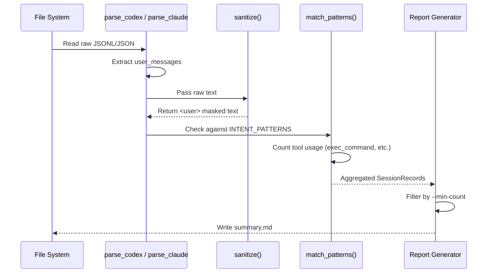
Sources: [skills/skill-miner/scripts/scan_sessions.py:139-145](), [skills/skill-miner/scripts/scan_sessions.py:169-188](), [skills/skill-miner/scripts/scan_sessions.py:20-31]()

## Output Format

By default, the script generates a Markdown report organized by **Workflow Patterns**. Each pattern includes:
*   **Frequency**: How many sessions matched the pattern.
*   **Recent Examples**: Sanitized snippets of user prompts.
*   **Associated Directories**: The `cwd` where these tasks typically occur.
*   **Tool Profile**: Common tools used during these sessions (e.g., `apply_patch` vs `tool_search`).

This output is designed to be piped directly into a `SKILL.md` creation prompt or used as the basis for the `discovery-rubric.md` evaluation.

---

# Page: skill-miner: Discovery Rubric & Patterns

# skill-miner: Discovery Rubric & Patterns

<details>
<summary>Relevant source files</summary>

The following files were used as context for generating this wiki page:

- [skills/skill-miner/references/discovery-rubric.md](skills/skill-miner/references/discovery-rubric.md)
- [skills/skill-miner/references/patterns.json](skills/skill-miner/references/patterns.json)

</details>


This page details the logic and configuration used by `skill-miner` to identify candidate skills within agent session histories. It focuses on the `discovery-rubric.md`, which defines the criteria for high-quality skill extraction, and `patterns.json`, which provides the regex-based engine for automated scanning.

## Discovery Rubric

The `discovery-rubric.md` serves as the authoritative guide for mining agent usage history. It defines where to look, what signals indicate a viable skill, and how to score candidates before they enter the lifecycle.

### Evidence Sources
The mining process scans a variety of local and exported data sources. Preference is given to summaries and metadata to reduce noise, with raw transcripts accessed only for validation [skills/skill-miner/references/discovery-rubric.md:5-22]().

| Source | Typical Path | What To Extract |
| :--- | :--- | :--- |
| **Codex** | `~/.codex/sessions/**/*.jsonl` | User asks, tool patterns, repeated fixes, verification habits. |
| **Claude Code** | `~/.claude/projects/**/*.jsonl` | Tool calls, rejected workflows, recurring commands. |
| **Gemini** | `~/.gemini/` | Task files, walkthroughs, implementation plans. |
| **Rollout Summaries** | `~/.codex/memories/rollout_summaries/` | Compressed memories and durable learnings. |
| **Shared Memories** | `~/.agents/memories/` | Stable preferences and repeated domains. |
| **Project Notes** | `AGENTS.md`, `CLAUDE.md` | Workflows already documented locally. |

Sources: [skills/skill-miner/references/discovery-rubric.md:9-20]()

### Candidate Signals & Scoring
Not every repeated task warrants a skill. `skill-miner` evaluates candidates based on specific signals of "non-obviousness" and failure risk [skills/skill-miner/references/discovery-rubric.md:46-63]().

**Strong Signals:**
*   Task has been requested at least 3 times [skills/skill-miner/references/discovery-rubric.md:50]().
*   Workflow requires non-obvious sequencing or local judgment [skills/skill-miner/references/discovery-rubric.md:51]().
*   Agents frequently miss steps or fail to verify [skills/skill-miner/references/discovery-rubric.md:52]().
*   The task crosses multiple tools, repos, or hosts [skills/skill-miner/references/discovery-rubric.md:53]().

**Scoring Rubric (1-5):**
*   **5 (Must Create):** Repeated, high-value, and likely to be mishandled without a skill [skills/skill-miner/references/discovery-rubric.md:81]().
*   **4 (Should Create):** Useful with clear triggers and validation steps [skills/skill-miner/references/discovery-rubric.md:82]().
*   **3 (Backlog):** Plausible but needs more evidence [skills/skill-miner/references/discovery-rubric.md:83]().
*   **1-2 (Skip):** Project-specific, generic, or risky [skills/skill-miner/references/discovery-rubric.md:84-85]().

Sources: [skills/skill-miner/references/discovery-rubric.md:46-87]()

---

## Pattern Workflow Definitions

The `patterns.json` file defines the regex patterns used by `scan_sessions.py` to cluster session data into potential skill candidates. Each entry represents a known workflow domain.

### Pattern Schema
Each pattern entry in `patterns.json` contains:
1.  **pattern**: A regex string used to match user prompts or tool outputs [skills/skill-miner/references/patterns.json:3]().
2.  **direction**: Categorizes the skill as `personal`, `public`, or `personal-to-public` (indicating it starts local but has general utility) [skills/skill-miner/references/patterns.json:4-9]().
3.  **why**: The rationale for why this specific pattern is worth tracking [skills/skill-miner/references/patterns.json:5]().
4.  **case_sensitive** (optional): Boolean flag to enforce case matching [skills/skill-miner/references/patterns.json:26]().

### Data Flow: From Patterns to Candidates
The following diagram illustrates how `patterns.json` interacts with the `scan_sessions.py` script to transform raw logs into structured clusters.

**Pattern-Based Discovery Pipeline**
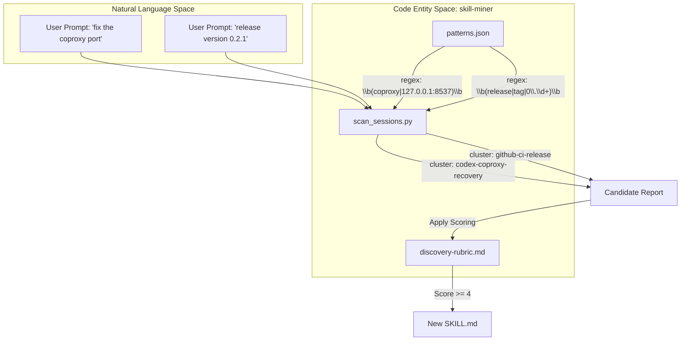
Sources: [skills/skill-miner/references/patterns.json:2-27](), [skills/skill-miner/references/discovery-rubric.md:36-42]()

---

## Clustering & Implementation

### Clustering Dimensions
When `scan_sessions.py` identifies matches, it groups them by several dimensions to help the developer identify the "Core Workflow" [skills/skill-miner/references/discovery-rubric.md:64-74]():
*   **Intent:** (e.g., debug, publish, deploy).
*   **Natural Trigger Phrasing:** The user's actual shorthand.
*   **Artifacts:** Specific files, URLs, or hosts involved.
*   **Completion Pattern:** What "done" looked like in successful sessions.

### From Discovery to Creation
Once a candidate is selected, the `discovery-rubric.md` mandates a simulation of the next lifecycle steps before writing the file [skills/skill-miner/references/discovery-rubric.md:104-108]():
1.  **Personalization Check:** Identify local paths or preferences needed.
2.  **Generalization Check:** Identify which details must be parameterized for others.

**System Logic: Discovery to SKILL.md**
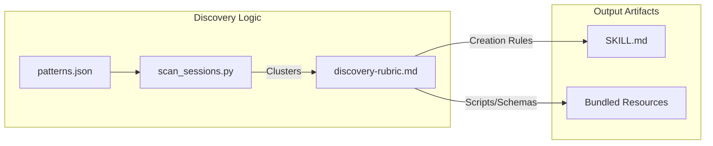
Sources: [skills/skill-miner/references/discovery-rubric.md:109-119](), [skills/skill-miner/references/patterns.json:1-48]()

### Creation Rules
When finalizing a discovered skill:
*   Keep frontmatter limited to `name` and `description` [skills/skill-miner/references/discovery-rubric.md:114]().
*   Use real user phrasing for trigger conditions [skills/skill-miner/references/discovery-rubric.md:115]().
*   Offload complex logic (parsing, redaction) to scripts in bundled resources rather than prose [skills/skill-miner/references/discovery-rubric.md:118]().

Sources: [skills/skill-miner/references/discovery-rubric.md:109-119]()

---

# Page: skill-personalizer

# skill-personalizer

<details>
<summary>Relevant source files</summary>

The following files were used as context for generating this wiki page:

- [skills/skill-personalizer/SKILL.md](skills/skill-personalizer/SKILL.md)
- [skills/skill-personalizer/agents/openai.yaml](skills/skill-personalizer/agents/openai.yaml)

</details>


The `skill-personalizer` is a core component of the Skill Optimizer lifecycle designed to bridge the gap between generic skill templates and a user's specific local environment. While `skill-miner` discovers new capabilities and `skill-generalizer` prepares them for public sharing, the personalizer focuses on **local optimization**: ensuring a skill triggers at the right time, uses the correct local paths, and respects the user's preferred tools and phrasing.

## Purpose and Scope

The primary objective of `skill-personalizer` is to audit and tune skills—whether they are newly mined, downloaded from a community repository, or forked—to fit a user's real-world setup [skills/skill-personalizer/SKILL.md:8-10](). It transforms a "generic" skill into a "private" skill that is highly efficient for a specific developer's machine and habits.

### When to Use
| Scenario | Use `skill-personalizer`? | Alternative |
| :--- | :--- | :--- |
| Adapting a GitHub skill to local aliases/paths | **Yes** | - |
| Skill triggers too often (overtriggering) | **Yes** | - |
| Skill misses obvious user requests (undertriggering) | **Yes** | - |
| Preparing a skill for public release | No | `skill-generalizer` |
| Extracting a brand new skill from session logs | No | `skill-miner` |

Sources: [skills/skill-personalizer/SKILL.md:12-19]()

## Component Architecture

The `skill-personalizer` operates as an agentic workflow defined within a `SKILL.md` file. It utilizes a diagnostic rubric to evaluate existing skills and provides a structured process for modification.

### Agent Interface
For agents supporting YAML-based metadata (like Codex), the component provides a display configuration to standardize how the personalizer is invoked.

**OpenAI Interface Configuration**
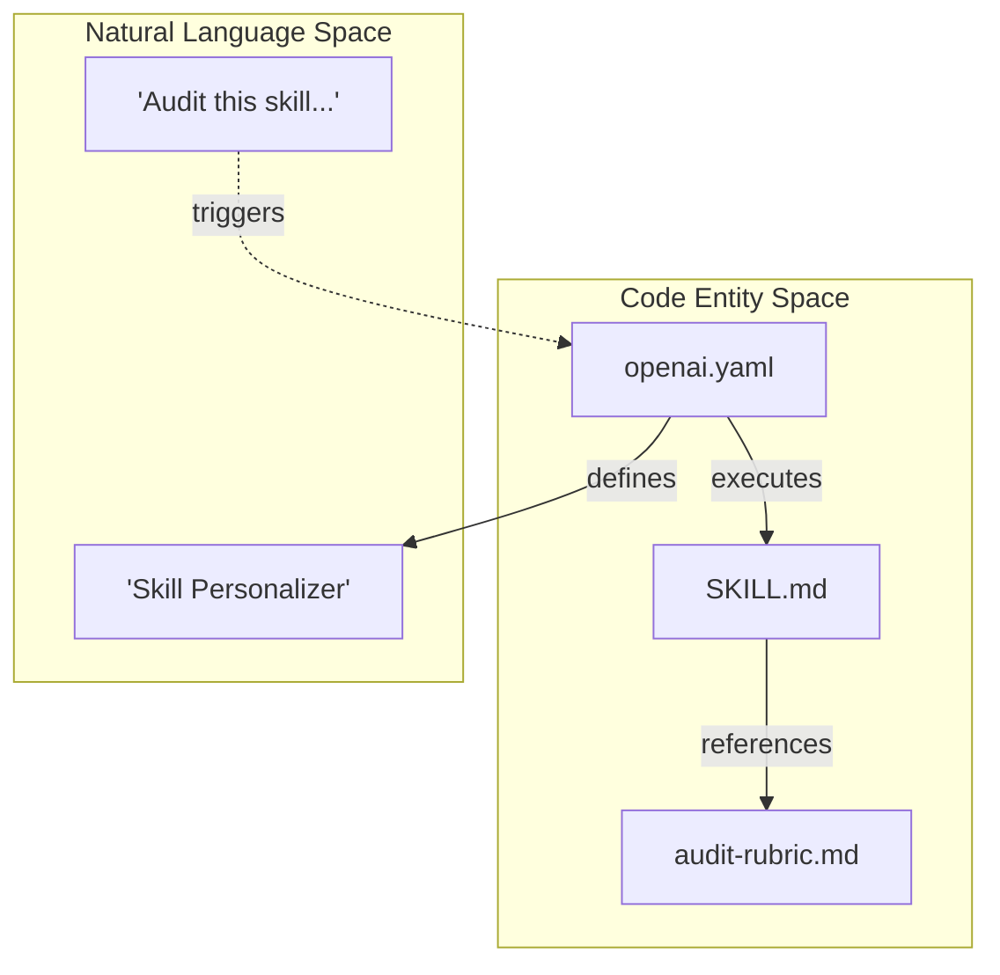
Sources: [skills/skill-personalizer/agents/openai.yaml:1-5](), [skills/skill-personalizer/SKILL.md:42-45]()

## Core Workflow

The personalization process follows an eight-step sequence to ensure that local adaptations do not break the underlying utility of the skill:

1.  **Inspection**: Reviewing the target skill alongside local memories and session evidence [skills/skill-personalizer/SKILL.md:23-23]().
2.  **Audit**: Running diagnostic checks using the [skill-personalizer: Audit Rubric](#3.2) to identify friction points [skills/skill-personalizer/SKILL.md:24-24]().
3.  **Contextualization**: Identifying specific local tools, directories, and recurring user phrasing [skills/skill-personalizer/SKILL.md:25-25]().
4.  **Trigger Alignment**: Comparing trigger conditions against actual user requests to reduce noise [skills/skill-personalizer/SKILL.md:26-26]().
5.  **Refinement**: Editing the skill to include local defaults and safety boundaries [skills/skill-personalizer/SKILL.md:27-28]().
6.  **Validation**: Verifying the new version with realistic prompts [skills/skill-personalizer/SKILL.md:30-30]().

Sources: [skills/skill-personalizer/SKILL.md:21-31]()

## Key Personalization Rules

To maintain high-quality skills, the personalizer adheres to specific constraints:
*   **Utility over Privacy**: Personal details are only included if they directly improve execution (e.g., a specific project path) [skills/skill-personalizer/SKILL.md:34-34]().
*   **Anti-Fragility**: Avoid adding "brittle fallbacks" that mask a broken local environment; the skill should fix the workflow, not hide errors [skills/skill-personalizer/SKILL.md:35-35]().
*   **Evidence-Based**: Prefer real session evidence over generic "best practices" [skills/skill-personalizer/SKILL.md:36-36]().
*   **Attribution**: When editing third-party skills, upstream licenses and attributions must remain intact [skills/skill-personalizer/SKILL.md:38-38]().

Sources: [skills/skill-personalizer/SKILL.md:32-39]()

## Child Pages

For detailed technical specifications and rubrics, refer to the following sub-pages:

*   **[skill-personalizer: SKILL.md & Workflow](#3.1)**
    Detailed walkthrough of the personalization logic, trigger conditions, and the validation steps required to finalize a local skill.
*   **[skill-personalizer: Audit Rubric](#3.2)**
    Full reference for `audit-rubric.md`, covering the nine dimensions of skill quality, including trigger fit, token economics, and cross-skill conflicts.

---

# Page: skill-personalizer: SKILL.md & Workflow

# skill-personalizer: SKILL.md & Workflow

<details>
<summary>Relevant source files</summary>

The following files were used as context for generating this wiki page:

- [skills/skill-personalizer/SKILL.md](skills/skill-personalizer/SKILL.md)
- [skills/skill-personalizer/references/personalization-rubric.md](skills/skill-personalizer/references/personalization-rubric.md)

</details>


The `skill-personalizer` is a specialized skill designed to audit and adapt Agent Skills to a specific user's local environment. Unlike the `skill-generalizer`, which strips away local context for public release, the personalizer deepens the integration between a skill and the user's actual tools, habits, directories, and session history [skills/skill-personalizer/SKILL.md:1-10]().

## Purpose and Trigger Conditions

The `skill-personalizer` is invoked when a skill feels "generic," noisy, or misaligned with the user's actual day-to-day operations.

| Trigger Condition | Description |
| :--- | :--- |
| **New Installation** | Adapting a skill downloaded from GitHub or community repositories to local paths [skills/skill-personalizer/SKILL.md:14-14](). |
| **Trigger Friction** | The skill overtriggers (noisy), undertriggers (misses intent), or asks redundant questions [skills/skill-personalizer/SKILL.md:15-15](). |
| **Environment Alignment** | Local aliases, MCP tools, repo conventions, or specific CLI preferences need to be reflected [skills/skill-personalizer/SKILL.md:17-17](). |
| **Quality Audit** | Evaluating if an existing skill is worth keeping, needs splitting, or has conflicts [skills/skill-personalizer/SKILL.md:16-16](). |

**Sources:** [skills/skill-personalizer/SKILL.md:1-20]().

---

## Personalization Workflow

The workflow follows an eight-step process to transform a generic skill into a highly-tuned local asset.

### Workflow Execution Logic
1.  **Inspection**: Analyze the target `SKILL.md`, local memories, and session evidence [skills/skill-personalizer/SKILL.md:23-23]().
2.  **Audit**: Execute diagnostic checks using the `audit-rubric.md` to identify quality or trigger gaps [skills/skill-personalizer/SKILL.md:24-24]().
3.  **Identify Patterns**: Detect recurring phrasing, expected autonomy levels, and verification habits [skills/skill-personalizer/SKILL.md:25-25]().
4.  **Trigger Comparison**: Compare current trigger conditions against real-world user requests [skills/skill-personalizer/SKILL.md:26-26]().
5.  **Targeted Editing**: Modify only the necessary `SKILL.md` and bundled resources [skills/skill-personalizer/SKILL.md:27-27]().
6.  **Inject Local Context**: Add concrete defaults (paths, commands) and safety boundaries [skills/skill-personalizer/SKILL.md:28-28]().
7.  **Preserve Attribution**: Ensure upstream behavior is preserved and divergence is documented [skills/skill-personalizer/SKILL.md:29-29]().
8.  **Validation**: Verify the result with realistic prompts and layout checks [skills/skill-personalizer/SKILL.md:30-30]().

### Personalization Data Flow
This diagram illustrates how the `skill-personalizer` bridges Natural Language Space (user habits/history) to Code Entity Space (SKILL.md assets).

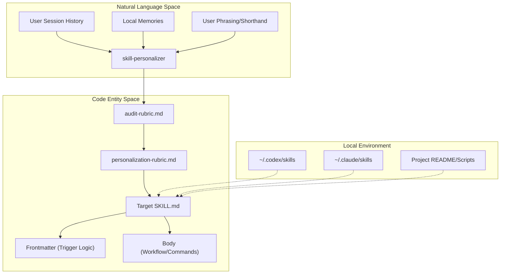

**Sources:** [skills/skill-personalizer/SKILL.md:21-31](), [skills/skill-personalizer/references/personalization-rubric.md:5-15]().

---

## Personalization Rules & Rubrics

The process is governed by strict rules to prevent "brittle" personalization that might break if the user moves to a different repository.

### Evidence Hierarchy
When personalizing, evidence must be gathered in a specific priority order to ensure accuracy:
1.  **Primary**: The target `SKILL.md` and its bundled files [skills/skill-personalizer/references/personalization-rubric.md:9-9]().
2.  **Secondary**: Installed copies in agent-specific directories (e.g., `~/.codex/skills`, `~/.claude/skills`) [skills/skill-personalizer/references/personalization-rubric.md:10-10]().
3.  **Tertiary**: Project-local metadata like `package.json`, `README.md`, or `AGENTS.md` [skills/skill-personalizer/references/personalization-rubric.md:11-11]().
4.  **Operational**: Recent shell history, logs, and session summaries [skills/skill-personalizer/references/personalization-rubric.md:12-13]().

### Core Constraints
*   **No Brittle Fallbacks**: Do not add workarounds that hide a broken local environment [skills/skill-personalizer/SKILL.md:35-35]().
*   **Broad Triggers**: Trigger descriptions should remain broad enough to catch natural variations in user phrasing [skills/skill-personalizer/SKILL.md:37-37]().
*   **Attribution**: If modifying a third-party skill, license text and upstream attribution must remain intact [skills/skill-personalizer/SKILL.md:38-38]().
*   **Explicit Defaults**: Local paths or CLIs should be explicit enough to execute but not so narrow they fail in other repositories [skills/skill-personalizer/references/personalization-rubric.md:38-38]().

**Sources:** [skills/skill-personalizer/SKILL.md:32-39](), [skills/skill-personalizer/references/personalization-rubric.md:1-15]().

---

## Validation Steps

The final step of the workflow requires validating the personalized skill against three specific scenarios.

### Validation Scenario Matrix
| Scenario | Requirement | Goal |
| :--- | :--- | :--- |
| **Direct Trigger** | Explicit request for the skill | Ensure the skill applies correctly [skills/skill-personalizer/references/personalization-rubric.md:57-57](). |
| **Natural Shorthand** | User uses nicknames/aliases | Ensure trigger tuning caught local phrasing [skills/skill-personalizer/references/personalization-rubric.md:58-58](). |
| **Neighbor Task** | Related but distinct task | Ensure the skill stays silent (no overtriggering) [skills/skill-personalizer/references/personalization-rubric.md:59-59](). |

### Technical Verification Logic
The system performs a final check on the file structure and syntax:
1.  **YAML Check**: Validate that the frontmatter parses correctly [skills/skill-personalizer/references/personalization-rubric.md:63-63]().
2.  **Path Check**: Verify referenced paths exist or are clearly marked as user-specific [skills/skill-personalizer/references/personalization-rubric.md:64-64]().
3.  **Command Check**: Ensure mentioned CLIs/tools are installed or optional [skills/skill-personalizer/references/personalization-rubric.md:65-65]().

### Validation Workflow (Code Entity Space)
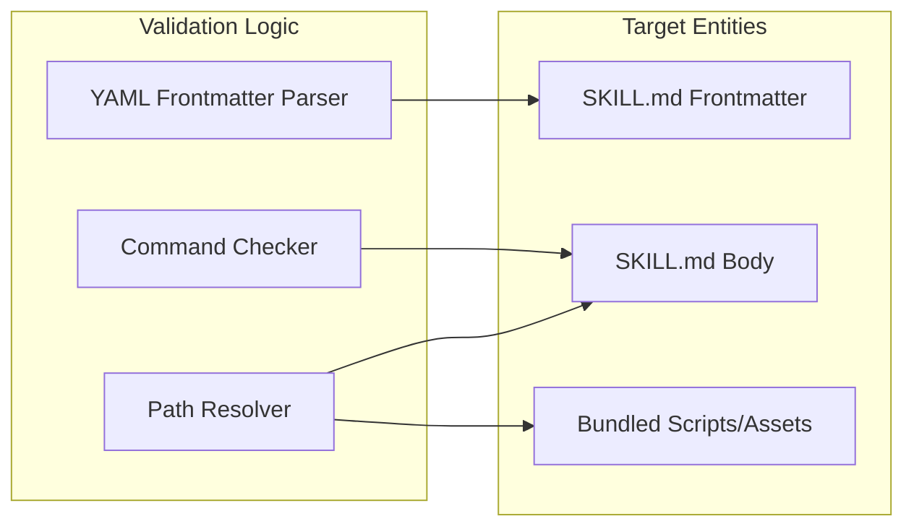

**Sources:** [skills/skill-personalizer/references/personalization-rubric.md:51-67]().

---

# Page: skill-personalizer: Audit Rubric

# skill-personalizer: Audit Rubric

<details>
<summary>Relevant source files</summary>

The following files were used as context for generating this wiki page:

- [skills/skill-personalizer/references/audit-rubric.md](skills/skill-personalizer/references/audit-rubric.md)
- [skills/skill-personalizer/references/personalization-rubric.md](skills/skill-personalizer/references/personalization-rubric.md)

</details>


The `skill-personalizer` audit rubric provides a structured framework for evaluating existing skills against real-world usage data. It serves as the analytical foundation for the personalization phase, identifying whether a skill should be kept, modified, or removed based on nine specific dimensions of performance and quality.

## Purpose and Scope

The audit process is triggered when a user identifies performance issues such as "noisy" behavior, failure to trigger (undertriggering), or conflicts between multiple skills [skills/skill-personalizer/references/audit-rubric.md:3-4](). The scope of an audit includes analyzing active and archived sessions, rollout summaries, and environment-specific configurations to ensure the skill is both technically sound and contextually relevant [skills/skill-personalizer/references/audit-rubric.md:7-7]().

## The Nine Audit Dimensions

The audit rubric defines nine dimensions to evaluate the health and utility of a skill.

| Dimension | Technical Check |
| :--- | :--- |
| **Trigger fit** | Validates if the `description` field in the YAML frontmatter matches actual user phrasing and semantic retrieval terms [skills/skill-personalizer/references/audit-rubric.md:15-15](). |
| **Undertrigger** | Identifies instances where the user requested a capability, but the skill was not retrieved or followed [skills/skill-personalizer/references/audit-rubric.md:16-16](). |
| **Overtrigger** | Detects if the skill fires for neighboring tasks where it is unnecessary, causing friction [skills/skill-personalizer/references/audit-rubric.md:17-17](). |
| **User reaction** | Analyzes session logs for user acceptance, corrections, rejections, or topic switching after a skill is invoked [skills/skill-personalizer/references/audit-rubric.md:18-18](). |
| **Workflow completion** | Verifies if the agent executed the stated steps in the `SKILL.md` or stopped prematurely [skills/skill-personalizer/references/audit-rubric.md:19-19](). |
| **Static quality** | Evaluates structural integrity: frontmatter, word count, and progressive disclosure [skills/skill-personalizer/references/audit-rubric.md:20-20](). |
| **Cross-skill conflicts** | Scans for trigger overlaps, duplicated workflows, or contradictory instructions across the skill library [skills/skill-personalizer/references/audit-rubric.md:21-21](). |
| **Environment consistency** | Confirms that referenced paths, tools, and commands exist in the user's local environment [skills/skill-personalizer/references/audit-rubric.md:22-22](). |
| **Token economics** | Assesses if large skills should be compressed or moved to `references/` to save context window space [skills/skill-personalizer/references/audit-rubric.md:23-23](). |

**Sources:** [skills/skill-personalizer/references/audit-rubric.md:11-23]()

## Audit Data Flow and Logic

The following diagram illustrates how the `skill-personalizer` processes raw session data and environment state through the audit rubric to generate a recommendation.

### Audit Process Logic
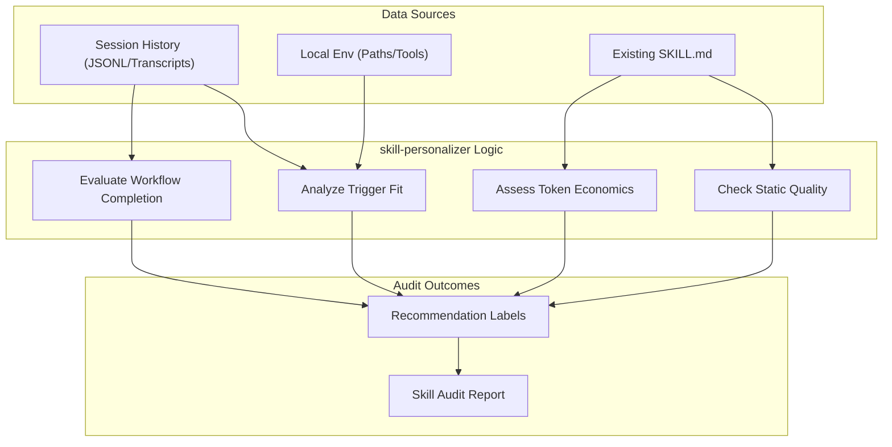
**Sources:** [skills/skill-personalizer/references/audit-rubric.md:7-23](), [skills/skill-personalizer/references/personalization-rubric.md:5-15]()

## Static Quality Checklist

A skill must meet specific structural requirements to pass the "Static Quality" dimension. These rules ensure cross-agent compatibility and prompt efficiency.

*   **Naming:** Use lowercase hyphen-case for the `name` field [skills/skill-personalizer/references/audit-rubric.md:28-28]().
*   **Description:** Must start with `Use when` and focus on trigger conditions rather than the internal workflow [skills/skill-personalizer/references/audit-rubric.md:29-29]().
*   **Front-loading:** Place the strongest trigger terms and critical safety rules at the top of the file [skills/skill-personalizer/references/audit-rubric.md:30-33]().
*   **Conciseness:** Keep the main `SKILL.md` brief; move long examples or scripts into bundled resources [skills/skill-personalizer/references/audit-rubric.md:31-31]().
*   **Tone:** Avoid narrative postmortems (e.g., "in one session we found") and excessive emphasis (MUST/NEVER); use concrete rules [skills/skill-personalizer/references/audit-rubric.md:34-35]().

**Sources:** [skills/skill-personalizer/references/audit-rubric.md:25-36]()

## Research-Backed Heuristics

The rubric incorporates heuristics derived from LLM behavior research (e.g., "Lost in the Middle") and agentic workflows (e.g., Voyager/ExpeL).

1.  **Compounding Risk:** Undertriggering is treated as a high-priority failure because skills that aren't retrieved cannot gather feedback for improvement [skills/skill-personalizer/references/audit-rubric.md:39-39]().
2.  **Context Density:** Prioritize narrow, relevant context over large, "kitchen-sink" skills to prevent prompt dilution [skills/skill-personalizer/references/audit-rubric.md:40-40]().
3.  **Positioning Bias:** Front-load triggers because long-context models often miss information buried in the middle of a document [skills/skill-personalizer/references/audit-rubric.md:41-41]().
4.  **Evidence Requirement:** Durable skills must be based on validated practices found in session history, not imagined workflows [skills/skill-personalizer/references/audit-rubric.md:42-42]().

**Sources:** [skills/skill-personalizer/references/audit-rubric.md:37-45]()

## Audit Report and Recommendation Labels

The output of an audit is a **Skill Audit Report** [skills/skill-personalizer/references/audit-rubric.md:49-72](). This report assigns one of the following recommendation labels to each audited skill:

| Label | Meaning |
| :--- | :--- |
| `keep` | The skill is healthy and strategically useful [skills/skill-personalizer/references/audit-rubric.md:76-76](). |
| `personalize` | The skill is valuable but requires local paths, phrasing, or workflow defaults [skills/skill-personalizer/references/audit-rubric.md:77-77](). |
| `generalize` | The skill is reusable but currently contains too much personal data for public sharing [skills/skill-personalizer/references/audit-rubric.md:78-78](). |
| `split` | The skill contains multiple unrelated workflows and should be divided [skills/skill-personalizer/references/audit-rubric.md:79-79](). |
| `compress` | The skill is too large for its value; move details to references/scripts [skills/skill-personalizer/references/audit-rubric.md:80-80](). |
| `remove` | No evidence of need, the skill is obsolete, or it is unsafe [skills/skill-personalizer/references/audit-rubric.md:81-81](). |

### Mapping Recommendations to File Entities
The following diagram maps the audit recommendations to the resulting file system changes.

```mermaid
graph LR
    subgraph "Audit Decision"
        A["Skill Audit Report"]
    end

    subgraph "Code Entity Actions"
        B["SKILL.md (Update Frontmatter)"]
        C["SKILL.md (Delete)"]
        D["references/ (Move content)"]
        E["New SKILL_v2.md (Split)"]
    end

    A -- "personalize" --> B
    A -- "remove" --> C
    A -- "compress" --> D
    A -- "split" --> E
```
**Sources:** [skills/skill-personalizer/references/audit-rubric.md:74-82]()

---

# Page: skill-generalizer

# skill-generalizer

<details>
<summary>Relevant source files</summary>

The following files were used as context for generating this wiki page:

- [skills/skill-generalizer/SKILL.md](skills/skill-generalizer/SKILL.md)
- [skills/skill-generalizer/agents/openai.yaml](skills/skill-generalizer/agents/openai.yaml)

</details>


The `skill-generalizer` is the final stage in the skill lifecycle, responsible for transforming local, private, or environment-specific Agent Skills into portable, public-facing artifacts [skills/skill-generalizer/SKILL.md:1-4](). While `skill-miner` discovers capabilities and `skill-personalizer` tunes them for an individual, the generalizer focuses on redaction, portability, and cross-platform compatibility to ensure a skill is useful to others without leaking private context [skills/skill-generalizer/SKILL.md:10-16]().

## Purpose and Scope

The primary objective of this component is to preserve the reusable technical logic of a skill while stripping away personal habits, internal hostnames, credentials, and machine-specific paths [skills/skill-generalizer/SKILL.md:10-10](). 

### When to Use
- **Public Sharing:** Preparing a skill for GitHub, marketplaces, or open-source contribution [skills/skill-generalizer/SKILL.md:14-14]().
- **Team Distribution:** Moving a skill from a single developer's workflow to a shared team repository [skills/skill-generalizer/SKILL.md:3-3]().
- **Sanitization:** When a skill contains traces of private transcripts, account IDs, or project-specific facts that should not be exposed [skills/skill-generalizer/SKILL.md:25-25]().

> [!IMPORTANT]
> Do not use `skill-generalizer` for tuning a skill for your own machine; use `skill-personalizer` for that purpose [skills/skill-generalizer/SKILL.md:18-18]().

**Sources:**
- [skills/skill-generalizer/SKILL.md:1-18]()

---

## Technical Workflow Overview

The generalization process bridges the gap between a "working local script" and a "standardized agent capability." It involves a nine-step workflow that transitions from source inspection to publication-ready packaging [skills/skill-generalizer/SKILL.md:22-30]().

### Generalization Logic Flow

The following diagram illustrates how the `skill-generalizer` processes private entities into public-facing code entities.

```mermaid
graph TD
    subgraph "Natural Language Space (Private Context)"
        A["Private Transcripts & Logs"] --> B["Personal Habits & Aliases"]
        B --> C["Internal Team Conventions"]
    end

    subgraph "skill-generalizer Processing"
        direction TB
        Step1["Inspect Source SKILL.md"] --> Step2["Redact Private Paths/IDs"]
        Step2 --> Step3["Abstract Logic into Variables"]
        Step3 --> Step4["Apply publication-rubric.md"]
    end

    subgraph "Code Entity Space (Public Artifact)"
        Step4 --> D["SKILL.md (Sanitized)"]
        Step4 --> E["agents/openai.yaml"]
        Step4 --> F["Portable Scripts/References"]
    end

    C -.-> Step1
    D -.-> G["Public GitHub Repo"]
```
**Sources:**
- [skills/skill-generalizer/SKILL.md:22-30]()
- [skills/skill-generalizer/agents/openai.yaml:1-5]()

---

## Component Relationships

The `skill-generalizer` relies on two primary reference documents to ensure the quality and reach of the generated skill.

### 1. Publication & Redaction
The process uses a specific rubric to evaluate if a skill is truly ready for "strangers" to use. This involves checking frontmatter descriptions, ensuring examples are generic, and verifying that essential personal details have been converted into configurable variables [skills/skill-generalizer/SKILL.md:34-38]().
- For details, see [skill-generalizer: SKILL.md & Workflow](#4.1).

### 2. Platform Portability
Since different agents (Codex, Claude Code, Cursor, etc.) have different execution environments, the generalizer must validate support claims against known compatibility shapes [skills/skill-generalizer/SKILL.md:44-44](). This ensures that install instructions and path placeholders work across various platforms.
- For details, see [skill-generalizer: Publication Rubric & Platform Compatibility](#4.2).

### Agent Interface Metadata
For agents like Codex, the generalizer includes specific metadata to define how the skill appears in the UI.

| File Path | Entity | Purpose |
| :--- | :--- | :--- |
| `skills/skill-generalizer/agents/openai.yaml` | `display_name` | The public-facing name of the tool [skills/skill-generalizer/agents/openai.yaml:2-2](). |
| `skills/skill-generalizer/agents/openai.yaml` | `default_prompt` | The instruction used to trigger the generalization logic [skills/skill-generalizer/agents/openai.yaml:4-4](). |

**Sources:**
- [skills/skill-generalizer/SKILL.md:32-45]()
- [skills/skill-generalizer/agents/openai.yaml:1-5]()

---

## Child Pages

- **[skill-generalizer: SKILL.md & Workflow](#4.1)**
  Detailed walkthrough of the nine-step generalization workflow, redaction rules for private data, and the specific formatting requirements for public `SKILL.md` files.
- **[skill-generalizer: Publication Rubric & Platform Compatibility](#4.2)**
  Full reference for the `publication-rubric.md` (safety passes and packaging) and `platform-compatibility.md` (cross-agent support and install paths).

---

# Page: skill-generalizer: SKILL.md & Workflow

# skill-generalizer: SKILL.md & Workflow

<details>
<summary>Relevant source files</summary>

The following files were used as context for generating this wiki page:

- [skills/skill-generalizer/SKILL.md](skills/skill-generalizer/SKILL.md)
- [skills/skill-generalizer/references/publication-rubric.md](skills/skill-generalizer/references/publication-rubric.md)

</details>


The `skill-generalizer` is the final stage in the skill lifecycle, responsible for transforming private, machine-specific workflows into portable, public-ready artifacts. While `skill-miner` discovers capabilities and `skill-personalizer` optimizes them for a specific user, the `skill-generalizer` ensures that skills can be shared across teams or marketplaces without leaking sensitive information or relying on brittle local configurations.

## Overview and Purpose

The primary objective of the generalizer is to strip away the "private context" of a skill—such as absolute file paths, internal hostnames, and personal habits—while preserving the underlying "reusable technique" [skills/skill-generalizer/SKILL.md:8-11](). 

### Trigger Conditions
The `skill-generalizer` is invoked when:
*   A user intends to publish or open-source a local skill [skills/skill-generalizer/SKILL.md:14-14]().
*   A skill contains references to private repositories, local paths, or team-specific conventions [skills/skill-generalizer/SKILL.md:15-15]().
*   The output must be usable by a third party without access to the author's specific environment [skills/skill-generalizer/SKILL.md:16-16]().

**Note:** If the goal is merely to tune a skill for one's own machine, the `skill-personalizer` should be used instead [skills/skill-generalizer/SKILL.md:18-18]().

Sources: [skills/skill-generalizer/SKILL.md:1-20]()

---

## The Nine-Step Generalization Workflow

The generalization process follows a structured pipeline to move a skill from "Private Code Entity Space" to "Public Natural Language/Instruction Space."

### Workflow Execution Logic
The agent follows these steps to ensure a clean transition:

1.  **Source Inspection:** Review the source skill and associated repository files [skills/skill-generalizer/SKILL.md:22-22]().
2.  **Quality Baseline:** If quality is questionable, perform an audit using `skill-personalizer` criteria first [skills/skill-generalizer/SKILL.md:23-23]().
3.  **Abstraction:** Separate the core reusable capability from specific implementation details [skills/skill-generalizer/SKILL.md:24-24]().
4.  **Redaction:** Remove private names, paths, credentials, and account IDs [skills/skill-generalizer/SKILL.md:25-25]().
5.  **Rewriting:** Focus the skill on general triggering conditions and portable workflows [skills/skill-generalizer/SKILL.md:26-26]().
6.  **De-cluttering:** Keep the core `SKILL.md` concise; move rubrics and scripts to bundled resources [skills/skill-generalizer/SKILL.md:27-27]().
7.  **Compatibility Check:** Verify target agent support (e.g., Codex vs. Claude Code) [skills/skill-generalizer/SKILL.md:28-28]().
8.  **Packaging:** Generate READMEs and promotion copy if requested [skills/skill-generalizer/SKILL.md:29-29]().
9.  **Verification:** Final check of frontmatter, file layout, and usage prompts [skills/skill-generalizer/SKILL.md:30-30]().

### Diagram: Generalization Data Flow
This diagram illustrates how the `skill-generalizer` transforms a local `SKILL.md` into a public artifact by filtering it through the `publication-rubric.md`.

**Skill Transformation Pipeline**
```mermaid
graph TD
    subgraph "Private_Code_Entity_Space"
        A["Local SKILL.md"] --> B["Private_Paths (/Users/...)"]
        A --> C["Internal_Tools (VPN_URLs)"]
        A --> D["Personal_Habits"]
    end

    subgraph "Generalizer_Logic"
        E["skill-generalizer/SKILL.md"]
        F["publication-rubric.md"]
        G["platform-compatibility.md"]
    end

    A --> E
    E -- "Consults" --> F
    E -- "Checks" --> G

    subgraph "Public_Entity_Space"
        H["Public SKILL.md"]
        I["Bundled_Resources (references/)"]
        J["Portable_Placeholders (<workspace>)"]
    end

    E -- "Redacts/Generalizes" --> H
    H --> J
    E -- "Extracts_Rubrics" --> I
```
Sources: [skills/skill-generalizer/SKILL.md:20-30](), [skills/skill-generalizer/references/publication-rubric.md:1-20]()

---

## Content Classification and Redaction

The `publication-rubric.md` provides a deterministic mapping for how to handle different types of content during generalization.

### Classification Table
| Content Class | Keep? | Treatment |
| :--- | :--- | :--- |
| **Reusable workflow** | Yes | Tighten and clarify [skills/skill-generalizer/references/publication-rubric.md:13-13](). |
| **Tool-specific command** | Usually | Keep if portable; otherwise document setup [skills/skill-generalizer/references/publication-rubric.md:14-14](). |
| **Personal preference** | Maybe | Convert to a configurable option [skills/skill-generalizer/references/publication-rubric.md:15-15](). |
| **Private path/host** | No | Replace with placeholders like `<workspace>` [skills/skill-generalizer/references/publication-rubric.md:16-16](). |
| **Credentials/Tokens** | No | Remove entirely [skills/skill-generalizer/references/publication-rubric.md:17-17](). |
| **Transcript quotes** | Rarely | Summarize or sanitize [skills/skill-generalizer/references/publication-rubric.md:18-18](). |

### Public Safety Pass
The generalizer specifically targets and removes:
*   Absolute home paths (e.g., `/Users/<name>/...`) [skills/skill-generalizer/references/publication-rubric.md:35-35]().
*   Internal hostnames, SSH aliases, and VPN-only URLs [skills/skill-generalizer/references/publication-rubric.md:36-36]().
*   PII (Email, phone numbers, account IDs) [skills/skill-generalizer/references/publication-rubric.md:37-37]().
*   First-person language (e.g., "My internal tool") [skills/skill-generalizer/references/publication-rubric.md:39-39]().

Sources: [skills/skill-generalizer/references/publication-rubric.md:5-42]()

---

## Public Release Rules & Packaging

To maintain a consistent ecosystem, the `skill-generalizer` enforces specific formatting and architectural rules.

### SKILL.md Frontmatter & Format
*   **Description:** Must start with `Use when` and describe trigger conditions rather than summarizing the workflow [skills/skill-generalizer/SKILL.md:34-34](), [skills/skill-generalizer/references/publication-rubric.md:48-48]().
*   **Naming:** Use `lowercase-hyphen-case` [skills/skill-generalizer/references/publication-rubric.md:47-47]().
*   **Structure:** Keep the main file short for easy scanning; offload checklists and templates to the `references/` directory [skills/skill-generalizer/references/publication-rubric.md:49-50]().

### Portability and Configuration
If a personal detail is essential to the skill's function, it must be converted into a **configurable variable** with setup guidance rather than being hardcoded [skills/skill-generalizer/SKILL.md:38-38](). The generalizer prefers portable commands over private aliases [skills/skill-generalizer/SKILL.md:37-37]().

### Diagram: Packaging Architecture
This diagram shows the relationship between the public `SKILL.md` and its supporting resources.

**Public Skill Bundle Structure**
```mermaid
graph LR
    subgraph "Skill_Package_Directory"
        SKILL["SKILL.md (Core Logic)"]
        
        subgraph "references_Folder"
            RUBRIC["publication-rubric.md"]
            COMPAT["platform-compatibility.md"]
        end
        
        subgraph "scripts_Folder"
            TOOL["Portable Helper Scripts"]
        end
    end

    SKILL -- "Links to" --> RUBRIC
    SKILL -- "Refers to" --> COMPAT
    SKILL -- "Invokes" --> TOOL
```
Sources: [skills/skill-generalizer/SKILL.md:32-45](), [skills/skill-generalizer/references/publication-rubric.md:43-52]()

---

## Validation and Platform Compatibility

Before final publication, the skill must be checked against `platform-compatibility.md` to ensure it functions across different agents like Codex, Claude Code, and Cursor [skills/skill-generalizer/SKILL.md:44-44]().

### Packaging Checklist
1.  `SKILL.md` exists in the `skills/<skill-name>/` directory [skills/skill-generalizer/references/publication-rubric.md:45-45]().
2.  Frontmatter contains only `name` and `description` [skills/skill-generalizer/references/publication-rubric.md:46-46]().
3.  Installation instructions in the README match the folder structure [skills/skill-generalizer/references/publication-rubric.md:51-51]().
4.  Promotion copy accurately reflects platform support and intentionally excluded features [skills/skill-generalizer/references/publication-rubric.md:56-65]().

Sources: [skills/skill-generalizer/SKILL.md:40-45](), [skills/skill-generalizer/references/publication-rubric.md:43-65]()

---

# Page: skill-generalizer: Publication Rubric & Platform Compatibility

# skill-generalizer: Publication Rubric & Platform Compatibility

<details>
<summary>Relevant source files</summary>

The following files were used as context for generating this wiki page:

- [skills/skill-generalizer/references/platform-compatibility.md](skills/skill-generalizer/references/platform-compatibility.md)
- [skills/skill-generalizer/references/publication-rubric.md](skills/skill-generalizer/references/publication-rubric.md)

</details>


The `skill-generalizer` component is the final stage in the skill lifecycle, responsible for transforming personalized, private skills into portable, public-facing artifacts. This page provides the technical reference for the `publication-rubric.md` and `platform-compatibility.md` files, which govern the classification of content, safety auditing, and cross-agent deployment strategies.

## Publication Rubric: Content Classification & Safety

The publication rubric ensures that skills are sanitized of private data and structured for high portability. It acts as a gatekeeper for the `skill-generalizer` workflow, moving from specific session-based evidence to reusable judgment patterns.

### Content Classification Table
Before a skill is published, its components must be inventoried and classified according to the following treatment rules:

| Class | Keep? | Treatment |
| :--- | :--- | :--- |
| **Reusable workflow** | Yes | Keep and tighten. |
| **Tool-specific command** | Usually | Keep if portable; otherwise document setup. |
| **Personal preference** | Maybe | Generalize into an option or remove. |
| **Private path or host** | No | Replace with placeholder or setup variable. |
| **Credential, token, cookie, key** | No | Remove entirely. |
| **Transcript quote** | Rarely | Summarize or sanitize. |
| **One-project fact** | Usually no | Move to an example only if generic. |

Sources: [skills/skill-generalizer/references/publication-rubric.md:9-20]()

### Generalization & Safety Passes
The generalization process involves a critical review of the skill's logic to ensure it does not depend on the author's local environment.

**Generalization Pass Questions:**
*   Could a new user understand when this skill applies from the description alone? [skills/skill-generalizer/references/publication-rubric.md:25-25]()
*   Does the skill require the author's exact machine, aliases, repos, or memories? [skills/skill-generalizer/references/publication-rubric.md:26-26]()
*   Are there hidden prerequisites that should become setup instructions? [skills/skill-generalizer/references/publication-rubric.md:27-27]()

**Public Safety Pass (Redaction Requirements):**
*   **Paths:** Remove absolute home paths (e.g., `/Users/<name>/...`). [skills/skill-generalizer/references/publication-rubric.md:35-35]()
*   **Infrastructure:** Remove internal hostnames, SSH aliases, VPN URLs, and private org/repo names. [skills/skill-generalizer/references/publication-rubric.md:36-36]()
*   **PII:** Remove email addresses, phone numbers, calendars, and account IDs. [skills/skill-generalizer/references/publication-rubric.md:37-37]()
*   **Secrets:** Remove cookies, tokens, API keys, and OAuth scopes. [skills/skill-generalizer/references/publication-rubric.md:38-38]()

**Placeholder Standardization:**
The system uses standardized placeholders to replace redacted data: `<workspace>`, `<repo>`, `<skill-name>`, `<agent-skills-dir>`, and `<platform-config>`. [skills/skill-generalizer/references/publication-rubric.md:41-41]()

### Packaging Checklist
Final verification before release requires adherence to the following structural rules:
*   **Naming:** Skill name must be lowercase hyphen-case. [skills/skill-generalizer/references/publication-rubric.md:47-47]()
*   **Triggers:** The `description` in frontmatter must start with `Use when` and contain only trigger conditions. [skills/skill-generalizer/references/publication-rubric.md:48-48]()
*   **Separation of Concerns:** Long checklists, scripts, and templates must live in bundled resources (e.g., `references/` or `scripts/`), not in the main `SKILL.md`. [skills/skill-generalizer/references/publication-rubric.md:50-50]()

Sources: [skills/skill-generalizer/references/publication-rubric.md:21-53]()

## Platform Compatibility

Skills are designed to be "Agent-Agnostic" at the core but require specific installation paths and metadata handling to function across different AI coding assistants.

### Native Support Shape
The following table describes how various agents consume the `SKILL.md` format and where they expect files to be located.

| Agent | Support Shape | Default Install Path |
| :--- | :--- | :--- |
| **Codex** | Native Agent Skills; plugins are the distribution unit. Supports `agents/openai.yaml`. | `~/.codex/skills/` (user), `.agents/skills/` (repo) |
| **Claude Code** | Native skills; uses descriptions for application decisions. | `~/.claude/skills/` (personal), `.claude/skills/` (project) |
| **Cursor** | Native Agent Skills; works alongside rules and commands. | `.agents/skills/` or `.cursor/skills/` |
| **OpenCode** | Native `skill` tool; supports multiple compatibility paths. | `.agents/skills/` or `~/.config/opencode/skills/` |
| **Gemini CLI** | Open format; uses `GEMINI.md` for always-on context. | `.agents/skills/` or installer-managed paths |

Sources: [skills/skill-generalizer/references/platform-compatibility.md:7-13]()

### Cross-Agent Portability Mapping
The following diagram illustrates how the generalized "Code Entity Space" (the files in the repository) maps to the "Natural Language Space" (the agent's interpretation) across different platforms.

**Skill Discovery and Execution Flow**
```mermaid
graph TD
    subgraph "Code Entity Space (Repository)"
        A["SKILL.md (Frontmatter: name, description)"]
        B["scripts/ (Executable Logic)"]
        C["references/ (Static Checklists)"]
        D["agents/openai.yaml (Codex Metadata)"]
    end

    subgraph "Natural Language Space (Agent Context)"
        E["Codex: Plugin Invocation"]
        F["Claude Code: Trigger Match"]
        G["OpenCode: Skill Tool Permission"]
        H["Gemini: Always-on Context"]
    end

    A -- "description trigger" --> F
    A -- "name/desc" --> E
    B -- "skill execution" --> G
    C -- "RAG injection" --> H
    D -- "UI Metadata" --> E
```
Sources: [skills/skill-generalizer/references/platform-compatibility.md:9-13](), [skills/skill-generalizer/references/publication-rubric.md:45-50]()

### Release Guidance
To maintain portability, developers should follow these constraints:
1.  **Conservative Frontmatter:** Only `name` and `description` are guaranteed to be cross-compatible. [skills/skill-generalizer/references/platform-compatibility.md:20-20]()
2.  **External Metadata:** Platform-specific metadata (like `openai.yaml`) must be kept in optional files, never inside the shared `SKILL.md`. [skills/skill-generalizer/references/platform-compatibility.md:21-21]()
3.  **Path Preference:** Use `.agents/skills/<name>/SKILL.md` as the primary path for portable repo-level skills. [skills/skill-generalizer/references/platform-compatibility.md:17-17]()

## Promotion and Distribution

The rubric defines how to write public-facing documentation for the skill to ensure users understand the scope and limitations.

**Promotion Copy Requirements:**
*   Identify the target audience and the specific problem solved. [skills/skill-generalizer/references/publication-rubric.md:58-59]()
*   List the evidence or workflow used to derive the skill. [skills/skill-generalizer/references/publication-rubric.md:60-60]()
*   Explicitly state what is **intentionally not included** to manage expectations. [skills/skill-generalizer/references/publication-rubric.md:62-62]()
*   Avoid "hype" or claims of deterministic automation; skills are instructional, not autonomous programs. [skills/skill-generalizer/references/publication-rubric.md:64-64]()

### Data Flow: From Private Session to Public Release
The following diagram maps the transition from a local environment to a public distribution.

**Generalization Pipeline**
```mermaid
graph LR
    subgraph "Private/Personal Space"
        P1["Personalized SKILL.md"]
        P2["Local Paths (/Users/...)"]
        P3["Private API Keys"]
    end

    subgraph "skill-generalizer (Transformation)"
        G1["publication-rubric.md Audit"]
        G2["Sanitization (Redaction)"]
        G3["Platform Path Mapping"]
    end

    subgraph "Public Space (Distribution)"
        D1["Portable SKILL.md"]
        D2[".agents/skills/ Structure"]
        D3["Promotion Copy"]
    end

    P1 --> G1
    P2 -- "Replace with <workspace>" --> G2
    P3 -- "Remove" --> G2
    G1 --> D1
    G2 --> D1
    G3 --> D2
    D1 --> D3
```
Sources: [skills/skill-generalizer/references/publication-rubric.md:5-41](), [skills/skill-generalizer/references/platform-compatibility.md:15-24]()

---

# Page: SKILL.md Format & Agent Integration

# SKILL.md Format & Agent Integration

<details>
<summary>Relevant source files</summary>

The following files were used as context for generating this wiki page:

- [skills/skill-generalizer/agents/openai.yaml](skills/skill-generalizer/agents/openai.yaml)
- [skills/skill-generalizer/references/platform-compatibility.md](skills/skill-generalizer/references/platform-compatibility.md)
- [skills/skill-miner/agents/openai.yaml](skills/skill-miner/agents/openai.yaml)
- [skills/skill-personalizer/agents/openai.yaml](skills/skill-personalizer/agents/openai.yaml)

</details>


The `SKILL.md` file is the primary unit of workflow definition within the Skill Optimizer ecosystem. It serves as a bridge between Natural Language instructions and executable Code Entities, designed to be consumed by both human developers and LLM-based coding agents. This page defines the structure of a skill package and how it integrates with various agent environments.

### The Skill Package Structure

A standardized skill is not just a single Markdown file; it is a directory structure (a "bundle") that provides the agent with all necessary context, scripts, and metadata to execute a specific workflow.

| Component | Path | Purpose |
| :--- | :--- | :--- |
| **Core Logic** | `SKILL.md` | The primary instruction set, triggers, and workflow steps. |
| **Metadata** | `agents/openai.yaml` | UI-specific metadata for agents like Codex [skills/skill-generalizer/agents/openai.yaml:1-5](). |
| **Resources** | `references/` | Supporting documentation, rubrics, or pattern files used by the skill. |
| **Logic** | `scripts/` | Deterministic scripts (e.g., Python, Bash) called by the agent during the workflow. |

### SKILL.md Frontmatter & Body

The `SKILL.md` file uses a YAML frontmatter block for basic identification. To maintain cross-agent portability, the frontmatter is kept conservative, focusing on fields recognized by the broadest range of tools [skills/skill-generalizer/references/platform-compatibility.md:20-20]().

*   **`name`**: A unique, slug-style identifier for the skill.
*   **`description`**: A concise summary used by agents to decide when to trigger the skill [skills/skill-generalizer/references/platform-compatibility.md:10-10]().

The body of the file typically follows a standardized lifecycle (e.g., Trigger → Steps → Verification) to ensure the agent maintains state throughout the task.

### Natural Language to Code Entity Mapping

The following diagram illustrates how the abstract "Skill" concept in Natural Language space maps to concrete file entities and agent-specific discovery paths in the Code Entity space.

**Skill Discovery and Execution Map**
```mermaid
graph TD
    subgraph "Natural Language Space"
        NL_Prompt["User Prompt / Trigger Condition"]
        Workflow["Workflow Steps & Logic"]
    end

    subgraph "Code Entity Space"
        SKILL_MD["SKILL.md (Markdown + Frontmatter)"]
        OPENAI_YAML["agents/openai.yaml (UI Metadata)"]
        SCRIPTS["scripts/ (Deterministic Logic)"]
        REFS["references/ (Contextual Data)"]
    end

    subgraph "Agent Integration Paths"
        CODEX_PATH["~/.codex/skills/"]
        CLAUDE_PATH["~/.claude/skills/"]
        PORTABLE_PATH[".agents/skills/"]
    end

    NL_Prompt -->|Matches Description| SKILL_MD
    Workflow -->|Executes| SCRIPTS
    SKILL_MD -->|References| REFS
    OPENAI_YAML -->|Configures UI| CODEX_PATH
    SKILL_MD -.->|Installed In| CODEX_PATH
    SKILL_MD -.->|Installed In| CLAUDE_PATH
    SKILL_MD -.->|Portable Root| PORTABLE_PATH
```
**Sources:** [skills/skill-generalizer/references/platform-compatibility.md:7-13](), [skills/skill-miner/agents/openai.yaml:1-5]().

### Agent Integration & Metadata

Different agents have varying levels of support for the skill format. While `SKILL.md` provides the instructions, the `agents/` directory holds platform-specific overrides.

#### Codex UI Metadata (`openai.yaml`)
For the Codex agent, an `openai.yaml` file in the `agents/` directory defines how the skill appears in the sidebar or command palette. It includes:
*   `display_name`: The human-readable title [skills/skill-miner/agents/openai.yaml:2-2]().
*   `short_description`: A one-sentence summary [skills/skill-personalizer/agents/openai.yaml:3-3]().
*   `default_prompt`: The initial instruction sent to the agent when the skill is manually invoked [skills/skill-generalizer/agents/openai.yaml:4-4]().

#### Cross-Agent Discovery
To ensure a skill is "portable," it should be placed in a directory structure that multiple agents can scan. The recommended portable path is `.agents/skills/<skill-name>/SKILL.md` [skills/skill-generalizer/references/platform-compatibility.md:17-17]().

**Agent Metadata Association**
```mermaid
graph LR
    subgraph "Skill Bundle"
        SMD["SKILL.md"]
        OYAML["agents/openai.yaml"]
    end

    subgraph "Agent Implementation"
        Codex["Codex Interface"]
        Claude["Claude Code"]
        OpenCode["OpenCode Tool"]
    end

    OYAML -->|Provides display_name| Codex
    SMD -->|Provides description| Claude
    SMD -->|Provides logic| OpenCode
    
    Codex -.->|Reads| SMD
    Claude -.->|Reads| SMD
    OpenCode -.->|Reads| SMD
```
**Sources:** [skills/skill-generalizer/references/platform-compatibility.md:9-12](), [skills/skill-miner/agents/openai.yaml:1-4]().

---

### Child Pages

#### [Supported Agents & Install Paths](#5.1)
Detailed installation guides for Codex, Claude Code, Cursor, OpenCode, and Gemini CLI. Covers native support shapes and recommended local vs. project-level install paths. For details, see [Supported Agents & Install Paths](#5.1).

#### [Machine-Readable Project Files](#5.2)
Reference for the metadata layer that allows agents to understand the repository as a whole, including `llms.txt`, `repo-metadata.json`, and site-data configurations. For details, see [Machine-Readable Project Files](#5.2).

**Sources:**
- [skills/skill-generalizer/references/platform-compatibility.md:1-24]()
- [skills/skill-miner/agents/openai.yaml:1-5]()
- [skills/skill-personalizer/agents/openai.yaml:1-5]()
- [skills/skill-generalizer/agents/openai.yaml:1-5]()

---

# Page: Supported Agents & Install Paths

# Supported Agents & Install Paths

<details>
<summary>Relevant source files</summary>

The following files were used as context for generating this wiki page:

- [README.md](README.md)
- [README.zh-CN.md](README.zh-CN.md)
- [skills/skill-generalizer/references/platform-compatibility.md](skills/skill-generalizer/references/platform-compatibility.md)

</details>


The Skill Optimizer project provides a standardized framework for managing the lifecycle of agent skills. To ensure these skills are correctly discovered and executed, they must be installed in specific directory structures recognized by various AI coding agents. This page details the native support shapes, recommended installation paths, and technical implementation details for the five primary supported agents.

## Platform Support Overview

The following table summarizes the support level and directory conventions across the ecosystem.

| Agent | Support Shape | Recommended Path |
| :--- | :--- | :--- |
| **Codex** | Native Agent Skills; uses `SKILL.md` for workflows and `openai.yaml` for UI metadata. | `~/.codex/skills/` (Personal) or `.agents/skills/` (Project) |
| **Claude Code** | Native skills with support for personal, project, and plugin scopes. | `~/.claude/skills/` (Personal) or `.claude/skills/` (Project) |
| **Cursor** | Agent Skills alongside `.cursorrules`. High discovery priority for agent-based workflows. | `.agents/skills/` or `.cursor/skills/` |
| **OpenCode** | Native `skill` tool with permission governance (`allow`, `ask`, `deny`). | `~/.config/opencode/skills/` or `.opencode/skills/` |
| **Gemini CLI** | Open format support; uses `GEMINI.md` for always-on context. | `.agents/skills/` or installer-managed paths |

**Sources:** [README.md:71-82](), [skills/skill-generalizer/references/platform-compatibility.md:5-14]()

---

## Technical Implementation & Data Flow

The Skill Optimizer bridges the "Natural Language Space" (user intent) to the "Code Entity Space" (skill execution) by mapping natural language triggers defined in `SKILL.md` frontmatter to specific file system locations that agents scan during initialization.

### Skill Discovery Logic
The diagram below illustrates how an agent resolves a user request into a specific skill execution based on the installation path.

**Diagram: Skill Discovery & Resolution Flow**
```mermaid
graph TD
    UserIntent["User Natural Language Intent"] --> AgentRouter["Agent Intent Router"]
    
    subgraph "Code Entity Space (File System)"
        PersonalPath["~/.agents/skills/"]
        ProjectPath[".agents/skills/"]
        AgentSpecificPath["~/.claude/skills/ OR ~/.codex/skills/"]
    end

    AgentRouter -->|Scans| PersonalPath
    AgentRouter -->|Scans| ProjectPath
    AgentRouter -->|Scans| AgentSpecificPath

    PersonalPath --> SkillMD["SKILL.md (Frontmatter: name, description)"]
    ProjectPath --> SkillMD
    AgentSpecificPath --> SkillMD

    SkillMD --> Execution["Skill Workflow Execution"]
```
**Sources:** [README.md:73-82](), [skills/skill-generalizer/references/platform-compatibility.md:7-13]()

---

## Agent-Specific Installation Guides

### 1. Codex
Codex utilizes the Agent Skills format as its primary workflow authoring format. While the logic resides in `SKILL.md`, Codex can also consume optional plugin metadata located in `agents/openai.yaml` [skills/skill-generalizer/references/platform-compatibility.md:9-9]().

*   **Personal Install:** `~/.codex/skills/`
*   **Project-Portable:** `.agents/skills/`
*   **Manual Command:**
    ```bash
    mkdir -p ~/.codex/skills
    cp -r skills/skill-miner ~/.codex/skills/
    ```
    [README.md:60-67]()

### 2. Claude Code
Claude Code supports native skills across three distinct scopes: personal, project, and plugin. It relies heavily on the `description` field in the `SKILL.md` frontmatter to decide when to apply a specific skill [skills/skill-generalizer/references/platform-compatibility.md:10-10]().

*   **Personal Install:** `~/.claude/skills/`
*   **Project Install:** `.claude/skills/`
*   **Compatibility:** Also scans `.agents/skills/` [README.md:76-76]().

### 3. Cursor
Cursor integrates Agent Skills alongside its proprietary rules and commands. For maximum portability, the project-level `.agents/skills/` path is recommended [skills/skill-generalizer/references/platform-compatibility.md:11-11]().

*   **Recommended Path:** `.agents/skills/`
*   **Cursor-Specific Path:** `.cursor/skills/`
*   **Note:** Cursor's agent will automatically discover and select relevant skills based on the context of the active project [README.md:77-77]().

### 4. OpenCode
OpenCode features a native `skill` tool that includes a permission system. Users can set permissions to `allow`, `ask`, or `deny` for specific skill executions [skills/skill-generalizer/references/platform-compatibility.md:12-12]().

*   **Global Config:** `~/.config/opencode/skills/`
*   **Project Config:** `.opencode/skills/`
*   **Cross-Compatibility:** OpenCode explicitly scans `.agents/skills/` and `.claude/skills/` paths for interoperability [skills/skill-generalizer/references/platform-compatibility.md:12-12]().

### 5. Gemini CLI
Gemini CLI follows the open Agent Skills format. It also uses a unique `GEMINI.md` file for "always-on" project context, which complements the triggered nature of `SKILL.md` files [skills/skill-generalizer/references/platform-compatibility.md:13-13]().

*   **Standard Path:** `.agents/skills/`
*   **Context File:** `GEMINI.md` (root directory)

---

## Compatibility Caveats & Best Practices

To ensure a skill remains portable across all supported agents, developers should adhere to the following architectural constraints:

### Frontmatter Conservatism
Only `name` and `description` are guaranteed to be supported across all agents. Platform-specific metadata (like Claude-specific fields or Codex `openai.yaml`) should be kept in optional auxiliary files rather than the core `SKILL.md` [skills/skill-generalizer/references/platform-compatibility.md:20-21]().

### Directory Structure Mapping
The internal layout of a skill package must follow the standard convention to be parsed correctly by the `skill-miner` and `skill-personalizer` components.

**Diagram: Skill Package Structure to Code Entities**
```mermaid
graph LR
    subgraph "Skill Package Entity"
        Root["skill-name/"]
        MD["SKILL.md"]
        Ref["references/"]
        Scripts["scripts/"]
        Agents["agents/"]
    end

    Root --> MD
    Root --> Ref
    Root --> Scripts
    Root --> Agents

    MD -->|"Defines"| Triggers["Trigger Conditions"]
    Scripts -->|"Contains"| ScanScript["scan_sessions.py"]
    Agents -->|"Contains"| CodexMeta["openai.yaml"]
```
**Sources:** [README.md:115-117](), [skills/skill-generalizer/references/platform-compatibility.md:9-13]()

### Generalization Rules
When using `skill-generalizer` to prepare a skill for public release:
1.  **Path Sanitization:** Remove all private paths and local environment facts [README.md:129-129]().
2.  **Portability:** Ensure commands and install instructions are not agent-locked [README.md:130-130]().
3.  **Layout:** The safest public layout is `skills/<name>/SKILL.md` within the repository [README.md:81-81]().

**Sources:** [README.md:127-132](), [skills/skill-generalizer/references/platform-compatibility.md:17-24]()

---

# Page: Machine-Readable Project Files

# Machine-Readable Project Files

<details>
<summary>Relevant source files</summary>

The following files were used as context for generating this wiki page:

- [llms-full.txt](llms-full.txt)
- [llms.txt](llms.txt)
- [repo-metadata.json](repo-metadata.json)
- [site/site-data.json](site/site-data.json)

</details>


The Skill Optimizer repository includes a dedicated layer of machine-readable metadata designed to facilitate seamless integration with LLM-based coding agents (such as Claude Code, Cursor, and Codex). These files provide structured and semi-structured context that allows an agent to understand the repository's purpose, the three-stage skill lifecycle (Mine → Personalize → Generalize), and the specific technical resources available without requiring manual exploration of the entire file tree.

## The AI Context Layer

Skill Optimizer implements the `/llms.txt` standard alongside structured JSON metadata to provide a "progressive disclosure" model for AI agents. When an agent first encounters the repository, it can ingest high-level summaries before diving into specific skill implementations.

### Context Discovery Flow

The following diagram illustrates how an LLM agent navigates the machine-readable files to build a mental model of the project.

**Diagram: AI Agent Knowledge Acquisition Flow**

```mermaid
graph TD
    "Agent" --> "llms.txt"
    subgraph "Entry Layer"
        "llms.txt"["llms.txt (High-level Summary)"]
    "sitemap.xml"["sitemap.xml (Public URLs)"]
    end

    "llms.txt" -- "Refers to" --> "llms-full.txt"
    "llms.txt" -- "Refers to" --> "repo-metadata.json"

    subgraph "Detailed Context Layer"
        "llms-full.txt"["llms-full.txt (Full Technical Context)"]
        "repo-metadata.json"["repo-metadata.json (Structured Facts)"]
    end

    "repo-metadata.json" -- "Points to" --> "SKILL_MD"["skills/*/SKILL.md (Executable Skills)"]
    "llms-full.txt" -- "Explains" --> "SCRIPTS"["scripts/scan_sessions.py (Deterministic Logic)"]

    style "Agent" stroke-dasharray: 5 5
```

**Sources:** [llms.txt:18-33](), [repo-metadata.json:35-41]()

---

## File Specifications

### 1. llms.txt & llms-full.txt
These files serve as the primary entry points for LLMs. While `llms.txt` provides a concise overview of the three core packages (`skill-miner`, `skill-personalizer`, and `skill-generalizer`), `llms-full.txt` provides deep technical context including installation paths, research background, and CLI command usage.

| File | Format | Target Use Case |
| :--- | :--- | :--- |
| `llms.txt` | Markdown | Initial discovery; quick summary of core skills and repo links. |
| `llms-full.txt` | Markdown | Deep dive; provides specific CLI flags for `scan_sessions.py` and research rationale. |

**Key Content in `llms-full.txt`:**
*   **Installation Paths:** Explicitly lists recommended paths like `~/.agents/skills/` and agent-specific paths for Codex, Claude, and Cursor [llms-full.txt:25-40]().
*   **CLI Reference:** Documents the `python3 skills/skill-miner/scripts/scan_sessions.py` interface [llms-full.txt:43-65]().
*   **Research Foundations:** Maps project design to academic concepts like Memento-Skills, Voyager, and Reflexion [llms-full.txt:69-77]().

**Sources:** [llms.txt:1-17](), [llms-full.txt:1-85]()

### 2. repo-metadata.json
This file provides a strictly structured representation of the repository. It is used by agents that prefer JSON parsing over natural language processing for identifying project boundaries and supported platforms.

**Key Fields:**
*   `skills`: An array of objects mapping skill names to their filesystem paths (e.g., `skills/skill-miner/SKILL.md`) [repo-metadata.json:10-26]().
*   `supported_agents`: A list of validated platforms including `Codex`, `Claude Code`, `Cursor`, `OpenCode`, and `Gemini CLI` [repo-metadata.json:27-34]().
*   `machine_readable_files`: A manifest of all files in this metadata layer [repo-metadata.json:35-41]().

**Sources:** [repo-metadata.json:1-42]()

### 3. site/site-data.json
This file mirrors a subset of the repository metadata specifically for the GitHub Pages deployment. It ensures that the web-based documentation remains synchronized with the repository's machine-readable state.

**Sources:** [site/site-data.json:1-12]()

---

## Bridging Code Entities to AI Concepts

The machine-readable layer acts as a bridge between the high-level "Skill Lifecycle" and the actual Python scripts and Markdown files that execute the work.

**Diagram: Concept-to-Entity Mapping**

```mermaid
graph LR
    subgraph "Natural Language Space (llms.txt)"
        "Lifecycle"["Skill Lifecycle"]
        "Mining"["Mining Repeated Workflows"]
        "Personalizing"["Auditing & Tuning"]
        "Generalizing"["Public Release"]
    end

    subgraph "Code Entity Space (Repository)"
        "SKILL_MINER"["skills/skill-miner/SKILL.md"]
        "SKILL_PERS"["skills/skill-personalizer/SKILL.md"]
        "SKILL_GEN"["skills/skill-generalizer/SKILL.md"]
        "SCANNER"["scripts/scan_sessions.py"]
    end

    "Mining" --> "SKILL_MINER"
    "Mining" --> "SCANNER"
    "Personalizing" --> "SKILL_PERS"
    "Generalizing" --> "SKILL_GEN"
    "Lifecycle" -.-> "repo-metadata.json"
```

**Sources:** [llms.txt:7-11](), [repo-metadata.json:10-26](), [llms-full.txt:11-24]()

## Usage by Agents

When an LLM-based agent (e.g., Claude 3.5 Sonnet via Claude Code) enters the repository, it typically follows these steps:

1.  **Detection:** The agent checks for the existence of `llms.txt` [llms.txt:1-3]().
2.  **Lifecycle Understanding:** It reads the "Skill Lifecycle Model" in `llms-full.txt` to understand that it should first mine history before personalizing skills [llms-full.txt:11-24]().
3.  **Command Execution:** If tasked with discovery, it identifies the correct Python command and flags (e.g., `--days 30 --min-count 3`) from the "Key Commands" section [llms-full.txt:41-48]().
4.  **Path Resolution:** It uses `repo-metadata.json` to find the exact path to the `SKILL.md` files it needs to "install" or "execute" [repo-metadata.json:10-26]().

**Sources:** [llms-full.txt:41-65](), [repo-metadata.json:10-26](), [llms.txt:27-33]()

---

# Page: Infrastructure & Web Presence

# Infrastructure & Web Presence

<details>
<summary>Relevant source files</summary>

The following files were used as context for generating this wiki page:

- [.github/workflows/pages.yml](.github/workflows/pages.yml)
- [robots.txt](robots.txt)
- [site/index.html](site/index.html)
- [site/styles.css](site/styles.css)
- [sitemap.xml](sitemap.xml)

</details>


This section provides an overview of the non-skill infrastructure supporting the Skill Optimizer project. It covers the automated deployment pipelines, the public-facing web presence, SEO configurations, and the community frameworks that ensure the project remains maintainable and discoverable.

The infrastructure is designed to be lightweight, utilizing GitHub's native ecosystem to manage the lifecycle of both the documentation and the machine-readable metadata used by AI agents.

## Deployment & Web Presence

The project maintains a public website and a structured metadata layer to facilitate both human browsing and machine discovery. The deployment is fully automated via GitHub Actions, ensuring that any changes to the core skill definitions or documentation are reflected on the live site.

### GitHub Pages Site
The public site serves as a landing page for the toolkit, providing installation instructions and high-level conceptual overviews [.github/workflows/pages.yml:1-44](). It is built using standard web technologies and includes specialized metadata for SEO and AI agent discovery.

### SEO and Crawler Configuration
To ensure the project is properly indexed by search engines and specialized AI crawlers, the repository includes standard configuration files:
*   **`robots.txt`**: Directs crawlers to allow full indexing and points to the sitemap [robots.txt:1-5]().
*   **`sitemap.xml`**: Lists priority URLs including the main repository, the research background, and machine-readable files like `llms.txt` [sitemap.xml:1-35]().
*   **Structured Data**: The site uses `ld+json` to define the project as `SoftwareSourceCode`, identifying its license, programming languages, and target application category [site/index.html:20-34]().

### AI-Agent Metadata
The infrastructure prioritizes "Agentic SEO" by deploying specific files to the site root that are designed for LLM consumption:
*   **`llms.txt`**: A summary of the repository for LLM context windows [site/index.html:16]().
*   **`repo-metadata.json`**: Machine-readable repository details [site/index.html:17]().

For technical details on the CI/CD pipeline, see **[GitHub Pages Deployment Pipeline](#6.1)**.

## Infrastructure Map

The following diagram illustrates the relationship between the source repository, the automated workflow, and the resulting web infrastructure.

### System Deployment Flow
```mermaid
graph TD
    subgraph "Source Control (GitHub)"
        [main_branch] --> |"push / dispatch"| [pages_yml]
    end

    subgraph "GitHub Actions (ubuntu-latest)"
        [pages_yml] --> [prepare_artifact]
        [prepare_artifact] --> |"cp"| [site_dir]
        [site_dir] --> [upload_artifact]
    end

    subgraph "Web Presence (GitHub Pages)"
        [upload_artifact] --> [deploy_pages]
        [deploy_pages] --> [site_root]
        [site_root] --> [index_html]
        [site_root] --> [robots_txt]
        [site_root] --> [sitemap_xml]
        [site_root] --> [llms_txt]
    end

    [site_root] -.-> |"indexed by"| [Search_Engines]
    [llms_txt] -.-> |"consumed by"| [AI_Agents]
```
**Sources:** [.github/workflows/pages.yml:1-44](), [robots.txt:1-5](), [sitemap.xml:1-35](), [site/index.html:1-35]()

## Community & Contribution

The project utilizes standardized templates to maintain high quality in community contributions. This infrastructure ensures that bug reports, feature requests, and pull requests contain the necessary evidence (such as agent session logs) required by the `skill-miner` and `skill-personalizer` workflows.

### Academic Citation
To support research transparency, the project includes a `CITATION.cff` file, allowing researchers to cite the toolkit in academic work related to Agent Skills or LLM workflows.

For more information on contributing, see **[Contributing & Community Templates](#6.2)**.

## Infrastructure Entity Mapping

This table maps the conceptual infrastructure components to their specific file entities within the codebase.

| Component | Code Entity / Path | Purpose |
| :--- | :--- | :--- |
| **CI/CD Workflow** | `.github/workflows/pages.yml` | Automates site assembly and deployment [.github/workflows/pages.yml:1-7]() |
| **Web Entry Point** | `site/index.html` | Human-readable landing page and installation guide [site/index.html:37-63]() |
| **Crawler Policy** | `robots.txt` | Defines access rules for web robots [robots.txt:1-5]() |
| **Discovery Map** | `sitemap.xml` | Facilitates indexing of key project resources [sitemap.xml:1-35]() |
| **Styling** | `site/styles.css` | Defines the visual identity of the project site [site/styles.css:1-118]() |

### Code-to-Presence Bridge
```mermaid
graph LR
    subgraph "Code Entities"
        [pages_yml]
        [index_html]
        [robots_txt]
        [sitemap_xml]
    end

    subgraph "Infrastructure Roles"
        [pages_yml] --- |"Job: deploy"| R1["Deployment Orchestrator"]
        [index_html] --- |"Role: SoftwareSourceCode"| R2["Schema.org Provider"]
        [robots_txt] --- |"Role: Allow: /"| R3["Index Permitter"]
        [sitemap_xml] --- |"Role: priority 1.0"| R4["Resource Prioritizer"]
    end
```
**Sources:** [.github/workflows/pages.yml:18-22](), [site/index.html:20-24](), [robots.txt:1-2](), [sitemap.xml:3-6]()

---

## Child Pages
*   **[GitHub Pages Deployment Pipeline](#6.1)**: Technical details of the `.github/workflows/pages.yml` CI/CD workflow, including artifact assembly and OIDC permissions.
*   **[Contributing & Community Templates](#6.2)**: Guide for contributors, including PR templates, `.gitignore` conventions, and academic citation formats.

---

# Page: GitHub Pages Deployment Pipeline

# GitHub Pages Deployment Pipeline

<details>
<summary>Relevant source files</summary>

The following files were used as context for generating this wiki page:

- [.github/workflows/pages.yml](.github/workflows/pages.yml)
- [site/favicon.svg](site/favicon.svg)
- [site/index.html](site/index.html)
- [site/styles.css](site/styles.css)

</details>


The GitHub Pages Deployment Pipeline is a continuous integration and continuous delivery (CI/CD) workflow that automates the assembly and publication of the Skill Optimizer web presence. It transforms repository metadata, documentation, and static assets into a hosted site accessible to both human users and AI agents.

### Workflow Triggers and Permissions

The workflow is defined in [.github/workflows/pages.yml:1-1]() and manages the lifecycle of the project's web presence. It utilizes OpenID Connect (OIDC) to securely interact with GitHub Pages without persistent secrets.

| Trigger | Description |
| :--- | :--- |
| `push` | Automatically fires when commits are merged into the `main` branch [[.github/workflows/pages.yml:4-5]](). |
| `workflow_dispatch` | Allows manual execution of the pipeline from the GitHub Actions UI [[.github/workflows/pages.yml:6-6]](). |

**Permissions and Concurrency:**
*   **Permissions**: The workflow requires `contents: read` to access files, and `pages: write` / `id-token: write` to authorize the deployment [[.github/workflows/pages.yml:8-11]]().
*   **Concurrency**: To prevent race conditions during rapid updates, the workflow uses a concurrency group named `pages` [[.github/workflows/pages.yml:13-14]](). If a new deployment starts while one is in progress, the older one is cancelled via `cancel-in-progress: true` [[.github/workflows/pages.yml:15-15]]().

**Sources:**
*   [.github/workflows/pages.yml:1-16]()

---

### Artifact Assembly and Data Flow

The pipeline executes a specific sequence to gather disparate files into a unified `site/` directory before deployment. This ensures that machine-readable files (for LLMs) and human-readable documentation are available at the site root.

**Pipeline Execution Flow**

```mermaid
graph TD
    subgraph "Repository Workspace"
        ROOT_LLMS["llms.txt"]
        ROOT_LLMS_FULL["llms-full.txt"]
        ROOT_META["repo-metadata.json"]
        ROOT_ROBOTS["robots.txt"]
        ROOT_SITEMAP["sitemap.xml"]
        DOCS_RESEARCH["docs/research-background.md"]
    end

    subgraph "Assembly Step (Prepare site artifact)"
        CP_CMD["cp commands"]
        MKDIR["mkdir -p site/docs"]
    end

    subgraph "Deployment Artifact (site/)"
        SITE_LLMS["site/llms.txt"]
        SITE_LLMS_FULL["site/llms-full.txt"]
        SITE_META["site/repo-metadata.json"]
        SITE_ROBOTS["site/robots.txt"]
        SITE_SITEMAP["site/sitemap.xml"]
        SITE_DOCS["site/docs/research-background.md"]
    end

    ROOT_LLMS --> CP_CMD
    ROOT_LLMS_FULL --> CP_CMD
    ROOT_META --> CP_CMD
    ROOT_ROBOTS --> CP_CMD
    ROOT_SITEMAP --> CP_CMD
    DOCS_RESEARCH --> MKDIR --> CP_CMD
    
    CP_CMD --> SITE_LLMS
    CP_CMD --> SITE_LLMS_FULL
    CP_CMD --> SITE_META
    CP_CMD --> SITE_ROBOTS
    CP_CMD --> SITE_SITEMAP
    CP_CMD --> SITE_DOCS
```

**Assembly Logic:**
1.  **Machine-Readable Files**: The core LLM context files `llms.txt`, `llms-full.txt`, and `repo-metadata.json` are copied from the repository root into the `site/` directory [[.github/workflows/pages.yml:28-30]]().
2.  **SEO & Crawling**: `robots.txt` and `sitemap.xml` are moved to the site root [[.github/workflows/pages.yml:31-32]]().
3.  **Documentation**: The workflow creates a `site/docs/` directory and populates it with `research-background.md` [[.github/workflows/pages.yml:33-34]]().

**Sources:**
*   [.github/workflows/pages.yml:26-34]()

---

### Deployment Sequence

The deployment is handled by a single job named `deploy` running on `ubuntu-latest` [[.github/workflows/pages.yml:18-22]](). It utilizes standard GitHub Actions components to interface with the GitHub Pages infrastructure.

**GitHub Pages Action Integration**

```mermaid
sequenceDiagram
    participant Runner as "ubuntu-latest Runner"
    participant Artifacts as "GitHub Artifact Store"
    participant Pages as "GitHub Pages Infrastructure"

    Runner->>Runner: actions/checkout@v4
    Note over Runner: Execute shell commands to copy files into site/
    Runner->>Runner: actions/configure-pages@v5
    Runner->>Artifacts: actions/upload-pages-artifact@v3 (path: site)
    Artifacts->>Pages: actions/deploy-pages@v4
    Pages-->>Runner: output page_url
```

**Key Actions:**
*   **`actions/configure-pages@v5`**: Initializes the environment for Pages deployment [[.github/workflows/pages.yml:35-36]]().
*   **`actions/upload-pages-artifact@v3`**: Packages the `site` directory (containing the assembled files, `index.html`, `styles.css`, and `favicon.svg`) into a tarball for deployment [[.github/workflows/pages.yml:37-40]]().
*   **`actions/deploy-pages@v4`**: Performs the actual release to the `github-pages` environment and outputs the final URL [[.github/workflows/pages.yml:41-43]]().

**Sources:**
*   [.github/workflows/pages.yml:35-43]()
*   [site/index.html:1-35]()
*   [site/styles.css:1-9]()

---

### Site Structure and Assets

The resulting site serves as both a landing page and a resource hub for AI agents.

| File | Role | Code Entity |
| :--- | :--- | :--- |
| `index.html` | Primary landing page providing installation commands and lifecycle overview [[site/index.html:36-126]](). | `SoftwareSourceCode` Metadata [[site/index.html:20-33]]() |
| `styles.css` | Design tokens including `--accent` (`#0b6b5f`) and `--accent-2` (`#c24b2d`) [[site/styles.css:1-9]](). | CSS Custom Properties |
| `favicon.svg` | Vector brand icon with the project's signature circle and stroke elements [[site/favicon.svg:1-5]](). | SVG Path/Circle |
| `llms.txt` | A compressed summary for LLM context windows [[site/index.html:16-16]](). | Link Relationship `alternate` |
| `repo-metadata.json` | Machine-readable repository structure [[site/index.html:17-17]](). | Link Relationship `alternate` |

**Sources:**
*   [site/index.html:1-136]()
*   [site/styles.css:1-107]()
*   [site/favicon.svg:1-6]()

---

# Page: Contributing & Community Templates

# Contributing & Community Templates

<details>
<summary>Relevant source files</summary>

The following files were used as context for generating this wiki page:

- [.github/ISSUE_TEMPLATE/bug_report.md](.github/ISSUE_TEMPLATE/bug_report.md)
- [.github/ISSUE_TEMPLATE/feature_request.md](.github/ISSUE_TEMPLATE/feature_request.md)
- [.github/pull_request_template.md](.github/pull_request_template.md)
- [.gitignore](.gitignore)
- [CITATION.cff](CITATION.cff)

</details>


This section details the infrastructure and standardized templates used to maintain the `skill-optimizer` project. To ensure consistency across the three-stage lifecycle (Mine → Personalize → Generalize), the repository employs structured issue reporting, rigorous pull request validation, and academic citation standards.

## Issue Reporting Infrastructure

The project utilizes GitHub Issue Templates to categorize community feedback and bug reports. These templates are designed to capture the specific stage of the skill lifecycle being addressed.

### Bug Reports
The bug report template ensures that technical failures in the `scan_sessions.py` script or logic errors in the `SKILL.md` workflows are captured with environmental context.

| Field | Purpose |
| :--- | :--- |
| **Affected Skill** | Identifies if the bug is in `skill-miner`, `skill-personalizer`, or `skill-generalizer` [.github/ISSUE_TEMPLATE/bug_report.md:12-14](). |
| **Agent / Environment** | Captures the specific coding agent (e.g., Codex, Claude Code, Cursor) and the installation path [.github/ISSUE_TEMPLATE/bug_report.md:19-21](). |
| **Evidence** | Requests sanitized logs or command outputs to reproduce the failure [.github/ISSUE_TEMPLATE/bug_report.md:23-25](). |

### Feature Requests
Feature requests focus on expanding the toolkit's capabilities, such as new scanner sources or improvements to the audit rubrics.

| Field | Purpose |
| :--- | :--- |
| **Problem** | Describes the current limitation in the skill lifecycle [.github/ISSUE_TEMPLATE/feature_request.md:8-9](). |
| **Proposed Improvement** | Suggests new workflows or scanner sources [.github/ISSUE_TEMPLATE/feature_request.md:10-11](). |
| **Target Skill** | Maps the request to a specific component or documentation/packaging [.github/ISSUE_TEMPLATE/feature_request.md:14-17](). |

**Sources:**
- [.github/ISSUE_TEMPLATE/bug_report.md:1-26]()
- [.github/ISSUE_TEMPLATE/feature_request.md:1-22]()

---

## Contribution & Pull Request Workflow

The project enforces a specific validation checklist for all Pull Requests (PRs) to maintain the integrity of the skill discovery and generalization pipeline.

### Pull Request Template
Contributors must complete a validation checklist that targets both the Python execution environment and the machine-readable metadata [.github/pull_request_template.md:1-12]().

**Data Flow for PR Validation:**

Title: "PR Validation and Code Integrity Flow"
```mermaid
graph TD
    subgraph "Contribution_Space"
        "User_Branch"["Feature Branch"]
    end

    subgraph "Validation_Checklist"
        "Check_Python"["python3 -m py_compile scan_sessions.py"]
        "Check_JSON"["python3 -m json.tool patterns.json"]
        "Check_Frontmatter"["Verify SKILL.md Frontmatter"]
        "Check_Metadata"["Update llms.txt / README"]
    end

    subgraph "Code_Entities"
        "SCAN_SCRIPT"["skills/skill-miner/scripts/scan_sessions.py"]
        "PATTERNS_FILE"["skills/skill-miner/references/patterns.json"]
        "SKILL_FILE"["SKILL.md"]
    end

    "User_Branch" --> "Check_Python"
    "User_Branch" --> "Check_JSON"
    "User_Branch" --> "Check_Frontmatter"
    "User_Branch" --> "Check_Metadata"

    "Check_Python" -.-> "SCAN_SCRIPT"
    "Check_JSON" -.-> "PATTERNS_FILE"
    "Check_Frontmatter" -.-> "SKILL_FILE"
```

### Git Conventions
The project maintains a minimal `.gitignore` to prevent environment pollution while ensuring that core logic and reference data are tracked.

- **Exclusions:** Python bytecode (`*.pyc`, `*.pyo`, `*.pyd`) and `__pycache__` directories are ignored to keep the repository clean [.gitignore:1-3]().

**Sources:**
- [.github/pull_request_template.md:1-12]()
- [.gitignore:1-3]()

---

## Academic Citation & Metadata

To support the research background of the project (incorporating concepts from Memento-Skills, Voyager, and ExpeL), the repository includes a `CITATION.cff` file. This allows researchers and developers to cite the software using a standardized format.

### CITATION.cff Structure
The citation file provides machine-readable metadata for the repository, including the MIT license and keywords associated with the agent-skill domain [.CITATION.cff:1-20]().

| Key | Value / Purpose |
| :--- | :--- |
| `type` | software [.CITATION.cff:4]() |
| `repository-code` | https://github.com/hqhq1025/skill-optimizer [.CITATION.cff:7]() |
| `abstract` | Summarizes the Mine → Personalize → Generalize lifecycle [.CITATION.cff:10]() |
| `keywords` | Includes `agent-skills`, `skill-miner`, and supported agents [.CITATION.cff:11-19]() |

**Relationship between Metadata and Code:**

Title: "Metadata Attribution and Entity Mapping"
```mermaid
graph LR
    subgraph "Natural_Language_Space"
        "Project_Identity"["Skill Optimizer Project"]
        "Lifecycle_Concept"["Mine-Personalize-Generalize"]
    end

    subgraph "Code_Entity_Space"
        "CFF_FILE"["CITATION.cff"]
        "KEYWORDS"["Keywords: agent-skills, skill-miner, etc."]
        "LICENSE_FIELD"["license: MIT"]
    end

    "Project_Identity" --> "CFF_FILE"
    "Lifecycle_Concept" --> "KEYWORDS"
    "CFF_FILE" --- "LICENSE_FIELD"
```

**Sources:**
- [CITATION.cff:1-20]()

---

# Page: Glossary

# Glossary

<details>
<summary>Relevant source files</summary>

The following files were used as context for generating this wiki page:

- [README.md](README.md)
- [docs/research-background.md](docs/research-background.md)
- [llms-full.txt](llms-full.txt)
- [skills/skill-generalizer/references/platform-compatibility.md](skills/skill-generalizer/references/platform-compatibility.md)
- [skills/skill-generalizer/references/publication-rubric.md](skills/skill-generalizer/references/publication-rubric.md)
- [skills/skill-miner/SKILL.md](skills/skill-miner/SKILL.md)
- [skills/skill-personalizer/references/audit-rubric.md](skills/skill-personalizer/references/audit-rubric.md)

</details>


This glossary defines the technical terms, architectural components, and domain-specific jargon used within the Skill Optimizer codebase. It serves as a reference for onboarding engineers to understand the mapping between natural language concepts and their implementation in the code.

## Core Concepts & Lifecycle

The Skill Optimizer operates on a three-stage lifecycle model designed to manage the evolution of agent capabilities from raw history to public distribution.

| Term | Definition | Implementation / Code Pointer |
| :--- | :--- | :--- |
| **Skill** | A structured directory containing a `SKILL.md` file and optional resources that provide an LLM agent with specific workflow instructions. | `skills/` directory structure [README.md:81-81]() |
| **Mining** | The process of scanning agent logs and session history to identify repeated patterns that should be formalized into skills. | `skill-miner` [skills/skill-miner/SKILL.md:10-10]() |
| **Personalization** | The act of auditing and tuning a skill to fit a specific user's local environment, tools, and phrasing. | `skill-personalizer` [skills/skill-personalizer/references/audit-rubric.md:3-3]() |
| **Generalization** | The process of removing private data and local dependencies from a skill to make it portable for public sharing. | `skill-generalizer` [skills/skill-generalizer/references/publication-rubric.md:21-21]() |
| **Trigger Fit** | A measure of how well a skill's `description` matches the natural language queries or intents expressed by a user. | `audit-rubric.md` dimension [skills/skill-personalizer/references/audit-rubric.md:15-15]() |

**Sources:** [README.md:7-9](), [llms-full.txt:13-23](), [skills/skill-miner/SKILL.md:10-11]()

## Technical Components

### Deterministic Session Scanner
The `scan_sessions.py` script is the primary tool for extracting data from various agent platforms. It avoids LLM hallucinations by using deterministic parsing and regex-based pattern matching.

**Key Functions and Arguments:**
*   `--days`: Limits the scan to a specific temporal window. [README.md:121-121]()
*   `--min-count`: The threshold of repetitions required before a workflow is flagged as a "candidate." [README.md:121-121]()
*   `--patterns`: A JSON configuration file defining regex patterns for specific workflows. [README.md:123-123]()
*   `--export`: Flag to ingest third-party JSON exports (e.g., Cursor chat). [llms-full.txt:51-53]()

### Rubrics
Rubrics are reference documents used by the agent to maintain consistency during the optimization process.
*   **Discovery Rubric**: Used by `skill-miner` to score candidates (1–5 scale). [skills/skill-miner/SKILL.md:41-43]()
*   **Audit Rubric**: Used by `skill-personalizer` to evaluate trigger fit, overtriggering, and token economics. [skills/skill-personalizer/references/audit-rubric.md:11-24]()
*   **Publication Rubric**: Used by `skill-generalizer` to ensure safety (redaction) and portability. [skills/skill-generalizer/references/publication-rubric.md:1-4]()

**Sources:** [README.md:115-125](), [skills/skill-miner/SKILL.md:45-46](), [skills/skill-personalizer/references/audit-rubric.md:1-24]()

## Natural Language to Code Mapping

The following diagrams bridge the gap between user-facing concepts and the specific files or scripts that handle them.

### Lifecycle Data Flow
This diagram shows how user session data transitions through the system components.

```mermaid
graph TD
    subgraph "Natural Language Space"
        A["'I keep doing this same git workflow'"]
        B["'My skill never triggers when I ask'"]
        C["'I want to share this on GitHub'"]
    end

    subgraph "Code Entity Space"
        A --> D["scan_sessions.py --min-count"]
        D --> E["skill-miner/SKILL.md"]
        
        B --> F["audit-rubric.md"]
        F --> G["skill-personalizer/SKILL.md"]
        
        C --> H["publication-rubric.md"]
        H --> I["skill-generalizer/SKILL.md"]
    end

    E -- "Generates Draft" --> G
    G -- "Sanitizes" --> I
```
**Sources:** [README.md:17-21](), [llms-full.txt:11-23](), [skills/skill-miner/SKILL.md:21-30]()

### Agent Integration Mapping
This diagram maps the generic concept of an "Agent" to the specific implementation paths and metadata files used in the codebase.

```mermaid
graph LR
    subgraph "System Names"
        "Agent Skills Folder"
        "Codex Metadata"
        "Project Context"
        "Global Skills"
    end

    subgraph "Code Entities"
        "Agent Skills Folder" --> PATH1[".agents/skills/"]
        "Codex Metadata" --> FILE1["agents/openai.yaml"]
        "Project Context" --> FILE2["GEMINI.md"]
        "Global Skills" --> PATH2["~/.claude/skills/"]
    end
```
**Sources:** [README.md:71-81](), [skills/skill-generalizer/references/platform-compatibility.md:5-13]()

## Detailed Terminology Table

| Term | Implementation Detail | Source |
| :--- | :--- | :--- |
| **Candidate** | A workflow identified by `skill-miner` that meets the `min-count` threshold but has not yet been formalized. | [skills/skill-miner/SKILL.md:21-30]() |
| **Evidence** | Sanitized snippets or counts from `scan_sessions.py` used to justify a skill's existence. | [skills/skill-miner/SKILL.md:32-40]() |
| **Frontmatter** | The YAML block at the top of a `SKILL.md` file containing `name` and `description`. | [skills/skill-generalizer/references/publication-rubric.md:44-46]() |
| **Overtrigger** | A failure mode where a skill fires for tasks where it is not relevant, causing "prompt bloat." | [skills/skill-personalizer/references/audit-rubric.md:17-17]() |
| **P0/P1/P2 Fixes** | Priority levels used in the `Skill Audit Report` to categorize personalization tasks. | [skills/skill-personalizer/references/audit-rubric.md:57-64]() |
| **Progressive Disclosure** | The design principle of keeping the main `SKILL.md` short and moving details to `references/` or `scripts/`. | [docs/research-background.md:9-9]() |
| **Token Economics** | The practice of compressing or splitting skills to minimize the consumption of the LLM's context window. | [skills/skill-personalizer/references/audit-rubric.md:23-23]() |
| **Undertrigger** | A failure mode where a user intent exists but the agent fails to retrieve the relevant skill. | [skills/skill-personalizer/references/audit-rubric.md:16-16]() |

**Sources:** [docs/research-background.md:7-14](), [skills/skill-personalizer/references/audit-rubric.md:11-24](), [skills/skill-generalizer/references/publication-rubric.md:43-52]()