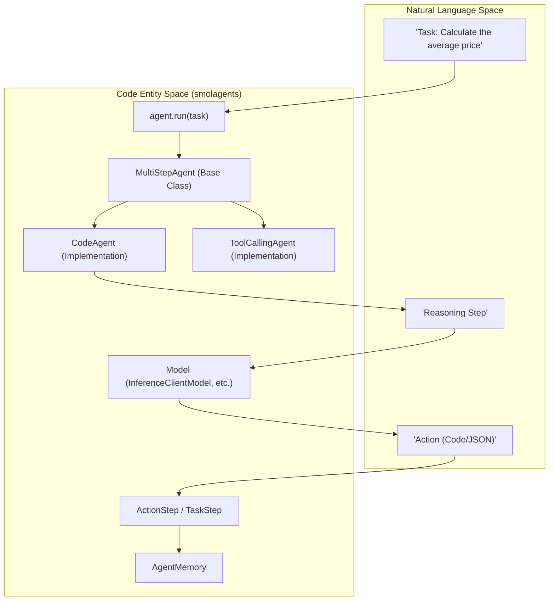
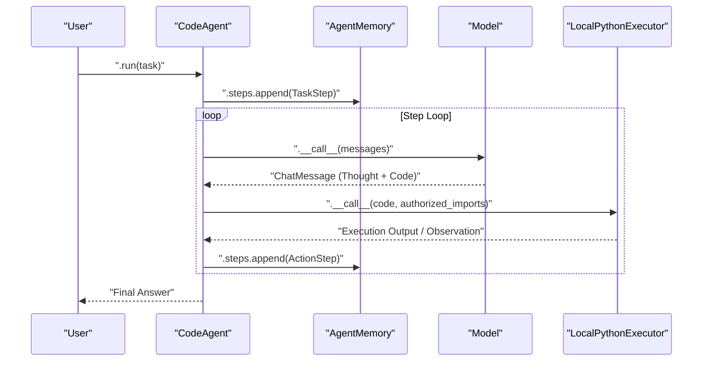

<!-- source: DeepWiki mcp.deepwiki.com · repo huggingface/smolagents · page 10.1 Basic Agent Usage · fetched 2026-10-27 -->

# Basic Agent Usage

<details>
<summary>Relevant source files</summary>

The following files were used as context for generating this wiki page:

- [docs/source/en/examples/using_different_models.md](docs/source/en/examples/using_different_models.md)
- [docs/source/en/guided_tour.md](docs/source/en/guided_tour.md)
- [docs/source/en/reference/models.md](docs/source/en/reference/models.md)
- [examples/agent_from_any_llm.py](examples/agent_from_any_llm.py)
- [src/smolagents/cli.py](src/smolagents/cli.py)
- [src/smolagents/vision_web_browser.py](src/smolagents/vision_web_browser.py)
- [tests/test_cli.py](tests/test_cli.py)
- [tests/test_vision_web_browser.py](tests/test_vision_web_browser.py)

</details>


This page demonstrates the fundamental patterns for creating and running agents in `smolagents`. It covers agent initialization, task execution, tool usage, and model switching through simple examples found in the codebase and `examples/` directory.

## Overview

The basic agent workflow consists of three steps:
1.  **Initialize** an agent with a model and optional tools.
2.  **Run** the agent with a task description.
3.  **Inspect** the results and agent memory.

All agents in `smolagents` follow the ReAct (Reasoning and Acting) paradigm, iteratively generating actions and observing results until reaching a final answer [docs/source/en/guided_tour.md:1-27](). The library emphasizes **Code Agents**, where actions are expressed as Python snippets rather than structured JSON [docs/source/en/guided_tour.md:12-27]().

### Natural Language to Code Entity Mapping: High-Level Architecture

The following diagram maps high-level agent concepts to the specific classes and methods implemented in the `smolagents` library.



**Sources:** [docs/source/en/guided_tour.md:7-62](), [src/smolagents/agents.py:734-738](), [src/smolagents/agents.py:1053-1057]()

## Creating an Agent

Agents require two core components: a `model` to power reasoning and an optional list of `tools` for actions.

### Choosing an Agent Type

`smolagents` provides two primary agent classes [docs/source/en/guided_tour.md:7-10]():

| Agent Class | Action Format | Execution | Best For |
| :--- | :--- | :--- | :--- |
| `CodeAgent` | Python Code | Local/Remote Interpreter | Complex logic, tool chaining, reasoning [docs/source/en/guided_tour.md:12-27]() |
| `ToolCallingAgent` | Structured JSON | Framework-side dispatch | Atomic API calls, high reliability [docs/source/en/guided_tour.md:29-50]() |

### Minimal Agent

The simplest agent initialization requires only a model. By default, `CodeAgent` is used for code-centric reasoning [docs/source/en/guided_tour.md:63-65]().

```python
from smolagents import CodeAgent, InferenceClientModel

model = InferenceClientModel() # Uses default model from HF Hub
agent = CodeAgent(tools=[], model=model)
agent.run("Calculate the sum of numbers from 1 to 10")
```

**Sources:** [docs/source/en/guided_tour.md:71-77](), [docs/source/en/guided_tour.md:121-128]()

## Running Tasks

### Basic Execution

The `run()` method executes a task and returns the final answer. It handles the loop of generating thoughts, executing actions, and updating memory [docs/source/en/guided_tour.md:76-77]().

```python
from smolagents import CodeAgent, WebSearchTool, InferenceClientModel

model = InferenceClientModel()
agent = CodeAgent(tools=[WebSearchTool()], model=model)
result = agent.run("What is the current weather in Paris?")
```

### Execution Flow: Internal Data Path

This diagram illustrates how data flows from the user input through the model and back to the execution environment.



**Sources:** [docs/source/en/guided_tour.md:63-92](), [src/smolagents/agents.py:796-840](), [src/smolagents/local_python_executor.py:48-52]()

## Model Switching

`smolagents` is model-agnostic. You can switch between different providers by changing the `model` instance passed to the agent [docs/source/en/examples/using_different_models.md:1-19]().

### Inference Client (Hugging Face Hub)
Supports providers like Cerebras, Together, and Nebius via `huggingface_hub` [docs/source/en/reference/models.md:60-62]().
```python
from smolagents import InferenceClientModel
model = InferenceClientModel(model_id="deepseek-ai/DeepSeek-R1", provider="together")
```
**Sources:** [docs/source/en/reference/models.md:60-91](), [examples/agent_from_any_llm.py:19-20]()

### Transformers (Local Inference)
Requires `transformers` and `torch` installed [docs/source/en/reference/models.md:55-56]().
```python
from smolagents import TransformersModel
model = TransformersModel(model_id="Qwen/Qwen2.5-Coder-32B-Instruct", device_map="auto")
```
**Sources:** [docs/source/en/reference/models.md:30-58](), [examples/agent_from_any_llm.py:22-23]()

### LiteLLM (Multi-provider Support)
Allows access to 100+ LLMs including Anthropic and OpenAI [docs/source/en/reference/models.md:93-96]().
```python
from smolagents import LiteLLMModel
model = LiteLLMModel(model_id="anthropic/claude-3-5-sonnet-latest", temperature=0.2)
```
**Sources:** [docs/source/en/reference/models.md:93-109](), [examples/agent_from_any_llm.py:33-35]()

### OpenAI / Compatible
Can be used for OpenAI, OpenRouter, or Google Gemini [docs/source/en/examples/using_different_models.md:24-51]().
```python
from smolagents import OpenAIModel
model = OpenAIModel(model_id="gpt-4o", api_key="sk-...")
```
**Sources:** [docs/source/en/reference/models.md:145-173](), [examples/agent_from_any_llm.py:37-39]()

## Using the CLI

The `smolagent` CLI allows for quick testing without writing code. It supports both direct prompts and an interactive mode [docs/source/en/guided_tour.md:107-118]().

```bash
# Direct prompt with specific model and tools
smolagent "Plan a trip to Tokyo" --model-type "InferenceClientModel" --tools "web_search"

# Interactive mode setup
smolagent
```

The CLI utilizes `smolagents.cli.load_model` to instantiate the requested backend [src/smolagents/cli.py:188-194]() and `smolagents.cli.interactive_mode` to guide users through configuration [src/smolagents/cli.py:110-185]().

**Sources:** [docs/source/en/guided_tour.md:107-118](), [src/smolagents/cli.py:45-107](), [src/smolagents/cli.py:188-210]()

## Advanced Usage Examples

### Web Browser Automation
The `vision_web_browser.py` script provides a specialized implementation of `CodeAgent` for browser automation using the `helium` library [src/smolagents/vision_web_browser.py:148-157](). It utilizes `step_callbacks` to capture screenshots after each agent action via the `save_screenshot` function, which updates the `ActionStep` in memory [src/smolagents/vision_web_browser.py:66-84]().

```python
agent = CodeAgent(
    tools=[WebSearchTool(), go_back, close_popups, search_item_ctrl_f],
    model=model,
    additional_authorized_imports=["helium"],
    step_callbacks=[save_screenshot],
    max_steps=20
)
```

**Sources:** [src/smolagents/vision_web_browser.py:148-157](), [src/smolagents/vision_web_browser.py:66-84]()

### Multi-Model Comparison
The `examples/agent_from_any_llm.py` file demonstrates how to compare `ToolCallingAgent` and `CodeAgent` using the same model backend, which is useful for evaluating which paradigm performs better for a specific task [examples/agent_from_any_llm.py:55-61]().

```python
# Comparison logic
agent_tc = ToolCallingAgent(tools=[get_weather], model=model)
agent_code = CodeAgent(tools=[get_weather], model=model)

agent_tc.run("What's the weather like in Paris?")
agent_code.run("What's the weather like in Paris?")
```

**Sources:** [examples/agent_from_any_llm.py:55-61]()

## Error Handling and Security

### Secure Code Execution
`CodeAgent` does not use the vanilla Python interpreter. It uses a `LocalPythonExecutor` that executes code via the Abstract Syntax Tree (AST) to prevent arbitrary execution of dangerous built-ins [docs/source/en/guided_tour.md:67-70](). 

Key safeguards include:
- **Import Restrictions**: Only explicitly authorized imports are allowed via `additional_authorized_imports` [docs/source/en/guided_tour.md:71-77]().
- **Sandboxing**: Support for remote execution in Blaxel, E2B, or Docker [docs/source/en/guided_tour.md:88-88]().

```python
agent = CodeAgent(
    tools=[],
    model=model,
    additional_authorized_imports=['requests', 'bs4']
)
```

### Self-Correction
If the generated code results in an error, the execution stops at that line, and the error is passed back to the agent as an observation. This allows the agent to attempt to fix its own code in the next iteration [docs/source/en/guided_tour.md:83-87]().

**Sources:** [docs/source/en/guided_tour.md:63-92](), [src/smolagents/local_python_executor.py:6-7]()

---

