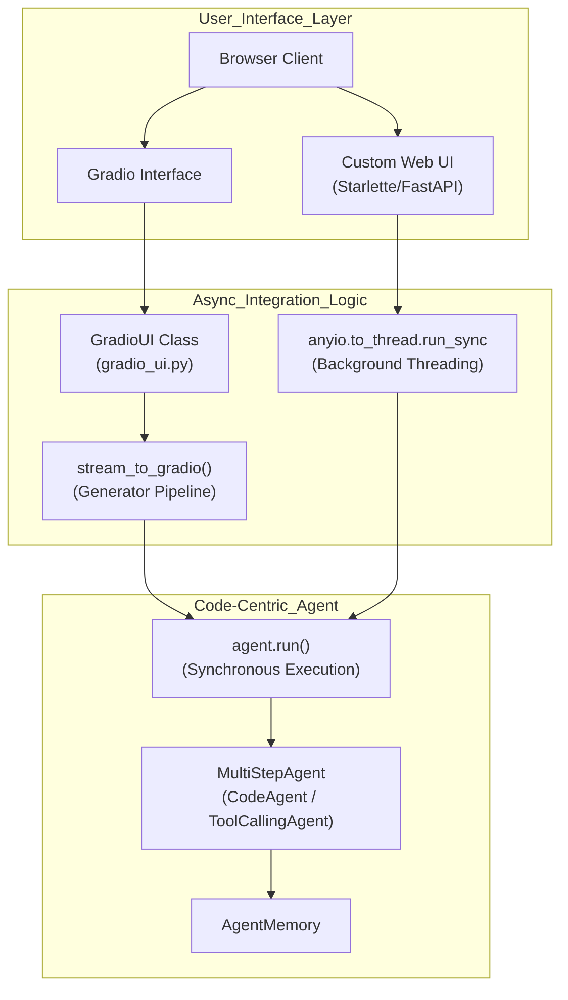
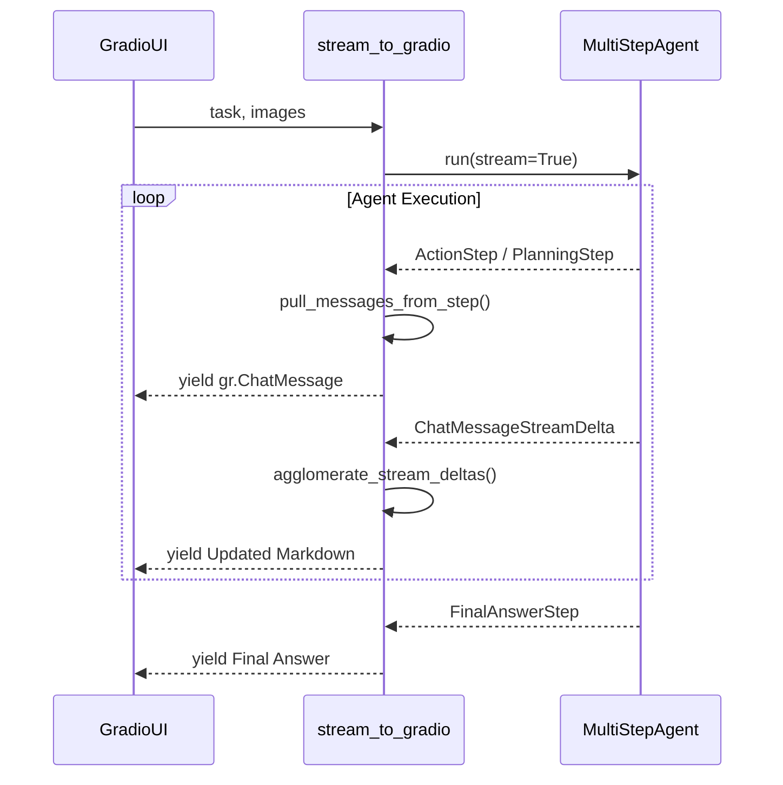
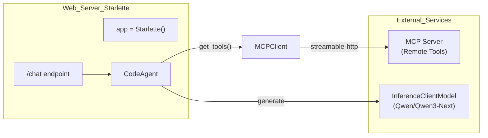

<!-- source: DeepWiki mcp.deepwiki.com · repo huggingface/smolagents · page 10.4 Async Integration & Web Applications · fetched 2026-10-27 -->

# Async Integration & Web Applications

<details>
<summary>Relevant source files</summary>

The following files were used as context for generating this wiki page:

- [docs/source/en/examples/async_agent.md](docs/source/en/examples/async_agent.md)
- [examples/async_agent/README.md](examples/async_agent/README.md)
- [examples/async_agent/main.py](examples/async_agent/main.py)
- [examples/async_agent/requirements.txt](examples/async_agent/requirements.txt)
- [examples/server/README.md](examples/server/README.md)
- [examples/server/main.py](examples/server/main.py)

</details>


This page documents the integration of `smolagents` into asynchronous web environments and user interfaces. It covers the Gradio-based UI components for browser interaction and the patterns for deploying agents within async web frameworks like Starlette and FastAPI.

## Overview

`smolagents` supports web deployment through two primary patterns:
1.  **Gradio UI**: A built-in, high-level class (`GradioUI`) that provides a complete chat interface with support for streaming, file uploads, and multimodal outputs [src/smolagents/gradio_ui.py:279-281]().
2.  **Async Web Frameworks**: Integration with frameworks like Starlette or FastAPI using background threads to prevent synchronous agent execution from blocking the async event loop [docs/source/en/examples/async_agent.md:12-15](), [examples/server/README.md:10-10]().

### Web & Async Architecture

The following diagram bridges the natural language request space to the code entities responsible for execution.

Title: Web Request to Agent Execution Mapping


**Sources:** [src/smolagents/gradio_ui.py:1-464](), [docs/source/en/examples/async_agent.md:1-20](), [examples/server/main.py:1-27]()

## Async Web Framework Integration

Since `MultiStepAgent.run()` is a synchronous, blocking operation, it must be offloaded to a background thread when used in asynchronous web applications (ASGI). This prevents the agent's computation from blocking the server's event loop, ensuring the application remains responsive to other concurrent requests [docs/source/en/examples/async_agent.md:12-15](), [examples/async_agent/README.md:20-22]().

### Threaded Execution Pattern

The recommended approach uses `anyio.to_thread.run_sync` to execute the agent's logic without blocking the main event loop [examples/async_agent/main.py:29-30](), [examples/server/main.py:201-201]().

| Component | Role | File Reference |
|-----------|------|----------------|
| `Starlette` | ASGI application framework used for routing and lifecycle management | [examples/server/main.py:207-214]() |
| `anyio.to_thread.run_sync` | Utility to offload blocking `agent.run` to a worker thread | [examples/async_agent/main.py:29-30]() |
| `JSONResponse` | Starlette response class to return agent results as JSON | [examples/async_agent/main.py:40-42]() |

### Implementation Example (Starlette/FastAPI)

In a typical implementation, the `chat` or `run_agent_endpoint` function awaits the result of the threaded execution [examples/server/main.py:197-204](), [examples/async_agent/main.py:33-42]().

```python
import anyio.to_thread
from starlette.applications import Starlette
from starlette.responses import JSONResponse
from smolagents import CodeAgent

agent = CodeAgent(model=my_model, tools=[])

async def chat_endpoint(request):
    data = await request.json()
    message = data.get("message", "")
    # Offload blocking run to a thread to avoid blocking the event loop
    result = await anyio.to_thread.run_sync(agent.run, message)
    return JSONResponse({"reply": str(result)})

app = Starlette(routes=[Route("/chat", chat_endpoint, methods=["POST"])])
```
**Sources:** [examples/async_agent/main.py:8-50](), [examples/server/main.py:197-204](), [docs/source/en/examples/async_agent.md:46-51]()

## Gradio UI Integration

The `GradioUI` class [src/smolagents/gradio_ui.py:279-281]() wraps an agent to provide a real-time web interface. It handles the conversion of agent internal steps into Gradio `ChatMessage` objects.

### Streaming Pipeline

The `stream_to_gradio()` utility [src/smolagents/gradio_ui.py:248-250]() acts as the bridge between agent execution events and UI updates, iterating over the agent's generator. It handles both full steps and incremental stream deltas [src/smolagents/gradio_ui.py:263-271]().

Title: Gradio Streaming Event Flow


**Sources:** [src/smolagents/gradio_ui.py:248-277](), [src/smolagents/gradio_ui.py:378-421]()

### Step Processing Details

The UI converts different `MemoryStep` types into specific visual components via `pull_messages_from_step` [src/smolagents/gradio_ui.py:227-229]():

*   **ActionStep**: Displays the "Step #" header, LLM reasoning (thought), tool calls (formatted as code for the Python interpreter), and execution logs [src/smolagents/gradio_ui.py:80-140]().
*   **PlanningStep**: Renders the current plan and progress [src/smolagents/gradio_ui.py:166-187]().
*   **Observations**: Images generated or captured during a step are yielded as separate messages with appropriate MIME types [src/smolagents/gradio_ui.py:142-150]().
*   **Footnotes**: Each step includes a footnote with duration and token usage via `get_step_footnote_content()` [src/smolagents/gradio_ui.py:29-36]().

**Sources:** [src/smolagents/gradio_ui.py:29-224]()

## File Uploads and Multimodal Input

`GradioUI` supports file uploads when initialized with a `file_upload_folder` [src/smolagents/gradio_ui.py:316-318]().

### File Handling Logic

1.  **Validation**: The `upload_file()` method [src/smolagents/gradio_ui.py:335-337]() checks for allowed extensions (default: `.pdf`, `.docx`, `.txt`).
2.  **Sanitization**: `_save_uploaded_file()` [src/smolagents/gradio_ui.py:324-326]() uses regex `re.sub(r"[^\w\-.]", "_", original_name)` to replace unsafe characters in filenames.
3.  **Persistence**: Files are copied to the local upload directory using `shutil.copy()` [src/smolagents/gradio_ui.py:332-333]().
4.  **Agent Injection**: Paths to uploaded files are appended to the user's task description before being sent to `agent.run()` [src/smolagents/gradio_ui.py:369-375]().

**Sources:** [src/smolagents/gradio_ui.py:324-376]()

## Server Integration with MCP

For complex environments, agents can be deployed as servers that interact with the **Model Context Protocol (MCP)** to access remote tools [examples/server/main.py:9-20](), [examples/server/README.md:49-66]().

### MCP Server Example

The server setup involves connecting an `MCPClient` to a remote server and passing its tools to a `CodeAgent` [examples/server/main.py:14-20]().

Title: MCP Server and Agent Integration


| Entity | Role | File Reference |
|--------|------|----------------|
| `mcp_client` | Connects to the MCP server via `streamable-http` | [examples/server/main.py:14-14]() |
| `agent` | `CodeAgent` initialized with tools from `mcp_client.get_tools()` | [examples/server/main.py:17-20]() |
| `shutdown` | Handler to call `mcp_client.disconnect()` when the server stops | [examples/server/main.py:24-25]() |

**Sources:** [examples/server/main.py:9-25](), [examples/server/README.md:43-79]()

## Summary of Key UI Classes & Functions

| Symbol | Type | Description |
|--------|------|-------------|
| `GradioUI` | Class | Main entry point for launching the Gradio-based agent web UI [src/smolagents/gradio_ui.py:279-281](). |
| `stream_to_gradio` | Function | Generator that yields Gradio-compatible messages from an agent's stream [src/smolagents/gradio_ui.py:248-250](). |
| `pull_messages_from_step` | Function | Dispatches a `MemoryStep` to specific processors for UI rendering [src/smolagents/gradio_ui.py:227-229](). |
| `_clean_model_output` | Function | Sanitizes raw LLM output by removing trailing `<end_code>` tags [src/smolagents/gradio_ui.py:39-41](). |

**Sources:** [src/smolagents/gradio_ui.py:39-279]()

---

