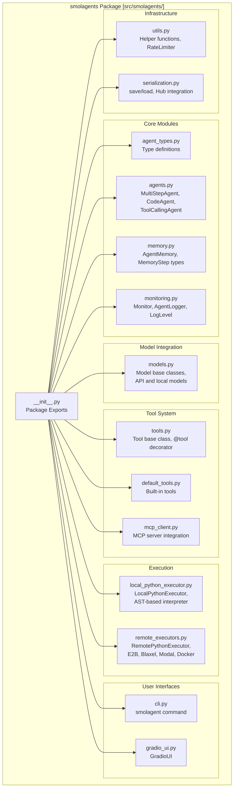
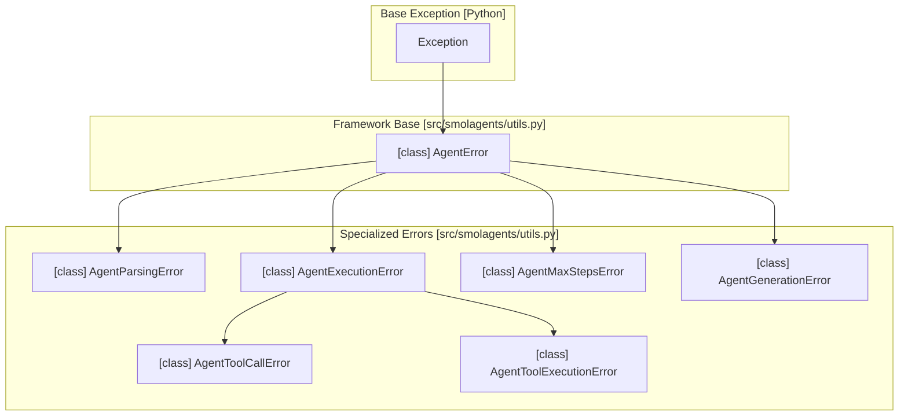

<!-- source: DeepWiki mcp.deepwiki.com · repo huggingface/smolagents · page 11 Reference · fetched 2026-10-27 -->

# Reference

<details>
<summary>Relevant source files</summary>

The following files were used as context for generating this wiki page:

- [CODE_OF_CONDUCT.md](CODE_OF_CONDUCT.md)
- [CONTRIBUTING.md](CONTRIBUTING.md)
- [Makefile](Makefile)
- [pyproject.toml](pyproject.toml)
- [src/smolagents/__init__.py](src/smolagents/__init__.py)

</details>


This section provides technical reference documentation for developers and contributors working with `smolagents`. It covers the package structure, dependency management, error handling, utility functions, and extension points for customizing the framework.

For user-facing API documentation of agents, see [Agent Framework](#3). For tool system details, see [Tool System](#5). For model integration, see [Model Integration](#4).

## Project Structure & Module Organization

The `smolagents` package is organized into focused modules, each handling a specific aspect of the agent framework. The main package exports are defined in `src/smolagents/__init__.py`.

### Module Hierarchy

**Natural Language to Code Entity Space: Package Architecture**



**Sources:** [src/smolagents/__init__.py:1-33]()

### Key Export Patterns

The package uses wildcard imports to expose public APIs from each module in the top-level namespace.

| Module | Key Exports |
|--------|-------------|
| `agent_types` | Type definitions and enums used across the framework |
| `agents` | `MultiStepAgent`, `CodeAgent`, `ToolCallingAgent` |
| `memory` | `AgentMemory`, `SystemPromptStep`, `TaskStep`, `ActionStep`, `PlanningStep` |
| `monitoring` | `Monitor`, `AgentLogger`, `LogLevel`, `TokenUsage`, `Timing` |
| `models` | `Model`, `TransformersModel`, `OpenAIModel`, `LiteLLMModel`, etc. |
| `tools` | `Tool`, `@tool` decorator, `ToolCollection` |
| `default_tools` | `PythonInterpreterTool`, `DuckDuckGoSearchTool`, `VisitWebpageTool` |
| `local_python_executor` | `LocalPythonExecutor` |
| `remote_executors` | `RemotePythonExecutor`, `E2BExecutor`, `DockerExecutor` |
| `utils` | `AgentError`, `parse_json_blob`, `parse_code_blobs` |

**Sources:** [src/smolagents/__init__.py:19-32]()

## Dependency Management

The project uses a sophisticated optional dependency system in `pyproject.toml` to minimize installation footprint while supporting diverse use cases.

### Core Dependencies

The minimal installation requires only essential packages for Hub communication and basic processing.

```toml
dependencies = [
  "huggingface-hub>=0.31.2",
  "requests>=2.32.3",
  "rich>=13.9.4",
  "jinja2>=3.1.4",
  "pillow>=10.0.1",
  "python-dotenv",
]
```

**Sources:** [pyproject.toml:14-22]()

### Optional Dependency Groups

The framework provides numerous optional dependency groups for specific model providers and tools.

| Group | Purpose | Key Packages |
|-------|---------|--------------|
| `toolkit` | Search and web tools | `ddgs`, `markdownify` |
| `transformers` | Local HF models | `transformers`, `accelerate`, `torch` |
| `openai` | OpenAI API client | `openai` |
| `litellm` | LiteLLM proxy | `litellm` |
| `e2b` | E2B sandbox | `e2b-code-interpreter` |
| `docker` | Docker sandbox | `docker`, `websocket-client` |
| `gradio` | Web UI | `gradio` |
| `mcp` | MCP servers | `mcp`, `mcpadapt` |
| `telemetry` | Observability | `arize-phoenix`, `opentelemetry-sdk` |

**Sources:** [pyproject.toml:24-91]()

### Script Entry Points

The package defines two CLI entry points:
- **`smolagent`**: Main CLI for running agents via `smolagents.cli:main`.
- **`webagent`**: Specialized browser agent via `smolagents.vision_web_browser:main`.

**Sources:** [pyproject.toml:139-142]()

## Error Types & Exception Hierarchy

The framework defines a structured exception hierarchy for different failure modes, all inheriting from the base `AgentError`.

### Error Class Hierarchy

**Natural Language to Code Entity Space: Exception Structure**



**Sources:** [src/smolagents/utils.py:92-138]()

### Error Type Reference

| Exception | Raised When |
|-----------|-------------|
| `AgentParsingError` | Errors in parsing LLM output (e.g., missing code blocks). |
| `AgentExecutionError` | Errors during the execution phase of the agent. |
| `AgentMaxStepsError` | Agent reaches the `max_steps` limit without a final answer. |
| `AgentToolCallError` | Incorrect arguments are passed to a tool. |
| `AgentToolExecutionError` | An error occurs while running a tool's logic. |
| `AgentGenerationError` | Errors during the LLM generation process. |

**Sources:** [src/smolagents/utils.py:104-138]()

## Utility Functions & Helpers

The `utils.py` module contains critical helpers for parsing LLM outputs and managing code objects.

### Key Utilities

- **`parse_json_blob(json_blob)`**: Extracts a JSON object from text, often used by `ToolCallingAgent`. [src/smolagents/utils.py:166-187]()
- **`parse_code_blobs(text, code_block_tags)`**: Extracts Python code from LLM output, supporting both custom tags and standard markdown blocks. [src/smolagents/utils.py:198-225]()
- **`make_json_serializable(obj)`**: Recursively converts complex objects (including custom classes) into JSON-safe formats. [src/smolagents/utils.py:140-164]()
- **`sanitize_for_rich(value)`**: Prepares strings for terminal output by escaping control characters. [src/smolagents/utils.py:64-89]()

**Sources:** [src/smolagents/utils.py:64-225]()

## Testing & Validation

The framework uses `pytest` for its test suite, with configurations defined in `pyproject.toml`.

- **Linter**: `ruff` is used for quality checks with a line length of 119. [pyproject.toml:119-126]()
- **CI/Dev Environment**: Developers can install dev dependencies using the `[dev]` optional group, which includes quality and test requirements. [pyproject.toml:110-113]()
- **Testing Scripts**: A `Makefile` provides convenient shortcuts for running quality checks (`make quality`), formatting code (`make style`), and running the full test suite (`make test`). [Makefile:1-17]()

**Sources:** [pyproject.toml:98-126](), [Makefile:1-17](), [CONTRIBUTING.md:115-132]()

## Extending the Framework

For details on extending specific components, see the following child pages:
- **Project Structure & Dependencies**: Detailed package configuration and build system. See [Project Structure & Dependencies](#11.1).
- **Error Types & Exception Hierarchy**: Detailed exception reference and handling patterns. See [Error Types & Exception Hierarchy](#11.2).
- **Utility Functions & Helpers**: Comprehensive utility reference for parsing and serialization. See [Utility Functions & Helpers](#11.3).
- **Testing & Validation**: Guide to framework testing, quality standards, and validation logic. See [Testing & Validation](#11.4).
- **Extending the Framework**: Guide for creating custom agents, models, and tools. See [Extending the Framework](#11.5).

---

