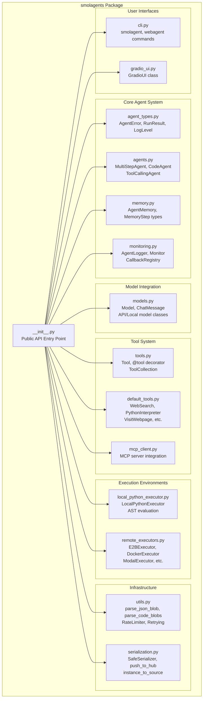
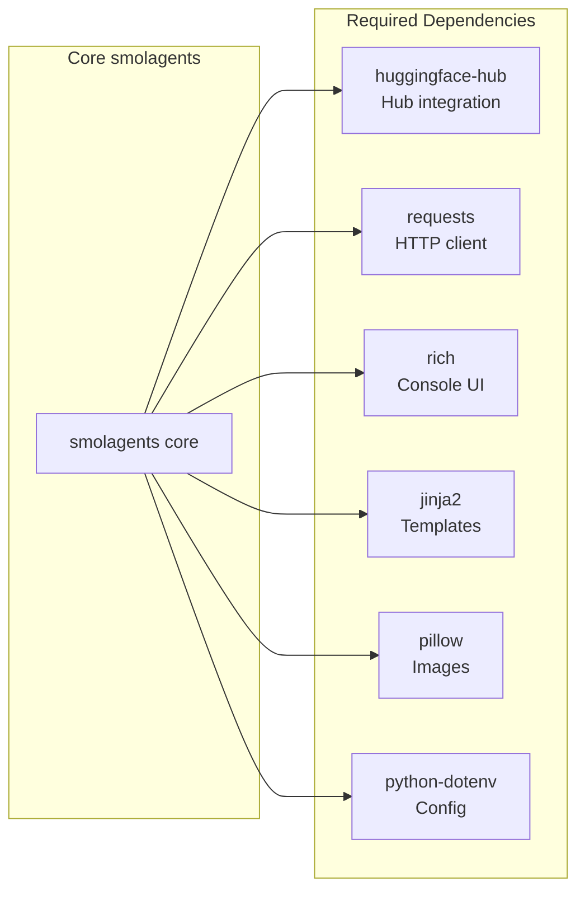
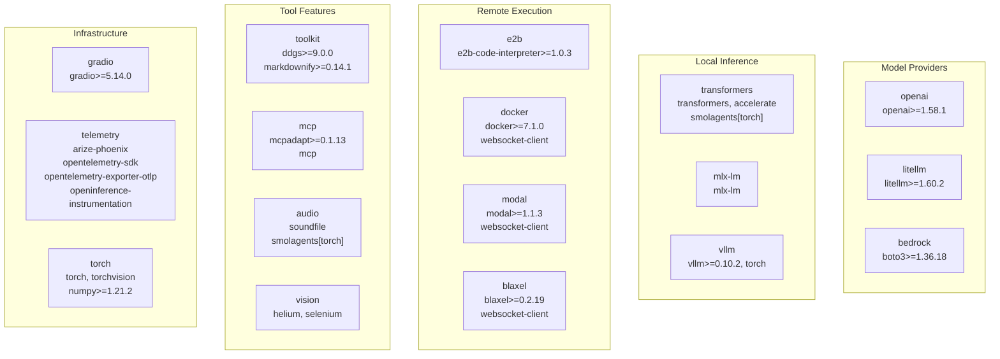

<!-- source: DeepWiki mcp.deepwiki.com · repo huggingface/smolagents · page 11.1 Project Structure & Dependencies · fetched 2026-10-27 -->

# Project Structure & Dependencies

<details>
<summary>Relevant source files</summary>

The following files were used as context for generating this wiki page:

- [.github/workflows/quality.yml](.github/workflows/quality.yml)
- [.github/workflows/tests.yml](.github/workflows/tests.yml)
- [pyproject.toml](pyproject.toml)
- [src/smolagents/__init__.py](src/smolagents/__init__.py)
- [tests/test_import.py](tests/test_import.py)

</details>


This page provides technical reference documentation for developers working with or extending the `smolagents` codebase. It covers the package structure, dependency organization, and build configuration.

For information about installation and setup for end users, see [Installation & Dependencies](#2.1). For extending the framework with custom components, see [Extending the Framework](#11.5).

## Package Organization

The `smolagents` package is organized into focused modules, each responsible for a specific subsystem. The public API is exported through a single entry point at `src/smolagents/__init__.py`.

### Module Structure Diagram



**Sources:** [src/smolagents/__init__.py:1-33]()

### Module Responsibilities

| Module | Primary Classes/Functions | Purpose |
|--------|---------------------------|---------|
| `agent_types` | `AgentError`, `RunResult`, `LogLevel` | Type definitions and exceptions |
| `agents` | `MultiStepAgent`, `CodeAgent`, `ToolCallingAgent` | Core agent implementations |
| `memory` | `AgentMemory`, `SystemPromptStep`, `TaskStep`, `ActionStep`, `PlanningStep`, `FinalAnswerStep` | Conversation history and state |
| `monitoring` | `AgentLogger`, `Monitor`, `CallbackRegistry` | Logging, metrics, and callbacks |
| `models` | `Model`, `ChatMessage`, `TransformersModel`, `OpenAIModel`, `LiteLLMModel`, etc. | LLM abstraction and integrations |
| `tools` | `Tool`, `@tool`, `ToolCollection` | Tool definition and validation |
| `default_tools` | `DuckDuckGoSearchTool`, `PythonInterpreterTool`, `VisitWebpageTool`, etc. | Pre-built tool implementations |
| `mcp_client` | MCP integration utilities | Model Context Protocol support |
| `local_python_executor` | `LocalPythonExecutor`, `evaluate_python_code` | AST-based local code execution |
| `remote_executors` | `E2BExecutor`, `DockerExecutor`, `ModalExecutor`, `BlaxelExecutor` | Sandboxed code execution |
| `utils` | `parse_json_blob`, `parse_code_blobs`, `RateLimiter`, `Retrying` | Parsing and utility functions |
| `serialization` | `SafeSerializer`, `push_to_hub`, `instance_to_source` | Serialization and Hub integration |
| `cli` | `main()` functions | Command-line interface |
| `gradio_ui` | `GradioUI` | Web-based UI component |

**Sources:** [src/smolagents/__init__.py:19-32]()

## Core Dependencies

The `smolagents` package requires a minimal set of dependencies to function. These are always installed regardless of which features you use.

### Required Dependencies Table

| Dependency | Minimum Version | Purpose |
|------------|-----------------|---------|
| `huggingface-hub` | 0.31.2 | Hub integration, model/tool sharing |
| `requests` | 2.32.3 | HTTP requests for tools and APIs |
| `rich` | 13.9.4 | Console formatting and logging |
| `jinja2` | 3.1.4 | Prompt template rendering |
| `pillow` | 10.0.1 | Image processing (security fix) |
| `python-dotenv` | (any) | Environment variable loading |

**Note:** The minimum Python version is 3.10 as specified in `requires-python = ">=3.10"`.

**Sources:** [pyproject.toml:13-22]()

### Core Dependency Diagram



**Sources:** [pyproject.toml:14-22]()

## Optional Dependency Groups

The `smolagents` package uses optional dependency groups to keep the core installation lightweight while enabling advanced features when needed. Install groups using `pip install smolagents[group1,group2]`.

### Feature-Enabling Dependencies



**Sources:** [pyproject.toml:24-94]()

### Dependency Group Reference

#### Model Provider Groups

| Group | Dependencies | Enables | Documentation |
|-------|--------------|---------|---------------|
| `openai` | `openai>=1.58.1` | `OpenAIModel` for OpenAI, Gemini, OpenRouter APIs | See [API-Based Models](#4.2) |
| `litellm` | `litellm>=1.60.2` | `LiteLLMModel` for 100+ model providers | See [API-Based Models](#4.2) |
| `bedrock` | `boto3>=1.36.18` | `AmazonBedrockModel` for AWS Bedrock | See [API-Based Models](#4.2) |

**Sources:** [pyproject.toml:25-27,52-54,66-68]()

#### Local Inference Groups

| Group | Dependencies | Enables | Documentation |
|-------|--------------|---------|---------------|
| `transformers` | `transformers>=4.0.0`, `accelerate`, `smolagents[torch]` | `TransformersModel` with HuggingFace models | See [Local Inference Models](#4.3) |
| `mlx-lm` | `mlx-lm` | `MLXModel` for Apple Silicon | See [Local Inference Models](#4.3) |
| `vllm` | `vllm>=0.10.2`, `torch` | `VLLMModel` for high-throughput inference | See [Local Inference Models](#4.3) |
| `torch` | `torch`, `torchvision`, `numpy>=1.21.2` | PyTorch-based models and tools | Base dependency for other groups |

**Sources:** [pyproject.toml:32-36,59-61,79-83,88-91]()

#### Remote Executor Groups

| Group | Dependencies | Enables | Documentation |
|-------|--------------|---------|---------------|
| `e2b` | `e2b-code-interpreter>=1.0.3`, `python-dotenv>=1.0.1` | `E2BExecutor` for cloud sandboxing | See [Remote Executors](#6.3) |
| `docker` | `docker>=7.1.0`, `websocket-client` | `DockerExecutor` for container execution | See [Remote Executors](#6.3) |
| `modal` | `modal>=1.1.3`, `websocket-client` | `ModalExecutor` for serverless containers | See [Remote Executors](#6.3) |
| `blaxel` | `blaxel>=0.2.19`, `websocket-client` | `BlaxelExecutor` for fast hibernating VMs | See [Remote Executors](#6.3) |

**Sources:** [pyproject.toml:28-31,41-44,45-48,62-65]()

#### Tool and Feature Groups

| Group | Dependencies | Enables | Documentation |
|-------|--------------|---------|---------------|
| `toolkit` | `ddgs>=9.0.0`, `markdownify>=0.14.1` | `DuckDuckGoSearchTool`, `VisitWebpageTool` | See [Built-in Tools](#5.2) |
| `mcp` | `mcpadapt>=0.1.13`, `mcp` | Model Context Protocol tool integration | See [External Tool Sources](#5.4) |
| `audio` | `soundfile`, `smolagents[torch]` | `SpeechToTextTool` with Whisper | See [Built-in Tools](#5.2) |
| `vision` | `helium`, `selenium` | Browser automation for `webagent` CLI | See [Command Line Interface](#8.2) |
| `gradio` | `gradio>=5.14.0` | `GradioUI` web interface | See [Gradio Web UI](#8.3) |
| `telemetry` | `arize-phoenix`, `opentelemetry-sdk`, `opentelemetry-exporter-otlp`, `openinference-instrumentation-smolagents>=0.1.15` | OpenTelemetry tracing and Arize Phoenix | See [OpenTelemetry Integration](#7.3) |

**Sources:** [pyproject.toml:37-40,49-51,55-58,69-74,75-78,84-87]()

#### Development Groups

| Group | Dependencies | Purpose |
|-------|--------------|---------|
| `all` | All optional groups | Install all features at once |
| `quality` | `ruff>=0.9.0` | Code linting and formatting |
| `test` | `pytest>=8.1.0`, `ipython>=8.31.0`, `pandas>=2.2.3`, etc. | Testing infrastructure |
| `dev` | `smolagents[quality,test]`, `sqlalchemy` | Complete development environment |

**Sources:** [pyproject.toml:92-113]()

## Build Configuration

The package uses `setuptools` as its build backend with specific configurations for packaging and distribution.

### Build System Configuration

| Setting | Value | Purpose |
|---------|-------|---------|
| Build system | `setuptools` | Package builder |
| Build backend | `setuptools.build_meta` | Build backend module |
| Package name | `smolagents` | PyPI package name |
| Version | `1.27.0.dev0` | Current development version |
| Python requirement | `>=3.10` | Minimum Python version |

**Sources:** [pyproject.toml:1-7,13]()

### Package Data

The package includes non-Python files that are shipped with the distribution:

```python
[tool.setuptools.package-data]
"smolagents.prompts" = ["*.yaml"]
```

This configuration ensures all YAML files in `src/smolagents/prompts/` are included in the package distribution. These files contain prompt templates used by agents.

**Sources:** [pyproject.toml:136-137]()

### Entry Points (CLI Scripts)

Two command-line entry points are defined:

| Script Name | Module Function | Purpose |
|-------------|-----------------|---------|
| `smolagent` | `smolagents.cli:main` | General-purpose agent CLI |
| `webagent` | `smolagents.vision_web_browser:main` | Browser automation CLI |

These are automatically installed as executable scripts when the package is installed.

**Sources:** [pyproject.toml:139-141]()

## Version Management

The package version is defined in two locations:

1. **pyproject.toml**: `version = "1.27.0.dev0"` [pyproject.toml:7]()
2. **__init__.py**: `__version__ = "1.27.0.dev0"` [src/smolagents/__init__.py:17]()

The `.dev0` suffix indicates this is a development version. Version numbers follow semantic versioning (MAJOR.MINOR.PATCH).

**Sources:** [pyproject.toml:7](), [src/smolagents/__init__.py:17]()

## Code Quality Configuration

The project uses `ruff` for linting and formatting with the following configuration:

### Ruff Settings

| Setting | Value | Purpose |
|---------|-------|---------|
| Line length | 119 characters | Maximum line length |
| Ignored rules | `F403` (import star), `E501` (line too long) | Exceptions to linting |
| Selected rules | `E`, `F`, `I`, `W` | Error, pyflakes, isort, warning checks |
| Known first-party | `smolagents` | Import sorting configuration |
| Lines after imports | 2 | Blank lines after import blocks |

### Per-File Ignores

```toml
[tool.ruff.lint.per-file-ignores]
"examples/*" = [
  "E402",  # module-import-not-at-top-of-file
]
```

Example files are allowed to have imports not at the top, enabling demonstration-focused code organization.

**Sources:** [pyproject.toml:119-134]()

## Test Configuration

The project uses `pytest` with specific configuration:

```toml
[tool.pytest.ini_options]
addopts = "-sv --durations=0"
```

| Option | Purpose |
|--------|---------|
| `-s` | Disable output capturing (show print statements) |
| `-v` | Verbose output |
| `--durations=0` | Show all test durations |

Additional test dependencies include timeout support (`pytest-timeout`), data directory fixtures (`pytest-datadir`), and environment variable handling (`python-dotenv`). The project also ensures the library can be imported without extra dependencies via automated tests.

**Sources:** [pyproject.toml:115-117,98-109](), [tests/test_import.py:6-31]()

## Dependency Selection Guide

Use this decision tree to determine which optional dependencies to install:

```mermaid
graph TD
    Start["Which features do you need?"]
    
    Start --> Models{"Which models?"}
    Models -->|"OpenAI/Gemini/OpenRouter"| InstallOpenAI["install smolagents[openai]"]
    Models -->|"100+ providers"| InstallLiteLLM["install smolagents[litellm]"]
    Models -->|"AWS Bedrock"| InstallBedrock["install smolagents[bedrock]"]
    Models -->|"Local HF models"| InstallTransformers["install smolagents[transformers]"]
    Models -->|"Apple Silicon"| InstallMLX["install smolagents[mlx-lm]"]
    Models -->|"High-throughput"| InstallVLLM["install smolagents[vllm]"]
    
    Start --> Execution{"Code execution?"}
    Execution -->|"Development only"| UseLocal["Use LocalPythonExecutor<br/>No extra deps needed"]
    Execution -->|"Production cloud"| InstallE2B["install smolagents[e2b]"]
    Execution -->|"Self-hosted Docker"| InstallDocker["install smolagents[docker]"]
    Execution -->|"Serverless"| InstallModal["install smolagents[modal]"]
    Execution -->|"Fast VMs"| InstallBlaxel["install smolagents[blaxel]"]
    
    Start --> Tools{"Which tools?"}
    Tools -->|"Web search/scraping"| InstallToolkit["install smolagents[toolkit]"]
    Tools -->|"MCP servers"| InstallMCP["install smolagents[mcp]"]
    Tools -->|"Speech-to-text"| InstallAudio["install smolagents[audio]"]
    Tools -->|"Browser automation"| InstallVision["install smolagents[vision]"]
    
    Start --> UI{"Which interface?"}
    UI -->|"Gradio web UI"| InstallGradio["install smolagents[gradio]"]
    UI -->|"CLI only"| CoreOnly["Core package sufficient"]
    
    Start --> Monitoring{"Telemetry?"}
    Monitoring -->|"OpenTelemetry/Phoenix"| InstallTelemetry["install smolagents[telemetry]"]
    Monitoring -->|"Basic logging"| CoreLogging["Use AgentLogger<br/>No extra deps needed"]
```



**Sources:** [pyproject.toml:24-94]()

---

