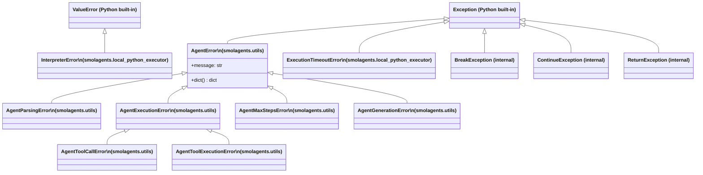
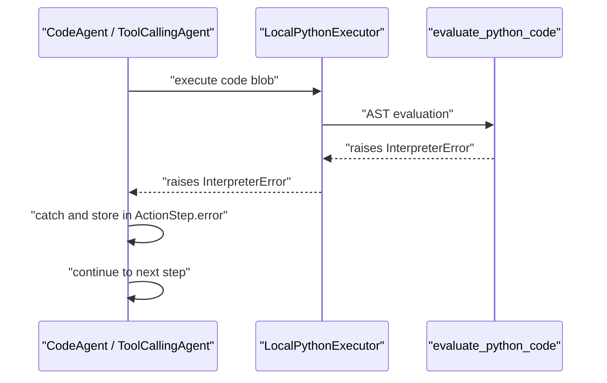
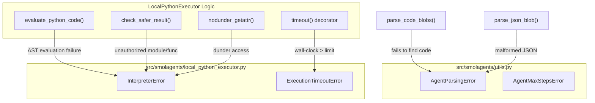

<!-- source: DeepWiki mcp.deepwiki.com · repo huggingface/smolagents · page 11.2 Error Types & Exception Hierarchy · fetched 2026-10-27 -->

# Error Types & Exception Hierarchy

<details>
<summary>Relevant source files</summary>

The following files were used as context for generating this wiki page:

- [src/smolagents/local_python_executor.py](src/smolagents/local_python_executor.py)
- [src/smolagents/utils.py](src/smolagents/utils.py)
- [tests/test_local_python_executor.py](tests/test_local_python_executor.py)
- [tests/test_utils.py](tests/test_utils.py)

</details>


This page documents every exception class defined in `smolagents`, their inheritance relationships, when each is raised, and how to catch them. It covers exceptions in the agent orchestration layer, the Python code execution layer, and the serialization layer.

For context on how errors are recorded in agent memory after they occur, see [9.3](). For how the local executor's safety limits trigger errors, see [6.2]().

---

## Exception Hierarchy Overview

`smolagents` exceptions fall into four distinct groups:

1.  **Agent-level errors** — raised during orchestration, parsing, model calls, and tool execution. Defined in `src/smolagents/utils.py`.
2.  **Executor errors** — raised during Python code interpretation. Defined in `src/smolagents/local_python_executor.py`.
3.  **Serialization errors** — raised when data cannot be safely transferred to/from remote executors. (Referenced in framework security logic).
4.  **Internal flow-control exceptions** — private to `LocalPythonExecutor`; not intended to be caught by user code.

**Full Exception Hierarchy**



Sources: [src/smolagents/utils.py:92-137](), [src/smolagents/local_python_executor.py:42-48](), [src/smolagents/local_python_executor.py:308-311](), [src/smolagents/local_python_executor.py:688-705]()

---

## Agent-Level Exceptions

All agent-level exceptions share a common base class `AgentError`, defined in [src/smolagents/utils.py:92-101](). A key characteristic of `AgentError` is that **construction itself logs the error**: the constructor calls `logger.log_error(message)` immediately, so the error is always captured in the agent's observable output even if the exception is later swallowed [src/smolagents/utils.py:95-98]().

Every `AgentError` subclass also exposes a `dict()` method returning `{"type": "<ClassName>", "message": "<message>"}`, which is how errors are serialized into `ActionStep` records in agent memory [src/smolagents/utils.py:100-101]().

### Quick Reference

| Exception | Parent | Source location | Raised when |
| :--- | :--- | :--- | :--- |
| `AgentError` | `Exception` | [src/smolagents/utils.py:92-101]() | Base class only; not raised directly |
| `AgentParsingError` | `AgentError` | [src/smolagents/utils.py:104-107]() | LLM output could not be parsed (e.g., missing code block, malformed JSON) |
| `AgentExecutionError` | `AgentError` | [src/smolagents/utils.py:110-113]() | General failure during an agent execution step |
| `AgentMaxStepsError` | `AgentError` | [src/smolagents/utils.py:116-119]() | Agent reached `max_steps` without producing a final answer |
| `AgentToolCallError` | `AgentExecutionError` | [src/smolagents/utils.py:122-125]() | Incorrect arguments were passed to a tool (argument validation failure) |
| `AgentToolExecutionError` | `AgentExecutionError` | [src/smolagents/utils.py:128-131]() | A tool's `forward()` method raised an exception during execution |
| `AgentGenerationError` | `AgentError` | [src/smolagents/utils.py:134-137]() | The LLM model call failed to return a valid response |

Sources: [src/smolagents/utils.py:92-137]()

---

### `AgentParsingError`

Raised when the agent receives a response from the model that cannot be converted into a valid action.

*   **For `CodeAgent`:** occurs when `parse_code_blobs()` cannot find a valid code block in the model output (e.g., the model forgot to wrap code in the expected tags) [src/smolagents/utils.py:198-211]().
*   **For `ToolCallingAgent`:** occurs when structured tool-call JSON is missing or malformed, handled by `parse_json_blob()` [src/smolagents/utils.py:166-186]().

---

### `AgentExecutionError`

The direct parent of `AgentToolCallError` and `AgentToolExecutionError`. Represents a failure that occurred while carrying out an action (as opposed to generating one) [src/smolagents/utils.py:110-113]().

---

### `AgentToolCallError`

Raised when a tool is called with incorrect or missing arguments — for example, when required parameters are absent or have the wrong type. This is often triggered during the parsing of model arguments for a specific tool [src/smolagents/utils.py:122-125]().

---

### `AgentToolExecutionError`

Raised when a tool's `forward()` method itself raises an exception during execution. The original exception is wrapped and its message is passed as the error message [src/smolagents/utils.py:128-131]().

---

### `AgentMaxStepsError`

Raised at the end of the `run()` loop when the agent exhausts its `max_steps` budget without calling `final_answer` [src/smolagents/utils.py:116-119]().

---

### `AgentGenerationError`

Raised when the model backend fails to generate a usable response — for example, due to a network error, API rate limit, or the model returning an empty output [src/smolagents/utils.py:134-137]().

---

## Executor Exceptions

These exceptions originate inside the code execution layer. They are defined in `src/smolagents/local_python_executor.py` and are **not** subclasses of `AgentError`. They propagate upward to the agent, which catches them and wraps relevant details into an `AgentExecutionError` or `AgentToolExecutionError` for storage in agent memory.

**How executor exceptions flow into agent memory**



Sources: [src/smolagents/local_python_executor.py:42-48](), [src/smolagents/local_python_executor.py:308-311]()

---

### `InterpreterError`

**Inheritance:** `ValueError` → `InterpreterError`

**Definition:** [src/smolagents/local_python_executor.py:42-48]()

The primary exception raised by the AST-based Python interpreter inside `LocalPythonExecutor`. It signals that the interpreter encountered code it could not safely or correctly evaluate. Common causes:

| Cause | Example trigger |
| :--- | :--- |
| Unauthorized import | `import os` without `os` in `authorized_imports` [src/smolagents/local_python_executor.py:168-170]() |
| Forbidden access to module | Accessing a `DANGEROUS_MODULES` member [src/smolagents/local_python_executor.py:130-141]() |
| Dunder attribute access | `obj.__class__` (except `ALLOWED_DUNDER_METHODS`) [src/smolagents/local_python_executor.py:68-71]() |
| Undefined variable | Referencing a name not in scope |
| Assignment to a tool name | `print = "hello"` (would overwrite a tool) [tests/test_local_python_executor.py:78-81]() |
| Forbidden function call | Calling a builtin like `eval()` or `exec()` [src/smolagents/local_python_executor.py:143-153]() |
| Unpacking error | Unpacking a non-dict value in `**kwargs` [tests/test_local_python_executor.py:171-201]() |

Because `InterpreterError` extends `ValueError` (not `Exception` directly), it can be caught with either `except InterpreterError` or `except ValueError`.

---

### `ExecutionTimeoutError`

**Inheritance:** `Exception` → `ExecutionTimeoutError`

**Definition:** [src/smolagents/local_python_executor.py:308-311]()

Raised when code execution exceeds `MAX_EXECUTION_TIME_SECONDS` (default: 30 seconds). The timeout is enforced using a `ThreadPoolExecutor`-based decorator (`timeout`) that wraps the execution logic [src/smolagents/local_python_executor.py:279-305](). This approach is cross-platform (works on Windows) and thread-safe, unlike signal-based timeouts.

---

## Internal Flow-Control Exceptions

The following exceptions are **private implementation details** of `LocalPythonExecutor`. They are used to implement Python control-flow semantics within the AST interpreter and should never be caught by user code.

| Exception | Purpose |
| :--- | :--- |
| `BreakException` | Implements `break` inside `for`/`while` loops [src/smolagents/local_python_executor.py:688-691]() |
| `ContinueException` | Implements `continue` inside `for`/`while` loops [src/smolagents/local_python_executor.py:695-698]() |
| `ReturnException` | Implements `return` from user-defined functions; carries the return value in `.value` [src/smolagents/local_python_executor.py:702-705]() |

**Definition:** [src/smolagents/local_python_executor.py:688-705]()

---

## Where Exceptions Are Raised: Code Entity Map

This diagram maps each exception to the specific code construct that raises it.



Sources: [src/smolagents/utils.py:92-137](), [src/smolagents/local_python_executor.py:42-71](), [src/smolagents/local_python_executor.py:156-183](), [src/smolagents/utils.py:166-186]()

---

## Catching Exceptions

### Catching agent-level errors

```python
from smolagents import AgentError
from smolagents.utils import AgentParsingError, AgentMaxStepsError

try:
    result = agent.run("some task")
except AgentMaxStepsError:
    # agent ran out of steps
    ...
except AgentParsingError:
    # model output could not be parsed
    ...
except AgentError as e:
    # catch any other agent-level failure
    print(e.message)
    print(e.dict())  # {"type": "...", "message": "..."}
```

### Catching executor errors

```python
from smolagents.local_python_executor import (
    InterpreterError,
    ExecutionTimeoutError,
)

try:
    output = executor(code_string)
except ExecutionTimeoutError:
    # code ran for too long
    ...
except InterpreterError as e:
    # code could not be evaluated safely
    ...
```

---

## Public Exports

The following exceptions are re-exported or intended for public reference:

| Symbol | Defined in |
| :--- | :--- |
| `AgentError` | `src/smolagents/utils.py` [src/smolagents/utils.py:41]() |
| `AgentParsingError` | `src/smolagents/utils.py` [src/smolagents/utils.py:104]() |
| `AgentExecutionError` | `src/smolagents/utils.py` [src/smolagents/utils.py:110]() |
| `AgentMaxStepsError` | `src/smolagents/utils.py` [src/smolagents/utils.py:116]() |
| `AgentToolCallError` | `src/smolagents/utils.py` [src/smolagents/utils.py:122]() |
| `AgentToolExecutionError` | `src/smolagents/utils.py` [src/smolagents/utils.py:128]() |
| `AgentGenerationError` | `src/smolagents/utils.py` [src/smolagents/utils.py:134]() |
| `InterpreterError` | `src/smolagents/local_python_executor.py` [src/smolagents/local_python_executor.py:42]() |
| `ExecutionTimeoutError` | `src/smolagents/local_python_executor.py` [src/smolagents/local_python_executor.py:308]() |

Sources: [src/smolagents/utils.py:41-137](), [src/smolagents/local_python_executor.py:42-48](), [src/smolagents/local_python_executor.py:308-311]()

---

