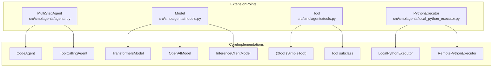

<!-- source: DeepWiki mcp.deepwiki.com · repo huggingface/smolagents · page 11.5 Extending the Framework · fetched 2026-10-27 -->

# Extending the Framework

<details>
<summary>Relevant source files</summary>

The following files were used as context for generating this wiki page:

- [src/smolagents/agents.py](src/smolagents/agents.py)
- [src/smolagents/models.py](src/smolagents/models.py)
- [src/smolagents/remote_executors.py](src/smolagents/remote_executors.py)
- [tests/test_agents.py](tests/test_agents.py)
- [tests/test_models.py](tests/test_models.py)
- [tests/test_remote_executors.py](tests/test_remote_executors.py)

</details>


This guide provides technical reference for extending `smolagents` by creating custom agents, models, tools, and executors. It documents the base classes, required interfaces, validation requirements, and integration patterns needed to implement custom components.

For usage examples of built-in components, see **Getting Started**. For tool creation patterns specifically, see **Creating Custom Tools**.

---

## Extension Points Overview

The `smolagents` framework provides four primary extension points, each with well-defined interfaces:

**Diagram: smolagents Code Entity Space**


**Sources:** [src/smolagents/agents.py:268-293](), [src/smolagents/models.py:452-482](), [src/smolagents/tools.py:98-136](), [src/smolagents/local_python_executor.py:49-55]()

---

## Creating Custom Agents

### Agent Interface Requirements

Custom agents must subclass `MultiStepAgent` and implement the abstract method `_step_stream()`. The base class handles the ReAct loop, memory management, and lifecycle hooks.

**Required Methods:**

| Method | Return Type | Purpose |
|--------|------------|---------|
| `initialize_system_prompt()` | `str` | Generate system prompt with tool descriptions and instructions. |
| `_step_stream()` | `Generator` | Execute one ReAct step, yielding intermediate outputs or deltas. |

**Sources:** [src/smolagents/agents.py:268-293](), [src/smolagents/agents.py:749-752](), [src/smolagents/agents.py:772-780]()

### System Prompt Construction

The `initialize_system_prompt()` method typically uses `populate_template()` to inject tools and instructions into a Jinja2 template.

```python
# Pattern from MultiStepAgent
def initialize_system_prompt(self) -> str:
    return populate_template(
        self.prompt_templates["system_prompt"],
        variables={
            "tools": self.tools,
            "tool_descriptions": self.tool_descriptions,
            "managed_agents": self.managed_agents,
        }
    )
```

**Sources:** [src/smolagents/agents.py:102-107](), [src/smolagents/agents.py:354-362](), [src/smolagents/agents.py:166-181]()

### Step Execution Implementation

The `_step_stream()` method receives a `MemoryStep` (usually an `ActionStep`) and must:

1. Generate LLM output via `self.model.generate()`.
2. Parse the output to extract actions (code or JSON).
3. Execute actions and capture observations.
4. Update the `ActionStep` object with results.
5. Yield `ActionOutput` or `ChatMessageStreamDelta`.

**Sources:** [src/smolagents/agents.py:772-788](), [src/smolagents/agents.py:1020-1131](), [src/smolagents/agents.py:1342-1449]()

---

## Creating Custom Models

### Model Interface Requirements

Custom models must subclass `Model` and implement the `generate()` method. Optionally implement `generate_stream()` for real-time updates.

**Required Methods:**

| Method | Return Type | Purpose |
|--------|------------|---------|
| `generate(messages, ...)` | `ChatMessage` | Process a list of `ChatMessage` and return the assistant response. |

**Optional Methods:**

| Method | Return Type | Purpose |
|--------|------------|---------|
| `generate_stream(messages, ...)` | `Generator` | Yield `ChatMessageStreamDelta` objects during generation. |

**Sources:** [src/smolagents/models.py:452-482](), [src/smolagents/models.py:553-578]()

### Message Processing and Stop Sequences

The base `Model` class provides `_prepare_completion_kwargs()` which standardizes inputs. It handles:
- **Parameter Precedence:** `self.kwargs` overrides parameters passed to `generate()`. [tests/test_models.py:50-78]()
- **Stop Sequences:** Automatically filters sequences if the provider doesn't support the `stop` parameter via `remove_content_after_stop_sequences`. [src/smolagents/models.py:79-91]()
- **Multimodal Content:** Encodes images to Base64 via `encode_image_base64`. [src/smolagents/models.py:29]()

**Sources:** [src/smolagents/models.py:502-551](), [src/smolagents/models.py:441-449]()

---

## Creating Custom Tools

### Tool Definition Approaches

`smolagents` validates tools through `validate_tool_attributes()` and `MethodChecker`.

**Diagram: Tool Validation Data Flow**
```mermaid
graph TD
    "ToolClassOrFunc"["Tool Class/Func"] --> "validate_after_init"["validate_after_init"]
    "validate_after_init" --> "validate_arguments"["validate_arguments()"]
    "validate_arguments" --> "is_valid_name"["is_valid_name()"]
    "validate_arguments" --> "MethodChecker"["MethodChecker.check_method()"]
    "MethodChecker" --> "ast_parse"["ast.parse(source)"]
    "ast_parse" --> "ImportFinder"["ImportFinder"]
    "ImportFinder" --> "UndefinedNameCheck"["Undefined Name Check"]
    "ImportFinder" --> "LocalImportCheck"["Local Import Check"]
```

**Sources:** [src/smolagents/tools.py:70-79](), [src/smolagents/tools.py:144-160]()

### Requirements for Subclassing `Tool`

When subclassing `Tool`, you must provide:
- `name`: A valid Python identifier. [src/smolagents/tools.py:167-170]()
- `description`: String used in the system prompt.
- `inputs`: A dictionary defining `type` and `description` for each argument.
- `output_type`: A string from `AUTHORIZED_TYPES`. [src/smolagents/tools.py:82-93]()

**Sources:** [src/smolagents/tools.py:106-136](), [src/smolagents/tools.py:144-160]()

---

## Creating Custom Executors

### Remote Executor Interface

To create a custom sandboxed environment, subclass `RemotePythonExecutor`. This class handles variable serialization and tool patching automatically.

**Key functions to override or use:**

| Function | File | Purpose |
|----------|------|---------|
| `run_code_raise_errors` | `src/smolagents/remote_executors.py:82` | Abstract method to execute code on the remote target. |
| `send_variables` | `src/smolagents/remote_executors.py:115` | Serializes local state for the remote kernel. |
| `send_tools` | `src/smolagents/remote_executors.py:94` | Sends tool source code to the remote environment. |
| `_patch_final_answer_with_exception` | `src/smolagents/remote_executors.py:143` | Modifies `FinalAnswerTool` to signal completion via exceptions. |

**Sources:** [src/smolagents/remote_executors.py:53-84](), [src/smolagents/remote_executors.py:143-157]()

### Serialization Logic

`RemotePythonExecutor` uses `SafeSerializer` to move data. It supports a prefix-based format:
- `safe:` for JSON-compatible data.
- `pickle:` for complex objects (only if `allow_pickle=True`). [src/smolagents/remote_executors.py:74-78]()

**Sources:** [src/smolagents/remote_executors.py:115-131](), [src/smolagents/remote_executors.py:143-186]()

---

## Integration Patterns

### Multi-Agent Systems
Custom agents can be wrapped as `ManagedAgent` instances. This allows a "manager" agent to call them as if they were tools.
- **Task Delegation:** The manager sends a task string to the managed agent via the `task` prompt template. [src/smolagents/agents.py:149]()
- **Reporting:** The managed agent returns a result which is formatted via the `report` template and injected back into the manager's memory. [src/smolagents/agents.py:150]()

**Sources:** [src/smolagents/agents.py:140-151](), [src/smolagents/agents.py:369-388]()

### Custom Callbacks
The `CallbackRegistry` allows injecting logic into the agent lifecycle. You can register functions to trigger on specific step types (e.g., `ActionStep`, `PlanningStep`).
- **Registration:** Use `agent.register_callback()`. [src/smolagents/agents.py:326-333]()
- **Execution:** The agent calls `self.callbacks.on_step_end(step)` at the end of every ReAct loop iteration. [src/smolagents/agents.py:817-818]()

**Sources:** [src/smolagents/memory.py:465-475](), [src/smolagents/agents.py:817-818]()

---

