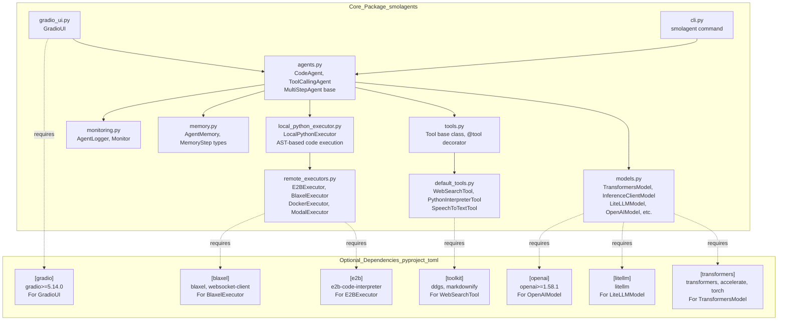
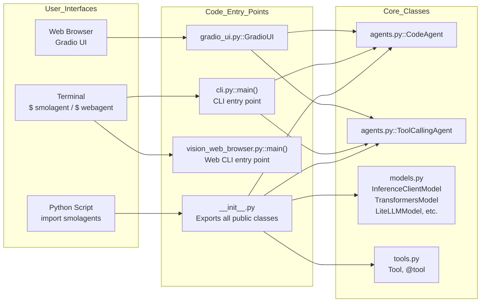
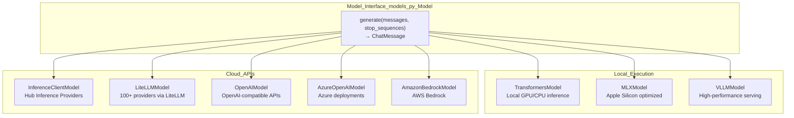

<!-- source: DeepWiki mcp.deepwiki.com · repo huggingface/smolagents · page 2 Getting Started · fetched 2026-10-27 -->

# Getting Started

<details>
<summary>Relevant source files</summary>

The following files were used as context for generating this wiki page:

- [README.md](README.md)
- [docs/source/en/index.md](docs/source/en/index.md)
- [docs/source/en/installation.md](docs/source/en/installation.md)
- [docs/source/en/tutorials/secure_code_execution.md](docs/source/en/tutorials/secure_code_execution.md)
- [pyproject.toml](pyproject.toml)
- [src/smolagents/__init__.py](src/smolagents/__init__.py)

</details>


This section provides everything you need to begin using `smolagents`: installation instructions, your first agent, and an introduction to core concepts. For advanced configuration and deployment patterns, see the Agent Framework section ([Agent Framework](#3)) and later chapters.

## What is smolagents?

`smolagents` is a lightweight Python library designed to make it extremely easy to build and run agents using just a few lines of code [docs/source/en/index.md:9-9](). Unlike traditional agent frameworks where agents output JSON tool calls, `smolagents`' `CodeAgent` writes Python code snippets to perform actions, enabling natural composability like function nesting and loops [docs/source/en/index.md:15-15]().

The framework is deliberately minimal—the core logic fits in approximately 1,000 lines of code [README.md:36-36]()—while providing production-ready features including:

- **Model-agnostic design**: Works with local `transformers`, cloud APIs (OpenAI, Anthropic, etc.), and 100+ providers via `LiteLLM` [README.md:42-42]().
- **Secure execution**: AST-based local interpreter or sandboxed environments via Blaxel, E2B, Modal, Docker, or Pyodide+Deno WebAssembly [README.md:38-38]().
- **Hub integration**: Share and load agents/tools from Hugging Face Hub as Gradio Spaces [docs/source/en/index.md:19-19]().
- **Multiple interfaces**: Python API, CLI (`smolagent`, `webagent`), and Gradio web UI [docs/source/en/index.md:27-27]().

## Package Structure

The library is organized into focused modules with optional dependency groups for different use cases:

"Core Package Architecture"


**Sources**: [pyproject.toml:24-94](), [src/smolagents/__init__.py:19-32]()

## Entry Points to Code

The library provides three main ways to interact with agents, each mapping to specific code entry points:

"UI to Code Entity Mapping"


**Sources**: [pyproject.toml:139-141](), [src/smolagents/__init__.py:19-32]()

## Installation

### Minimal Installation

For basic functionality with cloud-based models:

```bash
pip install smolagents
```

This installs core dependencies including `huggingface-hub`, `requests`, `rich`, `jinja2`, `pillow`, and `python-dotenv` [pyproject.toml:14-22]().

### With Default Tools

To enable the built-in toolbox (e.g., `DuckDuckGoSearchTool`, `VisitWebpageTool`):

```bash
pip install "smolagents[toolkit]"
```

### With Local Models

For running models locally using `transformers` or Apple Silicon with `MLX`:

```bash
pip install "smolagents[transformers]"  # Standard transformers [pyproject.toml:79-83]
pip install "smolagents[mlx-lm]"       # Apple Silicon [pyproject.toml:59-61]
```

### Common Combinations

For all available extras (includes remote executors, telemetry, etc.):

```bash
pip install "smolagents[all]"
```

**For detailed dependency information and use-case-specific installations, see [Installation & Dependencies](#2.1).**

**Sources**: [pyproject.toml:24-94](), [docs/source/en/installation.md:38-251]()

## Your First Agent in 30 Seconds

Here's a minimal working example using a cloud-based model and web search:

```python
from smolagents import CodeAgent, DuckDuckGoSearchTool, InferenceClientModel

# Initialize model (uses Hugging Face Inference API)
model = InferenceClientModel()

# Create agent with web search capability
agent = CodeAgent(tools=[DuckDuckGoSearchTool()], model=model)

# Run a task
result = agent.run("What is the current weather in Paris?")
print(result)
```

### What Happens Internally

1. `CodeAgent` receives the task and initializes `AgentMemory` [src/smolagents/__init__.py:25]().
2. The agent enters a ReAct loop:
   - It generates Python code to call tools via `model.generate()` [src/smolagents/models.py:126]().
   - Executes code using `LocalPythonExecutor` (default) [src/smolagents/local_python_executor.py:545]().
   - Stores the execution result in memory steps.
   - Repeats until a final answer is produced.

**For a complete walkthrough with multiple examples, see [Quick Start Guide](#2.2).**

**Sources**: [docs/source/en/index.md:68-79](), [README.md:60-67]()

## Agent Types: CodeAgent vs ToolCallingAgent

The library provides two agent paradigms with different execution models [docs/source/en/index.md:15-17]():

| Aspect | `CodeAgent` | `ToolCallingAgent` |
|--------|-------------|-------------------|
| **Action Format** | Python code snippets | JSON/Text tool calls |
| **Tool Invocation** | `result = tool_name(arg)` | Structured JSON blobs |
| **Execution** | `LocalPythonExecutor` (AST) or Sandbox | Direct tool execution |
| **Strengths** | Composability, loops, reasoning | Standard industry format |

**For detailed comparison and when to use each, see [Key Concepts](#2.3) and [Agent Framework](#3).**

**Sources**: [docs/source/en/index.md:15-17](), [docs/source/en/tutorials/secure_code_execution.md:10-24]()

## Model Integration Overview

The framework is model-agnostic. All models implement the `Model` interface [src/smolagents/models.py:126]():

"Model Provider Architecture"


**For complete model configuration and provider-specific examples, see [Model Integration](#4).**

**Sources**: [src/smolagents/models.py:126-785](), [README.md:80-173]()

## Execution Environment Quick Reference

`CodeAgent` requires a Python execution environment. Choice affects security [docs/source/en/tutorials/secure_code_execution.md:43-47]():

| Executor Type | Security Level | Setup Complexity |
|---------------|----------------|------------------|
| **LocalPythonExecutor** (default) | Medium (AST-based) | None |
| **Remote Executors** (E2B, Blaxel, Modal, Docker) | High (Sandboxed) | Requires API keys/Docker |

**LocalPythonExecutor** works by loading the Abstract Syntax Tree (AST) and executing operation by operation with strict rules on imports and resource usage [docs/source/en/tutorials/secure_code_execution.md:54-60]().

**For detailed security models and deployment recommendations, see [Code Execution & Security](#6).**

**Sources**: [docs/source/en/tutorials/secure_code_execution.md:51-103](), [src/smolagents/remote_executors.py:23]().

## Next Steps

Now that you understand the basics:

1. **[Installation & Dependencies](#2.1)**: Detailed dependency groups and environment setup.
2. **[Quick Start Guide](#2.2)**: Step-by-step examples with `CodeAgent` and `ToolCallingAgent`.
3. **[Key Concepts](#2.3)**: Deep dive into the ReAct loop, memory, and tools.

**Sources**: Wiki Table of Contents structure.

---

