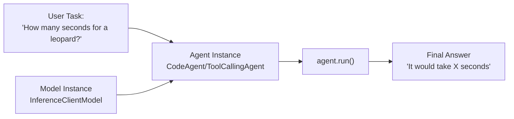
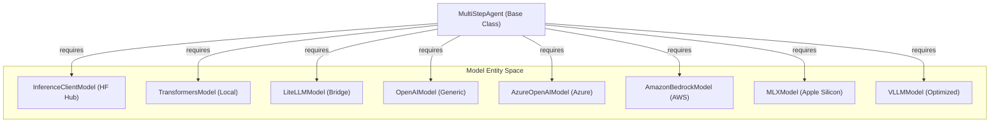
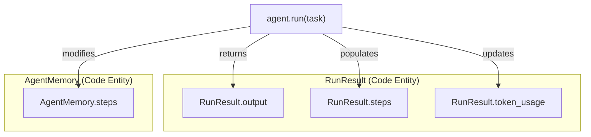

<!-- source: DeepWiki mcp.deepwiki.com · repo huggingface/smolagents · page 2.2 Quick Start Guide · fetched 2026-10-27 -->

# Quick Start Guide

<details>
<summary>Relevant source files</summary>

The following files were used as context for generating this wiki page:

- [README.md](README.md)
- [docs/source/en/examples/using_different_models.md](docs/source/en/examples/using_different_models.md)
- [docs/source/en/guided_tour.md](docs/source/en/guided_tour.md)
- [docs/source/en/index.md](docs/source/en/index.md)
- [docs/source/en/reference/models.md](docs/source/en/reference/models.md)
- [docs/source/en/tutorials/secure_code_execution.md](docs/source/en/tutorials/secure_code_execution.md)

</details>


This guide provides minimal working examples to get you running quickly with `smolagents`. For installation, see [Installation & Dependencies](#2.1). For detailed conceptual background, see [Key Concepts](#2.3).

---

## Quick Start Flow

The following diagram illustrates the high-level data flow when initializing and running an agent.

Title: Agent Execution Flow


**Typical quick start flow**: A user instantiates a `Model` (e.g., `InferenceClientModel` [src/smolagents/models.py:60-62]()), passes it to an agent constructor (`CodeAgent` [src/smolagents/agents.py:1260-1260]() or `ToolCallingAgent` [src/smolagents/agents.py:1700-1700]()), and invokes `agent.run(task)` [src/smolagents/agents.py:840-840]().

Sources: [src/smolagents/agents.py:840-840](), [docs/source/en/guided_tour.md:121-144](), [README.md:60-67]()

---

## Minimal CodeAgent Example

The `CodeAgent` is the flagship agent type in `smolagents`. It generates Python code to perform actions, allowing for complex logic and data transformation [docs/source/en/guided_tour.md:12-27]().

```python
from smolagents import CodeAgent, InferenceClientModel

# Initialize model and agent
model = InferenceClientModel() # Uses default model if model_id omitted
agent = CodeAgent(tools=[], model=model)

# Run task
result = agent.run("Calculate the sum of numbers from 1 to 10")
print(result)  # Output: 55
```

**How it works**: The agent generates a Python code block, which is extracted by `parse_code_blobs` [src/smolagents/utils.py:94-94]() and executed by the `LocalPythonExecutor` [src/smolagents/local_python_executor.py:52-54](). By default, it uses a restricted set of safe functions and disallows imports unless explicitly authorized via `additional_authorized_imports` [docs/source/en/guided_tour.md:67-71](). To make it secure for production, `smolagents` supports executing in sandboxed environments via Blaxel, E2B, Modal, or Docker [README.md:38-38]().

Sources: [src/smolagents/agents.py:1260-1350](), [docs/source/en/guided_tour.md:63-93](), [docs/source/en/index.md:47-59](), [src/smolagents/local_python_executor.py:52-54](), [src/smolagents/utils.py:94-94]()

---

## Minimal ToolCallingAgent Example

`ToolCallingAgent` follows the industry-standard pattern of generating structured JSON tool calls instead of arbitrary code, making it safer for environments where code execution is restricted [docs/source/en/guided_tour.md:29-50]().

```python
from smolagents import ToolCallingAgent, InferenceClientModel, DuckDuckGoSearchTool

# Initialize model and agent
model = InferenceClientModel()
agent = ToolCallingAgent(tools=[DuckDuckGoSearchTool()], model=model)

# Run task
result = agent.run("What is the current weather in Paris?")
print(result)
```

The agent generates a JSON blob that is parsed by `parse_json_if_needed` [src/smolagents/models.py:71-71]() and executed by calling the tool's `forward()` method [src/smolagents/tools.py:81-81]().

Sources: [src/smolagents/agents.py:1700-1700](), [docs/source/en/guided_tour.md:94-105](), [docs/source/en/index.md:67-79](), [src/smolagents/models.py:71-71](), [src/smolagents/tools.py:81-81]()

---

## CodeAgent vs ToolCallingAgent

The following diagram bridges the natural language intent to the specific code entities responsible for execution.

Title: Bridge - NL Intent to Code Entity Space

```mermaid
graph TB
    subgraph CodeAgentFlow["CodeAgent Execution (Code Entity Space)"]
        CA_Model["Model.generate()"]
        CA_Parse["parse_code_blobs()"]
        CA_Exec["LocalPythonExecutor.__call__()"]
        CA_Result["Python variable state"]
        
        CA_Model --> CA_Parse
        CA_Parse --> CA_Exec
        CA_Exec --> CA_Result
    end
    
    subgraph ToolCallingAgentFlow["ToolCallingAgent Execution (Code Entity Space)"]
        TCA_Model["Model.generate()"]
        TCA_Parse["parse_json_if_needed()"]
        TCA_Validate["validate_tool_arguments()"]
        TCA_Call["BaseTool.forward()"]
        TCA_Result["Tool return value"]
        
        TCA_Model --> TCA_Parse
        TCA_Parse --> TCA_Validate
        TCA_Validate --> TCA_Call
        TCA_Call --> TCA_Result
    end
```


| Aspect | CodeAgent | ToolCallingAgent |
|--------|-----------|------------------|
| **Output Format** | Python code snippets [docs/source/en/guided_tour.md:12-12]() | Structured JSON [docs/source/en/guided_tour.md:29-29]() |
| **Execution** | `LocalPythonExecutor` [src/smolagents/local_python_executor.py:52-52]() | `BaseTool.forward()` [src/smolagents/tools.py:81-81]() |
| **Expressivity** | High (loops, complex logic) [docs/source/en/guided_tour.md:21-21]() | Low (atomic tool calls) [docs/source/en/guided_tour.md:48-48]() |
| **Security** | Local AST execution or Sandbox [docs/source/en/guided_tour.md:88-92]() | Safe by default (No code execution) |

Sources: [docs/source/en/guided_tour.md:7-62](), [src/smolagents/agents.py:1260-1350](), [src/smolagents/agents.py:1700-1700](), [src/smolagents/tools.py:81-81](), [src/smolagents/local_python_executor.py:52-52]()

---

## Choosing a Model

Title: Model Provider Integration


All models inherit from the `Model` base class [src/smolagents/models.py:20-22]().

**Common Configurations:**
- **HF Inference**: `InferenceClientModel(model_id="...", provider="...")` [src/smolagents/models.py:60-62]()
- **Local Transformers**: `TransformersModel(model_id="...", device_map="auto")` [src/smolagents/models.py:30-32]()
- **LiteLLM (100+ Providers)**: `LiteLLMModel(model_id="anthropic/claude-3-5-sonnet-latest")` [src/smolagents/models.py:93-95]()
- **OpenAI-Compatible**: `OpenAIModel(model_id="...", api_base="...")` [src/smolagents/models.py:145-147]()

Sources: [src/smolagents/models.py:20-147](), [docs/source/en/guided_tour.md:121-128](), [docs/source/en/reference/models.md:13-112](), [docs/source/en/examples/using_different_models.md:8-19]()

---

## Adding Tools

Tools can be added via the `tools` list in the agent constructor. You can use built-in tools or create custom ones using the `@tool` decorator [src/smolagents/tools.py:71-71]().

```python
from smolagents import tool, CodeAgent, InferenceClientModel

@tool
def get_weather(location: str) -> str:
    """
    Gets current weather for a location.
    
    Args:
        location: City name
    """
    return f"Weather in {location}: Sunny, 72°F"

agent = CodeAgent(tools=[get_weather], model=InferenceClientModel())
```

- **`@tool` decorator**: Automatically creates a `Tool` instance from a function, using its docstring for the tool description [src/smolagents/tools.py:71-71]().
- **Hub Tools**: Load tools directly from the Hugging Face Hub using `Tool.from_hub("username/tool-name")` [README.md:40-41]().

Sources: [src/smolagents/tools.py:71-71](), [docs/source/en/guided_tour.md:410-531](), [README.md:40-41]()

---

## Inspecting Results

Title: Result and Memory Inspection


**Full result access**:
```python
agent = CodeAgent(tools=[], model=InferenceClientModel())
# Set stream_outputs=True to see real-time execution logs
agent = CodeAgent(tools=[], model=InferenceClientModel(), stream_outputs=True)
result = agent.run("Calculate 2**10")

print(result) # Final answer
```

The agent maintains a memory of all steps taken, which can be inspected via `agent.memory.steps` [src/smolagents/agents.py:148-148](). The final execution metadata is returned as a `RunResult` object [src/smolagents/agents.py:196-215]().

Sources: [src/smolagents/agents.py:148-215](), [README.md:64-64]()

---

## CLI Quick Start

The `smolagent` CLI allows running agents directly from the terminal without writing Python boilerplate [docs/source/en/guided_tour.md:107-117]().

```bash
# Interactive mode (guides you through model and tool selection)
smolagent

# Direct prompt with tools and authorized imports
smolagent "Plan a trip to Tokyo" --model-type "InferenceClientModel" --tools "web_search" --imports "pandas numpy"
```

The CLI orchestrates agent creation and provides a quick way to test prompts with different configurations [README.md:175-180]().

Sources: [docs/source/en/guided_tour.md:107-117](), [README.md:175-180]()

---

