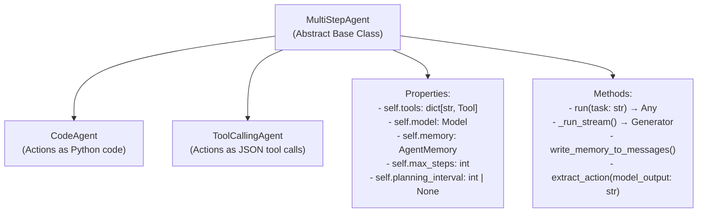
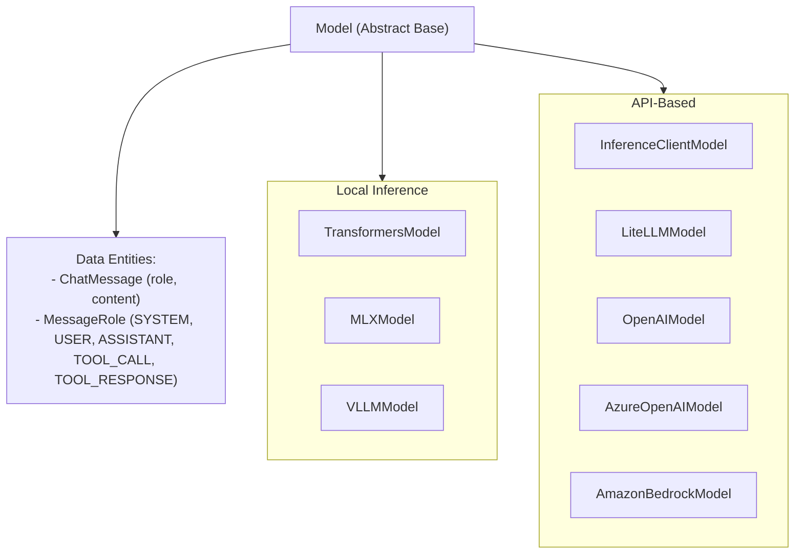
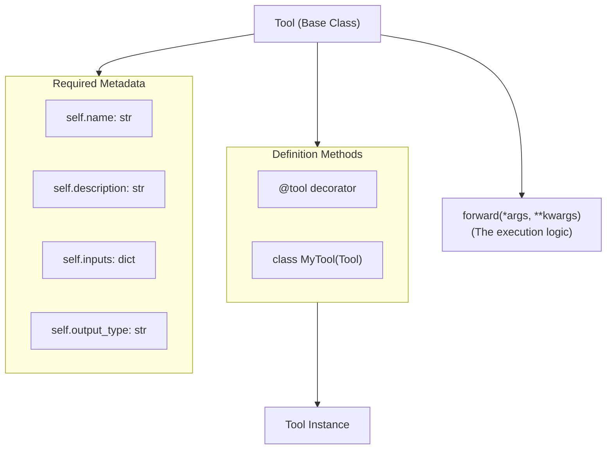

<!-- source: DeepWiki mcp.deepwiki.com · repo huggingface/smolagents · page 2.3 Key Concepts · fetched 2026-10-27 -->

# Key Concepts

Relevant source files

The following files were used as context for generating this wiki page:

- [docs/source/en/conceptual_guides/intro_agents.md](docs/source/en/conceptual_guides/intro_agents.md)
- [docs/source/en/conceptual_guides/react.md](docs/source/en/conceptual_guides/react.md)
- [docs/source/en/examples/rag.md](docs/source/en/examples/rag.md)
- [docs/source/en/examples/text_to_sql.md](docs/source/en/examples/text_to_sql.md)
- [docs/source/en/tutorials/building_good_agents.md](docs/source/en/tutorials/building_good_agents.md)
- [docs/source/en/tutorials/tools.md](docs/source/en/tutorials/tools.md)
- [docs/source/hi/conceptual_guides/react.md](docs/source/hi/conceptual_guides/react.md)
- [docs/source/zh/conceptual_guides/react.md](docs/source/zh/conceptual_guides/react.md)

This page explains the fundamental building blocks of `smolagents`: agents, models, tools, the ReAct loop, memory, and execution environments. These concepts form the foundation for understanding how to build and customize agentic systems.

For detailed API documentation, see the Agent Framework ([#3]()), Model Integration ([#4]()), and Tool System ([#5]()).

---

## The Agent Abstraction

Agents are the central orchestrators in `smolagents`. All agents inherit from `MultiStepAgent` and implement a ReAct-style iterative loop where they think, act, and observe until reaching a final answer [docs/source/en/conceptual_guides/react.md:7-18](). The agent is a system that uses an LLM as its engine rather than being just the LLM itself. Agency is viewed as a spectrum, from simple routers to autonomous code-generating systems [docs/source/en/conceptual_guides/intro_agents:12-23]().

### Agent Hierarchy and Structure

The diagram below bridges the high-level agent concept to the specific class hierarchy and core attributes used in the codebase.

**Diagram: Agent Class Architecture**

**Agent Type Comparison**

| Aspect | `CodeAgent` | `ToolCallingAgent` |
|--------|-----------|------------------|
| Action format | Python code snippets [docs/source/en/conceptual_guides/react.md:44-44]() | Structured JSON tool calls [docs/source/en/conceptual_guides/react.md:45-45]() |
| Strengths | Expressive logic, complex data handling [docs/source/en/conceptual_guides/intro_agents.md:91-95]() | Standardized, easy to parse for traditional APIs [docs/source/en/conceptual_guides/react.md:45-46]() |
| Execution | Via local interpreter or secure sandboxes | Direct `tool.forward()` calls |
| Use Case | Problem solver, programmer, complex reasoning | Dispatcher, controller, atomic API calls |

Sources: [docs/source/en/conceptual_guides/react.md:7-46](), [docs/source/en/conceptual_guides/intro_agents.md:1-95]()

---

## The Model Interface

Models provide the LLM abstraction layer. All models inherit from a base interface and provide a unified method for generating completions based on chat history.

### Model Integration Mapping

This diagram maps the natural language "Model" concept to specific provider classes and the data flow through chat entities.

**Diagram: Model Entity Space**

**Message Flow**

Agents convert their internal memory into a list of LLM-readable chat messages using `agent.write_memory_to_messages()` before sending them to the `Model` object [docs/source/en/conceptual_guides/react.md:15-16](). Stronger models (e.g., `Llama-3.3-70B` or `Qwen-Thinking` models) are recommended for complex agentic reasoning [docs/source/en/tutorials/building_good_agents.md:125-127](), [docs/source/en/examples/text_to_sql.md:178-185]().

Sources: [docs/source/en/conceptual_guides/react.md:15-16](), [docs/source/en/tutorials/building_good_agents.md:125-127](), [docs/source/en/examples/text_to_sql.md:128-133]()

---

## The Tool System

A tool is a class that wraps a function with metadata (name, description, inputs, output type) that helps the LLM understand how to use it [docs/source/en/tutorials/tools.md:13-20]().

### Tool Entity Mapping

This diagram bridges the conceptual "Tool" with the class-based implementation requirements in `smolagents`.

**Diagram: Tool Code Entity Space**

**Tool Components**
- **`name`**: Unique identifier for the tool used in code or JSON calls [docs/source/en/tutorials/tools.md:49-49]().
- **`description`**: Semantic description used to populate the agent's system prompt [docs/source/en/tutorials/tools.md:50-50]().
- **`inputs`**: Dictionary specifying JSON schema-compatible types and descriptions for arguments [docs/source/en/tutorials/tools.md:51-52]().
- **`forward`**: The core method containing the logic to be executed [docs/source/en/tutorials/tools.md:53-53]().

Sources: [docs/source/en/tutorials/tools.md:11-60](), [docs/source/en/examples/text_to_sql.md:97-119](), [docs/source/en/examples/rag.md:107-143]()

---

## The ReAct Loop

The ReAct (Reasoning + Acting) framework is the core execution pattern. Agents solve tasks in steps consisting of reasoning followed by action [docs/source/en/conceptual_guides/react.md:3-5]().

**Execution Lifecycle**
1. **Initialization**: System prompt is stored in `SystemPromptStep`; task is logged in `TaskStep` [docs/source/en/conceptual_guides/react.md:11-11]().
2. **Reasoning**: `agent.write_memory_to_messages()` prepares history for the `Model` [docs/source/en/conceptual_guides/react.md:15-15]().
3. **Action**: `Model` completion is parsed into an action (JSON for `ToolCallingAgent`, Python for `CodeAgent`) [docs/source/en/conceptual_guides/react.md:16-16]().
4. **Execution**: Action is performed (e.g., tool call), and results are logged as an `ActionStep` [docs/source/en/conceptual_guides/react.md:17-17]().
5. **Observation**: Resulting tool output is fed back into memory for the next step iteration.

Sources: [docs/source/en/conceptual_guides/react.md:1-20](), [docs/source/en/conceptual_guides/intro_agents.md:27-35]()

---

## Memory and State

`AgentMemory` maintains the conversation history and execution logs. It allows the LLM to self-correct based on previous errors or observations [docs/source/en/tutorials/building_good_agents.md:16-16]().

| Step Type | Description |
|-----------|-------------|
| `SystemPromptStep` | The base instructions and tool definitions [docs/source/en/conceptual_guides/react.md:11-11](). |
| `TaskStep` | The specific goal provided by the user [docs/source/en/conceptual_guides/react.md:11-11](). |
| `ActionStep` | Records reasoning, the action taken, and the observation (tool output) [docs/source/en/conceptual_guides/react.md:17-17](). |
| `PlanningStep` | (Optional) Periodically revised plan and facts about the task [docs/source/en/conceptual_guides/react.md:20-20](). |

Sources: [docs/source/en/conceptual_guides/react.md:11-20](), [docs/source/en/tutorials/building_good_agents.md:79-80]()

---

## Execution Environments

For `CodeAgent`, the generated Python code must be executed in a controlled environment.

- **Local Execution**: Uses an AST-based interpreter to execute code safely on the host machine.
- **Sandboxed Execution**: Code can be executed in isolated environments like Docker or remote executors (E2B, Blaxel) to prevent unauthorized access to the host system.
- **Tool Logic**: Even in `ToolCallingAgent`, the logic within a tool's `forward` method is executed locally or via defined remote calls [docs/source/en/tutorials/tools.md:39-43]().

Sources: [docs/source/en/conceptual_guides/react.md:43-46](), [docs/source/en/tutorials/tools.md:91-110]()

---

