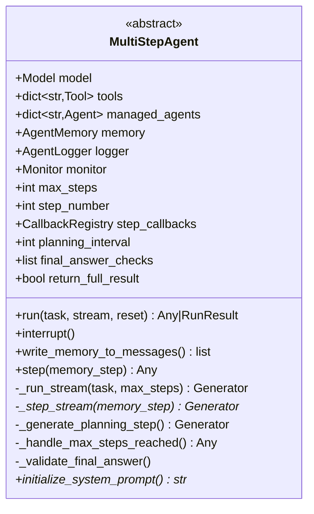
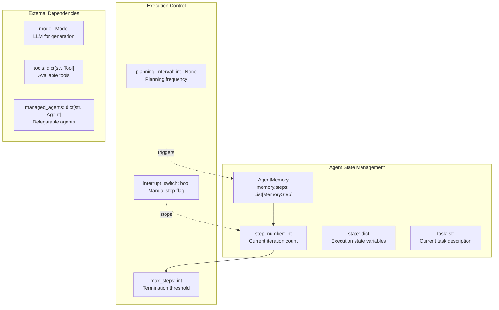
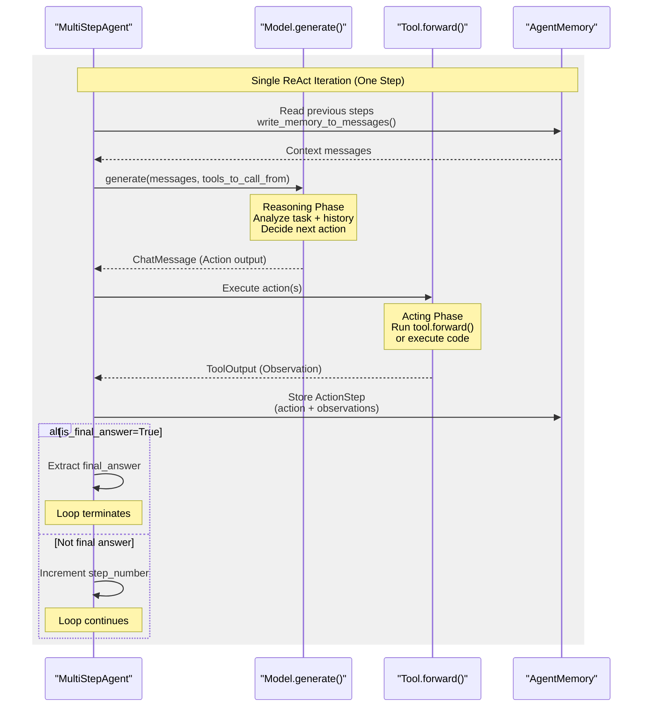
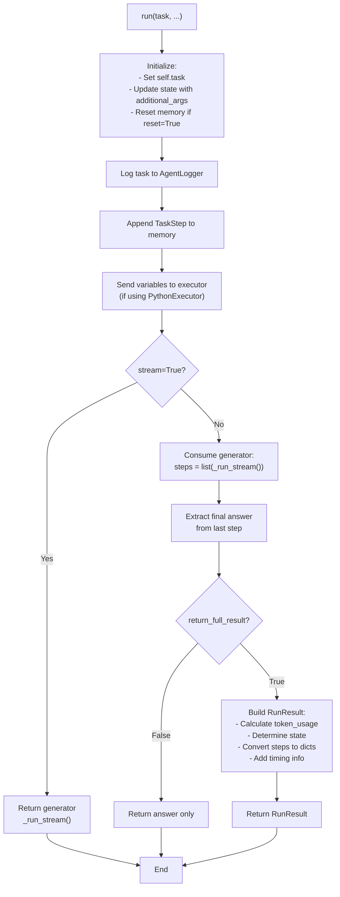
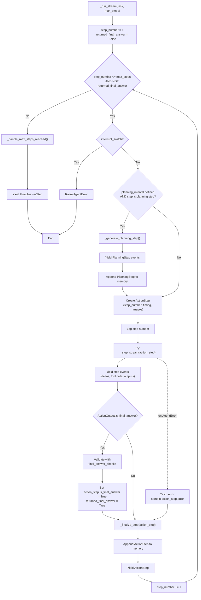
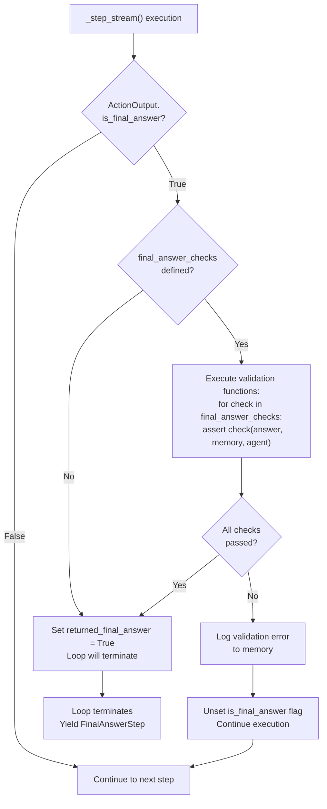

<!-- source: DeepWiki mcp.deepwiki.com · repo huggingface/smolagents · page 3.1 MultiStepAgent & ReAct Loop · fetched 2026-10-27 -->

# MultiStepAgent & ReAct Loop

<details>
<summary>Relevant source files</summary>

The following files were used as context for generating this wiki page:

- [docs/source/en/conceptual_guides/react.md](docs/source/en/conceptual_guides/react.md)
- [docs/source/hi/conceptual_guides/react.md](docs/source/hi/conceptual_guides/react.md)
- [docs/source/zh/conceptual_guides/react.md](docs/source/zh/conceptual_guides/react.md)
- [src/smolagents/agents.py](src/smolagents/agents.py)
- [tests/test_agents.py](tests/test_agents.py)

</details>


## Purpose and Scope

This document explains the `MultiStepAgent` base class and the ReAct (Reasoning + Acting) execution loop that powers all agents in `smolagents`. It covers the core iterative framework, loop mechanics, step-by-step processing, and the `_run_stream` generator lifecycle. For specific agent implementations (code generation vs JSON tool calling), see [CodeAgent](#3.2) and [ToolCallingAgent](#3.3). For memory management details, see [Agent Memory & State Management](#3.4).

**Sources:** [src/smolagents/agents.py:268-274](), [docs/source/en/conceptual_guides/react.md:3-15]()

## The MultiStepAgent Base Class

`MultiStepAgent` is the abstract base class that implements the ReAct framework [src/smolagents/agents.py:268](). It provides the core execution loop while requiring subclasses to implement agent-specific behavior like step execution logic and system prompt initialization.

### Class Definition



**Sources:** [src/smolagents/agents.py:268-857]()

### Constructor Parameters

The `MultiStepAgent.__init__()` method accepts the following key parameters:

| Parameter | Type | Default | Description |
|-----------|------|---------|-------------|
| `tools` | `list[Tool]` | Required | Tools the agent can use to solve tasks |
| `model` | `Model` | Required | LLM that generates agent actions |
| `prompt_templates` | `PromptTemplates \| None` | `None` | Custom prompt templates for system, planning, final answer |
| `instructions` | `str \| None` | `None` | Custom instructions inserted into system prompt |
| `max_steps` | `int` | `20` | Maximum iteration steps before forced termination |
| `add_base_tools` | `bool` | `False` | Whether to add default toolbox (search, visit webpage, transcriber) |
| `verbosity_level` | `LogLevel` | `LogLevel.INFO` | Logging verbosity level |
| `managed_agents` | `list \| None` | `None` | Sub-agents for hierarchical delegation |
| `step_callbacks` | `list \| dict` | `None` | Callbacks executed at each step |
| `planning_interval` | `int \| None` | `None` | Frequency of planning step generation |
| `name` | `str \| None` | `None` | Agent name (required for managed agents) |
| `description` | `str \| None` | `None` | Agent description (required for managed agents) |
| `final_answer_checks` | `list[Callable] \| None` | `None` | Validation functions for final answers |
| `return_full_result` | `bool` | `False` | Return `RunResult` object vs just final answer |

**Sources:** [src/smolagents/agents.py:294-352]()

### Key Internal State



**Sources:** [src/smolagents/agents.py:328-352](), [src/smolagents/memory.py:52-61]()

## The ReAct Framework

ReAct (Reasoning + Acting) is an iterative framework where the agent solves tasks by alternating between reasoning and taking actions [docs/source/en/conceptual_guides/react.md:3-5]().
1. **Reasoning**: The LLM analyzes the task and history to decide the next action.
2. **Acting**: The agent executes the chosen action (tool call or code snippet).
3. **Observing**: The agent receives feedback (observations) from the action.
4. **Repeating**: Steps 1-3 continue until the task is solved or a limit is reached.

### ReAct Cycle Within Each Step



**Sources:** [src/smolagents/agents.py:540-638](), [docs/source/en/conceptual_guides/react.md:13-18](), [src/smolagents/memory.py:50-61]()

## Core Execution Loop

The execution loop is implemented across two primary methods: `run()` (public synchronous/streaming API) and `_run_stream()` (internal generator implementation).

### The run() Method

The `run()` method is the primary entry point [src/smolagents/agents.py:436](). It initializes the task, resets memory if requested, and consumes the `_run_stream` generator if `stream=False`.

```python
def run(
    self,
    task: str,
    stream: bool = False,
    reset: bool = True,
    images: list["PIL.Image.Image"] | None = None,
    additional_args: dict | None = None,
    max_steps: int | None = None,
    return_full_result: bool | None = None,
) -> Any | RunResult:
```

**Execution Flow:**



**Sources:** [src/smolagents/agents.py:436-538]()

### The _run_stream() Generator

The `_run_stream()` method implements the actual ReAct loop as a generator that yields events (deltas, tool calls, completed steps) as they execute [src/smolagents/agents.py:540]().



**Sources:** [src/smolagents/agents.py:540-611]()

### Step Execution: _step_stream()

The `_step_stream()` method is an abstract generator that must be implemented by subclasses [src/smolagents/agents.py:772](). It performs the specific Reasoning → Acting → Observing cycle:

- **CodeAgent**: Generates Python code snippets and executes them via a `PythonExecutor` [src/smolagents/agents.py:1086-1212]().
- **ToolCallingAgent**: Generates JSON tool calls and executes them directly [src/smolagents/agents.py:1542-1713]().

**Sources:** [src/smolagents/agents.py:772-787](), [docs/source/en/conceptual_guides/react.md:43-46]()

## Loop Termination

The ReAct loop terminates under two primary conditions:

### Condition 1: Final Answer Reached

The agent solves the task by calling the `final_answer` tool or function [src/smolagents/agents.py:582]().



**Sources:** [src/smolagents/agents.py:582-593](), [src/smolagents/agents.py:613-618]()

### Condition 2: Max Steps Reached

If `step_number` exceeds `max_steps`, the agent attempts to synthesize a final answer from history via `_handle_max_steps_reached()` [src/smolagents/agents.py:606]().

```mermaid
sequenceDiagram
    participant Loop as "_run_stream loop"
    participant Agent as "MultiStepAgent"
    participant Model as "Model.generate()"
    participant Memory as "AgentMemory"
    
    rect rgb(250, 230, 230)
        Note over Loop,Memory: Max Steps Reached (step_number = max_steps + 1)
        
        Loop->>Agent: _handle_max_steps_reached(task)
        Agent->>Agent: Create messages from memory<br/>write_memory_to_messages()
        
        Agent->>Model: Summarize final answer
        Note over Model: System prompt + Task + History
        Model-->>Agent: ChatMessage with synthesized answer
        
        Agent->>Memory: Create ActionStep with AgentMaxStepsError
        Memory->>Memory: Append step
        
        Agent-->>Loop: Return synthesized answer
        
        Loop->>Loop: Yield FinalAnswerStep
    end
```

**Sources:** [src/smolagents/agents.py:606-637](), [src/smolagents/agents.py:810-853]()

## Execution Modes

### Streaming vs Non-Streaming

The `stream` parameter in `run()` controls the return type and execution behavior:

| Mode | `stream=False` (Default) | `stream=True` |
|------|-------------------------|---------------|
| **Return Type** | `Any` or `RunResult` | `Generator[StreamEvent]` |
| **Execution** | Consumes entire generator internally | Returns generator for manual iteration |
| **Use Case** | Simple scripts, batch processing | Real-time UI updates, logging |

**Sources:** [src/smolagents/agents.py:494-499](), [src/smolagents/agents.py:540-542]()

### Return Value Options

The `return_full_result` parameter controls whether the agent returns just the final answer or a detailed `RunResult` object [src/smolagents/agents.py:505]().

**RunResult structure:**
```python
@dataclass
class RunResult:
    output: Any | None              # Final answer
    state: Literal["success", "max_steps_error"]
    steps: list[dict]               # Full execution history as dicts
    token_usage: TokenUsage | None  # Total tokens consumed
    timing: Timing                  # Execution duration
```

**Sources:** [src/smolagents/agents.py:195-254](), [src/smolagents/agents.py:505-537]()

## Planning Intervals

When `planning_interval` is set, the agent periodically generates `PlanningStep` objects to revise its strategy [src/smolagents/agents.py:549]().

- **Initial plan** (step 1): The agent receives the task and generates a high-level strategy via `_generate_planning_step()` [src/smolagents/agents.py:654-678]().
- **Plan updates** (every N steps): The agent reviews previous actions and updates the plan [src/smolagents/agents.py:680-747]().
- **Memory Management**: Previous planning messages are typically removed from context to avoid bias, while keeping action results [src/smolagents/agents.py:642-652]().

**Sources:** [src/smolagents/agents.py:549-568](), [src/smolagents/agents.py:639-747]()

## Error Handling in the Loop

Errors during step execution (parsing, execution, tool calls) are caught, logged to memory as an `ActionStep` with an `error` attribute, and the loop continues to allow the agent to self-correct [src/smolagents/agents.py:594-604]().

**Error types stored in memory:**
- `AgentParsingError`: Failed to parse model output [src/smolagents/utils.py:87]().
- `AgentExecutionError`: Code execution failed [src/smolagents/utils.py:84]().
- `AgentToolCallError`: Invalid tool call format [src/smolagents/utils.py:88]().
- `AgentToolExecutionError`: Tool execution raised an exception [src/smolagents/utils.py:89]().

**Sources:** [src/smolagents/agents.py:594-604](), [src/smolagents/utils.py:83-96]()

---

