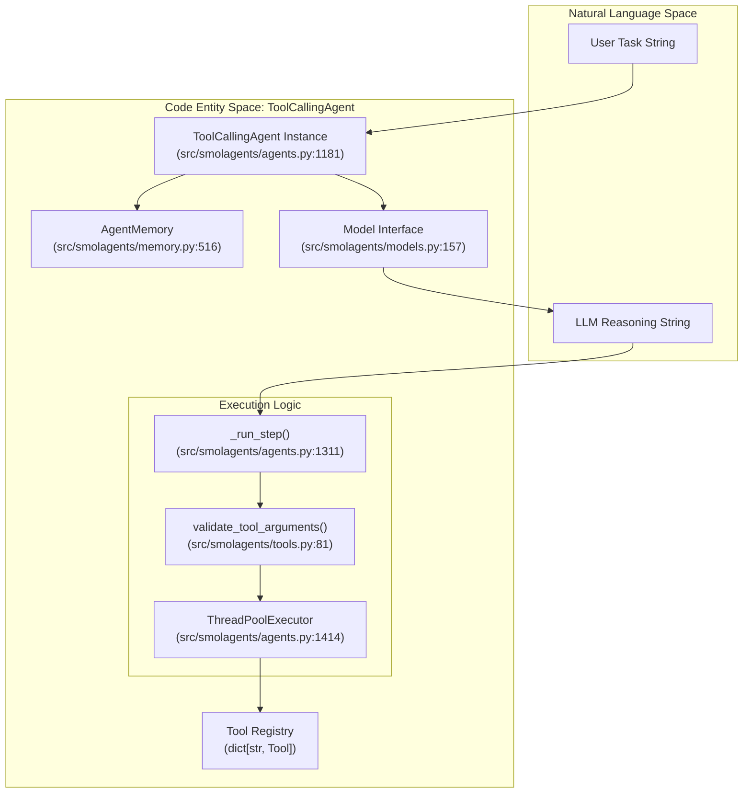
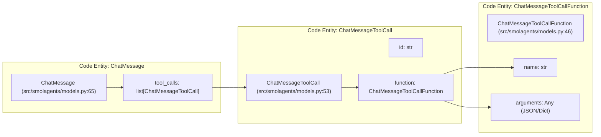
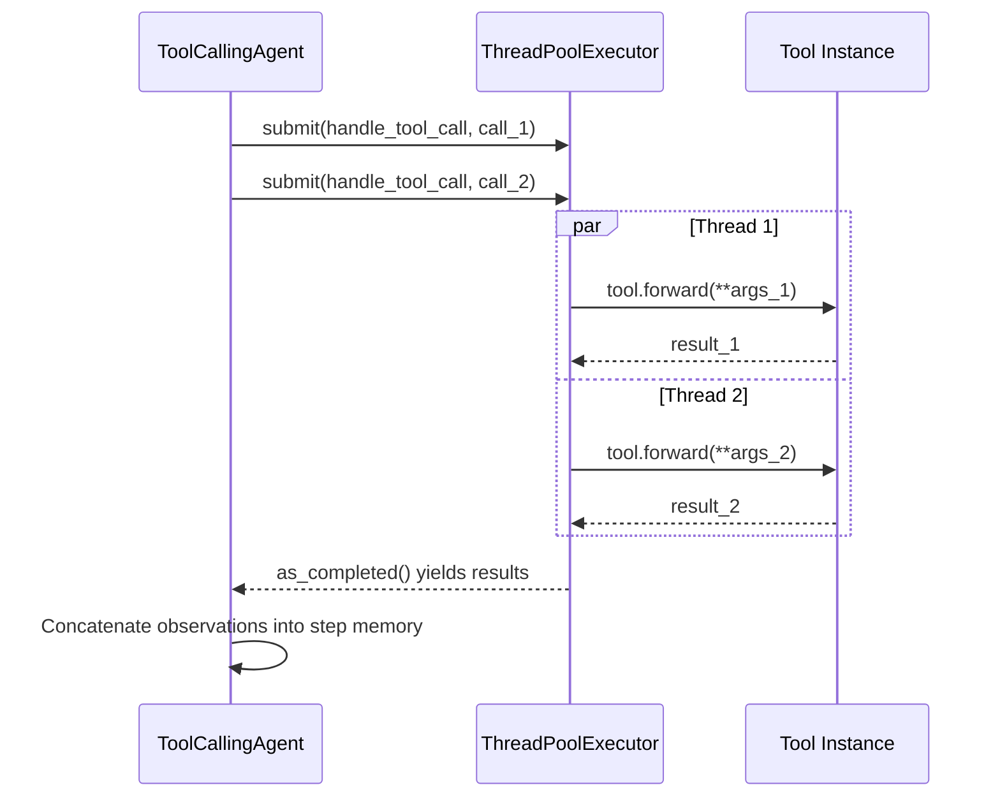

<!-- source: DeepWiki mcp.deepwiki.com · repo huggingface/smolagents · page 3.3 ToolCallingAgent · fetched 2026-10-27 -->

# ToolCallingAgent

Relevant source files

The following files were used as context for generating this wiki page:

- [src/smolagents/agents.py](src/smolagents/agents.py)
- [tests/test_agents.py](tests/test_agents.py)

## Purpose and Scope

The `ToolCallingAgent` class provides a structured, JSON-based approach to agent tool calling where the LLM generates tool invocations as validated JSON objects rather than executable code. This agent type prioritizes reliability, safety, and interoperability by constraining outputs to a predefined schema and validating all tool arguments before execution.

For information about the code-based alternative that generates Python code for tool calls, see [CodeAgent](3.2). For the base agent framework and ReAct loop implementation, see [MultiStepAgent & ReAct Loop](3.1).

**Sources:** [src/smolagents/agents.py:1181-1210](), [src/smolagents/prompts/toolcalling_agent.yaml:1-26]()

## Architecture Overview

`ToolCallingAgent` inherits from `MultiStepAgent` [src/smolagents/agents.py:1181]() and implements the ReAct (Reasoning + Acting) pattern using structured tool calls instead of code generation. Unlike the `CodeAgent`, it does not require an internal Python interpreter for its logic, as it maps tool calls directly to Python function calls.

### System Architecture Diagram

The following diagram bridges the Natural Language task space to the Code Entity Space by showing how `ToolCallingAgent` orchestrates its internal components.

Title: ToolCallingAgent Component Interaction

**Key Distinctions from CodeAgent:**
- No `PythonExecutor` required for general tool orchestration—tools are called directly via their `forward()` method [src/smolagents/agents.py:1451-1453]().
- Model receives tools as JSON schemas via the `tools_to_call_from` parameter in `model.generate()` [src/smolagents/agents.py:1252-1276]().
- Supports parallel execution of multiple tool calls in a single step via `ThreadPoolExecutor` [src/smolagents/agents.py:1414-1425]().
- Includes `PythonInterpreterTool` in base tools when `add_base_tools=True` to allow computation while maintaining a JSON-based outer loop [src/smolagents/agents.py:389-402]().

**Sources:** [src/smolagents/agents.py:1181-1210](), [src/smolagents/agents.py:1311-1509](), [src/smolagents/agents.py:389-402]()

## Tool Call Structure and Validation

The agent expects models to return `ChatMessageToolCall` objects following a standardized structure defined in `src/smolagents/models.py`.

Title: Tool Call Data Structure Mapping

**Validation Process:**

The agent validates tool calls through these steps within `_run_step()`:

1. **Tool Existence Check:** Verifies tool name exists in `self.tools` or `self.managed_agents` [src/smolagents/agents.py:1341-1355]().
2. **Argument Schema Validation:** Calls `validate_tool_arguments(tool, arguments)` which checks types and mandatory fields [src/smolagents/agents.py:1360-1365]().
3. **Managed Agent Handling:** If calling a `ManagedAgent`, the primary argument is mapped to `task` and others to `additional_args` [src/smolagents/agents.py:1372-1382]().

**Sources:** [src/smolagents/agents.py:1311-1382](), [src/smolagents/models.py:46-72](), [src/smolagents/tools.py:81]()

## Parallel Tool Execution

The `ToolCallingAgent` can execute multiple tool calls concurrently if the model provides more than one `tool_call` in a single response. This is a significant performance advantage for tasks requiring multiple independent lookups.

### Implementation Details

| Aspect | Implementation |
|--------|---------------|
| Executor | `ThreadPoolExecutor` with `max_workers=5` [src/smolagents/agents.py:1414-1416]() |
| Context Preservation | Uses `copy_context().run(...)` to maintain context variables during threaded execution [src/smolagents/agents.py:1421-1425]() |
| Result Collection | `as_completed(futures)` iterates as results finish to minimize latency [src/smolagents/agents.py:1428-1430]() |
| Output Object | Each result is wrapped in a `ToolOutput` dataclass [src/smolagents/agents.py:117-123]() |

### Parallel Execution Flow

Title: Concurrent Tool Execution Lifecycle

**Sources:** [src/smolagents/agents.py:1414-1479](), [src/smolagents/agents.py:117-123]()

## Step Execution Lifecycle

Each iteration of the ReAct loop in `ToolCallingAgent` follows a specific sequence of logic in `_run_step()`:

1. **Context Preparation:** Gathers messages from `AgentMemory` and identifies the current task context [src/smolagents/agents.py:1244-1249]().
2. **Model Generation:** Calls `self.model.generate()` with tool schemas to get the next action [src/smolagents/agents.py:1252-1276]().
3. **Parsing:** Extracts `tool_calls` from the `ChatMessage`. If the model provides a JSON blob in text instead of native tool calls, `parse_json_blob` is used [src/smolagents/agents.py:1316-1335]().
4. **Execution:** Dispatches tool calls. If multiple calls are present, they are executed in parallel via `ThreadPoolExecutor` [src/smolagents/agents.py:1406-1479]().
5. **Final Answer Check:** If `FinalAnswerTool` is invoked, the `is_final_answer` flag is set, terminating the ReAct loop [src/smolagents/agents.py:1468-1470]().
6. **Memory Update:** Appends the `ActionStep` containing observations and tool metadata to `self.memory` [src/smolagents/agents.py:1502-1509]().

**Sources:** [src/smolagents/agents.py:1211-1509](), [src/smolagents/memory.py:51-61]()

## Initialization and Configuration

### Constructor Parameters

| Parameter | Type | Description |
|-----------|------|-------------|
| `tools` | `list[Tool]` | Tools available for the agent to call. |
| `model` | `Model` | The LLM used for decision making and JSON generation. |
| `add_base_tools` | `bool` | If True, adds default tools including `PythonInterpreterTool` [src/smolagents/agents.py:1200](). |
| `planning_interval` | `int` | Frequency of planning steps (inherited from `MultiStepAgent`). |

### Prompt Templates
The agent uses a specific YAML configuration for its system prompt and planning logic, located at `src/smolagents/prompts/toolcalling_agent.yaml`. This template instructs the model to use the `final_answer` tool as the only way to complete the task [src/smolagents/prompts/toolcalling_agent.yaml:20-25](). It also handles the formatting of available tools using `tool.to_tool_calling_prompt()` [src/smolagents/prompts/toolcalling_agent.yaml:94]().

**Sources:** [src/smolagents/agents.py:1181-1210](), [src/smolagents/prompts/toolcalling_agent.yaml:1-120]()

## Comparison: ToolCallingAgent vs CodeAgent

| Feature | ToolCallingAgent | CodeAgent |
|--------|------------------|-----------|
| **Action Format** | JSON Tool Calls [src/smolagents/agents.py:1316]() | Python Code Blobs [src/smolagents/agents.py:772]() |
| **Execution Engine** | Python native calls | `LocalPythonExecutor` (AST) |
| **Parallelism** | Native (Threads) [src/smolagents/agents.py:1414]() | Sequential only |
| **Security** | Schema-bound (High) | Sandboxed Execution (Medium/High) |
| **Tool Definition** | `to_tool_calling_prompt()` | `to_code_prompt()` |

**Sources:** [src/smolagents/agents.py:1181-1210](), [src/smolagents/agents.py:772-787](), [src/smolagents/prompts/code_agent.yaml:1-10]()

---

